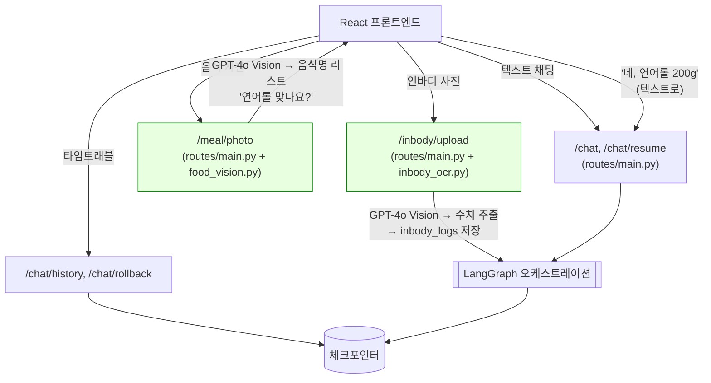
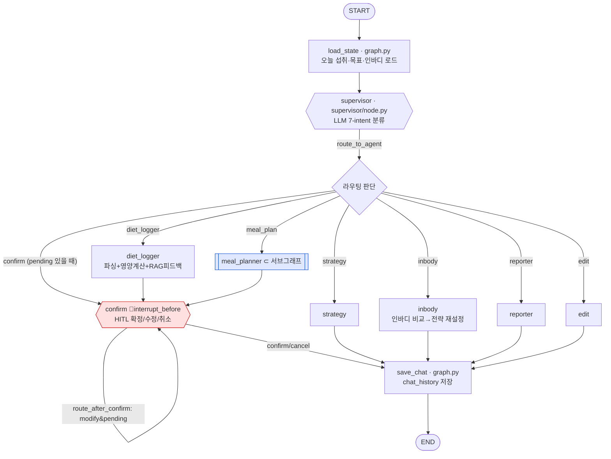
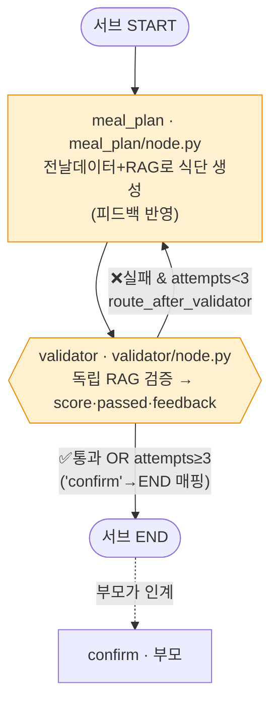
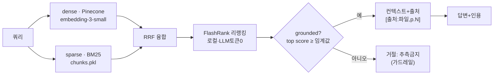
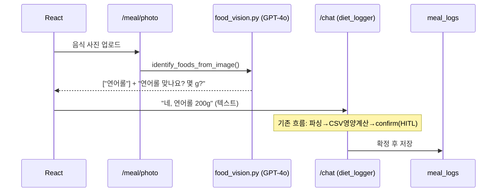
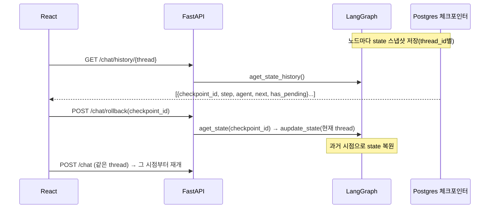
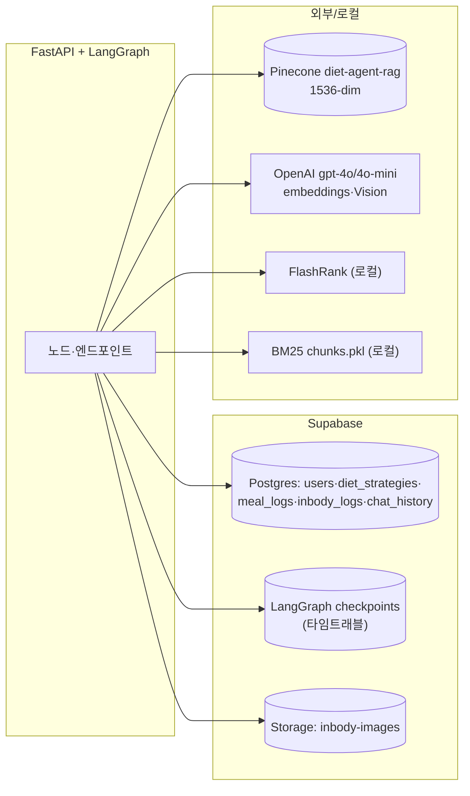

# Diet Agent 보고서용 핵심 정리

이 프로젝트는 단순 칼로리 기록 앱이 아니라, **LangGraph 기반 Multi-Agent 식단 코칭 시스템**이다. 사용자의 식단 입력, 사진 기반 음식 인식, 인바디 업로드, 식단 조언, 식단 계획, 리포트, 기록 수정 요청을 각각 다른 Agent가 처리하고, Supervisor Agent가 의도를 판단해 적절한 Agent로 라우팅한다. 또한 식단 기록은 Human-in-the-loop 방식으로 사용자의 확인을 받은 뒤 저장하며, LangGraph checkpointer를 통해 대화 상태와 interrupt 상태를 관리한다.

## 1. 영양성분 계산과 영양지식 RAG의 역할 분리

본 프로젝트는 **영양성분 계산**과 **영양지식 기반 조언**을 의도적으로 분리했다.

| 구분 | 사용 방식 | 데이터 소스 | 이유 |
|---|---|---|---|
| 영양성분 계산 | CSV lookup | `docs/nutrition/식품성분표_10개정판.csv` | 칼로리, 탄수화물, 단백질, 지방, 나트륨처럼 정량 수치가 필요한 영역은 RAG보다 구조화된 식품성분표 조회가 정확하고 재현성이 높다. |
| 영양지식 조언 | RAG | WHO, Dietary Guidelines, 논문 PDF | 단백질 섭취, 감량 전략, 식사 타이밍, 건강한 식단 구성처럼 문서 근거가 필요한 설명형 지식은 RAG로 검색하고 출처를 함께 제공한다. |
| 음식 사진 인식 | Vision | GPT-4o Vision | 사진에서는 음식명만 추출하고, 양(g)과 저장 여부는 사용자가 직접 확인한다. |
| 인바디 분석 | OCR/Vision + Agent | 인바디 이미지, DB 이력, RAG | 인바디 수치를 추출하고 이전 이력 및 현재 전략과 비교해 목표 칼로리/영양소를 재설정한다. |

따라서 영양성분은 RAG가 아니라 **CSV 기반 deterministic lookup**이며, 영양 조언은 **문서 근거 기반 RAG**로 처리한다. 이 구조는 수치 계산의 정확성과 설명형 조언의 근거성을 동시에 확보하기 위한 설계이다.

## 2. Multi-Agent 역할 분담

| Agent / Node | 역할 | 주요 입력 | 주요 출력 |
|---|---|---|---|
| `supervisor` | 사용자 의도 분류 및 라우팅 | 사용자 메시지, pending 상태, 최근 대화 | `diet_logger`, `strategy`, `meal_plan`, `confirm`, `edit`, `inbody`, `reporter` 중 하나 |
| `diet_logger` | 먹은 음식 파싱, CSV 영양성분 계산, 기록 후보 생성 | 텍스트 식단 입력, 음식명, g | `pending_meals`, 확인 메시지 |
| `confirm` | Human-in-the-loop 확정/수정/취소 | pending 식단, 사용자 응답 | DB 저장, 수정 재제안, 취소 |
| `strategy` | 현재 목표와 섭취 상태 기반 식단 조언 | 오늘 누적 섭취량, 목표 칼로리/단백질, RAG 문서 | 조언 응답 |
| `meal_plan` | 하루 식단 계획 생성 | 목표 영양소, 이전 섭취 데이터, RAG 문서 | 하루 식단 후보 |
| `validator` | meal_plan 결과 검증 및 피드백 | 생성된 식단, 목표 대비 적합성 | 통과 여부, 피드백, 재생성 요청 |
| `inbody` | 인바디 갱신 기반 전략 재설정 | 최신 인바디, 과거 인바디 이력, 현재 전략 | 새 칼로리/단백질/탄수/지방 목표 |
| `reporter` | 주간/월간 식단 리포트 | 식단 기록, 목표 달성률, 패턴 | 리포트 및 개선점 |
| `edit` | 저장된 식단 수정/삭제 | 수정/삭제 요청, 기존 meal_logs | DB 수정/삭제 결과 |
| `save_chat` | 대화 로그 저장 | user/assistant message | `chat_history` 저장 |

Supervisor Agent는 LLM 기반 intent classification을 기본으로 사용하되, 식단 확정/수정/취소, 인바디, 리포트, 식단 계획 등 명확하고 오류 비용이 큰 케이스에는 heuristic guardrail을 적용하여 잘못된 라우팅과 dead interrupt를 방지하였다.

## 3. LangGraph 개선사항

| 항목 | 구현 내용 | 기대 효과 |
|---|---|---|
| 상태 정의 | `AgentState`에 `message`, `messages`, `pending_meals`, `target_*`, `rag_context`, `validation_*` 등을 정의 | Agent 간 공유 메모리 역할 수행 |
| Reducer | `keep_latest`, `add_messages`, `merge_pending_meals`, `keep_max` 적용 | 동일 step 내 state 충돌 방지, 검증 루프 상태 안정화 |
| Checkpointer | `AsyncPostgresSaver` 사용 | thread별 대화 상태, interrupt 상태, 과거 checkpoint 저장 |
| Human-in-the-loop | `interrupt_before=["confirm"]` | 식단 저장 전 사용자 확인 강제, 잘못된 기록 방지 |
| Time travel | `/chat/history`, `/chat/rollback` | 과거 checkpoint로 돌아가 대화/기록 흐름 재개 |
| 순환 구조 | `confirm -> confirm`, `meal_plan -> validator -> meal_plan` | 사용자의 수정 요청 및 검증 피드백 루프 지원 |
| Subgraph | `meal_planner` subgraph | meal_plan과 validator의 상호 검증 루프를 독립 모듈화 |
| 장기/단기 상태 분리 | 장기 상태는 Supabase DB, 단기 대화 상태는 LangGraph checkpoint | 인바디/목표/식단 기록은 유지하고, 현재 대화 흐름은 thread 단위로 관리 |

## 4. RAG 고도화 요소

| 요소 | 구현 여부 | 구현 방식 |
|---|---:|---|
| 문서 기반 답변 | O | 영양지식 PDF를 Pinecone에 임베딩하고 검색 |
| Dense retrieval | O | OpenAI embedding 기반 Pinecone 검색 |
| Sparse retrieval | O | BM25 `chunks.pkl` 기반 sparse 검색 |
| Hybrid retrieval | O | Dense + BM25 결과를 RRF로 통합 |
| Reranking | O | FlashRank 기반 reranking |
| 출처 표시 | O | 파일명과 page metadata를 응답에 포함 |
| Grounded 판단 | O | 검색 score와 context 존재 여부로 `grounded` flag 관리 |
| Guardrail | O | 근거 부족 시 "현재 문서 기반 근거는 부족합니다"로 처리하고 출처 없는 RAG 조언 제한 |
| Chunk metadata | O | source, page 등 metadata 유지 |
| GraphRAG / Exa | X | 과제 기간상 MVP에서는 제외. 내부 영양 문서 기반 RAG와 CSV lookup을 우선 적용 |

RAG는 "영양성분 수치 계산"이 아니라 "영양학적 설명과 조언의 근거 제공"을 담당한다. 정량 영양성분은 CSV lookup으로 처리하여 RAG hallucination 가능성을 낮췄다.

## 5. 평가 결과 요약

상세 평가 정리는 [`EVALUATION.md`](EVALUATION.md)에 별도로 정리했다.

### Routing evaluation

`backend/scripts/eval/routing_report.json` 기준, 18개 synthetic routing case에 대해 intent와 route가 모두 정답과 일치했다.

| 평가 항목 | 결과 |
|---|---:|
| 평가 케이스 수 | 18 |
| Intent accuracy | 1.00 |
| Route accuracy | 1.00 |
| Confusion | 없음 |

추가 수동 smoke test에서도 식단 기록, 식단 계획, 리포트, 수정, confirm 취소, pending 없는 "아니야" fallback, 비이미지 업로드 거절 흐름을 확인했다.

### RAG evaluation

`backend/scripts/eval/eval_report.json` 기준, dense 단독보다 hybrid/full 구성이 page hit와 score에서 개선되었다.

| 모드 | n | Page hit | Source hit | Excerpt hit | Avg score | Citation rate | Faithfulness |
|---|---:|---:|---:|---:|---:|---:|---:|
| dense | 10 | 0.80 | 1.00 | 0.70 | 0.817 | 1.00 | 1.00 |
| hybrid | 10 | 1.00 | 1.00 | 0.90 | 0.817 | 1.00 | 1.00 |
| full | 10 | 1.00 | 1.00 | 0.90 | 0.978 | 1.00 | 1.00 |

해석: hybrid 검색과 reranking을 포함한 full 모드에서 source/page/citation/faithfulness가 안정적으로 유지되었고, 평균 score가 가장 높았다. 단, 평가는 synthetic QA 10개 기준이므로 실제 서비스 품질은 추가 사용자 시나리오 평가가 필요하다.

## 6. 기존 칼로리 앱과의 차별점

| 기존 칼로리 앱 | 본 프로젝트 |
|---|---|
| 사용자가 음식과 g을 직접 입력하면 수치만 계산 | 자연어 식단 입력을 Agent가 파싱하고 확인 후 저장 |
| 칼로리/영양성분 기록 중심 | 기록 + 조언 + 식단 계획 + 리포트 + 인바디 기반 전략 재설정 |
| 조언의 근거가 불명확한 경우가 많음 | RAG로 문서 근거와 출처를 함께 제공 |
| 목표 설정이 고정적 | 인바디 변화 이력에 따라 칼로리/단백질/탄수/지방 목표를 갱신 |
| 잘못 기록하면 직접 수정해야 함 | `edit` Agent와 HITL confirm으로 수정/취소 흐름 지원 |
| 단일 챗봇 구조 | Supervisor + 역할별 Agent + validator subgraph 구조 |
| 대화 상태 추적이 제한적 | LangGraph checkpoint 기반 time travel/rollback 지원 |

핵심 차별점은 "음식을 기록하는 앱"을 넘어서, 사용자의 식단 기록과 인바디 변화를 기반으로 목표를 조정하고, RAG 근거를 바탕으로 설명 가능한 식단 전략을 제안하는 **개인 맞춤형 Multi-Agent 코칭 시스템**이라는 점이다.

## 7. 보고서에 넣기 좋은 한 문단 요약

본 프로젝트는 개인 맞춤형 식단 관리를 위해 LangGraph 기반 Multi-Agent 구조를 적용하였다. Supervisor Agent가 사용자의 의도를 분류하고, 식단 기록, 식단 조언, 하루 식단 계획, 인바디 분석, 리포트, 기록 수정, 확인 절차를 각각 전담 Agent가 처리한다. 영양성분 계산은 RAG가 아닌 국가표준 식품성분표 CSV lookup으로 처리하여 수치 정확성을 확보했고, 단백질 섭취, 감량 전략, 식사 타이밍과 같은 설명형 영양 지식은 Pinecone 기반 hybrid RAG와 reranking을 통해 문서 근거와 출처를 제공하도록 설계했다. 또한 Human-in-the-loop interrupt, PostgreSQL checkpointer, time travel, meal_plan-validator 피드백 루프를 통해 사용자의 확인을 받은 안전한 식단 기록과 Agent 간 상호 검증을 구현하였다.

---

---

# Diet Agent — 아키텍처 문서 (음식사진 인식 포함)

개인 맞춤형 식단 Multi-AI-Agent. LangGraph 오케스트레이션 + 하이브리드 RAG + HITL + 체크포인터 타임트래블 + Vision(인바디·음식 사진 파싱).

**궁극 목표**: 인바디·목표 기반 개인화 식단을 *RAG 근거*로 조언/생성하고, *사람 확인(HITL)*으로 캘린더에 기록하며, 전날 데이터·인바디 변화에 따라 전략을 *RAG 근거로 자동 재조정*한다. 입력은 텍스트·음식사진·인바디사진 3가지.

---

## 0. 시스템 전체 — 진입점 3개

> **핵심**: 음식사진은 *그래프 노드가 아니라 전처리 엔드포인트*다. Vision은 "무슨 음식인지"만 파싱하고, 양(g)·저장은 사용자 확인을 거쳐 기존 `/chat`(diet_logger) 흐름으로 들어간다. (Vision을 '데이터 파싱'에만 쓴다는 일관 원칙 — inbody OCR과 동일)

---

## 1. LangGraph 오케스트레이션 (parent graph)

> [graph.py](backend/app/agents/graph.py) · `interrupt_before=["confirm"]` · 음식사진 추가로도 **그래프 노드는 불변**

**라우팅 규칙**([`route_to_agent`](backend/app/agents/supervisor/node.py#L79)): `awaiting_confirmation=True`이고 intent가 `[confirm,edit,diet_logger,strategy]`에 없으면 → 강제 `confirm`(식단 대기 중 이탈 방지).

---

## 2. meal_planner 서브그래프 (순환·최대 3회)

> [`build_meal_planner_subgraph()`](backend/app/agents/graph.py) · 부모 AgentState 공유 · 체크포인터 부모 상속

- **순환 조건**: `passed=False` & `validation_attempts < 3` → meal_plan 재생성
- **최대 3회**([validator/node.py:26](backend/app/agents/validator/node.py#L26)) 초과 시 강제통과(`can_improve=False`)
- **종료** → 서브그래프 END → 부모가 confirm 인계 → interrupt_before로 사용자 대기

---

## 3. RAG 파이프라인

> [retriever.py `retrieve()`](backend/app/rag/retriever.py) · [qa.py](backend/app/rag/qa.py) · 인덱싱 [build_rag.py](backend/scripts/build_rag.py)

폴백: chunks.pkl/flashrank 없으면 dense-only. 캐싱: meal_plan이 1회 검색→`state.rag_context`→validator 재사용.

---

## 4. 음식 사진 / 인바디 사진 플로우 (Vision)

- 양(g)은 **사용자 입력** — 모델 추정 부정확 회피 → 신뢰도 확보
- 인바디 사진: `/inbody/upload` → [inbody_ocr.py](backend/app/ocr/inbody_ocr.py) 수치추출 → `inbody_logs` 저장 → inbody 노드 트리거(전략 재설정)

---

## 5. State 관리 (리듀서)

> [models.py `AgentState`](backend/app/schemas/models.py#L78)

| 채널 | 리듀서 | 이유 |
|---|---|---|
| `message` | keep_latest | resume 시 메시지 덮어쓰기 허용 |
| `messages` | add_messages | 대화 누적 |
| `pending_meals` | merge_pending_meals | None이면 식단 제안 초기화 |
| `validation_attempts` | keep_max | 루프 카운트 단조증가(서브그래프 내 보존) |
| `rag_context`, `target_*`, `response` 등 | keep_latest | 최신값 유지 |

---

## 6. 타임 트래블 (체크포인터)

> `AsyncPostgresSaver`(Supabase Postgres) · [routes/main.py](backend/app/api/routes/main.py)

검증 완료: step5(삼겹살 150g 수정)로 롤백 → 닭가슴살 200g 교체 → 확정 → DB 정상 반영.

---

## 7. 노드 명세

| 노드 | 파일 | 목표 | 트리거 | 출력(state/DB) |
|---|---|---|---|---|
| load_state | graph.py | 컨텍스트 적재 | 매 요청 | today_*, target_*, latest_inbody |
| supervisor | supervisor/node.py | 의도 분류·라우팅 | load_state 후 | intent |
| diet_logger | diet_logger/node.py | 음식 파싱·영양계산 | "닭가슴살 먹었어" | pending_meals, awaiting=True |
| meal_planner(서브) | graph.py+meal_plan+validator | 식단 생성+상호검증 | "식단 짜줘" | pending_meals, rag_context, validation_* |
| confirm | confirm/node.py | HITL 확정/수정/취소 | pending 존재 | meal_logs 저장, pending=None |
| strategy | strategy/node.py | 식단 조언(RAG) | "뭐 먹을까?" | response |
| inbody | inbody/node.py | 인바디 비교→전략 재설정(RAG) | 인바디 업로드 | diet_strategies 저장, target_* |
| reporter | reporter/node.py | 주간/월간 리포트(RAG) | "리포트" | response |
| edit | edit/node.py | 저장 식단 수정/삭제 | "아까 기록 삭제" | meal_logs 수정 |
| save_chat | graph.py | 대화 저장 | 종료 직전 | chat_history 저장 |

---

## 8. py 파일 기능 맵

### 진입/서버
| 파일 | 기능 |
|---|---|
| [backend/main.py](backend/main.py) | 서버 진입점. Windows SelectorEventLoop 설정(psycopg 필수), LangSmith env, combined_lifespan(체크포인터+스케줄러), uvicorn 기동 |
| [app/api/routes/main.py](backend/app/api/routes/main.py) | 모든 FastAPI 엔드포인트. /chat·/chat/resume(HITL), /chat/history·/chat/rollback(타임트래블), /meal/photo(음식사진), /inbody/upload(인바디), /calendar, /report/weekly, /users/setup, /meal CRUD, /strategy |

### 오케스트레이션 (LangGraph)
| 파일 | 기능 |
|---|---|
| [app/agents/graph.py](backend/app/agents/graph.py) | 그래프 빌드·엣지·interrupt 설정, `load_state`/`save_chat` 노드, `build_meal_planner_subgraph()`, lifespan(체크포인터) |
| [app/agents/supervisor/node.py](backend/app/agents/supervisor/node.py) | 의도 7분류 + `route_to_agent` 라우팅 |
| [app/agents/diet_logger/node.py](backend/app/agents/diet_logger/node.py) | 음식 파싱 + CSV 영양계산 + RAG 피드백 → pending_meals |
| [app/agents/confirm/node.py](backend/app/agents/confirm/node.py) | HITL: confirm/modify/cancel 분류, 저장(중복삭제 후), 수정 재제안 |
| [app/agents/meal_plan/node.py](backend/app/agents/meal_plan/node.py) | 전날/패턴 데이터 + RAG로 하루 식단 생성, 피드백 반영 |
| [app/agents/validator/node.py](backend/app/agents/validator/node.py) | 독립 RAG 검증(점수·통과·피드백), `route_after_validator`(최대 3회) |
| [app/agents/strategy/node.py](backend/app/agents/strategy/node.py) | 식단 조언(RAG 근거) |
| [app/agents/inbody/node.py](backend/app/agents/inbody/node.py) | 인바디 이력 비교 → 근손실 판단 → 단백질·칼로리 재조정(RAG) → diet_strategies 저장 |
| [app/agents/reporter/node.py](backend/app/agents/reporter/node.py) | 주간/월간 리포트(패턴+상관분석+RAG) |
| [app/agents/edit/node.py](backend/app/agents/edit/node.py) | 저장된 식단 수정/삭제 |

### RAG
| 파일 | 기능 |
|---|---|
| [app/rag/retriever.py](backend/app/rag/retriever.py) | 단일 진입점 `retrieve()`: dense+BM25 RRF+FlashRank 리랭킹+grounded 판정, `format_docs`, 하위호환 `search_nutrition_knowledge` |
| [app/rag/qa.py](backend/app/rag/qa.py) | 가드레일 answerer `answer_from_knowledge`: 근거없으면 거절, 출처 footer 강제 |

### Tools
| 파일 | 기능 |
|---|---|
| [app/tools/agent_tools.py](backend/app/tools/agent_tools.py) | DB CRUD(save/update/delete_meal, get_today_meals), check_missing_meals, rag_nutrition_tool, 전략 조회/갱신, 인바디 이력 |
| [app/tools/nutrition_db.py](backend/app/tools/nutrition_db.py) | 국가표준식품성분표 CSV 조회(LLM 키워드분해+최적매칭, 컬럼 자동매핑) |
| [app/tools/analytics.py](backend/app/tools/analytics.py) | 어제 요약, 7일 패턴, 인바디-식단 상관, 결식 알림 |

### Vision / OCR
| 파일 | 기능 |
|---|---|
| [app/ocr/inbody_ocr.py](backend/app/ocr/inbody_ocr.py) | 인바디 사진 → 키·체중·골격근·체지방률·BMR 추출(GPT-4o Vision) |
| [app/ocr/food_vision.py](backend/app/ocr/food_vision.py) | 음식 사진 → 음식명 리스트(GPT-4o Vision, 양 추정 X) |

### 인프라/스키마
| 파일 | 기능 |
|---|---|
| [app/core/config.py](backend/app/core/config.py) | 설정(.env): Pinecone, RAG 임계값·후보수·리랭크모델, CSV/chunks 경로 |
| [app/core/scheduler.py](backend/app/core/scheduler.py) | APScheduler(주기 작업) |
| [app/db/supabase_client.py](backend/app/db/supabase_client.py) | Supabase 클라이언트 |
| [app/schemas/models.py](backend/app/schemas/models.py) | `AgentState`(TypedDict+리듀서), Pydantic 요청/응답 모델 |

### 스크립트
| 파일 | 기능 |
|---|---|
| [scripts/build_rag.py](backend/scripts/build_rag.py) | 스마트청킹(시멘틱+메타+정크필터) → Pinecone+chunks.pkl |
| [scripts/visualize_graph.py](backend/scripts/visualize_graph.py) | 그래프 PNG 렌더(서브그래프 xray) |
| [scripts/seed_data.py](backend/scripts/seed_data.py) | 3달치 가상 식단·인바디 시드 |
| [scripts/eval/](backend/scripts/eval/) | gen_dataset(합성QA), run_eval(RAG 지표), run_routing_eval(라우팅 정확도) |

---

## 9. DB / 외부 연결

| 저장소 | 용도 |
|---|---|
| Postgres `meal_logs` | 확정된 식단(캘린더) |
| Postgres `diet_strategies` | 칼로리/단백질 목표(active 1개) |
| Postgres `inbody_logs` | 인바디 측정 이력 |
| Postgres `chat_history` | 대화 로그 |
| Postgres `users` | 목표·키·체중·나이 |
| LangGraph checkpoints | thread별 state 스냅샷 → 타임트래블 |
| Storage `inbody-images` | 인바디 원본 사진 |
| Pinecone | 영양지식 PDF 임베딩(dense) |
| chunks.pkl | BM25 sparse 코퍼스(로컬) |

