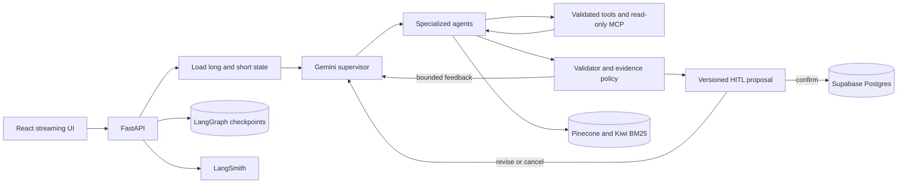

# MetaDiet AI — 근거와 승인 경계를 가진 멀티에이전트 식단 코치

## 프로젝트 한눈에 보기

MetaDiet AI는 식사·체중·인바디·장기 목표를 함께 사용해 식단을 기록하고 다음 행동을 제안하는 LangGraph 기반 멀티에이전트 서비스다. LLM이 전문 Agent와 읽기 도구를 선택하지만, 영양 계산·권한·실행 예산·저장 승인·근거 충돌은 코드가 통제한다.

| 구분 | 내용 |
|---|---|
| 역할 | 1인 개발, AI Agent/RAG/Backend/Frontend/Infra/Evaluation |
| 공개 결과 | [Render 제한 베타](https://metadiet-web.onrender.com) |
| 릴리스 | [beta-v1.1.0](https://github.com/Kim-Du-Yeon/MetaDiet-AI/releases/tag/beta-v1.1.0) |
| 핵심 기술 | LangGraph, Gemini, FastAPI, React, Supabase, Pinecone, LangSmith, Ragas, Docker, Kubernetes |
| 대상 범위 | 일반 성인 체중 관리 정보 서비스 |

## 1. 해결하려던 문제

일반적인 칼로리 기록 앱에 LLM 답변만 붙이면 다음 문제가 생긴다.

- 음식량과 영양 수치를 그럴듯하게 추정할 수 있다.
- 근거가 약한 식단 전략을 실제 사용자 상태에 적용할 수 있다.
- 도구 실패 때 같은 행동을 무한 반복하거나 중복 저장할 수 있다.
- 새로고침·연결 중단·Pod 교체 뒤 실행 상태를 잃을 수 있다.
- “답변이 자연스럽다”는 이유만으로 Agent와 RAG가 제대로 동작한다고 판단하기 쉽다.

따라서 목표를 “좋은 답변 생성”이 아니라 **근거를 추적하고 사용자가 승인한 변경만 저장하는 복구 가능한 Agent 시스템**으로 정의했다.

## 2. 최종 구조

Supervisor는 식사 기록, 전략, 식단 계획, 인바디, 목표, 리포트, 편집 작업을 전문 Agent에 위임한다. Meal Planner와 Validator는 최대 3회의 피드백 루프를 사용한다. Weekly Deep Agent는 장기 기록 분석과 읽기 전용 MCP 근거 검색을 별도 실행 예산 안에서 수행한다.

실제 식사·측정·전략 변경은 proposal ID와 version으로 고정한다. LLM이 쓰기 행동을 요청해도 사용자가 확정하기 전에는 domain DB를 변경하지 않는다.

## 3. LLM과 코드의 책임 분리

| LLM이 판단하는 것 | 코드가 보장하는 것 |
|---|---|
| 사용자 의도와 담당 Agent | 인증·사용자 소유권 |
| 필요한 읽기 도구와 호출 순서 | 허용 도구·인자 검증 |
| 실패 뒤 추가 검색·재계획 | 모델/도구/시간/재시도 예산 |
| 식단 후보와 설명 | CSV 영양 계산과 최소 안전선 |
| 근거를 적용한 자연어 답변 | 최신 판본·충돌 우선순위·grounded gate |
| 수정된 proposal 제안 | HITL·트랜잭션·멱등 저장 |

사용자가 “기록만”, “검색하지 마” 또는 기능 버튼으로 경로를 제한하면 그 선택을 LLM 자율 판단보다 먼저 적용한다.

## 4. RAG를 실험으로 선정한 과정

PDF 10개 전체를 대상으로 파서·청킹·임베딩·검색을 단계적으로 비교했다. 질문과 후보 수, 반환 수, 생성 모델, 평가 기준을 고정하고 한 단계씩 변수만 바꿨다.

| 실험 | 비교 | 관측 | 결정 |
|---|---|---|---|
| 파서·청킹 | PyPDF/PDFPlumber/Docling × page/parent-child/section/recursive | Docling은 표 구조에 강점이 있었지만 전체 처리 안정성과 dense 검색 우위를 확보하지 못함 | PyPDF + recursive |
| 임베딩 | Gemini 768/1536/3072 | 768차원은 독립 평가에서 3072보다 5%p 낮음 | Gemini 3072 |
| 검색 | Dense/BM25/Hybrid | Hybrid가 근거 회수와 대체 유효 근거 평가에서 우세 | Dense + Kiwi BM25 + RRF |
| 리랭킹 | 없음/FlashRank/Jev | FlashRank는 품질 저하와 1GiB Pod OOM, Jev는 지연·호출 증가 | 리랭커 없음 |
| 결정 모델 | Gemini/Jev supervisor·tool selection | Jev가 비열등성+20% 지연/비용 개선 기준을 충족하지 못함 | Gemini 운영, Jev 비활성 |

영양 수치는 RAG로 생성하지 않는다. 국가표준식품성분표 CSV에서 결정적으로 계산하고, RAG는 공식 지침을 근거로 설명하는 데만 사용한다.

## 5. 평가를 답변과 행동으로 분리

Ragas는 검색된 근거와 답변의 관계를 평가한다. Agent 평가는 별도의 gold contract로 라우팅, 위임, 도구, 인자, 재시도, HITL과 최종 상태를 평가한다. LangSmith는 실제 실행 trace에서 Agent 위임·도구 호출·재시도·지연을 연결한다.

| 평가 | 결과 | 범위 제한 |
|---|---:|---|
| 지정 근거 Recall@4 | 85% | 단일 지정 페이지 기준 |
| 대체 유효 근거 포함 evidence support | 95% | 원문 검토로 허용 근거 확장 |
| Ragas faithfulness | 1.00 | 동결 독립셋 기준 |
| Ragas context recall | 0.95 | 동결 독립셋 기준 |
| Agent 독립 흐름 | 8/8 | 합성 시나리오 |
| 정책 위반 / HITL 전 write | 0 / 0 | 평가한 실패 시나리오 |
| Agent p50 / p95 | 16.71s / 28.05s | 외부 API 상태에 따라 변동 |
| 회귀 테스트 | Backend 376 passed, 1 skipped / Frontend 42 passed | 외부 API는 fixture로 격리 |

## 6. 실패 로그로 바꾼 설계

### FlashRank OOM

Kubernetes 자체가 문제였던 것이 아니다. API, BM25 4,139개 청크, Kiwi, ONNX/PyTorch 런타임이 한 Pod의 1GiB 메모리 예산을 넘었고 Kubernetes가 `OOMKilled`로 격리했다. 리랭커가 품질까지 낮췄으므로 메모리 증설 대신 운영 경로에서 제거했다.

### Docling native 종료

Python stack dump 경쟁과 PDF parser의 C++ 접근 오류를 분리했다. 페이지 격리, 새 프로세스, PDFium 우회와 반복 검증을 수행했다. 표 보존 장점은 확인했지만 전체 처리 안정성과 검색 우위를 입증하지 못해 운영은 PyPDF를 유지했다.

### SSE 도중 Pod 삭제

진행 journal은 Pod 메모리에 있지만 실행 상태는 Postgres checkpoint에 남는다. 같은 run ID로 다른 Pod에 재접속하면 checkpoint부터 재개하도록 구성했다. 실제 Pod 삭제 시험에서 완료 후 proposal 1개, 승인 전 meal 0개, 중복 승인 후 meal 1개를 확인했다.

### 공개 배포의 잘못된 키

첫 공개 Agent E2E가 `API_KEY_INVALID`로 실패했다. LangSmith trace로 Supervisor 아래 Gemini 호출의 오류를 찾고 Render에 잘못 입력된 OpenAI 키를 Gemini 키로 교체했다. 키 값 자체는 로그나 artifact에 남기지 않았다.

### 무료 인스턴스 첫 요청 53초

휴면 뒤 `/health`는 53,022ms였지만 기동 후 20회 중앙값은 236.2ms였다. 로컬 앱 초기화는 약 5.7초여서 53초 대부분이 Render 무료 인스턴스 복구임을 분리했다. 제한 베타에서는 이를 안내하고 인위적 keep-alive나 복잡한 lazy initialization을 추가하지 않았다.

## 7. 배포와 복구 검증

| 항목 | 결과 |
|---|---:|
| kind rolling restart `/health` | 400/400, 실패 0, p95 5.86ms |
| 공개 제한 부하 | health 50건·인증 조회 30건·Agent 2건, 오류 0 |
| 실제 Agent SSE 2개 동시 첫 이벤트 | 4,317.4ms / 4,450.3ms |
| 실제 Agent SSE 2개 전체 wall time | 32.48초 |
| 피드백 멱등 저장 | 최초 201, 같은 UUID 재전송 200, DB 1행 |
| 계정 삭제 후 피드백 | 0행 |

공개 Chromium에서 스트리밍, proposal 새로고침 복원, API 500, SSE 중단, 인증 401, 피드백 503과 모바일 390×844 화면을 검증했다.

## 8. 현재 한계와 다음 판단

- 실제 사용자 만족도와 장기간 체중 관리 효과 데이터는 아직 없다. 시스템 평가 결과를 사용자 효과로 표현하지 않는다.
- 영어 독립 RAG 질문 1건은 근거를 찾지 못했다. 시스템은 인용을 만들지 않고 답변을 보류한다.
- 무료 Render API는 scale-to-zero cold start가 있다.
- `react-scripts`의 오래된 빌드 전이 의존성은 정적 런타임과 분리돼 있으며 Vite 전환은 선택 작업이다.
- 의료 진단·치료·응급 대응 서비스가 아니다. 실제 임상 정책 승인은 소프트웨어 평가와 별도다.

다음 유효한 데이터는 기능을 더 추가해서 얻는 것이 아니라 제한 베타 사용자의 동의된 피드백, 실패 trace, 재현 사례에서 얻는다. 해당 데이터가 생기면 실패 사례를 회귀 테스트로 만들고 개선 전후 결과를 같은 평가 기준으로 갱신한다.

## 관련 문서

- [최종 아키텍처](ARCHITECTURE.md)
- [전체 평가와 실패 로그](EVALUATION.md)
- [실험 결과 요약](PORTFOLIO_RESULTS.md)
- [베타 릴리스 노트](BETA_RELEASE_NOTES.md)
- [제한 베타 체크리스트](BETA_RELEASE_CHECKLIST.md)
