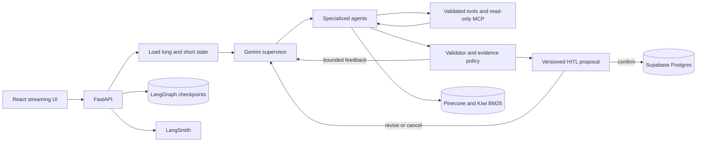

# MetaDiet AI — 근거와 승인 경계를 가진 멀티에이전트 식단 코치

## 사례 추가: 100건 비교로 최적화 채택 여부 결정하기 (2026-10-13)

빠르게 보이는 몇 번의 응답만 선택하지 않고 조건별 100건을 고정했다. 공개 전후 측정은 실제 배포를 사용하고, 모델 전달 방식과 DB 예약은 교차 실험으로 분리했다. 개선 기준을 충족하지 못한 스트리밍·DB 최적화는 기본 적용하지 않았다. 스트리밍 기술 도입보다 검증되지 않은 초안을 노출하지 않는 승인·근거 경계를 우선했다.

배포 직후 실행 경로가 불분명했던 문제는 커밋 식별자를 실제 응답과 trace에 연결해 진단 가능하게 했다. 재접속 검토에서 발견한 중복 모델 호출과 완료 뒤 네트워크 오류 처리 문제를 회귀 테스트로 고쳤다. UI는 안전한 Markdown과 분리한 추천 버튼으로 개선했다. [100건 결과, 실패와 재검증, 공개 캡처](docs/latency100/README.md).

## 사례 추가: 첫 추천 대기시간 절반으로 줄이기 (2026-10-13)

첫 추천의 공개 단계 시간을 분리하니 Supervisor 4.74초, meal 생성 7.42초가 관찰됐다. 전체 Agent를 바꾸는 대신 단순 추천만 최신 DB 문맥을 확인한 읽기 전용 모델로 직접 연결하고 추론 수준을 낮췄다. 실제 모델 3군 교차 실험 후 공개 동일 대화로 재검증해 완료 중앙값 20.70→10.30초, 호출 2→1회를 확인했다. HITL·복잡한 계획·기록 변경 경로는 유지했고 오래된 대화보다 수정·확정한 DB 수치를 우선하는지 검증했다. 최초 배포에서 구경로가 관찰되어 비식별 판정 로그를 추가하고 실제 호출 수로 재검증했다. 원인을 입증하지 못한 배포 전환 현상도 숨기지 않았다. [실험 설계, 실패 근거, 품질 결과, 캡처](docs/first_coaching/README.md).

기준일: **2026-10-12**. 공개 제한 베타 구현·실험·배포 검증 기준이며 실제 사용자 성과는 아직 포함하지 않는다. 이전 prerelease 이후 변경도 포함한 현재 코드 기준이다.

## 프로젝트 한눈에 보기

MetaDiet AI는 식사·체중·인바디·장기 목표를 함께 사용해 식단을 기록하고 다음 행동을 제안하는 LangGraph 기반 멀티에이전트 서비스다. LLM이 전문 Agent와 읽기 도구를 선택하지만, 영양 계산·권한·실행 예산·저장 승인·근거 충돌은 코드가 통제한다.

| 구분 | 내용 |
|---|---|
| 역할 | 1인 개발, AI Agent/RAG/Backend/Frontend/Infra/Evaluation |
| 공개 결과 | [Render 제한 베타](https://metadiet-web.onrender.com) |
| 릴리스 | [beta-v1.1.0](https://github.com/Kim-Du-Yeon/MetaDiet-AI/releases/tag/beta-v1.1.0) |
| 핵심 기술 | LangGraph, Gemini, FastAPI, React, Supabase, Pinecone, LangSmith, Ragas, Docker, Kubernetes |
| 대상 범위 | 일반 성인 체중 관리 정보 서비스 |

## 1. 해결하려던 문제

일반적인 칼로리 기록 앱에 LLM 답변만 붙이면 다음 문제가 생긴다.

- 음식량과 영양 수치를 그럴듯하게 추정할 수 있다.
- 근거가 약한 식단 전략을 실제 사용자 상태에 적용할 수 있다.
- 도구 실패 때 같은 행동을 무한 반복하거나 중복 저장할 수 있다.
- 새로고침·연결 중단·Pod 교체 뒤 실행 상태를 잃을 수 있다.
- “답변이 자연스럽다”는 이유만으로 Agent와 RAG가 제대로 동작한다고 판단하기 쉽다.

따라서 목표를 “좋은 답변 생성”이 아니라 **근거를 추적하고 사용자가 승인한 변경만 저장하는 복구 가능한 Agent 시스템**으로 정의했다.

## 2. 최종 구조

Supervisor는 식사 기록, 전략, 식단 계획, 인바디, 목표, 리포트, 편집 작업을 전문 Agent에 위임한다. Meal Planner와 Validator는 최대 3회의 피드백 루프를 사용한다. Weekly Deep Agent는 장기 기록 분석과 읽기 전용 MCP 근거 검색을 별도 실행 예산 안에서 수행한다.

실제 식사·측정·전략 변경은 proposal ID와 version으로 고정한다. LLM이 쓰기 행동을 요청해도 사용자가 확정하기 전에는 domain DB를 변경하지 않는다.

## 3. 현재 구현한 사용자·운영 기능

| 기능 | 구현과 검증 경계 |
|---|---|
| 가입·온보딩 | JWT 인증, 일반 성인 적용 대상 확인, 활동 수준·체중·목표 입력, 기존 설정 조회 중 로딩/오류 상태 분리 |
| 식사 기록 | 자연어·음식 사진 → 음식 후보·중량 확인 → CSV 영양 계산 → proposal 확정 저장 |
| 체중·체성분 | 일상 체중은 `weight_logs`, 완전한 체성분은 `inbody_logs`로 분리; 수치가 없으면 미입력 표시; 인바디 확정 시 체중 연동 |
| 목표·전략 | 최근 기록과 근거에 따른 전략 proposal; 사용자 승인 전에 전략 변경 금지 |
| 대화·화면 복원 | 체크포인트·최근 대화·섭취량·진행 proposal 조회; 완료 실행 재수행 없이 화면 복원 |
| 입력·화면 | 활동 수준 선택 카드, 필수/선택 항목 구분, 모바일 입력·확인 카드, 오류·빈 상태 |
| 인증·개인정보 | 세션 저장소, 만료 JWT의 로그인 복귀, 계정 삭제 시 기록·피드백·제품 이벤트 cascade |
| 운영 관측 | 관리자 DAU/WAU·가입 cohort 전환·응답 완료율·p95, 인앱 피드백, Render 실패 이메일, LangSmith 실행 추적 |

브라우저 세션 저장은 새로고침을 유지하고 영구 localStorage 로그인을 없앤다. 브라우저의 세션 복원 설정에 따라 닫힌 탭이 복원될 수 있어 모든 브라우저에서 종료 즉시 로그아웃을 절대 보장한다고 표현하지 않는다.

## 4. LLM과 코드의 책임 분리

| LLM이 판단하는 것 | 코드가 보장하는 것 |
|---|---|
| 사용자 의도와 담당 Agent | 인증·사용자 소유권 |
| 필요한 읽기 도구와 호출 순서 | 허용 도구·인자 검증 |
| 실패 뒤 추가 검색·재계획 | 모델/도구/시간/재시도 예산 |
| 식단 후보와 설명 | CSV 영양 계산과 최소 안전선 |
| 근거를 적용한 자연어 답변 | 최신 판본·충돌 우선순위·grounded gate |
| 수정된 proposal 제안 | HITL·트랜잭션·멱등 저장 |

사용자가 “기록만”, “검색하지 마” 또는 기능 버튼으로 경로를 제한하면 그 선택을 LLM 자율 판단보다 먼저 적용한다.

## 5. RAG를 실험으로 선정한 과정

PDF 10개 전체를 대상으로 파서·청킹·임베딩·검색을 단계적으로 비교했다. 질문과 후보 수, 반환 수, 생성 모델, 평가 기준을 고정하고 한 단계씩 변수만 바꿨다.

| 실험 | 비교 | 관측 | 결정 |
|---|---|---|---|
| 파서·청킹 | PyPDF/PDFPlumber/Docling × page/parent-child/section/recursive | Docling은 표 구조에 강점이 있었지만 전체 처리 안정성과 dense 검색 우위를 확보하지 못함 | PyPDF + recursive |
| 임베딩 | Gemini 768/1536/3072 | 768차원은 독립 평가에서 3072보다 5%p 낮음 | Gemini 3072 |
| 검색 | Dense/BM25/Hybrid | Hybrid가 근거 회수와 대체 유효 근거 평가에서 우세 | Dense + Kiwi BM25 + RRF |
| 리랭킹 | 없음/FlashRank/Jev | FlashRank는 품질 저하와 1GiB Pod OOM, Jev는 지연·호출 증가 | 리랭커 없음 |
| 결정 모델 | Gemini/Jev supervisor·tool selection | Jev가 비열등성+20% 지연/비용 개선 기준을 충족하지 못함 | Gemini 운영, Jev 비활성 |

영양 수치는 RAG로 생성하지 않는다. 국가표준식품성분표 CSV에서 결정적으로 계산하고, RAG는 공식 지침을 근거로 설명하는 데만 사용한다.

## 6. 평가를 답변과 행동으로 분리

Ragas는 검색된 근거와 답변의 관계를 평가한다. Agent 평가는 별도의 gold contract로 라우팅, 위임, 도구, 인자, 재시도, HITL과 최종 상태를 평가한다. LangSmith는 실제 실행 trace에서 Agent 위임·도구 호출·재시도·지연을 연결한다.

| 평가 | 결과 | 범위 제한 |
|---|---:|---|
| 지정 근거 Recall@4 | 85% | 단일 지정 페이지 기준 |
| 대체 유효 근거 포함 evidence support | 95% | 원문 검토로 허용 근거 확장 |
| Ragas faithfulness | 1.00 | 동결 독립셋 기준 |
| Ragas context recall | 0.95 | 동결 독립셋 기준 |
| Agent 독립 흐름 | 8/8 | 합성 시나리오 |
| 정책 위반 / HITL 전 write | 0 / 0 | 평가한 실패 시나리오 |
| Agent p50 / p95 | 16.71s / 28.05s | 외부 API 상태에 따라 변동 |
| 회귀 테스트 | Backend 389 passed, 1 skipped / Frontend 58 passed | 외부 API는 fixture로 격리 |

### Agent 호출 최적화: 안전 경계를 유지하면서 중복 제거

실제 인증 요청 하나에서 모델 12회·도구 17회·99.76초를 관찰했다. 같은 근거·음식 후보를 다시 읽고 전문 Agent 결과를 Supervisor가 다시 요약하는 경로를 분석했다. 성공한 동일 인자의 읽기 도구만 실행 내 캐시로 재사용하고, Supervisor의 중복 종합 호출을 제거했다. 실패 결과·proposal·위임처럼 효과가 있는 호출은 캐시하지 않았다.

| 동일 개발 흐름 8개, 각 1회 | 변경 전 | 변경 후 | 변화 |
|---|---:|---:|---:|
| 목표 달성 | 8/8 | 8/8 | 유지 |
| 정책 위반 | 0 | 0 | 유지 |
| p50 | 16.64초 | 9.31초 | -44.0% |
| p95 | 24.92초 | 13.69초 | -45.1% |
| 전체 모델 호출 | 35 | 30 | -14.3% |

이 비교는 개발셋 재시험이다. 앞의 독립 최종 Agent 8개(p50 16.71초/p95 28.05초)와 서로 다른 표본이며 공개 서비스 전체의 45% 지연 개선으로 주장하지 않는다. 변경 전 도구 합계가 없어 도구 호출 감소율은 계산하지 않았고, 실제 청구 비용 절감도 검증하지 않았다. [원본 조건](EVALUATION.md#29-agent-호출지연-최적화-2026-10-11)

## 7. 실패 로그로 바꾼 설계

### FlashRank OOM

Kubernetes 자체가 문제였던 것이 아니다. API, BM25 4,139개 청크, Kiwi, ONNX/PyTorch 런타임이 한 Pod의 1GiB 메모리 예산을 넘었고 Kubernetes가 `OOMKilled`로 격리했다. 리랭커가 품질까지 낮췄으므로 메모리 증설 대신 운영 경로에서 제거했다.

### Docling native 종료

Python stack dump 경쟁과 PDF parser의 C++ 접근 오류를 분리했다. 페이지 격리, 새 프로세스, PDFium 우회와 반복 검증을 수행했다. 전체 10개 PDF/1,953페이지 처리를 완료했지만 접근 오류 메시지와 dump가 남았다. 문제가 된 24페이지 재실행은 오류 없이 완료되고 174개 블록이 기존과 일치했다. 이는 산출물 일관성 검증이며 native 오류 근본 해결 증거는 아니다. 표 보존 장점과 page 청크 문맥 잘림·검색 결과를 함께 보고 운영은 PyPDF를 유지했다.

### SSE 도중 Pod 삭제

진행 journal은 Pod 메모리에 있지만 실행 상태는 Postgres checkpoint에 남는다. 같은 run ID로 다른 Pod에 재접속하면 checkpoint부터 재개하도록 구성했다. 실제 Pod 삭제 시험에서 완료 후 proposal 1개, 승인 전 meal 0개, 중복 승인 후 meal 1개를 확인했다.

### 공개 배포의 잘못된 키

첫 공개 Agent E2E가 `API_KEY_INVALID`로 실패했다. LangSmith trace로 Supervisor 아래 Gemini 호출의 오류를 찾고 Render에 잘못 입력된 OpenAI 키를 Gemini 키로 교체했다. 키 값 자체는 로그나 artifact에 남기지 않았다.

### 무료 인스턴스 첫 요청 53초

휴면 뒤 `/health`는 53,022ms였지만 기동 후 20회 중앙값은 236.2ms였다. 로컬 앱 초기화는 약 5.7초여서 53초 대부분이 Render 무료 인스턴스 복구임을 분리했다. 제한 베타에서는 이를 안내하고 인위적 keep-alive나 복잡한 lazy initialization을 추가하지 않았다.

## 8. 배포와 복구 검증

| 항목 | 결과 |
|---|---:|
| kind rolling restart `/health` | 400/400, 실패 0, p95 5.86ms |
| 공개 제한 부하 | health 50건·인증 조회 30건·Agent 2건, 오류 0 |
| 실제 Agent SSE 2개 동시 첫 이벤트 | 4,317.4ms / 4,450.3ms |
| 실제 Agent SSE 2개 전체 wall time | 32.48초 |
| 피드백 멱등 저장 | 최초 201, 같은 UUID 재전송 200, DB 1행 |
| 계정 삭제 후 피드백 | 0행 |

공개 Chromium에서 스트리밍, proposal 새로고침 복원, API 500, SSE 중단, 인증 401, 피드백 503과 모바일 390×844 화면을 검증했다.

### 제품 분석과 LangSmith의 실제 연결

제품 이벤트에는 원문 대화·음식명·이메일·체중·체성분을 허용하지 않는다. 고정 이벤트·속성, 성공 여부, 소요 시간, 사용자별 중복 방지 UUID와 실행 ID만 저장한다. 인증·삭제 처리를 위해 내부 사용자 FK는 존재하며 완전한 익명 통계라고 주장하지 않는다.

가입 cohort는 Auth 가입일, 온보딩은 실제 전략 존재, 첫 식사 전환은 실제 식사 기록으로 계산한다. DAU는 최근 24시간, WAU는 최근 7일이며 선택한 cohort 기간과 구분한다. 오류 표시와 실패 완료 이벤트를 이중 계산하지 않는다. 응답 완료율은 브라우저의 completed 수신 지표이며 답변 정확도가 아니다. 분석 전송은 best-effort라 브라우저 종료·네트워크 장애로 누락될 수 있다.

그래프 실행 UUID → checkpoint/SSE `trace_id` → 제품 이벤트 → LangSmith root span을 연결했다. 공개 합성 계정으로 세 ID의 일치와 `stream_run_id` metadata를 직접 조회했다. 실제 관리자 로그인에서 1·7·30·90일 조회 및 새로고침 후 재조회를 확인했고 일반 사용자는 403으로 차단됐다. Render 재배포가 In progress일 때 이전 Live를 최종 결과로 오인하지 않고 전환 후 확인했다.

| 공개 관측 검증 | 결과 |
|---|---|
| 제품 이벤트 최초/재전송 | 201 / 200, DB 1행 |
| 계정 삭제 후 제품 이벤트 | 0행 |
| 관리자 인증 화면 | 실제 계정 조회 정상 |
| 일반 계정 관리자 API | 403 |
| SSE·DB·LangSmith root ID | 동일 ID 확인 |

[관리자 설정·검증 안내](docs/ADMIN_ANALYTICS_GUIDE.md), [실험 기록 54~57장](EVALUATION.md#54-개인정보-최소화-제품-분석-기반-2026-10-12)

### 추가 실패와 해결 과정

| 관측 로그/증상 | 원인 | 수정과 재검증 |
|---|---|---|
| 가입 메일 후 localhost 연결 거부 | 가입 redirect 지정 누락·Supabase Site URL | 현재 origin을 명시하고 운영 redirect 허용 주소 설정 |
| 로그인 직후 온보딩 폼이 잠시 노출 | 기존 설정 조회 전 입력 폼 렌더링 | 조회 중 로딩, 실패 재시도, 실제 신규 사용자만 폼 표시 |
| 1일 조회의 WAU도 1일로 집계 | 집계 기간 결합 | 24시간/7일 활성 창과 가입 cohort 창 분리 |
| 가입 전환율이 과대평가될 가능성 | 온보딩 성공 시 가입 이벤트 발생 | 실제 Auth 가입 cohort와 domain 기록을 사용 |
| 공개 완료 응답에 trace ID 없음 | 새 배포 반영 전 이전 버전 응답 | Live 전환 대기 후 실제 LangSmith 조회 통과 |
| trace 검증 HTTP 422 Field required | 검증 payload의 필수 status 누락 | status 추가 후 SSE→DB→LangSmith 통과 |
| Jest 시작 시 EPERM | sandbox 임시 폴더 realpath 권한 | 동일 테스트를 일반 실행 환경에서 재검증 |

## 9. 현재 한계와 다음 판단

- 실제 사용자 만족도와 장기간 체중 관리 효과 데이터는 아직 없다. 시스템 평가 결과를 사용자 효과로 표현하지 않는다.
- 영어 독립 RAG 질문 1건은 근거를 찾지 못했다. 시스템은 인용을 만들지 않고 답변을 보류한다.
- 무료 Render API는 scale-to-zero cold start가 있다.
- `react-scripts`의 오래된 빌드 전이 의존성은 정적 런타임과 분리돼 있으며 Vite 전환은 선택 작업이다.
- 의료 진단·치료·응급 대응 서비스가 아니다. 실제 임상 정책 승인은 소프트웨어 평가와 별도다.

다음 유효한 데이터는 기능을 더 추가해서 얻는 것이 아니라 제한 베타 사용자의 동의된 피드백, 실패 trace, 재현 사례에서 얻는다. 해당 데이터가 생기면 실패 사례를 회귀 테스트로 만들고 개선 전후 결과를 같은 평가 기준으로 갱신한다.

## 관련 문서

- [최종 아키텍처](ARCHITECTURE.md)
- [전체 평가와 실패 로그](EVALUATION.md)
- [실험 결과 요약](PORTFOLIO_RESULTS.md)
- [베타 릴리스 노트](BETA_RELEASE_NOTES.md)
- [제한 베타 체크리스트](BETA_RELEASE_CHECKLIST.md)

## 10. 포트폴리오에 사용할 요약

> LangGraph 기반 멀티에이전트 식단 코칭 서비스를 구현하고 Render 공개 베타로 배포했다. Supervisor·전문 Agent·읽기 전용 MCP와 실행 예산을 구성하고, 사용자 승인 전 저장을 차단하는 proposal/HITL 및 Postgres checkpoint 복구를 구현했다. 파서·청킹·임베딩 차원·검색·리랭커를 비교해 운영 구성을 선정했으며 독립 RAG 20문항에서 faithfulness 1.00/context recall 0.95, 독립 Agent 8개 흐름에서 목표 달성 8/8·정책 위반 0을 확인했다. 동일 개발셋의 중복 호출 제거로 p95 24.92→13.69초를 관찰하고, 공개 배포의 휴면 지연·OOM·인증·재연결 실패를 로그 기반으로 분석했다. 관리자 제품 분석과 실제 LangSmith trace ID를 연결해 베타 운영 관측을 구성했다.

### 추후 실제 사용자 자료를 추가할 자리

| 아직 확보하지 않은 자료 | 추가할 내용 |
|---|---|
| 베타 참여 | 참여 기간, 동의 범위, 실제 사용자 수, 테스트 계정 제외 기준 |
| 사용성과 만족도 | 실제 제출 수·분류·만족도 분포, 무응답/소수 표본 한계 |
| 실패 개선 | 익명화 증상, trace 원인, 재현 테스트, 동일 조건 전후 비교 |
| 장기 성과 | 관찰 기간과 측정 누락; 소프트웨어 지표와 건강 효과 분리 |

현재 문서에는 위 항목의 숫자를 만들어 넣지 않는다. 이전 평가 결과는 당시 조건의 snapshot이며 최신 코드의 독립 재평가 결과로 소급해 표현하지 않는다.

## 2026-10-13: 간단 입력과 하루 코칭 개선

기본 분량 기반 식사 확인 카드, 모델 없는 DB 계산 경로, 서버 분량 재계산과 최신 proposal 복구를 추가했다. 동일 버전 경로 활성/비활성 합성 평가(각 9회)에서 즉시 제안 0/9→9/9, 모델 호출 중앙값 3→0회, 논리 도구 4→2회, 로컬 실행 중앙값 15.389→0.203초였다. HTTP·DB 저장·Render 휴면 복구는 제외한 측정이며 실제 사용자 성과가 아니다. [조건·원본·실패와 수정·공개 검증](docs/simple_meals/RESULTS.md).

공개 검증에서 기본 카드 → 분량 수정 → 확정 전 복원 → 확정 후 3행·707.2kcal 유지, 정확한 제품 선택·취소, 오늘 남은 칼로리를 반영한 저녁 코칭을 확인했다. 제품 제안과 코칭은 실제 섭취량을 추가하지 않았다. 라이스페이퍼 대표값은 원본의 특이한 영양 구성을 발견해 재검토·교체하고 공개 80g·272kcal 카드로 재검증했다. 최종 전체 회귀는 backend 434 passed·1 existing skipped, frontend 65 passed·build passed다.

## 2026-10-13: 일상 음식 확장

간단 입력 매핑을 12→35개로 확장했다. 음식의 조리 형태, 등록 오타·띄어쓰기·연결 조사와 기본 분량을 서버에서 관리한다. 확장 요청 고정 9개에서 모델 없는 경로 지원 0/9→9/9, 현재 모델 0회·논리 도구 2회로 확인 제안을 생성했다. 모든 34개 CSV 매핑의 실제 영양값을 검증했고 전체 백엔드 484 passed·기존 1 skipped, 프론트 65 passed·build passed다. 실제 사용자 성과와 공개 응답 시간은 별도다. [조건·기본 분량·원본·실패 해결·공개 검증](docs/simple_meals/EXPANSION.md).
## 사용자 입력 부담을 줄인 기록 흐름

정확한 분량·조리 상태·미등록 제품 영양표를 연달아 요청하던 흐름을 기본값과 선택 카드로 전환했다. 사용자가 원할 때만 직접 입력하며, 제외한 음식과 명시적으로 선택한 일반 아이스크림 대체 기준을 기록에 남긴다. 모델 없이 사용자 예시를 분해하고 서버 영양 DB로 계산하며 확인 전 미저장·중복 방지는 유지한다. [실패 분석과 검증 결과](docs/simple_meals/BUTTON_FIRST.md)

아이스크림에 한정됐던 편의성을 빵·피자·만두 등으로 확장했다. 정확한 제품 정보가 없는 메론빵·브랜드 피자는 유사/일반 기준을 명시하고 기본 분량으로 확인 카드를 먼저 제공한다. 입력·수정의 단위 환산을 서버 설정으로 통일했으며, 고정 합성 12건은 모두 추가 질문 없이 계산 가능해졌다. 실제 사용자 성공률과는 구분한다. [분량 정책·회귀 실패 해결](docs/simple_meals/EVERYDAY_CATEGORIES.md)

## 음식군 대표 기준 확장 (2026-10-13)

기존 개별 음식 연결에 18개 음식군 대표 규칙을 추가해 질문을 줄이고, 계산 카드에 음식별 제외·되돌리기를 연결했습니다. 고정 합성 평가 1/18 → 18/18, 백엔드 567 passed·1 기존 skipped, 프론트 71 passed와 빌드 성공. 대표값의 오차와 미지원 음식군을 구분합니다. [구현·실패 해결·검증 상세](docs/simple_meals/FOOD_GROUPS.md).

공개 API 6개 음식군 입력과 제외·분량 수정·확정 저장을 검증했고, 공개 브라우저의 카드 재계산·취소 흐름도 확인했습니다. API와 웹은 `98c840e` 자동 배포 Live. 상세 결과는 위 음식군 문서와 공개 합성 보고서에 기록했습니다.

## 후속 식단 코칭 성능 개선

추가로 모델 생성 지연과 완성 답변 표시 지연을 분리했다. 단어별 30ms 대기 제거는 동일 100단어 통제 실험에서 3,332.275→0.724ms였고, 공개 실제 문맥 24개 요청에서 첫 답변 이후 완료 중앙값 2.00→0.39초였다. 첫 답변 자체는 21초 수준으로 남았음을 공개했다. SSE 재연결 순서를 유지하고, 오래된 대화 속 0kcal보다 수정·확정한 최신 DB 섭취량을 사용함을 실환경에서 검증했다. 숫자만 맞으면 통과하던 평가의 허점을 코드 검토로 찾아 문맥에 연결된 섭취량 검사와 실패 후 정리로 보완했다. [전후 캡처·평가 증거·다음 실험](docs/answer_delivery/README.md).

요청 단위 조회 결과 재사용, Supervisor·전문 Agent의 최신 컨텍스트 공유, 짧은 후속 답변과 한 줄 진행 표시를 적용했습니다. 통제 실험의 반복 DB 조회는 6→3회, 위임 코칭 모델 호출은 3→2회입니다. 일반 요청의 최신 DB 조회 3회와 사용자 확인 저장 정책은 유지합니다. [공개 측정·화면 캡처·실패 해결 기록](docs/coaching_performance/README.md).

공개 고정 독립 요청 각 6회의 중앙값: 첫 답변 30.46→22.96초, 전체 완료 38.06→25.16초, 답변 919→214자. 명시적 점심 코칭 모델 호출 3→2회. 소수 합성 표본이며 다중 턴 속도 개선율·실제 사용자 성공률로 일반화하지 않습니다. 전후 실제 화면 캡처와 원본 보고서는 위 성능 문서에 포함했습니다.

## 단계별 병목 측정과 DB 연결 재사용 (2026-10-13)

공개 다중 턴 각 12요청에서 실행 예산 저장 중앙값 6.86→3.90초(43.1% 감소), 전체 완료 21.36→18.45초(13.6% 감소), 첫 답변 20.97→18.05초를 관측했다. 모델 합산은 10.12→10.58초로 증가했으므로 모델 생성 개선이라고 주장하지 않는다. 트랜잭션 전용 풀로 승인·실행 예산 경계를 유지했고 실제 DB 동시 예약 12개 중 한도 4개만 허용됨과 롤백을 검증했다. 최신 문맥 회귀 100건, 전체 백엔드 685 passed/기존 1 skipped, 프론트 72 passed·빌드 통과. 실제 스트리밍은 provider 단독 3회 정상 완료를 확인했으며 검증 전 답변 노출과 SSE 복구 경계 때문에 운영 활성화는 후속 범위로 명시했다. [원본·실험 조건·캡처·실패 해결](docs/coaching_stages/README.md).

## 단순 후속 코칭 직접 경로 (2026-10-13)

최신 요청 컨텍스트가 확인된 읽기 전용 후속 코칭에서 Supervisor 모델 왕복을 제거했다. 동일 공개 평가 전후 각 12요청 중 후속 6건의 완료 중앙값 19.28→12.07초(37.4% 감소), 첫 답변 18.64→11.70초, 모델 호출 중앙값 1.5→1회를 관측했다. 첫 추천은 기존 경로(2회)를 유지했다. 블라인드 단일 모델 rubric의 5개 기준은 전후 각각 6/6이었으며 실제 사용자·임상 품질 보장은 아니다. 기존/직접 경로 최신성 200건과 공개 최신 기록·승인 검증 통과, 백엔드 799 passed/기존 1 skipped, 프론트 72 passed·빌드 통과. 혼합 기록 요청이 읽기 전용 경로에 들어가던 오류를 재현·수정했다. [원본·품질 기준·한계·캡처](docs/direct_followup/README.md).

## 후속 코칭 추론 수준 최적화 (2026-10-13)

모든 요청을 일괄 단순화하지 않고 최신 데이터가 확인된 읽기 전용 후속 코칭에만 Gemini `thinking_level=low`를 적용했다. 실제 모델·합성 DB의 동일 문맥 교차 비교 9쌍에서 처리시간 중앙값 8.72→5.06초(42.0% 감소), 최신 섭취·목표 반영 9/9를 양쪽 모두 확인했다. 공개 환경의 전후 각 12요청 중 후속 6건씩은 완료 중앙값 **13.00→9.86초(24.2% 감소)**, 모델 구간 **6.55→3.83초**, 모델 호출 1회·최신 정보 조회 2회를 유지했다. 첫 추천은 적용 대상이 아니다.

버전명을 숨긴 모델 품질 검토의 5개 기준은 합성 교차 비교 양쪽 9/9, 공개 비교 양쪽 6/6이었다. 공개 승인·수정·중복 확정·최신 기록·삭제 복원 검증, 설정 범위/최신성 회귀 223건, 백엔드 808 passed/기존 1 skipped, 프론트 72 passed·빌드를 통과했다. 예비 측정 문구가 다른 경로를 유발한 오류를 발견해 집계에서 제외하고 경로 단언을 추가했다. 샌드박스 EPERM은 제품 결함과 구분해 정상 권한으로 재검증했다.

이는 작은 합성 표본과 시간순 공개 비교이며 실제 사용자 성과·임상 정확도·운영 p95를 입증하지 않는다. `COACHING_THINKING_LEVEL=default`로 되돌릴 수 있다. [원본·동일 평가·실패 원인·배포·캡처](docs/coaching_thinking/README.md).
