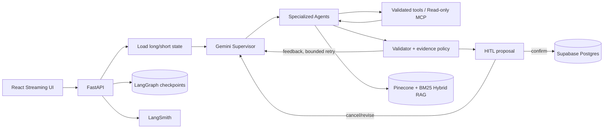

# MetaDiet AI 포트폴리오 결과

## 일반 음식 입력의 불필요한 제품 선택 제거 (2026-10-15)

후속 공개 브라우저 검증도 완료했다. 기본200g/1인분 표시→분량 수정→밥 제외→재계산→확정→새로고침·캘린더 유지까지 확인했다. 취소 후 잘못 붙던 확정 배지는 공통 확인 처리 문구로 수정하고 취소 메시지 복원 테스트를 추가했다(프론트78 passed·build 성공). [실제 카드 캡처와 단계별 근거](docs/default-serving-browser/README.md).

김치찌개·간장불고기의 대표 항목 누락으로 제조사 선택과 g 재입력이 발생하던 경로를 수정했다. 입력한 g를 유지하고 생략하면 앱 기본 200g/1인분을 채워 수정 가능한 계산 카드로 진행한다. CSV 익힌 음식과 출처를 고정한 식약처 제품 유래 대표값을 사용하며 대략값임을 표시한다. 확정 전 실제 섭취 저장은 하지 않는다. 전체 백엔드1057 passed·기존1 skipped, 프론트77 passed·build 성공. main 자동 배포 후 임시 계정의 공개 API에서 기본값·수정·제외·취소·중복 확정 방지·복원을 검증했고 계정을 정리했다. 브라우저는 로그아웃 상태여서 로그인 후 전체 조작은 미검증이다. 이는 기능 검증이며 실사용 성과나 속도 향상 주장이 아니다. [원인·수정·출처·공개 검증·한계](docs/DEFAULT_SERVING_FIX.md).

## 외부 호출 관측과 스트리밍 가설 기각 — 새 공개200건 (2026-10-14)

연결(DNS+TCP)·TLS·전송·헤더 대기·본문 수신을 고정 숫자 trace로 분리했다. 기준100건에서 연결32.55ms/TLS16.89ms보다 헤더 대기2749.39ms가 컸다. 동일 HTTPX 경로의 스트리밍100건은 전체 중앙값 **8.384→8.455초**, p95 **10.421→11.375초**, 외부 호출 **2.865→3.099초**로 개선되지 않아 복구했다. 헤더 대기가 줄어도 본문 수신에 생성 대기가 옮겨가므로 최적화라고 주장하지 않는다.

완료·최신 섭취/목표 열량·미저장 양쪽100/100, 동일 Pro judge 품질5기준각100/100. 최종 실패0건과 후보의 복구된500 INTERNAL1건을 구분했다. LangSmith 오류 child와 root 정상 종료를 확인했고 제한 재시도로 복구한 요청도 원본 분모에 남겼다. 순수 서버 큐/추론/생성은 미측정이다. 전체1046 passed·기존1 skipped, 프론트77 passed·build 통과. [원본·사전 기준·실패 해결·복구](docs/transport_public/README.md). 통신 경로 변경·20조건 반복·시간대·자동 judge·설정 캡처 실패의 한계를 공개한다.

## SDK 준비와 외부 호출을 분리한 새 공개200건 (2026-10-14)

기존 timer의 경로별 차이를 수정하고 새 기준100건·후보100건을 측정했다. SDK 준비 중앙값 **514.69→0.03ms**, 전체 중앙값 **7.918→7.406초(6.46% 감소)**, p95 **11.021→9.662초(12.33% 감소)**. 가장 큰 외부 호출은 **2.760→2.671초(약3.22% 감소)**로 사전 모델구간10% 개선 기준에 미달해 후보를 복구했다. 준비 비용 제거와 전체 개선은 관측했지만 모델 생성 병목 해결이라고 주장하지 않는다.

모델·prompt·thinking·현재 DB 조회는 유지하고 provider/연결만 재사용했다. 양쪽 완료·최신값·미저장100/100, 동일 judge 품질5기준 각각100/100, 실패0건. 요청별 context와 binding은 공유하지 않는다. 역할/설정/loop·동시 요청 격리·종료 tests를 검토해1042 passed·기존1 skipped, 프론트77 passed·build 통과. Live 이전 취소 probe도 원본에 보존했고 정식200건과 구분한다. [수치·소스·판정·캡처·복구](docs/sdk_phase_public/README.md). 단일 자동 judge·20조건 반복·시간대 차이와 provider 내부 시간 미분리라는 제한을 공개한다.

## 모델 병목: 개선 후보를 수치로 기각 (2026-10-14)

기존 200건 분석에서 모델 단계 중앙값 2.596초/p95 4.378초를 확인했다. SDK 출력 토큰에 thinking이 포함되는 것을 확인해 답변 길이 병목 가설을 수정했다. 공개 기존 100건과 후보별 100건을 비교했다. 전체 중앙값/p95는 기존 **7.821/9.551초**, Flash-Lite **6.334/10.727초**, 도구 생략 **7.884/9.707초**다. Flash-Lite는 중앙값 19% 개선에도 p95 12.3% 악화와 실행 가능한 조언 100→98건으로 기각했다. 도구 생략은 속도가 개선되지 않아 기각했다.

세 조건 모두 최신 기록 반영·미저장 100/100, 실패·보류 0/100이었다. 0건의 장애로 장애율 개선을 주장하지 않는다. baseline과 judge는 SHA를 보존해 재사용했다. 순차 측정·20조건 반복·자동 평가·SDK timer 경계 차이를 공개하며 실제 사용자 성과와 구분한다. [모델 결과·원본·캡처](docs/model_followup_public/README.md), [도구 결과와 복구](docs/tool_free_followup_public/README.md). 전체 회귀 1028 passed, 기존 1 skipped; 마지막 정책·평가 기준 테스트 29 passed.

## 공개 재검증 후 적용: 외부 오류 복구와 예산 저장 개선 (2026-10-14)

같은 공개 코드에서 저장 방식만 바꿔 각100건을 비교했다. **저장 중앙값29.5% 감소(2.500→1.762초), 전체 중앙값8.8% 감소(8.378→7.642초)**. p95는10.018→10.360초로3.4% 증가, 최장 응답은22.15초였다. 양쪽 완료·최신 섭취/목표 반영·미저장100/100. 동일 자동judge5기준도각100/100으로 채택해Render pipeline=true를 유지했다.

모델·읽기의 제한 재시도와 실패 진단 보존을 구현하고988개 회귀 테스트를 통과했다(기존1skip). 기존 judge504로 누락된10개는 원본을 보존한 별도 평가로 보완했다. 서비스200건에서는 재시도가 없어 장애율 개선을 입증한 것은 아니다. [원본·실패 해결·기준·캡처](docs/budget_public_v2/README.md). 실제 사용자 성과는 추후 추가한다.

## 공개 환경 재검증: 같은 커밋, 조건별 100건 (2026-10-14)

로컬 개선을 운영 성능으로 주장하지 않고 Render 공개 API에서 같은 커밋의 설정만 바꿔 전후 각 100건을 측정했다. 예산 저장 중앙값 **2.497→1.800초(27.9% 감소)**, 정상 응답 완료 중앙값 **8.236→7.807초(5.2% 감소)**, p95 **10.987→10.759초**였다. 기존 99/100·후보 100/100이 완료됐으며 완료 답변은 모두 현재 DB 열량·목표를 반영했다. 양쪽 식사·목표 미변경은 100/100이다.

기존 504 1건을 LangSmith의 `DEADLINE_EXCEEDED`로 추적했고 사전 상태 조회의 HTTP 500은 Render의 `httpx.ReadError` 로그로 분류했다. 실패를 지우지 않고 평가를 재개하도록 보완했다. 최초 비교의 양쪽 100건 완전성 기준에 미달해 영구 적용하지 않는다. 순차 시간대 차이·합성 계정·자동 judge라는 한계를 함께 기록했다. [원본 200건·오류 근거·캡처·채택 판단](docs/budget_public/README.md).

동일 judge의 5개 품질 항목은 각각 **99/100→100/100**이었다(양쪽 judge 실행 100/100 완료). 복원 배포 후 기존 경로를 실제 API로 확인하고 테스트 계정·자격증명을 정리했다. 전체 백엔드 **977 passed, 기존 1 skipped**. 모델 단계 중앙값은 2.561→2.728초로 줄지 않았으므로 모델 성능 개선으로 설명하지 않는다.

## 실행 예산 저장 세분화와 채택 보류 (2026-10-14)

품질 judge의504 한 묶음 때문에 최초 판정은97/100·98/100이었다. 공식 문서 확인 후 실패5건만 별도 재평가해 모두 통과했고, 전체 고유 답변100개씩의5항목을 확인했다. 원본 실패는 보존했다. 전체 백엔드967 passed/기존1 skipped이며 후보는 비활성으로 유지한다.

공개 로그의2.46초를 연결 준비·SQL·커밋으로 나눠 SQL 왕복 비용을 대상으로 pipeline 후보를 구현했다. 동일 실제 모델·격리 DB 전후 각100건에서 저장 중앙값 **381→275ms(27.6% 감소)**, 전체 **3.966→3.940초(0.7% 감소)**였다. 전체5% 개선이라는 사전 기준을 충족하지 못해 기본 적용하지 않았다. 공개2.46초와 로컬275ms를 직접 비교하지 않는다. 최신값 반영은 양쪽100/100이며 동시 상한·롤백·취소 후 연결 복구를 실제 DB에서 확인했다. [원본·채택 기준·한계](docs/budget_pipeline/README.md).

## 가장 큰 병목의 단일 변경 검증 (2026-10-14)

블라인드 자동 품질 평가 다섯 항목은 양쪽 각각100/100, 저장 없음100/100이며 평가 호출 실패는 없었다. 최종 백엔드 전체 회귀961 passed/기존1 skipped. 자동 품질 평가는 인간·임상 평가를 대신하지 않는다.

기존 공개 100건의 단계별 로그에서 모델 생성 중앙값 4.444초가 가장 컸다. 최신 조회와 저장 안전장치를 유지하며 후속 코칭 지시만 축소하고, 실제 모델로 동일 문맥을 전후 각각 100회 새로 실행했다. 완료 중앙값 **4.323→4.413초**, p95 **7.320→6.112초**, 입력 토큰 중앙값 **1,357→887**이었다. 최신 수치 반영은 양쪽 **100/100**이다. 중앙값 10% 개선이라는 사전 기준에 미달하여 **운영 활성화를 보류**했다. 로컬 실제 모델·합성 DB 평가이며 공개 응답시간 또는 사용자 성과로 해석하지 않는다. [전체 결과·품질·원본·원인 분석](docs/compact_coaching/README.md).

## 조건별 100건 검증과 배포 추적 보완 (2026-10-13)

소표본 결과만으로 속도를 주장하지 않도록 공개 전후 각 100건, 실제 모델 호출 방식 각 100건, 실제 DB 예약 각 100건을 분리해 비교했다. 배포 커밋을 API·웹·SSE·LangSmith에서 대조하고, 검증 후 답변 전달과 재연결 중복 실행 방지를 구현했다. Markdown·추천 버튼을 개선하고 실제 공개 화면과 모바일 캡처를 남겼다. [결과·원본·실패 분석·캡처](docs/latency100/README.md).

공개 전후 각 100건 모두 완료했으며 완료 중앙값 **10.63→10.53초**, p95 **36.67→22.69초**, 모델 호출 합계 **153→118회**였다. 첫 표시 중앙값은 **10.16→10.46초**로 개선되지 않았다. 긴 대기 구간은 줄었지만 보편적인 체감 속도 개선으로 주장하지 않는다. native streaming은 완료 중앙값이 4.459→4.508초로 개선되지 않아 기본 적용하지 않았다. 최신 수치 반영은 두 방식 모두 100/100이었다.

최신 코드 회귀: 백엔드 **955 passed, 기존 1 skipped**, 프론트 **77 passed**, production build 성공. 이전 문단의 작은 표본 실험과 과거 테스트 수는 당시 기록으로 유지한다. 실제 사용자 성과·건강 개선은 여전히 미측정이다.

## 2026-10-13 첫 추천 성능 개선

첫 추천 병목을 단계별 측정한 뒤 최신 요청 정보가 확인된 단순 추천만 Supervisor 위임 없이 낮은 추론으로 처리했다. 공개 동일 다중 턴 전후 각 12요청에서 첫 추천 6개의 완료 중앙값 **20.70→10.30초(50.2% 감소)**, 모델 호출 **2→1회**였다. 후속은 9.72→9.58초. 첫 추천·후속 품질 다섯 기준은 전후 각각 6/6이며, 실제 수정·확정 섭취 438kcal를 반영해 남은 1887kcal를 확인했다. 전체 백엔드 937 passed/기존 1 skipped, 프론트 72 passed·빌드 성공. 배포 직후 구경로 관찰과 판정 로그 재검증 과정까지 [원본·한계·공개 캡처](docs/first_coaching/README.md)에 기록했다. 작은 합성 표본이며 실제 사용자 성과나 p95 주장이 아니다.

기준일: **2026-10-12**. 현재 구현·평가·공개 검증을 정리한 결과이며 실제 사용자 피드백과 건강 효과는 아직 포함하지 않는다.

국내 가공식품 보강: 식약처 원본 323,197행에서 검증된 281,583행을 버전 관리 카탈로그에 반영했다. 누락값을 0으로 치환하지 않고 41,614행을 제외했다. 제품이 모호하거나 부분 일치이면 사용자 선택을 요구하며, 영양표 입력도 확인 전에는 저장하지 않는다. 공개 API 9항목, 실제 PostgreSQL의 임시 테이블 복구 7항목, 공개 브라우저 제품 선택→Agent 제안→확정→새로고침 11항목을 검증했다. 최신 회귀는 백엔드 407 passed/1 skipped, 프론트 61 passed 및 빌드 통과다.

현재 Agent에서 카탈로그만 바꾼 합성 18회 비교는 정확한 선택 제품 제안 3/9→9/9, 모델 중앙값 4회·도구 3회로 동일, 실행 중앙값 16.128→18.010초였다. **조회 범위는 개선됐으나 속도 개선은 확인되지 않았다.** 돼지바 검색의 합성 선택은 B.돼지바 마카롱이며 원래 돼지바 아이스크림 검증으로 해석하지 않는다. 과거 약 100초 장애 실행의 동일 조건 전후 비교나 실제 사용자 성과도 아니다.

공개 재요청의 LangGraph as_node 오류, UI 제품 선택 ID의 Agent 재검증 실패, 날짜 없는 제품 선택 요청의 기록일 오류를 로그·이벤트·확인 카드에서 발견했다. 공식 문서 확인→회귀 테스트 RED→GREEN→공개 재검증으로 해결했으며 확정 전 미저장과 새로고침 후 1회 저장을 확인했다. [구현 보고서](docs/food_catalog/IMPLEMENTATION.md)와 [측정 원본·실패 해결·검증 한계](docs/food_catalog/VERIFICATION_RESULTS.md)에 증거를 연결했다.

## 1. 해결한 문제

식단 서비스가 LLM 답변만 생성하면 잘못된 영양 수치, 근거 없는 전략 변경, 중복 저장과 무한 재시도 위험이 생긴다. MetaDiet AI는 작업을 전문 Agent로 나누고 다음 경계를 코드로 보장한다.

1. LLM은 Agent와 읽기 도구를 선택하고 실패 피드백을 받아 재계획한다.
2. 수치 계산, 권한, 호출 예산, 최신 판본, 근거 충돌과 저장 승인은 서버가 검사한다.
3. 실제 식사·측정·전략 변경은 versioned proposal을 사용자가 승인한 뒤에만 저장한다.
4. 체크포인트와 실행 journal로 새로고침·연결 중단·Pod 교체 뒤에도 완료된 실행을 중복 수행하지 않는다.

## 2. 최종 아키텍처

전문 역할은 Supervisor, diet logger, strategy, meal planner, validator, InBody, goal manager, reporter, edit, confirm으로 구성된다. Weekly Deep Agent는 장기 분석을 별도 예산으로 실행하고 음식·영양·근거용 읽기 전용 MCP를 사용한다.

## 3. 성능 실험에서 내린 결정

| 실험 | 비교 | 관측 | 최종 결정 |
|---|---|---|---|
| 파서·청킹 | PyPDF/PDFPlumber/Docling × page/parent-child/section/recursive | Docling은 표 구조에 강점이 있었지만 전체 처리 안정성·page 문맥 잘림·dense 검색에서 우위 미확보 | PyPDF/recursive 유지 |
| 임베딩 | Gemini 768/1536/3072 | 768은 저장량을 줄였지만 독립 평가에서 3072 대비 5%p 낮음 | 3072 유지 |
| 검색 | Dense/BM25/Hybrid | Hybrid가 독립 근거 평가의 최종 후보로 우수 | Dense+BM25+RRF Hybrid |
| 리랭킹 | 없음/FlashRank/Jev | FlashRank는 품질 하락과 1GiB Pod 메모리 초과, Jev는 지연·호출 증가 | 리랭커 없음 |
| 결정 모델 | Gemini/Jev Supervisor·tool selection | Jev Supervisor 자체 정확도와 전체 지연 채택 기준 미충족 | Gemini 기본, Jev 실험 비활성 |

선정 실패를 숨기지 않았다. 예를 들어 FlashRank OOM은 Kubernetes 결함이 아니라 API, BM25 4,139청크, Kiwi, ONNX/PyTorch 런타임이 한 Pod의 1GiB 예산을 넘었고 Kubernetes가 이를 격리한 사건으로 진단했다. 품질 개선도 없었으므로 메모리 증설 대신 구성 제거를 선택했다.

## 4. 평가 결과

| 평가 영역 | 결과 | 해석 제한 |
|---|---:|---|
| 독립 RAG 20문항 지정 근거 Recall@4 | 85% | 단일 지정 페이지 기준 |
| 대체 유효 근거 포함 evidence support | 95% | 원문 검토로 허용 근거 확장 |
| Ragas faithfulness | 1.00 | 동결 독립셋 기준 |
| Ragas context recall | 0.95 | 동결 독립셋 기준 |
| Gemini Agent 독립 flow | 8/8 | 실제 사용자가 아닌 합성 시나리오 |
| 정책 위반 / HITL 전 write | 0 / 0 | 평가한 실패 시나리오 범위 |
| Agent p50 / p95 | 16.71s / 28.05s | 외부 API 상태에 따라 변동 |
| 백엔드 회귀 | 389 passed, 1 skipped | 선택적 파서 환경 1건 skip |
| 프론트엔드 회귀 | 58 passed | production build 별도 성공 |
| 인앱 피드백 수명주기 | 201 생성, 200 재전송, DB 1행→삭제 후 0행 | 합성 계정 1건 공개 E2E |

LangSmith에는 Supervisor 위임, 도구 호출, 재시도, 예산, HITL과 지연을 연결했다. 운영 trace는 입력·출력을 숨기고 가명 thread ID를 사용한다. Ragas와 custom evaluator는 검색 품질과 Agent 행동 품질을 서로 다른 gold contract로 평가한다.

## 5. 장애·실패를 해결한 사례

| 장애 | 로그 기반 원인 | 해결 |
|---|---|---|
| Gemini 공개 E2E 실패 | LangSmith의 `API_KEY_INVALID` | Render의 잘못된 OpenAI 키를 Gemini 키로 교체 |
| Docling native 종료 | Python stack dump 경쟁과 별도 PDF parser C++ 접근 오류를 분리 | 반복 dump 제거, 페이지 격리·PDFium 우회, 운영은 안정적인 PyPDF 유지 |
| FlashRank Pod 종료 | cgroup 1GiB 초과로 `OOMKilled` | 품질도 낮아 운영 리랭커 제거 |
| SSE 도중 Pod 삭제 | journal은 Pod 메모리, 실행은 Postgres checkpoint에 존재 | 같은 run ID로 checkpoint부터 재개하고 proposal 멱등성 유지 |
| 공개 자동 배포 미작동 | Render 로그의 저장소 접근 권한 경고 | GitHub credential 연결 후 push 자동 배포 확인 |
| 만료 JWT가 화면에 잔류 | API 401 공통 경계 부재 | auth-expired 이벤트로 토큰 삭제·로그아웃·로그인 복귀 |
| 피드백 재전송·개인정보 위험 | 네트워크 재시도 시 중복 저장 가능, 자유 입력에 민감정보 포함 가능 | 사용자별 UUID unique, 최소 필드·길이 제한, 원문 로그/trace 제외, 계정 삭제 cascade |

## 6. 배포 검증

- Render 공개 API·정적 UI 배포와 Git push 자동 배포를 확인했다.
- 제한 부하: health 50건, 인증 조회 30건, 실제 Agent SSE 2건에서 오류 0건.
- 무료 인스턴스 지연을 다음처럼 구간별로 분리했다.

| 구간 | 표본·결과 | 해석 |
|---|---:|---|
| 15분 이상 휴면 뒤 첫 `/health` | 1회, **53,022.0ms** | Render 무료 Web Service 기동 시간 포함 |
| 기동 후 `/health` | 20회, 중앙값 **236.2ms**, p95 **949.9ms**, 범위 **203.9~1,272.4ms** | 서버 생존 확인용 경량 요청이며 실제 상담 시간이 아님 |
| 로컬 새 프로세스→health 준비 | 1회, **5,720.3ms** | 앱 자체 초기화 시간 |
| 로컬 `import main` | 3회, 중앙값 **5,132.3ms** | Python·LangGraph·Agent·SDK import가 앱 초기화 대부분을 차지 |
| 실제 Agent SSE 제한 부하 | 2개 동시 요청, 첫 이벤트 **4,317.4/4,450.3ms**, 전체 wall time **32.48초** | Gemini·RAG·도구 호출·Agent 검증이 포함돼 `/health`보다 오래 걸림 |

이 분해를 통해 53초 전체를 애플리케이션 최적화 대상으로 오인하지 않았다. 앱 초기화를 전부 제거한다고 가정해도 줄일 수 있는 상한은 로컬 측정 기준 약 5.7초다. 제한 베타에서는 cold start를 안내하고, 상시 응답이 필요할 때 휴면하지 않는 인스턴스로 전환한다.
- kind rolling restart 중 `/health` 400/400 성공, p95 5.86ms였다.
- 인증 SSE 중 Pod를 삭제한 뒤 다른 Pod에서 재개했고 proposal 중복 저장은 0건이었다.
- 실제 Chromium에서 성공 흐름, proposal 복원, API 500, SSE 중단, 인증 401 UI를 확인했다.
- 공개 피드백 API는 합성 계정에서 최초 저장 2,388.0ms, 동일 UUID 재전송 1,307.5ms였고 행 수는 1개로 유지됐다. 계정 삭제 후 피드백 행은 0개였다. 두 시간은 단일 표본이라 p50/p95로 표기하지 않는다.

## 7. 남은 한계와 다음 선택 작업

- Render workspace 장애 이메일 알림은 `Email` + `Only failure notifications`로 확인했으며 서비스별 override는 없다.
- 무료 플랜은 15분 휴면 뒤 첫 API 요청에 cold start가 생긴다는 점을 제품 안내에 표시한다. health만 빨리 여는 lazy initialization과 인위적 keep-alive는 첫 채팅 지연 또는 운영 복잡도만 옮기므로 도입하지 않고, 상시 응답이 필요해질 때 휴면하지 않는 유료 instance로 전환한다.
- 근거 누락 영어 질문 1건은 안전 보류하며 별도 개발셋에서 query expansion을 연구한다.
- Vite 전환으로 오래된 `react-scripts` 빌드 의존성을 정리할 수 있다.
- 실제 임상 정책 승인과 장기간 사용자 효과 평가는 이 소프트웨어 평가와 구분한다.

세부 실험 조건, 원본 artifact 경로와 실패 로그는 [EVALUATION.md](EVALUATION.md)에 있다.

## 8. 호출 최적화 전후와 최신 운영 관측

| 동일 개발 8개 흐름, 각 1회 | 변경 전 | 변경 후 |
|---|---:|---:|
| 목표 달성 / 정책 위반 | 8/8 / 0 | 8/8 / 0 |
| p50 | 16.64초 | 9.31초 (-44.0%) |
| p95 | 24.92초 | 13.69초 (-45.1%) |
| 모델 호출 합계 | 35 | 30 (-14.3%) |

성공한 동일 읽기 도구의 실행 내 캐시와 Supervisor 중복 종합 호출 제거 결과다. 효과가 있는 쓰기·위임 및 실패 결과는 캐시하지 않는다. 개발셋 재시험이며 독립 최종 Agent 8개·공개 사용자 지연과 구분한다. 도구 전후 합계와 실제 청구 비용 절감은 검증하지 않았다.

- 체중 기록과 완전한 인바디 기록을 분리하고 저장 전 HITL을 적용했다. 가입 체중 표시, 측정 입력 카드, 미입력 상태와 그래프 경로를 마련했다.
- 온보딩 UI는 활동 수준 카드와 필수/선택 구분을 적용하고 기존 설정 조회 중에는 로딩 화면을 사용한다.
- 제품 이벤트에는 건강 수치·원문·음식명·이메일을 담지 않으며 내부 사용자 FK와 중복 방지 ID는 포함한다. 완전한 익명 데이터로 표현하지 않는다.
- 관리자 분석은 DAU/WAU, 실제 Auth 가입 cohort의 온보딩·첫 식사 전환, 상담 응답 완료율과 p95를 제공한다. 응답 완료율은 답변 품질이 아니며 브라우저 분석 전송에는 누락 가능성이 있다.
- 공개 SSE의 trace ID, 제품 이벤트 DB ID, LangSmith root span ID 일치를 확인했다. 입력/출력은 운영 trace에서 숨긴다.
- 실제 관리자 계정의 1·7·30·90일 조회·새로고침 재조회, 일반 사용자 403 차단을 확인했다. 공개 분석 저장 201/재전송 200/1행/계정 삭제 후 0행을 검증했다.

## 9. 증거와 후속 자료

- [상세 사례·실패 원인·포트폴리오 요약](PORTFOLIO_CASE_STUDY.md)
- [독립 RAG 조건·원문 판정·한계](docs/rag_experiments/RAG_FINAL_EVALUATION_V1.md)
- [독립 Agent 동결 계약](docs/agent_experiments/final_agent_flow_v1.json)
- [전체 실험 기록](EVALUATION.md): 호출 최적화 29장, Deep/MCP 실패 주입 31장, 독립 Agent 32장, 휴면 시간 46장, 제품 분석·trace·관리자 54~57장
- [관리자 운영 안내](docs/ADMIN_ANALYTICS_GUIDE.md)

실제 사용자 수·만족도·장기간 건강 효과는 미측정이다. 베타 참여 후 테스트 계정을 제외한 기간·표본 수·동의 범위를 먼저 기록하고, 실패 재현과 동일 조건 개선 전후 결과를 추가한다. 개발/독립/공개 부하 표본을 합쳐 하나의 성공률이나 p95로 만들지 않는다. 로컬 artifacts의 원문 trace·개인정보·키·dump는 공개 저장소에 올리지 않는다.

## 일반 음식 표준값과 제품 선택 UX
일반 음식에는 검증한 표준 항목을 적용하고 제조사 제품만 카드로 확인하도록 개선했다. 출처 추적과 HITL은 유지했다. 모델의 standard 오분류로 실제 등록 제품이 미등록 처리되는 실패를 재현하고 서버 fallback으로 보완했다. 전체 회귀는 백엔드 417 passed/1 skipped, 프론트 64 passed이며 production build를 통과했다. [상세 근거와 한계](docs/food_catalog/SELECTION_POLICY.md).

공개 브라우저에서도 제품 카드 복원, 전체 식사 검토, 명시적 확정 후 4건 저장, 새로고침 상태 유지까지 합성 계정으로 검증했다. 미요청 월남쌈 후보가 추가되는 실제 실패를 관찰하고 서버 차단과 재현 테스트를 추가해 수정·재배포 후 검증했다. [공개 검증](docs/food_catalog/SELECTION_POLICY_PUBLIC.json).

## 2026-10-13: 간단 입력과 하루 코칭 개선

기본 분량 기반 식사 확인 카드, 모델 없는 DB 계산 경로, 서버 분량 재계산과 최신 proposal 복구를 추가했다. 동일 버전 경로 활성/비활성 합성 평가(각 9회)에서 즉시 제안 0/9→9/9, 모델 호출 중앙값 3→0회, 논리 도구 4→2회, 로컬 실행 중앙값 15.389→0.203초였다. HTTP·DB 저장·Render 휴면 복구는 제외한 측정이며 실제 사용자 성과가 아니다. [조건·원본·실패와 수정·공개 검증](docs/simple_meals/RESULTS.md).

공개 검증에서 기본 카드 → 분량 수정 → 확정 전 복원 → 확정 후 3행·707.2kcal 유지, 정확한 제품 선택·취소, 오늘 남은 칼로리를 반영한 저녁 코칭을 확인했다. 제품 제안과 코칭은 실제 섭취량을 추가하지 않았다. 라이스페이퍼 대표값은 원본의 특이한 영양 구성을 발견해 재검토·교체하고 공개 80g·272kcal 카드로 재검증했다. 최종 전체 회귀는 backend 434 passed·1 existing skipped, frontend 65 passed·build passed다.

## 2026-10-13: 일상 음식 확장

간단 입력 매핑을 12→35개로 확장했다. 음식의 조리 형태, 등록 오타·띄어쓰기·연결 조사와 기본 분량을 서버에서 관리한다. 확장 요청 고정 9개에서 모델 없는 경로 지원 0/9→9/9, 현재 모델 0회·논리 도구 2회로 확인 제안을 생성했다. 모든 34개 CSV 매핑의 실제 영양값을 검증했고 전체 백엔드 484 passed·기존 1 skipped, 프론트 65 passed·build passed다. 실제 사용자 성과와 공개 응답 시간은 별도다. [조건·기본 분량·원본·실패 해결·공개 검증](docs/simple_meals/EXPANSION.md).
## 버튼 중심 식사 입력 개선

일반 음식의 분량·조리법을 반복 질문하던 문제를 앱 기본값으로 해결했다. 미등록 제품은 명시적 대표값 선택·선택 후 영양표 입력·제외·스킵·취소로 처리하며 HITL 저장은 유지했다. 백엔드 498 passed/기존 1 skipped, 프론트 69 passed, 빌드 통과. [원인·해결·검증](docs/simple_meals/BUTTON_FIRST.md)

2026-10-13 범주 보강: 기본 매핑 35→53개, 고정 합성 입력 12건의 완전 기본 계산 0/12→12/12. 빵·피자·만두 기본 분량, 조사·오타, 개수/조각/판/회분 수정과 대략값 기준 안내를 추가했다. 백엔드 538 passed/기존 1 skipped, 프론트 70 passed, 빌드 통과. 실제 사용자 결과나 Agent 응답 지연 지표는 아니다. [실험과 한계](docs/simple_meals/EVERYDAY_CATEGORIES.md)

## 음식군 대표 기준 확장 (2026-10-13)

기존 개별 음식 연결에 18개 음식군 대표 규칙을 추가해 질문을 줄이고, 계산 카드에 음식별 제외·되돌리기를 연결했습니다. 고정 합성 평가 1/18 → 18/18, 백엔드 567 passed·1 기존 skipped, 프론트 71 passed와 빌드 성공. 대표값의 오차와 미지원 음식군을 구분합니다. [구현·실패 해결·검증 상세](docs/simple_meals/FOOD_GROUPS.md).

공개 API 6개 음식군 입력과 제외·분량 수정·확정 저장을 검증했고, 공개 브라우저의 카드 재계산·취소 흐름도 확인했습니다. API와 웹은 `98c840e` 자동 배포 Live. 상세 결과는 위 음식군 문서와 공개 합성 보고서에 기록했습니다.

## 후속 식단 코칭 성능 개선

2026-10-13 추가 실험: 완성 답변의 단어별 30ms 표시 대기를 제거했다. 실제 문맥을 전달한 공개 Gemini 6개 대화×2버전(24요청)에서 첫 답변 이후 완료 중앙값 2.00→0.39초(80.4% 감소), 전체 완료 23.06→21.80초를 관측했다. 첫 답변은 21.20→21.41초로 개선되지 않았고 호출 수 중앙값은 모델 2회·논리 도구 3회로 동일했다. 100개 합성 컨텍스트 회귀와 공개 API 승인·최신 섭취·삭제 검증을 구분했다. 백엔드 680 passed/기존 1 skipped, 프론트 72 passed·빌드 통과. [원본·화면·재현·한계](docs/answer_delivery/README.md).

요청 단위 조회 결과 재사용, Supervisor·전문 Agent의 최신 컨텍스트 공유, 짧은 후속 답변과 한 줄 진행 표시를 적용했습니다. 통제 실험의 반복 DB 조회는 6→3회, 위임 코칭 모델 호출은 3→2회입니다. 일반 요청의 최신 DB 조회 3회와 사용자 확인 저장 정책은 유지합니다. [공개 측정·화면 캡처·실패 해결 기록](docs/coaching_performance/README.md).

공개 고정 독립 요청 각 6회의 중앙값: 첫 답변 30.46→22.96초, 전체 완료 38.06→25.16초, 답변 919→214자. 명시적 점심 코칭 모델 호출 3→2회. 소수 합성 표본이며 다중 턴 속도 개선율·실제 사용자 성공률로 일반화하지 않습니다. 전후 실제 화면 캡처와 원본 보고서는 위 성능 문서에 포함했습니다.

## 단계별 병목 측정과 DB 연결 재사용 (2026-10-13)

공개 다중 턴 각 12요청에서 실행 예산 저장 중앙값 6.86→3.90초(43.1% 감소), 전체 완료 21.36→18.45초(13.6% 감소), 첫 답변 20.97→18.05초를 관측했다. 모델 합산은 10.12→10.58초로 증가했으므로 모델 생성 개선이라고 주장하지 않는다. 트랜잭션 전용 풀로 승인·실행 예산 경계를 유지했고 실제 DB 동시 예약 12개 중 한도 4개만 허용됨과 롤백을 검증했다. 최신 문맥 회귀 100건, 전체 백엔드 685 passed/기존 1 skipped, 프론트 72 passed·빌드 통과. 실제 스트리밍은 provider 단독 3회 정상 완료를 확인했으며 검증 전 답변 노출과 SSE 복구 경계 때문에 운영 활성화는 후속 범위로 명시했다. [원본·실험 조건·캡처·실패 해결](docs/coaching_stages/README.md).

## 단순 후속 코칭 직접 경로 (2026-10-13)

최신 요청 컨텍스트가 확인된 읽기 전용 후속 코칭에서 Supervisor 모델 왕복을 제거했다. 동일 공개 평가 전후 각 12요청 중 후속 6건의 완료 중앙값 19.28→12.07초(37.4% 감소), 첫 답변 18.64→11.70초, 모델 호출 중앙값 1.5→1회를 관측했다. 첫 추천은 기존 경로(2회)를 유지했다. 블라인드 단일 모델 rubric의 5개 기준은 전후 각각 6/6이었으며 실제 사용자·임상 품질 보장은 아니다. 기존/직접 경로 최신성 200건과 공개 최신 기록·승인 검증 통과, 백엔드 799 passed/기존 1 skipped, 프론트 72 passed·빌드 통과. 혼합 기록 요청이 읽기 전용 경로에 들어가던 오류를 재현·수정했다. [원본·품질 기준·한계·캡처](docs/direct_followup/README.md).

## 후속 코칭 추론 수준 최적화 (2026-10-13)

모든 요청을 일괄 단순화하지 않고 최신 데이터가 확인된 읽기 전용 후속 코칭에만 Gemini `thinking_level=low`를 적용했다. 실제 모델·합성 DB의 동일 문맥 교차 비교 9쌍에서 처리시간 중앙값 8.72→5.06초(42.0% 감소), 최신 섭취·목표 반영 9/9를 양쪽 모두 확인했다. 공개 환경의 전후 각 12요청 중 후속 6건씩은 완료 중앙값 **13.00→9.86초(24.2% 감소)**, 모델 구간 **6.55→3.83초**, 모델 호출 1회·최신 정보 조회 2회를 유지했다. 첫 추천은 적용 대상이 아니다.

버전명을 숨긴 모델 품질 검토의 5개 기준은 합성 교차 비교 양쪽 9/9, 공개 비교 양쪽 6/6이었다. 공개 승인·수정·중복 확정·최신 기록·삭제 복원 검증, 설정 범위/최신성 회귀 223건, 백엔드 808 passed/기존 1 skipped, 프론트 72 passed·빌드를 통과했다. 예비 측정 문구가 다른 경로를 유발한 오류를 발견해 집계에서 제외하고 경로 단언을 추가했다. 샌드박스 EPERM은 제품 결함과 구분해 정상 권한으로 재검증했다.

이는 작은 합성 표본과 시간순 공개 비교이며 실제 사용자 성과·임상 정확도·운영 p95를 입증하지 않는다. `COACHING_THINKING_LEVEL=default`로 되돌릴 수 있다. [원본·동일 평가·실패 원인·배포·캡처](docs/coaching_thinking/README.md).
