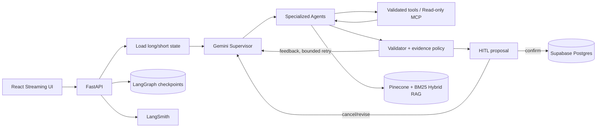

# MetaDiet AI 포트폴리오 결과

기준일: **2026-10-12**. 현재 구현·평가·공개 검증을 정리한 결과이며 실제 사용자 피드백과 건강 효과는 아직 포함하지 않는다.

## 1. 해결한 문제

식단 서비스가 LLM 답변만 생성하면 잘못된 영양 수치, 근거 없는 전략 변경, 중복 저장과 무한 재시도 위험이 생긴다. MetaDiet AI는 작업을 전문 Agent로 나누고 다음 경계를 코드로 보장한다.

1. LLM은 Agent와 읽기 도구를 선택하고 실패 피드백을 받아 재계획한다.
2. 수치 계산, 권한, 호출 예산, 최신 판본, 근거 충돌과 저장 승인은 서버가 검사한다.
3. 실제 식사·측정·전략 변경은 versioned proposal을 사용자가 승인한 뒤에만 저장한다.
4. 체크포인트와 실행 journal로 새로고침·연결 중단·Pod 교체 뒤에도 완료된 실행을 중복 수행하지 않는다.

## 2. 최종 아키텍처

전문 역할은 Supervisor, diet logger, strategy, meal planner, validator, InBody, goal manager, reporter, edit, confirm으로 구성된다. Weekly Deep Agent는 장기 분석을 별도 예산으로 실행하고 음식·영양·근거용 읽기 전용 MCP를 사용한다.

## 3. 성능 실험에서 내린 결정

| 실험 | 비교 | 관측 | 최종 결정 |
|---|---|---|---|
| 파서·청킹 | PyPDF/PDFPlumber/Docling × page/parent-child/section/recursive | Docling은 표 구조에 강점이 있었지만 전체 처리 안정성·page 문맥 잘림·dense 검색에서 우위 미확보 | PyPDF/recursive 유지 |
| 임베딩 | Gemini 768/1536/3072 | 768은 저장량을 줄였지만 독립 평가에서 3072 대비 5%p 낮음 | 3072 유지 |
| 검색 | Dense/BM25/Hybrid | Hybrid가 독립 근거 평가의 최종 후보로 우수 | Dense+BM25+RRF Hybrid |
| 리랭킹 | 없음/FlashRank/Jev | FlashRank는 품질 하락과 1GiB Pod 메모리 초과, Jev는 지연·호출 증가 | 리랭커 없음 |
| 결정 모델 | Gemini/Jev Supervisor·tool selection | Jev Supervisor 자체 정확도와 전체 지연 채택 기준 미충족 | Gemini 기본, Jev 실험 비활성 |

선정 실패를 숨기지 않았다. 예를 들어 FlashRank OOM은 Kubernetes 결함이 아니라 API, BM25 4,139청크, Kiwi, ONNX/PyTorch 런타임이 한 Pod의 1GiB 예산을 넘었고 Kubernetes가 이를 격리한 사건으로 진단했다. 품질 개선도 없었으므로 메모리 증설 대신 구성 제거를 선택했다.

## 4. 평가 결과

| 평가 영역 | 결과 | 해석 제한 |
|---|---:|---|
| 독립 RAG 20문항 지정 근거 Recall@4 | 85% | 단일 지정 페이지 기준 |
| 대체 유효 근거 포함 evidence support | 95% | 원문 검토로 허용 근거 확장 |
| Ragas faithfulness | 1.00 | 동결 독립셋 기준 |
| Ragas context recall | 0.95 | 동결 독립셋 기준 |
| Gemini Agent 독립 flow | 8/8 | 실제 사용자가 아닌 합성 시나리오 |
| 정책 위반 / HITL 전 write | 0 / 0 | 평가한 실패 시나리오 범위 |
| Agent p50 / p95 | 16.71s / 28.05s | 외부 API 상태에 따라 변동 |
| 백엔드 회귀 | 389 passed, 1 skipped | 선택적 파서 환경 1건 skip |
| 프론트엔드 회귀 | 58 passed | production build 별도 성공 |
| 인앱 피드백 수명주기 | 201 생성, 200 재전송, DB 1행→삭제 후 0행 | 합성 계정 1건 공개 E2E |

LangSmith에는 Supervisor 위임, 도구 호출, 재시도, 예산, HITL과 지연을 연결했다. 운영 trace는 입력·출력을 숨기고 가명 thread ID를 사용한다. Ragas와 custom evaluator는 검색 품질과 Agent 행동 품질을 서로 다른 gold contract로 평가한다.

## 5. 장애·실패를 해결한 사례

| 장애 | 로그 기반 원인 | 해결 |
|---|---|---|
| Gemini 공개 E2E 실패 | LangSmith의 `API_KEY_INVALID` | Render의 잘못된 OpenAI 키를 Gemini 키로 교체 |
| Docling native 종료 | Python stack dump 경쟁과 별도 PDF parser C++ 접근 오류를 분리 | 반복 dump 제거, 페이지 격리·PDFium 우회, 운영은 안정적인 PyPDF 유지 |
| FlashRank Pod 종료 | cgroup 1GiB 초과로 `OOMKilled` | 품질도 낮아 운영 리랭커 제거 |
| SSE 도중 Pod 삭제 | journal은 Pod 메모리, 실행은 Postgres checkpoint에 존재 | 같은 run ID로 checkpoint부터 재개하고 proposal 멱등성 유지 |
| 공개 자동 배포 미작동 | Render 로그의 저장소 접근 권한 경고 | GitHub credential 연결 후 push 자동 배포 확인 |
| 만료 JWT가 화면에 잔류 | API 401 공통 경계 부재 | auth-expired 이벤트로 토큰 삭제·로그아웃·로그인 복귀 |
| 피드백 재전송·개인정보 위험 | 네트워크 재시도 시 중복 저장 가능, 자유 입력에 민감정보 포함 가능 | 사용자별 UUID unique, 최소 필드·길이 제한, 원문 로그/trace 제외, 계정 삭제 cascade |

## 6. 배포 검증

- Render 공개 API·정적 UI 배포와 Git push 자동 배포를 확인했다.
- 제한 부하: health 50건, 인증 조회 30건, 실제 Agent SSE 2건에서 오류 0건.
- 무료 인스턴스 지연을 다음처럼 구간별로 분리했다.

| 구간 | 표본·결과 | 해석 |
|---|---:|---|
| 15분 이상 휴면 뒤 첫 `/health` | 1회, **53,022.0ms** | Render 무료 Web Service 기동 시간 포함 |
| 기동 후 `/health` | 20회, 중앙값 **236.2ms**, p95 **949.9ms**, 범위 **203.9~1,272.4ms** | 서버 생존 확인용 경량 요청이며 실제 상담 시간이 아님 |
| 로컬 새 프로세스→health 준비 | 1회, **5,720.3ms** | 앱 자체 초기화 시간 |
| 로컬 `import main` | 3회, 중앙값 **5,132.3ms** | Python·LangGraph·Agent·SDK import가 앱 초기화 대부분을 차지 |
| 실제 Agent SSE 제한 부하 | 2개 동시 요청, 첫 이벤트 **4,317.4/4,450.3ms**, 전체 wall time **32.48초** | Gemini·RAG·도구 호출·Agent 검증이 포함돼 `/health`보다 오래 걸림 |

이 분해를 통해 53초 전체를 애플리케이션 최적화 대상으로 오인하지 않았다. 앱 초기화를 전부 제거한다고 가정해도 줄일 수 있는 상한은 로컬 측정 기준 약 5.7초다. 제한 베타에서는 cold start를 안내하고, 상시 응답이 필요할 때 휴면하지 않는 인스턴스로 전환한다.
- kind rolling restart 중 `/health` 400/400 성공, p95 5.86ms였다.
- 인증 SSE 중 Pod를 삭제한 뒤 다른 Pod에서 재개했고 proposal 중복 저장은 0건이었다.
- 실제 Chromium에서 성공 흐름, proposal 복원, API 500, SSE 중단, 인증 401 UI를 확인했다.
- 공개 피드백 API는 합성 계정에서 최초 저장 2,388.0ms, 동일 UUID 재전송 1,307.5ms였고 행 수는 1개로 유지됐다. 계정 삭제 후 피드백 행은 0개였다. 두 시간은 단일 표본이라 p50/p95로 표기하지 않는다.

## 7. 남은 한계와 다음 선택 작업

- Render workspace 장애 이메일 알림은 `Email` + `Only failure notifications`로 확인했으며 서비스별 override는 없다.
- 무료 플랜은 15분 휴면 뒤 첫 API 요청에 cold start가 생긴다는 점을 제품 안내에 표시한다. health만 빨리 여는 lazy initialization과 인위적 keep-alive는 첫 채팅 지연 또는 운영 복잡도만 옮기므로 도입하지 않고, 상시 응답이 필요해질 때 휴면하지 않는 유료 instance로 전환한다.
- 근거 누락 영어 질문 1건은 안전 보류하며 별도 개발셋에서 query expansion을 연구한다.
- Vite 전환으로 오래된 `react-scripts` 빌드 의존성을 정리할 수 있다.
- 실제 임상 정책 승인과 장기간 사용자 효과 평가는 이 소프트웨어 평가와 구분한다.

세부 실험 조건, 원본 artifact 경로와 실패 로그는 [EVALUATION.md](EVALUATION.md)에 있다.

## 8. 호출 최적화 전후와 최신 운영 관측

| 동일 개발 8개 흐름, 각 1회 | 변경 전 | 변경 후 |
|---|---:|---:|
| 목표 달성 / 정책 위반 | 8/8 / 0 | 8/8 / 0 |
| p50 | 16.64초 | 9.31초 (-44.0%) |
| p95 | 24.92초 | 13.69초 (-45.1%) |
| 모델 호출 합계 | 35 | 30 (-14.3%) |

성공한 동일 읽기 도구의 실행 내 캐시와 Supervisor 중복 종합 호출 제거 결과다. 효과가 있는 쓰기·위임 및 실패 결과는 캐시하지 않는다. 개발셋 재시험이며 독립 최종 Agent 8개·공개 사용자 지연과 구분한다. 도구 전후 합계와 실제 청구 비용 절감은 검증하지 않았다.

- 체중 기록과 완전한 인바디 기록을 분리하고 저장 전 HITL을 적용했다. 가입 체중 표시, 측정 입력 카드, 미입력 상태와 그래프 경로를 마련했다.
- 온보딩 UI는 활동 수준 카드와 필수/선택 구분을 적용하고 기존 설정 조회 중에는 로딩 화면을 사용한다.
- 제품 이벤트에는 건강 수치·원문·음식명·이메일을 담지 않으며 내부 사용자 FK와 중복 방지 ID는 포함한다. 완전한 익명 데이터로 표현하지 않는다.
- 관리자 분석은 DAU/WAU, 실제 Auth 가입 cohort의 온보딩·첫 식사 전환, 상담 응답 완료율과 p95를 제공한다. 응답 완료율은 답변 품질이 아니며 브라우저 분석 전송에는 누락 가능성이 있다.
- 공개 SSE의 trace ID, 제품 이벤트 DB ID, LangSmith root span ID 일치를 확인했다. 입력/출력은 운영 trace에서 숨긴다.
- 실제 관리자 계정의 1·7·30·90일 조회·새로고침 재조회, 일반 사용자 403 차단을 확인했다. 공개 분석 저장 201/재전송 200/1행/계정 삭제 후 0행을 검증했다.

## 9. 증거와 후속 자료

- [상세 사례·실패 원인·포트폴리오 요약](PORTFOLIO_CASE_STUDY.md)
- [독립 RAG 조건·원문 판정·한계](docs/rag_experiments/RAG_FINAL_EVALUATION_V1.md)
- [독립 Agent 동결 계약](docs/agent_experiments/final_agent_flow_v1.json)
- [전체 실험 기록](EVALUATION.md): 호출 최적화 29장, Deep/MCP 실패 주입 31장, 독립 Agent 32장, 휴면 시간 46장, 제품 분석·trace·관리자 54~57장
- [관리자 운영 안내](docs/ADMIN_ANALYTICS_GUIDE.md)

실제 사용자 수·만족도·장기간 건강 효과는 미측정이다. 베타 참여 후 테스트 계정을 제외한 기간·표본 수·동의 범위를 먼저 기록하고, 실패 재현과 동일 조건 개선 전후 결과를 추가한다. 개발/독립/공개 부하 표본을 합쳐 하나의 성공률이나 p95로 만들지 않는다. 로컬 artifacts의 원문 trace·개인정보·키·dump는 공개 저장소에 올리지 않는다.
