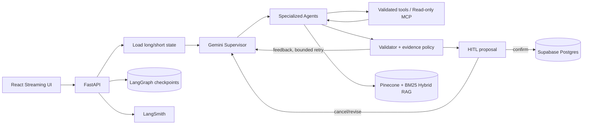

# MetaDiet AI 포트폴리오 결과

## 1. 해결한 문제

식단 서비스가 LLM 답변만 생성하면 잘못된 영양 수치, 근거 없는 전략 변경, 중복 저장과 무한 재시도 위험이 생긴다. MetaDiet AI는 작업을 전문 Agent로 나누고 다음 경계를 코드로 보장한다.

1. LLM은 Agent와 읽기 도구를 선택하고 실패 피드백을 받아 재계획한다.
2. 수치 계산, 권한, 호출 예산, 최신 판본, 근거 충돌과 저장 승인은 서버가 검사한다.
3. 실제 식사·측정·전략 변경은 versioned proposal을 사용자가 승인한 뒤에만 저장한다.
4. 체크포인트와 실행 journal로 새로고침·연결 중단·Pod 교체 뒤에도 완료된 실행을 중복 수행하지 않는다.

## 2. 최종 아키텍처

전문 역할은 Supervisor, diet logger, strategy, meal planner, validator, InBody, goal manager, reporter, edit, confirm으로 구성된다. Weekly Deep Agent는 장기 분석을 별도 예산으로 실행하고 음식·영양·근거용 읽기 전용 MCP를 사용한다.

## 3. 성능 실험에서 내린 결정

| 실험 | 비교 | 관측 | 최종 결정 |
|---|---|---|---|
| 파서·청킹 | PyPDF/PDFPlumber/Docling × page/parent-child/section/recursive | Docling은 표 구조에 강점이 있었지만 전체 처리 안정성·page 문맥 잘림·dense 검색에서 우위 미확보 | PyPDF/recursive 유지 |
| 임베딩 | Gemini 768/1536/3072 | 768은 저장량을 줄였지만 독립 평가에서 3072 대비 5%p 낮음 | 3072 유지 |
| 검색 | Dense/BM25/Hybrid | Hybrid가 독립 근거 평가의 최종 후보로 우수 | Dense+BM25+RRF Hybrid |
| 리랭킹 | 없음/FlashRank/Jev | FlashRank는 품질 하락과 1GiB Pod 메모리 초과, Jev는 지연·호출 증가 | 리랭커 없음 |
| 결정 모델 | Gemini/Jev Supervisor·tool selection | Jev Supervisor 자체 정확도와 전체 지연 채택 기준 미충족 | Gemini 기본, Jev 실험 비활성 |

선정 실패를 숨기지 않았다. 예를 들어 FlashRank OOM은 Kubernetes 결함이 아니라 API, BM25 4,139청크, Kiwi, ONNX/PyTorch 런타임이 한 Pod의 1GiB 예산을 넘었고 Kubernetes가 이를 격리한 사건으로 진단했다. 품질 개선도 없었으므로 메모리 증설 대신 구성 제거를 선택했다.

## 4. 평가 결과

| 평가 영역 | 결과 | 해석 제한 |
|---|---:|---|
| 독립 RAG 20문항 지정 근거 Recall@4 | 85% | 단일 지정 페이지 기준 |
| 대체 유효 근거 포함 evidence support | 95% | 원문 검토로 허용 근거 확장 |
| Ragas faithfulness | 1.00 | 동결 독립셋 기준 |
| Ragas context recall | 0.95 | 동결 독립셋 기준 |
| Gemini Agent 독립 flow | 8/8 | 실제 사용자가 아닌 합성 시나리오 |
| 정책 위반 / HITL 전 write | 0 / 0 | 평가한 실패 시나리오 범위 |
| Agent p50 / p95 | 16.71s / 28.05s | 외부 API 상태에 따라 변동 |
| 백엔드 회귀 | 360 passed, 1 skipped | 선택적 파서 환경 1건 skip |
| 프론트엔드 회귀 | 35 passed | production build 별도 성공 |

LangSmith에는 Supervisor 위임, 도구 호출, 재시도, 예산, HITL과 지연을 연결했다. 운영 trace는 입력·출력을 숨기고 가명 thread ID를 사용한다. Ragas와 custom evaluator는 검색 품질과 Agent 행동 품질을 서로 다른 gold contract로 평가한다.

## 5. 장애·실패를 해결한 사례

| 장애 | 로그 기반 원인 | 해결 |
|---|---|---|
| Gemini 공개 E2E 실패 | LangSmith의 `API_KEY_INVALID` | Render의 잘못된 OpenAI 키를 Gemini 키로 교체 |
| Docling native 종료 | Python stack dump 경쟁과 별도 PDF parser C++ 접근 오류를 분리 | 반복 dump 제거, 페이지 격리·PDFium 우회, 운영은 안정적인 PyPDF 유지 |
| FlashRank Pod 종료 | cgroup 1GiB 초과로 `OOMKilled` | 품질도 낮아 운영 리랭커 제거 |
| SSE 도중 Pod 삭제 | journal은 Pod 메모리, 실행은 Postgres checkpoint에 존재 | 같은 run ID로 checkpoint부터 재개하고 proposal 멱등성 유지 |
| 공개 자동 배포 미작동 | Render 로그의 저장소 접근 권한 경고 | GitHub credential 연결 후 push 자동 배포 확인 |
| 만료 JWT가 화면에 잔류 | API 401 공통 경계 부재 | auth-expired 이벤트로 토큰 삭제·로그아웃·로그인 복귀 |

## 6. 배포 검증

- Render 공개 API·정적 UI 배포와 Git push 자동 배포를 확인했다.
- 제한 부하: health 50건, 인증 조회 30건, 실제 Agent SSE 2건에서 오류 0건.
- 무료 인스턴스 cold start는 53,022ms였다. 기동 후 `/health` 20회는 중앙값 236.2ms, p95 949.9ms였다. 로컬 새 프로세스 기동 5,720.3ms와 import 중앙값 5,132.3ms를 분리 측정해, 지연의 대부분이 애플리케이션보다 Render 무료 scale-to-zero 복구에서 발생함을 확인했다.
- kind rolling restart 중 `/health` 400/400 성공, p95 5.86ms였다.
- 인증 SSE 중 Pod를 삭제한 뒤 다른 Pod에서 재개했고 proposal 중복 저장은 0건이었다.
- 실제 Chromium에서 성공 흐름, proposal 복원, API 500, SSE 중단, 인증 401 UI를 확인했다.

## 7. 남은 한계와 다음 선택 작업

- Render workspace 장애 이메일 알림 활성화 여부를 Dashboard에서 최종 확인한다.
- 무료 플랜은 15분 휴면 뒤 첫 API 요청에 cold start가 생긴다는 점을 제품 안내에 표시한다. health만 빨리 여는 lazy initialization과 인위적 keep-alive는 첫 채팅 지연 또는 운영 복잡도만 옮기므로 도입하지 않고, 상시 응답이 필요해질 때 휴면하지 않는 유료 instance로 전환한다.
- 근거 누락 영어 질문 1건은 안전 보류하며 별도 개발셋에서 query expansion을 연구한다.
- Vite 전환으로 오래된 `react-scripts` 빌드 의존성을 정리할 수 있다.
- 실제 임상 정책 승인과 장기간 사용자 효과 평가는 이 소프트웨어 평가와 구분한다.

세부 실험 조건, 원본 artifact 경로와 실패 로그는 [EVALUATION.md](EVALUATION.md)에 있다.
