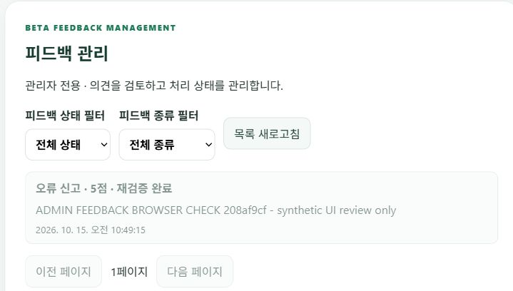
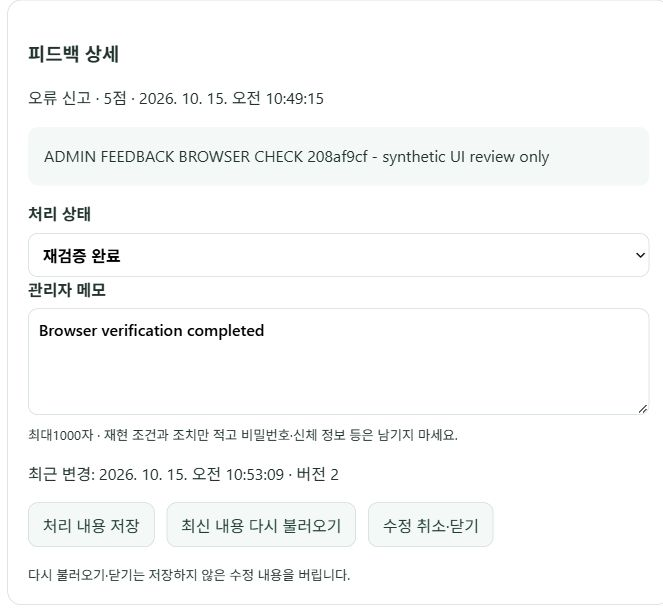
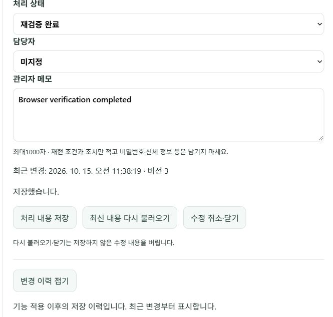
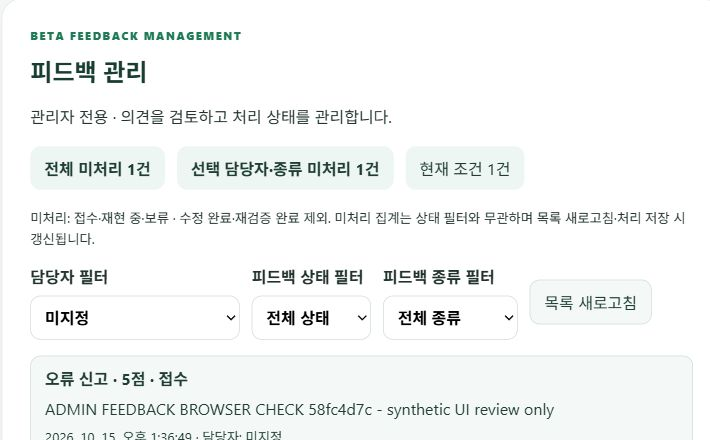
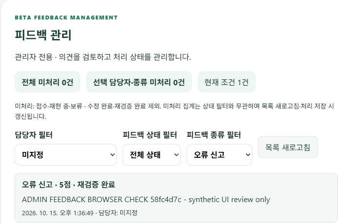
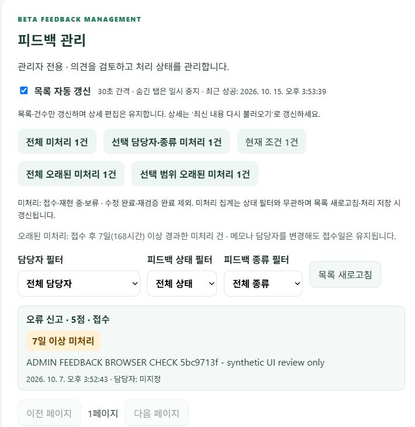

# 관리자 피드백 검토와 처리 상태 관리

## 사용 방법

`ADMIN_EMAILS`에 등록된 MetaDiet 계정으로 로그인하고 **설정 → 제품 운영 지표 아래 피드백 관리**를 엽니다. 일반 사용자는 화면을 볼 수 없으며 직접 API를 호출해도 접근이 거부됩니다. [관리자 이메일 설정](ADMIN_ANALYTICS_GUIDE.md)을 참고하세요.

1. 상태·종류 필터로 의견을 찾습니다. 목록은 최신순으로20건씩 표시되며 이전·다음 페이지와 새로고침을 제공합니다.
2. 목록의 의견을 누르면 전체 의견, 만족도, 종류, 접수 시각을 확인할 수 있습니다. 의견이 없는 피드백도 확인 가능합니다.
3. 처리 상태를 **접수 → 재현 중 → 수정 완료 → 재검증 완료**로 관리합니다. 진행하기 어려우면 **보류**를 선택합니다. 필요하면 상태를 되돌릴 수도 있습니다.
4. 관리자 메모에 재현 조건·조치·검증 결과를 최대1000자로 기록하고 **처리 내용 저장**을 누릅니다. 개인정보나 자격 증명은 적지 않습니다.
5. 실패하면 입력이 유지됩니다. 다른 관리자의 수정 또는 삭제와 충돌하면 덮어쓰지 않고 안내합니다. 메모를 확인한 뒤 **최신 내용 다시 불러오기**로 최신 버전을 읽고 다시 처리합니다. 다시 불러오기와 닫기는 저장하지 않은 편집을 버립니다.

메모와 상태는 관리자 검토용이며 사용자에게 자동 통보되지 않습니다. 담당자는 서버 `ADMIN_EMAILS`에 등록되고 가입·이메일 확인을 마친 관리자 중 선택하거나 미지정으로 해제합니다. **변경 이력 보기**에서 변경자·시각과 상태·담당자·메모의 변경 전후 값을 확인합니다. 메모 변경은 펼쳐서 읽을 수 있습니다. 변경 이력은 기능 적용 이후부터 생성하며 과거 변경을 추정해 만들지 않습니다.

## 보안과 데이터 범위

- 모든 목록·상세·변경 요청은 기존 `get_current_admin`으로 서명 검증된 JWT의 최상위 이메일을 서버 allowlist와 대조합니다. `user_metadata`의 역할을 신뢰하지 않습니다. 미로그인은401, 일반 계정은403입니다.
- `/admin/feedback` 목록과 `/{id}` 상세·PATCH를 제공합니다. UUID·상태·종류·페이지 범위·메모 길이를 검증하고 알 수 없는 변경 필드는 거부합니다.
- 목록은 의견 앞100자만, 상세는 의견 원문과 메모를 반환합니다. 피드백 작성자의 이메일·신체 정보·대화·식사 기록을 조회하거나 결합하지 않습니다. 담당자와 변경자 표시에는 관리자 이메일만 사용합니다. 의견을 HTML로 실행하지 않고 일반 텍스트로 렌더링합니다.
- 원문과 메모를 LangSmith·제품 이벤트·오류 로그에 추가하지 않습니다. 관리자 응답은 `Cache-Control: no-store`이며 클라이언트도 캐시를 사용하지 않습니다.
- DB의 RLS를 유지하고 `anon`·`authenticated`의 테이블 권한을 회수했습니다. 브라우저가 JWT만으로 DB를 우회 조회·수정할 수 없습니다. 관리자 기능은 인증된 백엔드 API를 사용합니다.
- 변경은 ID와 버전이 동시에 일치할 때만 적용하고 버전을 증가시킵니다. 처리자는 요청 본문이 아니라 인증된 관리자 ID를 기록합니다.
- migration `20261015014035_admin_feedback_workflow.sql`은 기존 의견을 보존하고 기본 상태를 접수로 설정합니다. 실제 DB 적용 전후 기존 ID·평점·종류·의견의 건수와 해시가 같음을 확인했습니다.

## 실패 원인과 수정

보안 테스트로 아직 없는 경로의404와 미구현 모듈을 먼저 확인한 뒤 기능을 연결했습니다. CLI가 설치되지 않은 환경은 공식 npm 패키지와 `migration new`를 사용했습니다. Supabase 변경 이력의 관련 TLS 공지를 확인했으며 이번 변경으로 SDK·TLS 설정을 바꾸지는 않았습니다.

코드 리뷰에서 A 의견 저장 중 B 의견을 열면 늦게 도착한 A 응답이 B 화면을 덮는 경쟁 조건을 발견했습니다. 지연된 응답을 사용하는 재현 테스트가 실제로 실패했습니다. 선택 세대를 비교하고, 선택·필터·페이지·다시 불러오기·화면 종료 이후의 오래된 저장 응답은 무시하도록 수정했습니다. 이미 열린 행은 재선택하지 않도록 막았습니다. DB 버전 비교는 다른 관리자의 동시 수정도 차단합니다.

근거: [React의 네트워크 응답 경쟁 조건 처리](https://react.dev/reference/react/useEffect), [Supabase RLS와 권한](https://supabase.com/docs/guides/database/postgres/row-level-security), [공식 migration 절차](https://supabase.com/docs/guides/deployment/database-migrations).

## 검증

백엔드 전체 **1063 passed·기존1 skipped**, 프론트 전체 **24 suites / 82 passed**, production build 성공. 권한·필터 검증·404·409·503·SQL 파라미터·오류 내용 비노출, HTML 원문 안전 표시·오류 후 입력 유지·필터·페이지 이동·지연 응답 무시·임시 계정 정리 재인증을 확인했습니다. 일반 조회는 기존 API를 유지합니다.

공개 기능 검증은 `backend/venv/Scripts/python.exe backend/scripts/check_admin_feedback.py prepare`로 표시된 합성 피드백을 만든 뒤 관리자 브라우저에서 확인합니다. 담당자를 선택하고 재현 중 상태·메모를 저장한 뒤 새로고침으로 유지되는지 확인합니다. 이어 담당자를 미지정으로 해제하고 상태를 재검증 완료, 메모를 `Browser verification completed`로 저장합니다. 지정·해제 두 이력을 읽고 `probe`로 미로그인·일반 계정 차단과 상태·이력 영속화를 확인합니다. 마지막에 `cleanup`으로 이번 임시 계정과 합성 피드백을 정리합니다. 자격 증명은 git에서 제외한 env에만 보관하며 출력·문서에 포함하지 않습니다. 실제 사용자 의견은 수정하지 않습니다.

이 검증은 기능·권한 확인이며 속도·정확도 성능 비교나 실제 사용자 성과가 아닙니다.

## 공개 배포와 실제 브라우저 결과

API health와 웹 build-info가 모두 `b4856edfade59d4337882508cf9d9b4d527d70a0`임을 확인했다. Render main Auto-Deploy 후 Live 상태였다.

| 확인 | 결과 |
|---|---|
| 관리자 설정 화면 | 합성 피드백만 선택해 목록·전체 의견·평점·종류 확인 |
| 상태·메모 저장 | 접수→재검증 완료, 메모 저장 후 버전1→2 |
| 필터 | 접수 필터에서는 해당 건 제외, 재검증 완료·오류 신고 필터에서는 표시 |
| 새로고침 | 관리자 화면 재진입 후 저장된 상태·메모·버전2 유지 |
| 미로그인 API | 목록·상세·변경 모두401 |
| 일반 계정 API | 목록·상세·변경 모두403, 변경 시도 후 저장값 유지 |
| 검증 데이터 정리 | 임시 계정·합성 피드백 삭제 및 DB 잔여 행 없음 확인, 관리자 목록에서도 제거 |

[비식별 공개 검사 결과](admin-feedback/public-check.json). 페이지 이동·응답 지연 경쟁 조건·저장 실패 후 입력 유지·HTML 안전 표시는 자동 회귀 테스트로 검증했다. 공개 브라우저의 목록은 합성1건이어서 다음 페이지 버튼 비활성화까지만 확인했다.

캡처에는 합성 의견만 포함했다. 관리자 이메일·개인 목표·실제 의견은 포함하지 않았다. 캡처는 임시 피드백을 삭제하기 전 검증 당시 화면이다.

## 공개 검증 중 오류와 복구

- 배포 직후 한 차례 기존 대화 복원 실패 안내가 나타났다. 브라우저 오류 로그는 비어 있어 정확한 원인을 확정하지 못했다. 기존 **화면 상태 다시 불러오기**로 대화·화면이 복구됐고 실행이나 섭취 저장을 다시 수행하지 않았다. 이후 새로고침 검증은 정상 완료했다. 영구 장애나 이번 피드백 기능의 결함으로 단정하지 않는다.
- 임시 계정 정리에서401 `recent_authentication_required`가 발생했다. 비밀번호 인증 후554초가 지났지만 계정 삭제는300초 이내의 비밀번호 인증을 요구했다. JWT refresh로는 이 조건을 충족하지 않는 기존 보안 정책을 유지했다. 검증 스크립트가 임시 계정 자격 증명을 git-ignored env에 보관하고, 정리 직전에 비밀번호로 다시 로그인하도록 수정했다. 초기 실행의 임시 자격 증명은 `feedback-check-…@example.invalid` 계정임을 확인한 뒤 해당 임시 계정만 복구했다. 재인증 후 계정·피드백 삭제와 잔여 행 없음 검증이 통과했고 env도 제거했다.
- 정리 재인증 회귀 테스트는 이전 토큰 대신 새 비밀번호 인증 토큰으로 삭제를 요청하는지 검증한다. 일반 계정의 삭제 보안 정책·실제 계정 비밀번호·실제 의견은 변경하지 않았다. [Supabase 세션 공식 문서](https://supabase.com/docs/guides/auth/sessions), [서버 관리자 사용자 관리](https://supabase.com/docs/guides/auth/managing-user-data).

## 담당자 배정·변경 이력 확장 (2026-10-15)

- `GET /admin/feedback/assignees`: 서버 허용 목록과 이메일 확인을 마친 가입 계정의 교집합만 제공합니다. 일반 사용자 목록을 노출하지 않습니다.
- `PATCH /admin/feedback/{id}`: `assignee_id`가 없으면 기존 배정을 유지하고, null이면 해제합니다. 임의 UUID·비관리자는422로 거부합니다. 변경자는 JWT에서 결정하며 클라이언트가 지정할 수 없습니다.
- `GET /admin/feedback/{id}/history`: 버전 내림차순, 기본20건·최대100건, `before_version` 커서로 이전 이력을 조회합니다. 모든 경로는 관리자 검증과 no-store 정책을 적용합니다.
- 행 잠금·버전 비교 → 상태·메모·담당자 변경 → 이력 INSERT를 한 트랜잭션으로 처리합니다. 이력 기록 실패는 본문 변경도 롤백하며 오래된 버전은409로 거부합니다. 성공한 저장마다 버전을 증가시키고 이력을 한 건 남깁니다.
- migration `20261015022407_admin_feedback_assignment_history.sql`을 적용했습니다. 이력 테이블의 RLS와 anon/authenticated 권한 회수를 실제 DB에서 확인했습니다. 사용자 탈퇴 시 해당 사용자의 피드백과 이력은 함께 삭제됩니다.
- 이력은 관리자 API로 수행한 저장을 기록합니다. 운영자의 직접 SQL 작업까지 포착하는 범용 DB 감사 시스템은 아닙니다. 관리자 계정 삭제 시 담당자는 해제되고 변경자는 ‘삭제된 관리자’로 표시될 수 있습니다. 이메일을 영구 복제하지 않고 현재 Auth 계정에서 표시합니다.

실제 PostgreSQL의 임시 피드백에 이력 중복 버전 충돌을 유도하여 본문 변경이 롤백됨을 확인했습니다. 담당자 지정→기존 클라이언트 요청에서 유지→해제, 오래된 버전 거부와 이력 커서도 검증했으며 이 테스트 변경은 전부 롤백했습니다.

코드 리뷰에서 이력의 이전 페이지를 읽은 뒤 접기·다시 열기 시 같은 페이지가 중복되는 문제를 발견했습니다. React 중복 key 로그와 실패 테스트로 재현하고 다시 열 때 최신 페이지부터 조회하도록 수정했습니다. 늦게 도착한 네트워크 응답은 effect 정리에서 무시합니다. [React effect 공식 문서](https://react.dev/reference/react/useEffect), [PostgreSQL 트랜잭션](https://www.postgresql.org/docs/current/tutorial-transactions.html).

개발 도구에서 Windows 기본 cp949로 UTF-8 소스를 읽어 UnicodeDecodeError가 발생했습니다. 소스는 변경되지 않았고, 명시적 UTF-8 및 프로젝트 Python의 `-X utf8`로 재실행했습니다. [Python Windows UTF-8 모드](https://docs.python.org/3/using/windows.html).

전체 회귀: **백엔드1068 passed·기존1 skipped / 프론트25 suites·86 passed / production build 성공**. 공개 브라우저 검증도 아래와 같이 완료했습니다.

추가 검증에서 Windows 기본 pytest 임시 경로의 WinError5 권한 오류가 발생했다. 애플리케이션 테스트 실패가 아니라 tmp_path 생성 실패였으며, 프로젝트 내 전용 `--basetemp`를 지정해 동일11건이 통과했다. 기존 테스트를 제거하거나 스킵하지 않았다. [pytest 임시 디렉터리 공식 문서](https://docs.pytest.org/en/stable/how-to/tmp_path.html).

### 담당자·이력 공개 배포 결과

API health와 웹 build-info가 모두 기능 커밋 `6432b4af8d383d4e05c3b1ff2c7c34c6825c30c4`임을 확인했습니다. Render main 자동 배포 후 로그인된 실제 관리자 브라우저에서 표시된 합성 의견 한 건만 검증했습니다.

| 확인 | 결과 |
|---|---|
| 담당자 지정 | 허용된 관리자 선택, 재현 중·메모 저장, 버전1→2 |
| 새로고침 | 지정 담당자·메모·버전2 유지 |
| 이력 | 변경자·시각·상태·배정·메모 전후 표시, 메모 펼쳐보기 정상 |
| 담당자 해제 | 미지정·재검증 완료·최종 메모 저장, 버전2→3 |
| 최종 새로고침 | 미지정·최종 메모·버전3 유지 |
| 공개 API 권한 | 목록·상세·담당자·이력·변경: 미로그인401 / 일반 계정403 |
| 저장·이력 검증 | 지정·해제 이력2건, 권한 없는 변경 시도 후 저장값 유지 |
| 정리 | 이번 임시 계정·피드백·이력 삭제, DB 잔여 행 없음 확인 |

[비식별 기능 검증 결과](admin-feedback/assignment-public-check.json). 실제 사용자 의견이나 기존 섭취 기록은 변경하지 않았습니다. 이력 이전 페이지 이동·접기/재열기·늦은 응답·실패 재시도는 자동 테스트로 검증했으며 공개 브라우저 표본은 이력2건입니다. 여러 관리자가 동시에 클릭하는 공개 부하 테스트나 처리 알림 발송은 이번 범위에 포함하지 않았습니다.

캡처는 검증 당시 저장 성공 화면이며 이메일과 개인 목표를 제외했습니다. 합성 피드백은 검증 후 삭제했습니다. 기존 변경을 소급 복원하지 않는 점과 직접 SQL 작업은 감사 대상이 아닌 점은 위 데이터 범위를 따릅니다.

## 담당자 필터·미처리 건수 (2026-10-15)

관리자 설정의 피드백 관리에서 **담당자 필터**로 전체·미지정·허용된 관리자를 선택합니다. 상태·종류 필터와 함께 사용할 수 있고 필터를 바꾸면1페이지로 돌아갑니다. 목록에도 배정된 담당자를 표시합니다.

- **전체 미처리**: 전체 피드백 중 접수·재현 중·보류의 건수입니다.
- **선택 담당자·종류 미처리**: 담당자·종류 조건에 맞는 미처리 건수입니다. 상태 필터와 무관합니다.
- **현재 조건**: 담당자·종류·상태 조건을 모두 적용한 전체 목록 건수입니다. 현재 페이지20건의 개수가 아닙니다.
- 수정 완료·재검증 완료는 미처리에서 제외합니다. 보류는 남은 업무이므로 포함합니다. 상태·담당자 저장과 목록 새로고침으로 목록·건수를 함께 갱신합니다. 실시간 push 방식은 아닙니다.

기존 관리자 전용 `GET /admin/feedback`에 `assignee=unassigned` 또는 관리자 UUID 조건과 `counts` 응답을 추가했습니다. 잘못된 담당자 형식은422입니다. 기존 응답 필드·인증·no-store·읽기 권한은 유지하며 새 DB 마이그레이션은 없습니다. 담당자 허용 목록에서 제외된 기존 배정은 전체 목록에서 확인할 수 있지만 현재 선택 목록에는 나오지 않습니다.

목록과 건수는 PostgreSQL read-only Repeatable Read 트랜잭션에서 같은 스냅샷으로 읽습니다. 다른 관리자의 변경이 두 조회 사이에 들어오더라도 같은 응답 안에서 서로 다른 시점이 섞이지 않도록 했습니다. [PostgreSQL 격리 수준](https://www.postgresql.org/docs/current/transaction-iso.html), [조건부 집계 FILTER](https://www.postgresql.org/docs/current/sql-expressions.html).

검증: 실제 PostgreSQL 세션 전용 임시 테이블에 다섯 상태와 서로 다른 배정을 구성해 전체·미지정·담당자·종류·상태·빈 결과·페이지 독립 집계를 확인했습니다. 실제 운영 행은 변경하지 않았으며 임시 테이블은 연결 종료로 제거됩니다. 자동 테스트에서 아직 없는 필터 검증·UI를 먼저 실패시킨 뒤 구현했습니다. 기존 SQL 테스트의 ‘마지막 실행 SQL’ 가정은 집계 쿼리 추가로 실패하여 목록 SQL 자체를 선택해 검증하도록 갱신했습니다.

전체 회귀: **백엔드1072 passed·기존1 skipped / 프론트25 suites·87 passed**. production build도 성공했고 공개 배포·브라우저 검증도 아래와 같이 완료했습니다. 이번 검증은 기능·집계 정확성 확인이며 실제 사용자 성과나100건 전후 성능 실험이 아닙니다.

### 필터·미처리 공개 검증 결과

API와 웹이 모두 `ecda1c5c42d1aecddc064c0ae6e990a55e972afe`로 자동 배포된 것을 확인한 뒤 실제 관리자 브라우저에서 합성 의견 한 건만 검증했습니다.

| 흐름 | 전체 미처리 / 선택 범위 미처리 / 현재 조건 |
|---|---|
| 최초 미지정 필터 | 1 / 1 / 1 |
| 배정 전 특정 관리자 필터 | 1 / 0 / 0 |
| 관리자 배정 후 미지정 필터 | 1 / 0 / 0 |
| 배정 관리자·오류 신고 필터 | 1 / 1 / 1 |
| 완료 상태 필터 (아직 재현 중) | 1 / 1 / 0 |
| 완료 저장·배정 해제 후 미지정·오류 신고 | 0 / 0 / 1 |
| 새로고침 후 전체 조건 | 0 / 0 / 1 |

기존 목록·담당자·상세·이력·변경에 더해 특정 담당자/미지정 목록 요청도 미로그인401, 일반 사용자403을 반환했습니다. 실제 일반 계정의 변경 시도 후 저장 내용과 이력은 유지됐습니다. 검증용 계정·합성 의견·이력을 정리하고 잔여 행이 없음을 확인했습니다. 공개 표본은1건이며, 페이지 경계는 자동 테스트와 실제 PostgreSQL 임시 테이블 검증으로 확인했습니다. [비식별 검사 결과](admin-feedback/filter-public-check.json).

캡처에는 합성 의견만 포함하고 개인 이메일·목표는 제외했습니다. 캡처 이후 해당 합성 의견은 삭제했습니다. 이번 작업에서 배포나 공개 기능 실패는 발생하지 않았습니다. 기존 의존성 deprecation 경고와 네트워크 실패를 의도적으로 발생시키는 프론트 회귀 테스트의 console 출력은 남아 있으나 테스트·빌드는 모두 통과했습니다.

## 목록 자동 갱신·오래된 미처리 표시 (2026-10-15)

- 관리자 피드백 목록과 집계는 **30초 간격**으로 자동 갱신합니다. 현재 요청이 끝난 뒤 다음 간격을 시작하며 숨김 탭에서는 요청하지 않습니다. 탭으로 돌아오거나 창이 포커스를 얻으면 다시 조회합니다. ‘목록 자동 갱신’ 체크를 해제해 중지할 수 있습니다.
- 화면 종료·권한 상실·자동 갱신 중지 시 타이머와 이벤트 리스너를 정리합니다. 동시에 발생하는 복귀·포커스·타이머 이벤트는 한 번만 요청합니다. 실패 시 오류를 표시하고 다음 간격에 재시도하며 수동 새로고침도 가능합니다. 최근 성공 시각을 표시합니다.
- **상세 편집은 자동으로 덮어쓰지 않습니다.** 목록·건수만 갱신하고 미저장 메모·상태·담당자 편집을 보존합니다. 상세와 이력은 ‘최신 내용 다시 불러오기’로 갱신합니다. 다른 관리자가 바꾼 버전으로 저장하면 기존409 충돌 방지가 작동합니다.
- **오래된 미처리**는 접수 시각으로부터168시간 이상 지난 접수·재현 중·보류 건입니다. 서버 UTC 시간을 기준으로 판정하고 클라이언트 시계는 판정에 사용하지 않습니다. 수정 완료·재검증 완료·미래 접수 시각은 제외합니다. 메모·담당자 수정만으로 접수일이나 기준이 초기화되지 않습니다.
- 목록의 ‘7일 이상 미처리’ 배지와 전체/선택 범위 오래된 미처리 건수를 제공합니다. 담당자·종류 범위를 적용하고 상태 필터와 페이지 수에는 영향받지 않습니다. 같은 서버 cutoff와 읽기 스냅샷을 사용합니다. 신규 DB 마이그레이션이나 공개 경로 추가는 없습니다.

[React effect 정리·네트워크 응답 처리](https://react.dev/reference/react/useEffect), [Page Visibility API](https://developer.mozilla.org/en-US/docs/Web/API/Page_Visibility_API)에 따라 조회·타이머 생명주기를 분리했습니다. 처음에는 누락된 서버 판정 함수와 UI의 실패 테스트를 확인했고 구현 후 통과했습니다. 기존 집계 SQL 파라미터 테스트는 cutoff 두 개와 선택 범위 반복 조건을 검증하도록 확장했습니다. fake timer는 컴포넌트 렌더링 전에 설치해 실제 브라우저 타이머와 테스트 타이머가 섞이지 않게 했습니다.

전체 회귀: **백엔드1079 passed·기존1 skipped / 프론트26 suites·91 passed**. 실제 PostgreSQL의 세션 전용 임시 테이블에서 정확히7일/1초 전후·완료·미래 시각·담당자·빈 범위와 배지/집계 일치를 확인했고 운영 행은 변경하지 않았습니다. 자동 테스트는 숨김·복귀·중복 이벤트·요청 중·중지·화면 종료·편집 보존을 검증합니다. production build도 성공했으며 공개 배포·브라우저 검증 결과는 아래에 기록했습니다.

이 기능은 실시간 push나 장기 미처리 이메일 알림이 아닙니다. 브라우저·네트워크 지연으로30초보다 늦게 반영될 수 있습니다. 공개 기능 검증과100건 전후 속도 실험은 구분하며 이번 작업은 기능·권한·경계값 검증입니다.

### 자동 갱신·오래된 표시 공개 검증 결과

API health와 웹 build-info가 모두 `021b115d17c73594dc0902e2e809bf5869ff7986`임을 확인했습니다. 실제 로그인된 관리자 브라우저에서 검증용 합성 의견 한 건만8일 전 접수로 설정했습니다.

| 확인 | 결과 |
|---|---|
| 오래된 표시 | 접수8일 된 합성 의견의 배지·전체/선택 오래된 건수1 확인 |
| 자동 반영 | 외부에서 해당 합성 의견의 preview만 바꾼 뒤 버튼 없이 다음 주기에 반영 |
| 편집 보존 | 상세에 입력한 미저장 메모가 주기 조회·중지·재개 후에도 유지 |
| 중지 | 체크 해제 후35초 동안 변경 preview와 최근 성공 시각 미반영 |
| 재개 | 체크 후 다음 주기에 변경 preview 반영 |
| 보류·배정 변경 | 오래된 표시1건 유지, 접수 시각 초기화 없음 |
| 완료 | 재검증 완료 저장 후 오래된 배지 제거·오래된 건수0 |
| 새로고침 | 완료 상태·오래된 건수0 유지 |
| 권한 | 목록·필터·담당자·상세·이력·수정의 미로그인401/일반 계정403 |
| 정리 | 임시 계정·합성 의견·이력 삭제, 잔여 행 없음 확인 |

[비식별 검사 결과](admin-feedback/auto-refresh-public-check.json). 공개 표본은 합성 의견1건이며 숨김 탭·동시 이벤트·느린 요청·자동 재시도는 자동 회귀 테스트로 검증했습니다. 자동 갱신을 기다린 시간은 기능 확인을 위한 대기이며 응답 지연/성능 비교값으로 사용하지 않습니다. 변경한 preview·접수일은 합성 건에만 적용했으며 실제 의견·섭취 기록은 변경하지 않았습니다.

최초 캡처는 상세 닫기 후 스크롤 위치가 바뀌어 불필요한 삭제 설정 영역이 포함됐습니다. 새 합성 건을 생성하고 최신 화면을 관찰한 다음 화면 변경 없이 캡처를 다시 저장·검수했습니다. 재촬영용 합성 건도 정리했습니다. 갱신 주기 전에 배지 선택자를 기다리다 브라우저 도구의 선택자 대기 제한이 발생한 경우에는 주기를 기다린 후 실제 표시를 확인했으며 기능 실패로 집계하지 않았습니다. [Playwright locator 공식 문서](https://playwright.dev/docs/locators).

코드 리뷰의 독립 실행은 sandbox EPERM 제약으로 일부 검사를 완료하지 못했으나, 주 실행 환경에서 프론트 전체91개와 백엔드 전체1079개·빌드를 직접 실행해 통과를 확인했습니다. 테스트를 삭제하거나 새로 스킵하지 않았습니다.

검증 데이터 삭제 후에도 수동 조회 없이 다음 자동 갱신에서 빈 목록·현재 조건0·오래된 미처리0으로 바뀐 것을 확인했습니다.

## 동시 수정·대량 데이터 검증

[상세 결과·원본·공개 캡처](admin-feedback/SCALE_CONCURRENCY.md): 실제 격리 PostgreSQL 1천/1만 건에서 동일100개 조회 각각100/100, 두 관리자 경합100회 모두 덮어쓰기 없이200/409와 이력1건을 확인했습니다. React 모의1만 건·100회 갱신과 공개61건의 페이지·필터·집계·편집 보존도 통과했습니다. 서비스 코드 결함은 발견되지 않았으며 공개 표본과 대량 DB 검증은 구분합니다.
