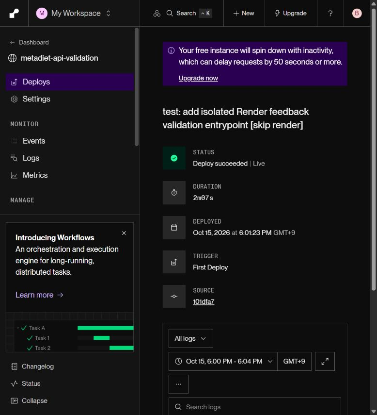
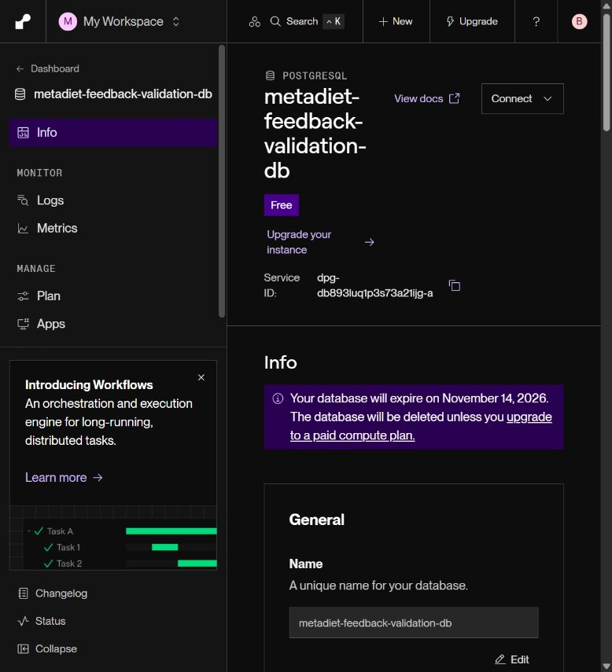
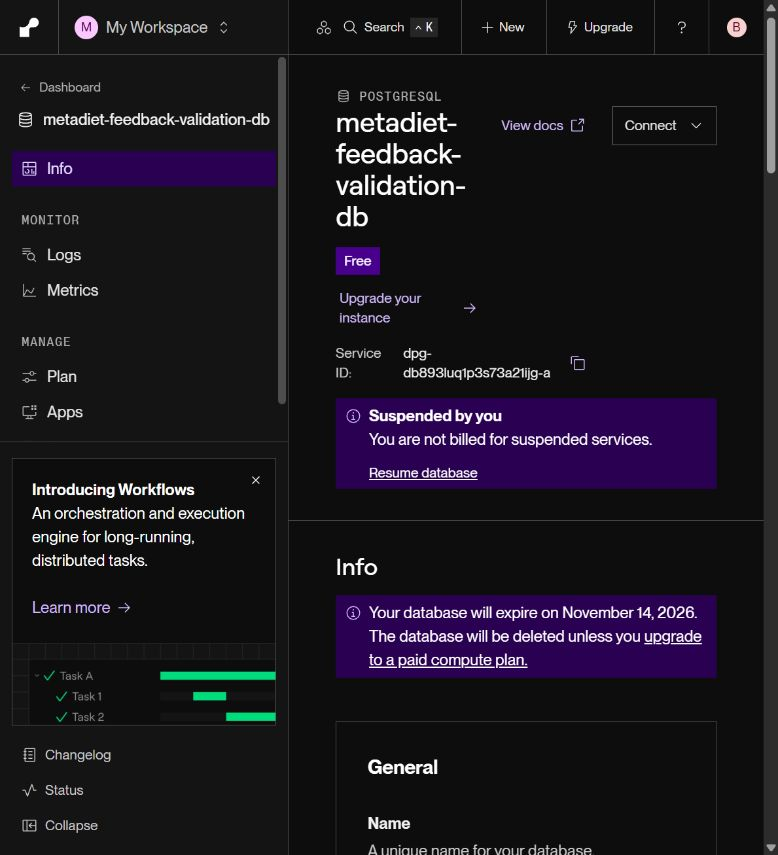
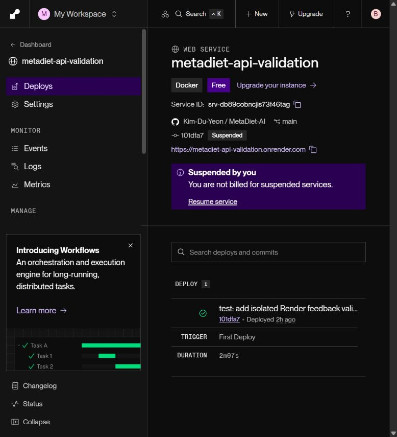

# 무료 Render PostgreSQL 2시간 부하·재시작·직접 복구 검증

2026-10-15 별도 무료 Render 웹 서비스와 PostgreSQL에서 완료했다. 운영 Supabase 데이터·사용자·환경변수는 복사하거나 변경하지 않았다. [원본 720건·재시작·경합](render-free-soak.json), [직접 복구 원본](render-free-restore.json), [동일 사례 비교 요약](render-free-summary.json).

## 환경과 범위

- 웹 `metadiet-api-validation`: 무료 0.1 CPU/512 MB, Singapore, 자동 배포 Off. 배포 커밋 `101dfa74721110a9fdd684fe1f74dbf2eb374d64`.
- DB `metadiet-feedback-validation-db`: 별도 무료 PostgreSQL 17.11/1 GB. 운영 DB와 다른 호스트·DB 이름·run marker를 서버와 검사 도구가 확인한다.
- 합성 피드백 10,000건, 합성 관리자 RSA JWT 3개. 실제 운영 관리자 router·JWT 서명/allowlist 검사·SQL 저장소를 사용했다. 인증 의존성을 우회하지 않았다.
- Supabase Auth 서비스는 실행하지 않았다. fixture의 auth.users 3행은 실제 Supabase 계정이나 로그인·갱신 세션이 아니다. 전체 Agent/RAG/체크포인터도 실행하지 않는 별도 진입점이다.
- 로컬 발생기 → 공개 Render HTTPS → 실제 PostgreSQL 경로다. 로컬 ASGI 수치를 공개 지연으로 바꾸어 쓰지 않았다.
- 검사가 끝난 뒤 새 웹과 DB를 모두 Suspended로 정지했다. 유료 인스턴스·PITR·요금제 변경은 하지 않았다. Free DB의 30일 만료(2026-11-14)는 정지해도 보존 기한을 보장하지 않는다. 무료 시간·빌드·전송량은 workspace 공유 한도다. [Render 무료 문서](https://render.com/docs/free).

## 측정과 결과

측정 시작은 2026-10-15 18:03:47 KST이며 7,200.015초 동안 30초 간격으로 3세션 각각 240회 조회했다. 고정 100개 필터·페이지 사례를 반복하고 독립 Python 계산으로 목록 ID·순서·미처리/장기 미처리 집계·페이지·no-store를 대조했다. 실패와 timeout은 삭제하지 않고 분모에 포함하도록 수집했다. 이번 실제 조회 실패는 0건이다.

| 검증 | 시도/결과 | 중앙값 | p95 |
|---|---:|---:|---:|
| 전체 2시간 HTTPS 조회 | 720/720 통과, 실패 0·미시도 0 | 530.63ms | 753.94ms |
| 재시작 관측 전 동일 100사례 × 3세션 | 300/300 | 520.29ms | 747.64ms |
| 재시작 관측 후 동일 100사례 × 3세션 | 300/300 | 519.19ms | 724.48ms |
| 복원 후 단일 세션 조회 | 100/100 | 282.88ms | 397.01ms |

재시작 전후는 동일 사례를 한 바퀴씩 추출했으며 순서는 회전되어 있다. 최적화 전후 실험이나 무작위 대조가 아니므로 속도 개선율을 주장하지 않는다. 복원 후 조회도 동시성·필터가 달라 앞 표와 속도 비교하지 않는다. raw의 phase planned=360은 반분 예상치이며 실제 관측 경계로 369/351건이 됐다. after_restart의 not_attempted=9는 전체 누락이 아니다. 전체 720건이 모두 실행됐고 비교 표는 각각 완전한 동일 100사례/300건을 사용한다.

## 실제 DB 재시작

검증 DB의 Restart Database를 실행했다. pg_postmaster_start_time은 `2026-10-15T08:43:33.327029+00:00`에서 `2026-10-15T10:04:44.216050+00:00`으로 바뀌었다. 재시작 전에 계속 열어 둔 연결은 `AdminShutdown`으로 실패했고 새 연결의 API 조회는 정상으로 돌아왔다. health는 총 120/120 통과했다.

30초 조회와 60초 health 주기 사이에 재시작되어 HTTP 실패를 포착하지 못했다. **무중단이나 RTO 0초를 의미하지 않는다.** DB 시작 시각과 첫 정상 health 관측 사이 약 3.9초는 표본 관측 간격일 뿐 재시작 명령부터 복구까지의 정확한 RTO가 아니다. 단 1회 재시작이므로 재시작 신뢰도나 SLA를 추정하지 않는다.

재시작 후 세 JWT가 같은 version을 동시에 바꾸는 100라운드/300 PATCH를 실행했다. 매회 `200,409,409`, 성공한 관리자 1명의 version=2 이력 1건을 DB에서 확인했다. 충돌 200건은 기대한 덮어쓰기 방지 동작이며 장애 실패로 세지 않는다. 전체 조회 단계와 쓰기 단계는 분리해 고정 데이터의 집계 비교를 보존했다.

## 직접 백업·손실·복원

[Render 공식 문서](https://render.com/docs/postgresql-backups)는 Free 관리형 백업은 없지만 로컬 pg_dump 직접 백업을 지원한다고 설명한다. 공식 PostgreSQL Windows 안내에서 연결된 EDB 17.11 도구를 사용했다. 외부 DB 연결은 verify-full TLS와 CA 검증, 비밀번호는 자식 프로세스 환경변수로 전달했다. env·RSA 개인키·dump는 git ignored이며 공개하지 않았다.

1. DB 이름과 run marker를 재확인하고 auth/public 합성 데이터의 custom-format 백업을 생성했다. 347,994 bytes, SHA256 `7d50c65b7b8c82117aed5602340859b12008e3a7217aeada681a952cae5fe10f`.
2. 아카이브 목록 검사와 변경 없는 DB fingerprint 확인 후 합성 피드백 1건만 삭제해 손실을 확인했다.
3. 같은 폐기용 DB에 `pg_restore --clean --if-exists --no-owner --no-acl --single-transaction`으로 복구했다. exit 0, **복원 명령 8,318.328ms**. 이는 전체 장애 인지·백업·운영 전환 시간을 포함한 RTO가 아니다. [pg_restore 공식 옵션](https://www.postgresql.org/docs/17/app-pgrestore.html).
4. 합성 auth.users 3행·users 1행·피드백 10,000행·변경 이력 100행·marker 1행의 정렬 데이터 hash와 제약·인덱스·RLS flag hash가 모두 일치했다. 백업 시점 데이터의 관측 누락은 0행이다. 지속 쓰기·백업 후 신규 트랜잭션이 없는 조건이므로 운영 RPO=0을 보장하지 않는다.
5. 복원 후 공개 조회 100/100, 미인증 401, 실제 저장 200·같은 버전 재확정 409·version+1·이력+1을 확인했다. 마지막 기능 검사 쓰기는 합성 데이터이며 hash 일치 확인 뒤 실행했다.

## Supabase 운영 환경과의 차이

| 항목 | 이번 무료 Render 검증 | 운영 Supabase에서 별도로 필요한 검증 |
|---|---|---|
| DB | 별도 PostgreSQL 17.11, 1 GB 합성 fixture | 실제 프로젝트 버전·연결 한도·설정 차이 |
| 인증 | 합성 RSA JWT와 최소 auth.users fixture | Supabase Auth 로그인·refresh·폐기·관리 서비스 복구 |
| 연결 복구 | 관리자 저장소의 요청별 새 연결, 기존 연결 종료 확인 | LangGraph AsyncPostgresSaver pool·장기 트랜잭션 복구 |
| 복구 | 직접 custom dump/restore 1회, auth/public 일부 스키마 | 전체 schema/roles/ACL/extensions/Storage 등 서비스 종속성 |
| 관리형 백업/PITR | 미지원·미검증 | 요금제·백업 생성/보존·PITR 옵션별 검증 |
| 부하 | 3세션/30초, 2시간, 1만 건 | 실제 사용자 분포·최대 동시성·수일 지속·메모리/CPU 추이 |

[Supabase 공식 백업 문서](https://supabase.com/docs/guides/platform/backups)와 같이 논리 복구와 관리형 백업/PITR는 별도다. 이번 결과로 운영 Supabase 전체 재해 복구를 통과했다고 주장하지 않는다. 메모리 누수·포화 처리량·실제 사용자 성과도 측정하지 않았다.

## 실패 원인·조치·회귀

- 독립 Supabase 생성은 Free 활성 프로젝트 2개 제한으로 기존 프로젝트를 사용하지 않고 대안을 선택했다. [준비 당시 상태](validation-readiness.json)는 보존했다.
- Docker engine이 응답하지 않아 PostgreSQL 공식 Windows 안내 → EDB 공식 바이너리로 pg_dump/pg_restore 17.11을 확보했다. Docker가 정상화됐다고 주장하지 않는다.
- 최초 전체 pytest는 `WinError 5`로 공용 임시 디렉터리를 만들지 못했다. [pytest 공식 --basetemp](https://docs.pytest.org/en/stable/how-to/tmp_path.html)에 따라 전용 workspace 임시 경로로 재실행해 통과했다. 테스트 제거/신규 skip 없이 백엔드 **1106 passed, 기존 1 skipped**였다.
- 공개 검사·재시작·dump/restore 자체에서 미해결 오류는 발생하지 않았다. 자동 승인 심사의 자격 정보 전송 차단은 사용자의 검증 전용 값/목적지 명시 승인 후 진행했으며 운영 키와 RSA 개인키는 Render로 전송하지 않았다.
- production main.py·운영 render.yaml·운영 DB schema는 변경하지 않았다. 프론트 변경이 없어 이번 작업에서 프론트 테스트/빌드를 반복하지 않았다.

## 재현 도구

- [별도 Blueprint](../../render.validation.yaml), [가드/집계](../../backend/scripts/render_validation_common.py), [독립 진입점](../../backend/scripts/render_validation_app.py)
- [합성 초기화](../../backend/scripts/prepare_render_validation.py), [2시간 HTTPS runner](../../backend/scripts/run_render_free_soak.py), [직접 복원](../../backend/scripts/restore_render_validation.py)
- [원본 오프라인 분석](../../backend/scripts/analyze_render_free_validation.py): `backend/venv/Scripts/python.exe backend/scripts/analyze_render_free_validation.py`

실제 연결은 전용 git-ignored `backend/.env.render-validation`만 읽는다. 운영 .env를 복사하거나 fallback하지 않는다. 재실행은 새 독립 DB/run ID에서 시작해야 한다. 이력 경합을 수행한 기존 fixture에 초기 version=1 가정을 재사용하지 않는다.

정지 후 [운영 읽기 전용 정상 응답 확인](render-free-cleanup.json)을 따로 기록했다. 검증 자원의 정지는 운영 서비스 설정 변경이 아니다.
