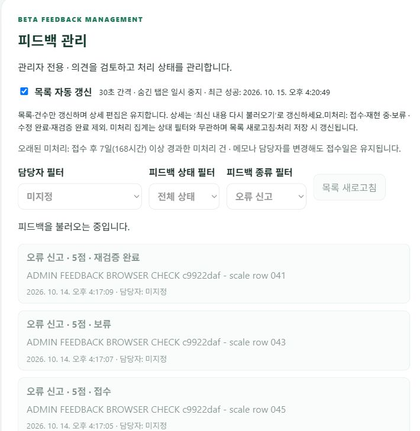

# 관리자 피드백 동시 수정·대량 조회 검증 (2026-10-15)

서비스 결함은 발견되지 않았다. 운영 코드 변경이나 재배포 없이 검증 도구·회귀 테스트·문서를 추가했다. 실제 사용자 성과가 아닌 합성 데이터 검증이다. 검증 대상 공개 API·웹 버전은 `021b115d17c73594dc0902e2e809bf5869ff7986`, 작업 시작 main은 `9f32541`이다.

## 실제 PostgreSQL 조회: 같은 고정 100개 사례

| 격리 데이터 수 | 시도 | 정확성 통과 | 실패·타임아웃 | 중앙값 | p95 |
|---|---:|---:|---:|---:|---:|
| 1,000건 | 100 | 100 | 0 | 138.15ms | 179.34ms |
| 10,000건 | 100 | 100 | 0 | 163.87ms | 216.73ms |

[전체 요청별 결과](scale-final.json). 동일 필터 사례 SHA256: `110877d733da9e147795014a221767960a7d09fc5d96a6f0d15f05b5a921f742`. 상태·종류·담당자·미지정·빈 결과·페이지 이동을 조합하고, 별도 Python 계산값과 5개 집계·정렬된 ID·다음 페이지·오래된 표시·no-store를 비교했다. 모든 조합을 망라한 검사는 아니다. 실패와 타임아웃은 원래 분모에 포함하며 p95는 nearest-rank다.

실제 운영 저장소 코드와 FastAPI 라우터를 사용하되 요청은 로컬 ASGI이며 관리자 의존성을 합성 계정으로 대체했다. 시간에는 원격 DB 새 연결이 포함된다. Render 공개 API 지연이나 SQL만의 시간이 아니다. 동일 코드의 데이터 규모 비교이므로 최적화 전후 성능 개선으로 해석하지 않는다. 순차 측정의 네트워크·시간대 차이도 남는다.

## 동시 수정과 읽기 일관성

두 합성 관리자가 같은 버전의 한 의견을 동시에 변경하는 경합을 100회 실행했다(쓰기 200회). 매회 성공200 하나와 충돌409 하나, 최종 버전2와 성공한 관리자에 해당하는 이력 한 건을 확인했다. 100/100 통과, 실패·타임아웃0이다. 409는 예상된 충돌 방지이며 장애율에 포함할 예기치 않은 실패가 아니다. 실제 PostgreSQL의 서로 다른 연결을 사용했다. 이는 두 작성자의 경합이며 100명의 동시 관리자 부하 검증은 아니다.

목록 SELECT 직후 다른 연결에서 수정한 다음 집계 SELECT를 진행하도록 제어했다. 같은 응답의 목록·집계는 이전 스냅샷을 유지하고 다음 조회에서는 미처리 감소를 반영했다. 오래된 목록과 새 집계가 섞이지 않음을 확인했다.

격리 스키마에 운영 테이블의 인덱스·제약을 복제하고 RLS와 공개 권한 회수를 적용했다. LIKE 복제는 외래 키를 복사하지 않으므로 실제 사용자 FK·JWT 통합 검증으로 간주하지 않는다. 실행 후 무작위 격리 스키마 제거를 확인했다. 실제 의견·섭취 기록은 변경하지 않았다.

## 자동 갱신과 공개 브라우저

React/Jest의 1만 건 모의 API에서 30초 갱신 100회를 진행했다. 20개 행만 렌더링하고 담당자·종류·페이지·미저장 메모가 유지됨을 확인했다. 이는 실제 브라우저나 네트워크 지연의 성능 측정이 아니다.

공개 로그인 관리자 브라우저에서는 별도 임시 계정의 합성 의견 60건을 만들었다. 20건씩 세 페이지에서 60개 고유 행을 확인했다. 상태 필터는 20건, 빈 종류 필터는 0건이며 전체 미처리40·오래된20은 유지됐다. 두 번째 페이지에서 메모를 편집하는 동안 61번째 의견을 추가했다. 수동 갱신 없이 다음 주기에 현재 조건61·미처리41·오래된21로 반영됐고 페이지·필터·메모가 유지됐다.

[공개 권한·저장·정리 결과](scale-public-check.json). 목록·담당자·상세·이력·수정 등 7개 요청의 미로그인401·일반 계정403을 확인했다. 실제 UI의 배정·해제·상태·메모 저장과 이력2건을 검증했다. 공개에서는 관리자 한 계정을 사용했으며 두 실제 관리자 JWT의 동시 브라우저 조작을 검증했다고 주장하지 않는다. 임시 계정·합성 의견61건·이력과 임시 자격 증명 파일을 정리했고 잔여 행·격리 스키마0을 확인했다.



캡처는 자동 조회 진행 중의 목록 장면이며, 수치·편집 보존 판정은 별도 DOM 확인 결과다. 삭제한 합성 의견만 표시한다.

## 실패 원인과 검증 도구 보완

코드 리뷰에서 경합 중 예외가 나면 뒤의 시도와 결과 파일을 잃을 수 있고 정리 DDL의 대기가 제한되지 않는 문제를 발견했다. 실제 서비스 장애가 아닌 검사 도구의 실패 처리 결함이다. 계획된 100회 분모 유지·회차별 오류 보존·30초 제한·gather의 예외 수집과 연결/statement/lock timeout을 추가했다. 정리 실패도 진단 파일에 남기도록 수정하고 최종 전체 검사를 다시 실행했다. 최종 실행 진단은 비어 있고 정리도 성공했다. 모든 인프라 장애에서 정리를 보장한다는 의미는 아니다.

근거: [Python asyncio wait_for·gather](https://docs.python.org/3/library/asyncio-task.html), [PostgreSQL search_path·statement_timeout·lock_timeout](https://www.postgresql.org/docs/current/runtime-config-client.html), [트랜잭션 격리](https://www.postgresql.org/docs/current/transaction-iso.html). 테스트를 삭제하거나 새로 스킵하지 않았다.

## 재현과 회귀

저장소 루트에서 프로젝트 가상환경을 사용한다. DB 자격 증명은 git에서 제외한 환경 파일에만 둔다.

```powershell
backend\venv\Scripts\python.exe backend/scripts/check_feedback_scale.py
backend\venv\Scripts\python.exe -m pytest backend/tests -q
npm.cmd --prefix frontend test -- --runInBand --watchAll=false
npm.cmd --prefix frontend run build
```

최종 백엔드 **1081 passed·기존1 skipped**, 프론트 **26 suites·92 passed**, production build 성공. 도구의 실패 분모 회귀 테스트도 포함한다. 실제 사용자 유입 성과, 10만 건 이상·장시간 부하·여러 실제 관리자 세션, 강제 DB 장애 복구는 이번 검증 범위 밖이다. 현재 결과로 운영 용량 SLA를 보장하지 않는다.
