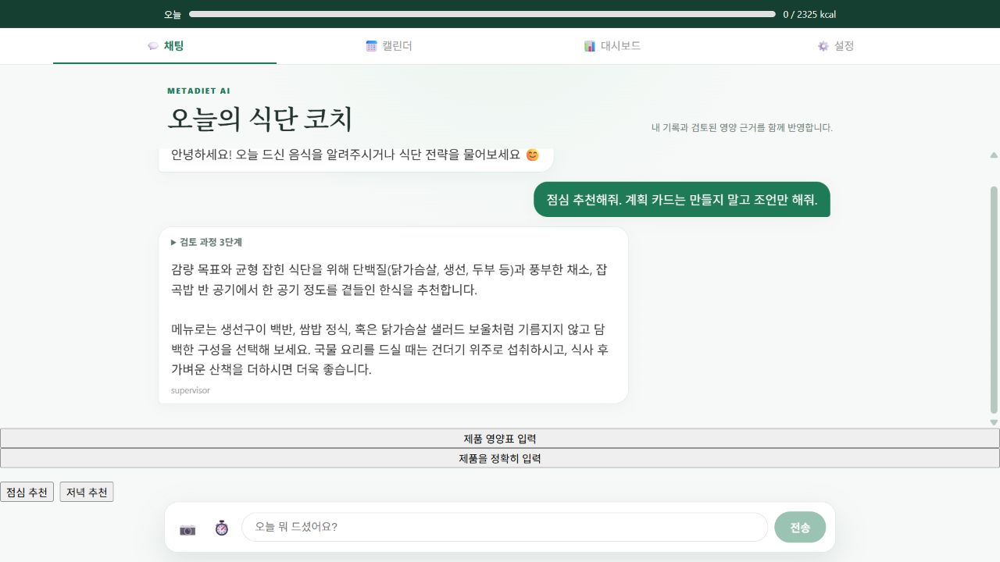
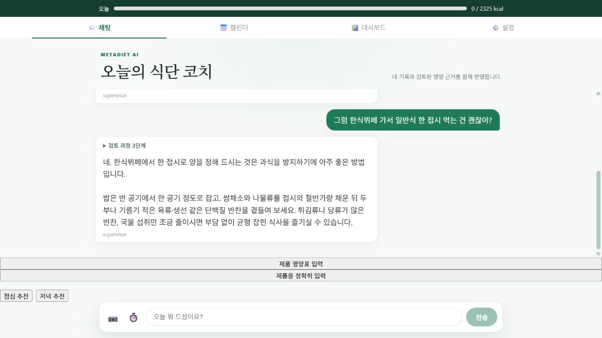
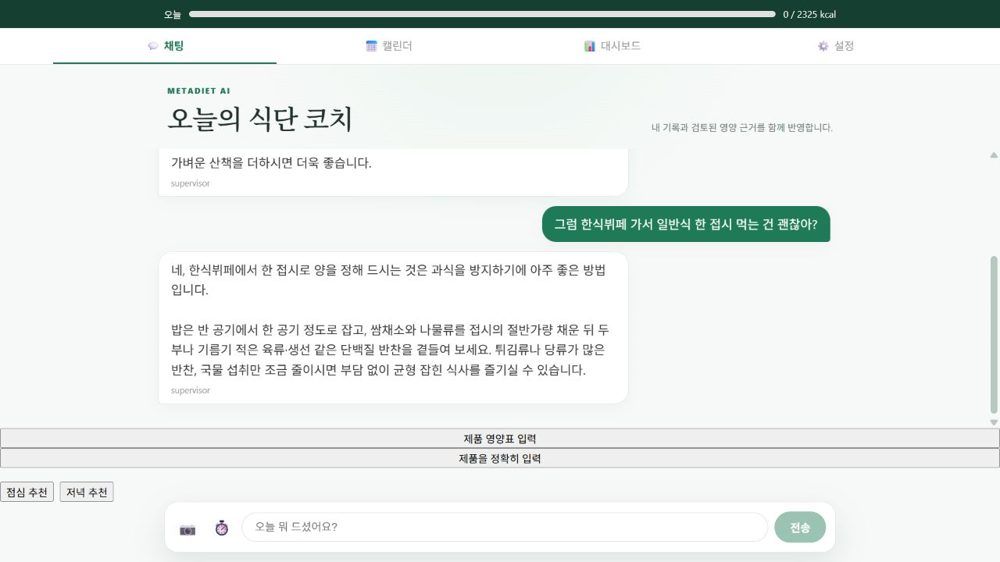

# 표시 지연 제거와 실제 문맥 다중 턴 검증

## 문제와 변경

완성된 답변을 SSE로 전송하면서 단어마다 `asyncio.sleep(0.03)`을 실행했다. 모델이 이미 답변을 완성해도 사용자에게는 늦게 표시됐다. 이를 `sleep(0)`으로 바꿔 이벤트 루프에 제어권은 양보하면서 의도적인 대기를 없앴다. [Python 공식 asyncio 문서](https://docs.python.org/3/library/asyncio-task.html#sleeping).

기존 단어별 프레임, seq 1001부터의 번호, after_seq 재연결 필터, completed 이벤트 번호는 유지했다. 실제 모델 토큰 스트리밍을 새로 구현한 것은 아니다. LangGraph·HITL·확정 저장·요청 단위 컨텍스트 재사용 정책도 유지했다. 요청 간 캐시는 추가하지 않았다.

## 공개 환경 전후 측정

2026-10-13, 변경 전 `cc30a62` → 변경 후 `82231c1`. Render API와 웹의 해당 커밋 Live를 확인했다. 기동 상태의 같은 합성 계정에서 점심→한식뷔페, 저녁→편의점, 아침→밥·계란의 3개 대화를 각각 2회 실행했다. 각 버전 6개 대화·12개 요청, 총 24개 요청이다. 후속 요청은 실제 이전 사용자 발화와 모델 답변을 `messages`로 전달했다. 식사 기록은 측정 동안 0건으로 고정했다.

| 중앙값 | 변경 전 | 변경 후 | 해석 |
|---|---:|---:|---|
| 첫 답변 도착 | 21.20초 | 21.41초 | 약 1.0% 느림; 생성 속도 개선은 입증하지 못함 |
| 전체 완료 | 23.06초 | 21.80초 | 관측상 5.5% 감소 |
| 첫 답변 이후 완료 | 2.00초 | 0.39초 | 관측상 80.4% 감소 |
| 모델 호출 | 2회 | 2회 | 중앙값; 호출 최적화 추가 없음 |
| 논리 도구 호출 | 3회 | 3회 | 중앙값 |

전체 완료 및 첫 답변 이후 시간에는 네트워크와 완료 이벤트의 공개 통계 조회가 포함된다. 모델 출력 길이·라우팅과 외부 부하는 변동한다. 전후를 시간순으로 실행했으며 통계적 유의성·운영 p95·실제 사용자 성과를 주장하지 않는다. 두 버전 모두 12/12 요청에 검증된 컨텍스트 진행 이벤트가 있었다. 이전 독립 요청 평가와 표본을 합치지 않는다.

- [변경 전 원본](BEFORE_MULTITURN.json), [변경 후 원본](AFTER_MULTITURN.json)
- 재현: `backend/venv/Scripts/python.exe backend/scripts/eval/benchmark_multiturn_delivery.py --phase before --repeats 2`, 배포 확인 뒤 `--phase after` 실행. API URL과 기준 커밋은 스크립트에 명시했다. 자격 증명은 git-ignored env 파일에서만 읽는다.

## 표시 대기의 통제 실험

동일한 완성 답변·모델 없음·DB 없음·네트워크 없음, 각 조건 3회. 전후 실제 `_stream` 함수를 실행하고 텍스트 복원과 이벤트 순서를 함께 검사했다.

| 답변 길이(공백 단위) | 변경 전 전송 루프 중앙값 | 변경 후 |
|---|---:|---:|
| 20단어 | 666.205ms | 0.222ms |
| 100단어 | 3,332.275ms | 0.724ms |
| 200단어 | 6,664.409ms | 1.372ms |

이 결과는 로컬 루프의 지연 제거 효과이며 공개 API 응답 시간으로 표현하지 않는다. [원본](CONTROLLED_DELIVERY.json). `backend/`에서 `venv/Scripts/python.exe scripts/eval/evaluate_answer_delivery.py`로 재현한다.

## 최신 기록과 저장 안전성

실제 `DietTeam.execute`에 스크립트 모델과 가짜 DB를 연결한 20개 시나리오×5회, 100개 회귀 실행을 통과했다. 확정·수정·삭제 후 값 변경, 다른 thread, 목표 변경, 날짜 변경, 사용자 분리, DB 조회 실패, 같은 요청의 중복 읽기를 포함한다. 모델에 전달되는 컨텍스트가 최신 DB 값인지 검사한다. 조회 실패를 섭취 0으로 바꾸지 않는다.

`cancelled` 명칭의 합성 사례는 변경 없는 컨텍스트와 미저장만 검사하며 실제 취소 API 검증은 아니다. 100개 실행은 독립된 실제 사용자 평가나 실모델 답변 정확도 평가가 아니다. [JUnit 증거](MULTITURN_MATRIX.xml), [테스트](../../backend/tests/unit/test_multiturn_freshness_matrix.py).

공개 API에서는 별도 합성 계정으로 취소 시 미저장, 확정 전 분량 수정 시 미저장, 중복 확정 1건, 오래된 0kcal 대화 문맥보다 수정·확정한 최신 섭취량 우선, 삭제 후 복원 상태 0을 검증한다. [공개 검증 보고서](FRESHNESS_PUBLIC.json). 날짜·목표 변경·DB 장애는 공개 환경에서 인위적으로 주입하지 않았다.

## 실제 화면

변경 전 점심 추천 완료:

변경 후 실제 문맥의 한식뷔페 후속 답변:

새로고침 후 대화 복원:

화면은 합성 계정의 기능 증거다. 서로 다른 질문의 정지 캡처만으로 속도 개선을 증명하지 않는다. 속도는 위 SSE 타임스탬프와 동일 답변 통제 실험을 근거로 한다.

## 실패 재현과 검증 보완

표시 지연 회귀 테스트는 기존 코드에서 양수 sleep 값 0.03 때문에 실패했고 수정 후 통과했다. 공식 asyncio 문서의 sleep(0) 동작을 확인해 협력적 제어권 양보를 유지했다. 코드 검토에서는 공개 평가가 답변 속 임의의 숫자를 최신 섭취량으로 잘못 인정할 수 있음을 발견했다. `오늘 확정 섭취: N kcal`에 명시적으로 연결된 수치를 검증하도록 강화했다. 실패 후 시험 기록이 남아 재시도를 방해하지 않도록 finally 정리를 추가했다.

전체 백엔드 **680 passed, 기존 1 skipped**, 프론트 **72 passed / 22 suites**, production build 통과. 기존 skip을 새로 추가하거나 테스트를 제거하지 않았다. 별도 lint/type-check npm script는 없다. SSE 순서·재연결 회귀도 통과했다.

## 남은 한계와 다음 실험

첫 답변까지 약 21초는 그대로다. 다음 단계는 LangSmith span으로 모델 생성·위임·체크포인트·조회 시간을 나눠 측정하고, 실제 provider 스트리밍과 짧은 코칭 경로를 각각 독립 실험한다. 동일 문맥·최신 기록 반영·오답률을 함께 비교해야 한다. 요청 간 캐시는 기록 변경 시 무효화, 사용자·서비스 날짜 분리, 조회 실패 처리를 검증한 뒤에만 검토한다. 체크포인트의 대화 기억이 최신 DB 읽기를 대신한다고 가정하지 않는다. [LangGraph persistence 공식 문서](https://docs.langchain.com/oss/python/langgraph/persistence).

포트폴리오 요약: **“답변 생성과 표시 지연을 분리 측정했다. 단어별 인위적 지연 제거 후 공개 다중 턴 24개 요청의 표시 완료 구간 중앙값이 2.00→0.39초로 줄었다. 첫 답변 시간은 개선되지 않았음을 함께 공개했고, 100개 컨텍스트 회귀와 공개 확정·수정·취소·중복 검증으로 최신 기록 반영을 확인했다.”**
