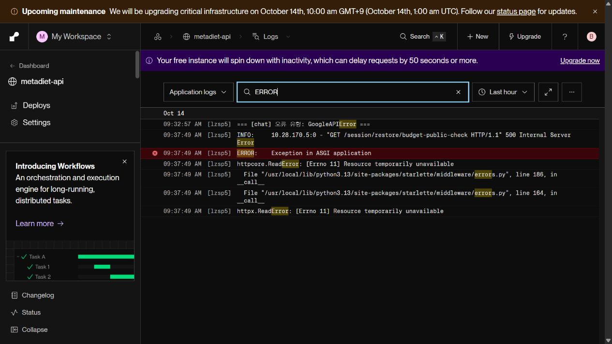
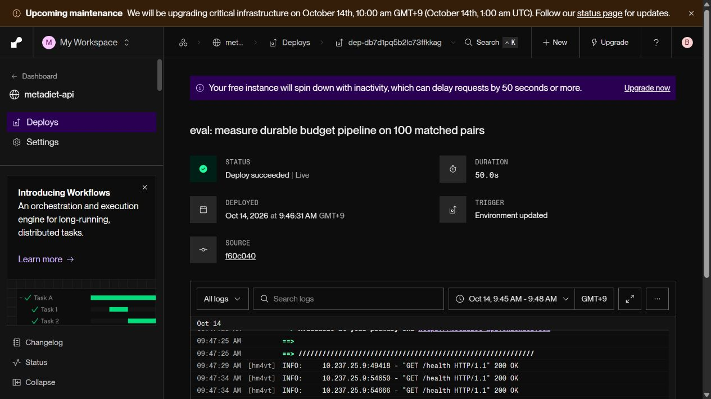
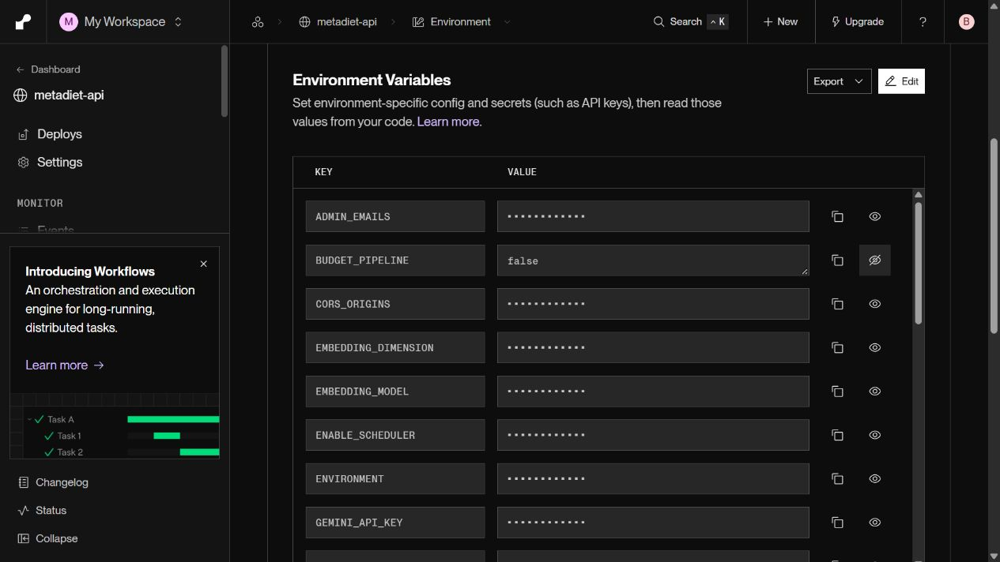

# 공개 API 예산 저장 최적화: 조건별 100건 비교

2026-10-14. **Render 공개 API에 같은 코드·다른 설정을 배포해 기존 100건과 pipeline 100건을 비교했다.** 로컬 성능을 공개 성능으로 대신 제시하지 않는다.

## 결과와 적용 판단

| 지표 | 기존 방식 | pipeline 후보 |
|---|---:|---:|
| 실제 채팅 요청 수 | 100 | 100 |
| 정상 완료 | 99/100 | 100/100 |
| 예산 저장 중앙값 | 2,497.04ms (n=99) | 1,800.26ms (n=100) |
| 예산 저장 p95 | 2,538.04ms (n=99) | 1,826.16ms (n=100) |
| 정상 응답 완료 중앙값 | 8,235.73ms | 7,806.99ms |
| 정상 응답 완료 p95 | 10,987.28ms | 10,758.95ms |
| 실패 포함 전체 시도 시간 중앙값 | 8,239.50ms (n=100) | 7,806.99ms (n=100) |
| 첫 답변 표시 중앙값 | 8,164.90ms | 7,736.05ms |
| 최신 섭취·목표 열량 반영 | 99/100 (완료 답변 99/99) | 100/100 |
| 식사·목표 행 미변경 | 100/100 | 100/100 |
| 예상치 않은 proposal | 0 | 0 |
| 완료 요청의 모델 호출 중앙값 | 1회 | 1회 |
| 자동 품질 5항목 각각 통과 | 99/100 | 100/100 |
| 품질 judge 실행 완료 | 100/100 | 100/100 |

**저장 중앙값은 27.9%, 정상 응답 완료 중앙값은 5.2% 감소했다.** 그러나 최초 기존 조건에서 Gemini 504가 1건 발생해 양쪽 모두 100건의 정상 응답·계측·최신값 반영을 요구한 사전 완전성 기준에 미달했다. 실패 표본을 제거하거나 사후 기준을 완화하지 않으며, 이번 1차 비교만으로 영구 활성화하지 않는다. 후보에서 문제가 발생했다거나 pipeline이 Gemini 오류를 고쳤다는 결론도 내리지 않는다.

수치는 [before.json](before.json) / [after.json](after.json)에 보존했다. 정상 응답 지연은 기존 n=99, 후보 n=100이며 실패 포함 시간은 양쪽 n=100이다. 첫 표시는 검증 완료 답변의 전달 시점이며 모델의 첫 토큰 시간이 아니다. 작은 분할 구간의 중앙값을 더해 전체 중앙값을 재구성하지 않는다.

[자동 판정 summary.json](summary.json)의 속도·품질 비악화 게이트는 통과했지만 완전성 게이트는 실패했다(`adopt=false`). [기존 품질](before_quality.json)과 [후보 품질](after_quality.json)은 같은 `gemini-3.1-pro-preview`로 관련성·실행 가능성·섭취 사실 비조작·허위 저장 주장 없음·간결성을 평가했다. 답변이 없는 실패 1건은 다섯 항목 모두 실패로 유지했다. 후보의 100/100이 임상 정확도 100%라는 의미는 아니다.

저장 세부 중앙값은 기존 pool checkout 355ms, setup 709ms, SQL 1,071ms, commit 359ms였다. 후보는 checkout 357ms, setup enqueue 361ms, SQL enqueue/조회 363ms, sync 포함 commit 717ms였다. 동기화 위치가 바뀌므로 부분 구간의 감소 자체를 개선으로 세지 않는다. 모델 단계 중앙값은 오히려 **2,561→2,728ms**였고 모델 호출 수는 1회로 같았다. 이번 변화는 모델 생성 최적화가 아니라 저장 왕복 감소의 신호다.

## 비교 조건

- 공개 경로: `https://metadiet-api.onrender.com/chat`, SSE protocol 2.
- 동일 배포 커밋 `f60c040bb1a973db4e8ecc18196ecf52920d73c8`; 차이는 `BUDGET_PIPELINE=false/default`와 `true`뿐이다. 프롬프트·모델·timeout·재시도·DB 스키마를 중간에 바꾸지 않았다.
- 네 가지 후속 코칭 질문 × 다섯 DB 상태 × 다섯 반복. 기존/후보의 질문·현재 수치·순서가 일치한다. 100명의 사용자나 100개 독립 질문은 아니다.
- 별도 합성 계정만 사용했다. 측정 전 DB의 확정·수정·삭제 상태, 목표 변경, 전날 기록만 있는 상태를 준비하고 공개 session restore로 확인했다. 상태 준비는 측정 시간 밖이며 실제 UI 편집 흐름을 100회 시험한 것은 아니다.
- 모든 요청에 과거 섭취 300kcal/목표 2200kcal라는 낡은 대화를 넣고, 답변이 현재 DB 수치를 우선하는지 검사했다. 실시간 날짜 경과가 아닌 전날 기록 필터링 시험이다.
- 후보 배포 후 [별도 준비 요청](after_probe.json)으로 pipeline 계측을 확인했다. 이 요청은 100건에 포함하지 않았다.
- 채택 기준은 [사전 프로토콜](WORK_LOG.md)에 기록했다: 저장 중앙값 ≥20% 감소, 전체 중앙값 ≥5% 감소, p95 악화 ≤10%, 완전한 100건 증거, 최신값·미저장·자동 품질 비악화.

## 오류 원인과 재검증

1. **Gemini 504:** 기존 47번째 요청이 34.44초 후 실패했다. Render 로그의 `GoogleAPIError`와 [LangSmith 오류 코드 근거](failure_trace.json)에서 `504 DEADLINE_EXCEEDED`를 확인했다. 같은 질문·같은 상태의 후속 반복은 정상 완료됐지만 최초 실패는 그대로 남겼다. 공급자 내부의 지연 원인까지 확인된 것은 아니다.
2. **상태 복원 일시 오류:** 사전 확인에서 통계 필드 누락, 이어 HTTP 500이 발생했다. 로그는 `httpx.ReadError: [Errno 11] Resource temporarily unavailable`였다. 읽기 전용 사전 확인에만 최대 3회 제한 재시도를 적용하고, 누락을 0으로 간주하지 않도록 검증했다. 실제 채팅 실패를 숨기는 재시도는 추가하지 않았다.
3. **평가 도구:** 오류 응답의 누락 build를 버전 변경으로 잘못 판정해 중단하던 처리를 보완했다. `--resume`은 실패를 포함한 기존 행을 유지하고 나머지 순서만 이어간다. 별도 파일의 계정과 로그인 신원이 일치해야 DB 준비·정리를 허용한다. judge 모델·원본 SHA256·유효 시간 표본 수를 검증한다.

[Google 재시도 지침](https://ai.google.dev/gemini-api/docs/troubleshooting), [504 설명](https://ai.google.dev/gemini-api/docs/api-errors), [HTTPX ReadError](https://www.python-httpx.org/exceptions/), [읽기 오류 재시도 범위](https://www.python-httpx.org/advanced/transports/)를 확인하고 위 조치를 적용했다. 서비스의 읽기 오류와 모델 시간 초과가 영구 해결됐다고 주장하지 않는다.



## 배포 증거

같은 코드에서 설정만 변경한 후보 배포가 Live가 된 뒤 응답의 pipeline timing을 검증했다.



측정 후 `BUDGET_PIPELINE=false`로 복원한 배포가 Live가 됐으며, [별도 복원 검증](before_probe.json)에서 기존 계측 경로·최신값·미저장을 확인했다. 합성 계정과 테스트 자격증명도 [정리 완료](cleanup.json)했다.



## 한계와 재현

- 순차 전후 비교여서 시간대·공급자 부하 차이가 남는다. 교차 무작위 공개 트래픽 실험은 아니다.
- 따뜻한 단일 사용자 순차 호출이다. 휴면 복구, 동시 사용자, 실제 사용자 평균/p95를 보장하지 않는다.
- 자동 품질 judge는 같은 제공자 계열 한 모델이다. 인간 검토나 임상 정확성 인증이 아니다.
- [Render 점검 공지](https://status.render.com/incidents/bwd9ycdxqps4)는 10:00–11:00 KST 관리 화면/API 제한을 예고했다. 공지는 배포된 서비스·DB 무중단이라고 명시하며, 이를 이번 오류 원인으로 단정하지 않는다.
- 다음 검증은 외부 읽기/모델 실패의 재시도·관측 보완 후 사전 기준을 고정한 새 조건별 100건 비교다. 이번 실패 원본을 덮어쓰지 않는다.

```powershell
backend\venv\Scripts\python.exe backend/scripts/eval/budget_public100.py setup
backend\venv\Scripts\python.exe backend/scripts/eval/budget_public100.py before
# Same code deployment, BUDGET_PIPELINE=true. Verify mode with --probe.
backend\venv\Scripts\python.exe backend/scripts/eval/budget_public100.py after
backend\venv\Scripts\python.exe backend/scripts/eval/quality100.py before --folder docs/budget_public
backend\venv\Scripts\python.exe backend/scripts/eval/quality100.py after --folder docs/budget_public
backend\venv\Scripts\python.exe backend/scripts/eval/summarize_budget_public100.py
backend\venv\Scripts\python.exe backend/scripts/eval/budget_public100.py cleanup
```

기존 증거 덮어쓰기를 금지하므로 재실험은 새 출력 폴더/버전으로 분리해야 한다. 자격증명은 git-ignored env에만 저장한다. [전체 작업 기록](WORK_LOG.md).

전체 백엔드 회귀 **977 passed, 기존 1 skipped**. 테스트를 제거하거나 새로 건너뛰지 않았다. 이번에는 프론트 코드·의존성을 변경하지 않아 프론트 빌드를 재실행하지 않았다.
