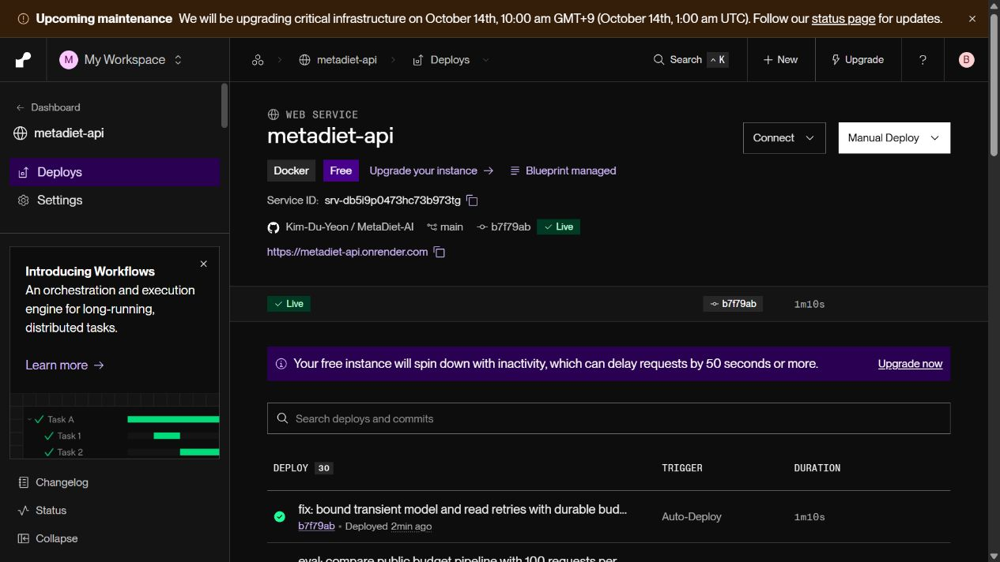
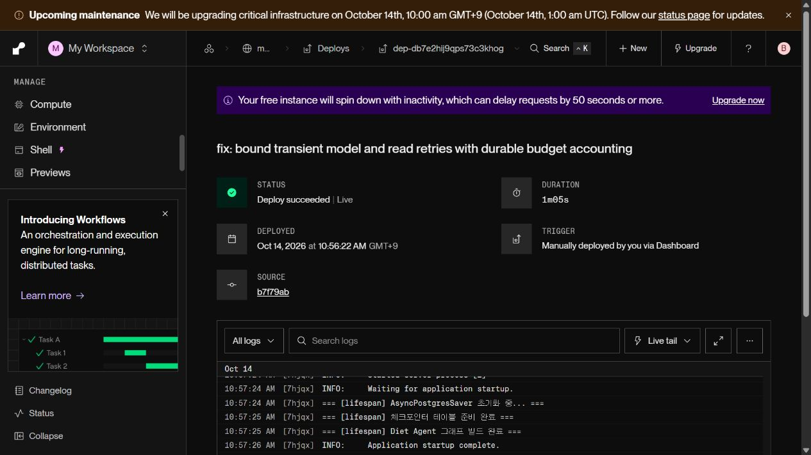
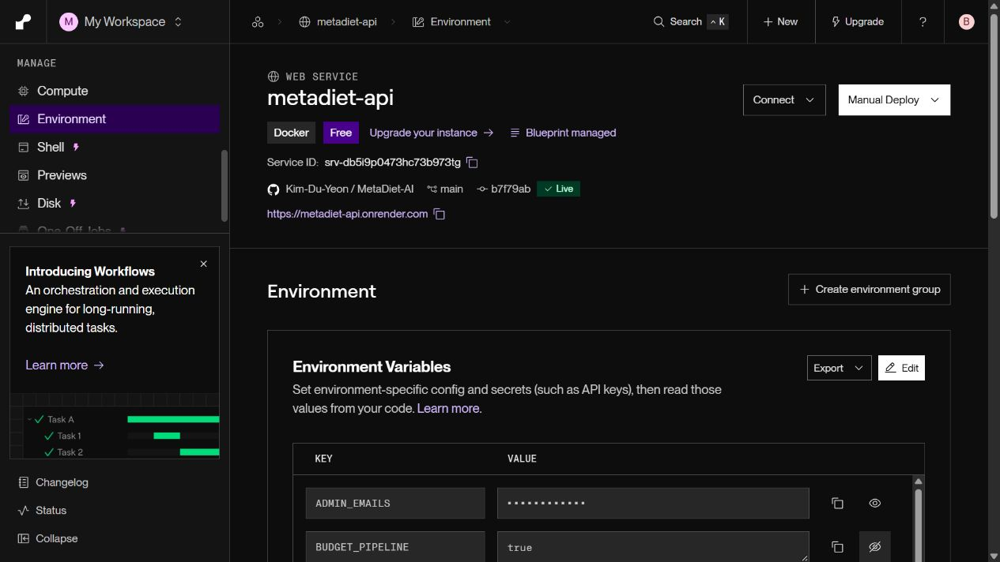

# 공개 100건 재검증: 오류 복구 보완과 예산 pipeline 채택

2026-10-14. **동일 공개 커밋에서 전후100건씩 측정하고 품질·최신값·미저장 검증을 통과해 Render `BUDGET_PIPELINE=true`를 유지했다.** 이전 실패 원본은 [1차 평가](../budget_public/README.md)에 그대로 보존한다.

## 결과

| 지표 | 기존 false | pipeline true |
|---|---:|---:|
| 공개 시도/완료 | 100/100 | 100/100 |
| 최종 실패·timeout·blocked | 0 | 0 |
| 예산 저장 중앙값 | 2499.69ms | 1761.55ms |
| 예산 저장 p95 | 2521.30ms | 1782.42ms |
| 전체 시도 시간 중앙값 | 8378.44ms | 7641.84ms |
| 전체 시도 시간 p95 | 10017.56ms | 10360.24ms |
| 첫 답변 표시 중앙값 | 8305.94ms | 7570.80ms |
| 최장 응답 | 11419.55ms | 22153.53ms |
| 최신 섭취·목표 반영 | 100/100 | 100/100 |
| 식사·전략 행 미변경 | 100/100 | 100/100 |
| 예상치 않은 proposal | 0 | 0 |
| 모델 호출 중앙값 | 1 | 1 |
| 자동 품질 5항목 각각 | 100/100 | 100/100 |

**저장 중앙값29.5%, 전체 중앙값8.8% 감소**. p95는3.4% 증가했으며 개선됐다고 표현하지 않는다. 사전 허용 범위(10% 이내)를 통과했다. 최장 응답은 악화됐다. 후보70번째의22.15초 중 모델 생성17.14초, 예산 저장1.765초였다. 모델 생성 중앙값은2.598→2.574초로 비슷하다. 이번 채택은 모델 생성 속도 개선 주장이 아니라 저장 왕복 감소와 전체 중앙값 개선에 근거한다.

실패를 버리거나 성공할 때까지100개를 채우지 않았다. 양쪽 각100번의 원본을 사용했고 이번 서비스 표본에서는 최종 실패가0이었다. 따라서 완료 지연과 실패 포함 전체 시도 지연이 같다. 첫 표시는 검증된 답변의 전달 시점이지 모델 첫 토큰 시간이 아니다.

## 오류 처리와 검증

이전 실제 로그의 `504 DEADLINE_EXCEEDED`와 `httpx.ReadError`를 바탕으로 모델 생성·읽기 전용 조회에 최대1회 재시도(1초+jitter)를 추가했다. 모델 재시도는 durable model budget도 예약하고 기존 전체 실행 deadline을 유지한다. 취소·입력 오류는 재시도하지 않으며 도구·제안·확정·쓰기 전체를 다시 실행하지 않는다. 실패가 지속되면 안전한 오류 유형·재시도 여부·단계 시간을 실패 SSE에도 보존한다.

주입 회귀 테스트는504/ReadError 복구, 지속 실패2회 상한, 입력 오류·취소 무재시도, 예산 거부, 전체 deadline, 실패 스트림 진단 보존을 검증했다. 공개200건의 외부 오류 이벤트는0이었다. **자연 발생 장애 복구 효과나 장애율 감소를 입증한 것은 아니다.** Auth/RAG 등 모든 외부 경로에 재시도를 추가한 것도 아니다.

평가 judge의 기존 답변 평가에서504 두 배치(10개)가 실패했다. 최초90/100 결과를 [원본](before_quality.json)에 보존하고 [별도 보완](before_quality_retry.json)으로 같은 모델의 누락10개만 평가해100개를 확보했다. 완료된 낮은 점수는 재평가하지 않았다. 후보 judge는 최초100/100 완료. 집계는 원본 해시·모델·실패 인덱스를 대조하며 최초 결과와 보완 결과를 각각 남긴다. 서비스200건의 시간/성공률 분모는 바뀌지 않았다.

첫 후보 준비 요청은 실행 계측이 기존 경로라 `Mode mismatch`로 중단됐다. 환경변수 UI에false가 남아 있음을 확인하고true 표시를 검증한 뒤 저장·재배포했다. [잘못된 준비 요청](after_probe_wrong_mode.json)과 [올바른 준비 요청](after_probe.json)을 모두 보존하며 정식100건에서 제외했다.

- [Google 오류·재시도 지침](https://ai.google.dev/gemini-api/docs/troubleshooting)
- [HTTPX 재시도 범위](https://www.python-httpx.org/advanced/transports/)
- [Render 환경변수 저장·배포](https://render.com/docs/configure-environment-variables)
- [상세 작업·실패 기록](WORK_LOG.md)

## 평가 조건과 증거

커밋`b7f79abf86def6453843349b3b2267e88f68b463` 동일, 오류 처리·모델·추론·프롬프트 동일, 저장flag만 변경했다. 네 질문×다섯 실제 DB 상태×다섯 반복. 오래된 대화300/2200kcal보다 현재 식사·목표를 우선하는지 검사했다. 확정·수정·삭제·목표 변경·전날 기록만 있는 경우를 포함한다. 상태 준비/확인은 측정 밖이고 UI편집이나 자정 경과 시험이 아니다. 별도 합성 계정만 사용하고 [삭제 완료](cleanup.json)했다.

- [사전 기준](PROTOCOL.md), [자동 판정: adopt=true](summary.json)
- [기존100 원본](before.json), [후보100 원본](after.json)
- [기존 품질 최초](before_quality.json), [누락 보완](before_quality_retry.json), [후보 품질](after_quality.json)
- 최종 회귀 **988 passed, 기존1 skipped**, 3개 deprecation warning. 테스트 삭제/새 skip 없음. 프론트 코드·의존성 변경이 없어 프론트 테스트/빌드는 이번에 재실행하지 않았다.

```powershell
backend\venv\Scripts\python.exe backend/scripts/eval/summarize_budget_public100.py --folder docs/budget_public_v2 --complete-missing-judges
```

신규 실험은 새 폴더를 사용하고 `budget_public100.py --folder ... --expected-commit ...`으로 버전을 고정한다. 기존 증거는 덮어쓰지 않는다. 원본과 보완 judge 파일을 함께 보관한다.

## 배포와 남은 한계

Render에서true를 유지하고 `render.yaml`에도 명시했다. 로컬 코드 기본값false는 유지하므로 되돌릴 때 Render 환경변수와 Blueprint 값을false로 맞춘 후 재배포한다.





순차 시간대·공급자 부하 차이, 한 합성 계정의20조건 반복, 동일 제공자 자동judge의 한계가 있다. 실제 사용자 평균/p95나 임상 정확도100%가 아니다. 휴면 기동/동시 부하/장시간 안정성은 이번 평가 대상이 아니다. 모델 지연은 여전히 길어질 수 있고 외부 장애가 영구 해결된 것은 아니다. 예산 저장 pipeline의 취소·롤백·동시성 검증은 [이전 별도 실험](../budget_pipeline/README.md)을 참고한다.
