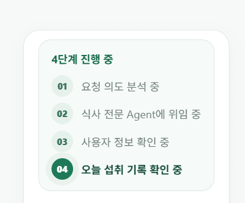
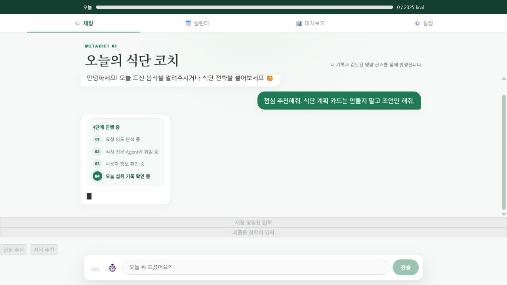
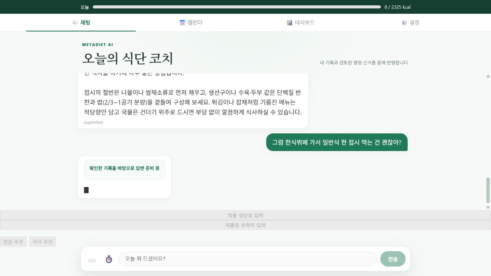
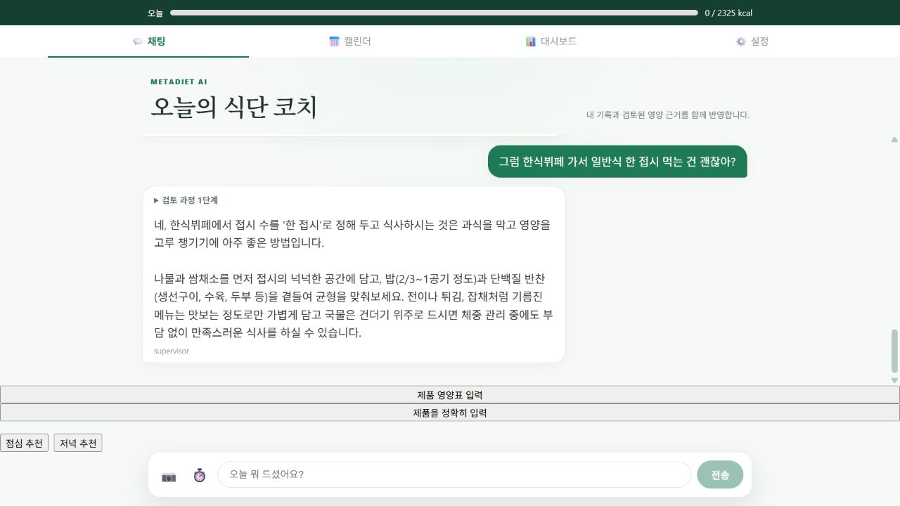

# 후속 식단 코칭 성능 개선 실험

## 문제와 구현 범위

점심 추천 뒤 한식뷔페 후속 질문에도 프로필·섭취 확인과 긴 목표 표가 반복됐다. 공개 서비스는 `DietTeam` 도구 기반 그래프를 사용한다. `build_legacy_graph`의 load_state/strategy 중복 조회는 별도 legacy 경로이며 이번 성능 원인으로 혼동하지 않는다.

Ruling: 이번 단계는 요청 단위 성공 조회 재사용과 코칭 컨텍스트 선조회만 적용한다. 요청 간 캐시는 도입하지 않는다. 매 새 요청이 DB를 확인하므로 다른 탭의 식사 변경·목표 변경에 오래된 값을 쓰지 않는다. 장기 캐시는 부하 측정 후 변경 버전·TTL·무효화 설계를 별도 검증한다.

- 요청 안에서 profile/intake 반복 조회는 성공 결과만 재사용.
- intake는 날짜가 바뀌면 요청 안에서도 다시 조회.
- 점심 추천과 대화 맥락이 있는 후속 식단 질문에는 Supervisor 실행 전에 필요한 최신 정보를 읽어 직접 응답과 전문 Agent 양쪽에 전달.
- 권한 정책과 실행 예산을 적용하며 record_only 경로에는 선조회하지 않음.
- DB 조회 실패를 0kcal로 바꾸지 않고 도구 재확인/보류 경로 유지.
- 후속 코칭 답변은 2~4문장으로 유도하며 목표/섭취 표 반복을 줄임.
- 확인한 정보를 재사용하며 답변을 준비하는 동안 한 줄 진행 표시. 근거 검색 등 새 작업은 실제 진행 단계 표시 유지.
- 저장·확정·중복 방지·JWT 소유권 흐름 변경 없음.

## 검증과 측정

백엔드 전체 578 passed, 1 기존 skipped. 프론트 72 passed / 22 suites, 프로덕션 빌드 성공.
통제 실험은 반복 profile/intake 조회 6→3 DB 쿼리, scripted 모델의 코칭 경로 3→2 호출을 확인했다. 일반 요청의 필수 DB 조회는 3→3이고 도구 예산도 3→3이다. 모델 선조회 선택 왕복을 줄인 것이며 모든 호출이 감소한다고 주장하지 않는다.
[통제 결과](CONTROLLED.json), [개선 전 공개 실험](BEFORE_LIVE.json). 공개 전후 측정은 messages를 생략한 동일 독립 요청 2개×3회이며 소수 합성 표본으로 p95나 실제 사용자 성공률을 일반화하지 않는다. 첫 진행 이벤트와 첫 답변 도착은 구분한다. 현재 SSE는 완성 응답을 단어 단위로 표시하므로 전체 완료 시간에는 표시 시간이 포함된다.

## 실패·해결 기록

TDD에서 중복 조회/선조회 부재를 먼저 확인했다. 구현 후 선조회 예외가 전문 Agent 위임을 실패시켜 기존 근거 검증을 건너뛰는 회귀가 2건 발생했다. 예외는 인증정보/DB 오류 원문 없이 unavailable 상태로 전환하고 기존 도구 재확인으로 진행시켰다. 실행 예산 한도/취소 예외는 그대로 전파한다. 기존 근거 테스트를 삭제하거나 스킵하지 않고 전체 재검증했다.
[Python timeout과 cancellation 공식 문서](https://docs.python.org/3/library/asyncio-task.html), [LangGraph persistence 공식 문서](https://docs.langchain.com/oss/python/langgraph/persistence).

## 캡처

개선 전은 사용자가 제공한 실제 진행 화면이며 성능 측정 계정의 화면으로 혼동하지 않는다.

실제 사용자 피드백은 아직 없다. 아래 결과는 합성 요청 측정이다.

배포 검증 중 새 컨텍스트 이벤트가 없는 이전 API 응답이 관측되어 `new_coaching_context_not_observed`로 개선 후 측정을 중단했다. Render는 새 인스턴스 startup complete와 /health 200을 반복 기록했지만 약 10분 동안 Live 전환이 지연됐다. 앱 예외 원인은 확인되지 않았으며 플랫폼 전환 지연은 추정으로만 분류한다. 대기 배포를 취소하고 같은 커밋 재배포를 1회 시도한다. [Render 헬스체크 조건](https://render.com/docs/health-checks), [배포 문제 해결](https://render.com/docs/troubleshooting-deploys). 이전 API 결과를 개선 후 성능으로 기록하지 않는 검증 가드를 추가했다.

재배포 `b3bd966`은 약 1분 만에 Live로 전환되어 초기 전환 지연이 코드 오류로 입증되지는 않았다. 이후 공개 후속 질문에서 Supervisor가 직접 답하면 전문 Agent 선조회를 우회하는 경로를 발견했다. 동일 guard 실패를 단순 재시도하지 않고 direct-supervisor 재현 테스트를 추가해 실패를 확인한 뒤 선조회 위치를 Supervisor 앞으로 이동했다(`5241eb7`). 직접 답하든 위임하든 fresh_current_request를 공급한다. 진행 이벤트도 verified context가 있는 모델 실행에만 간소화한다. 전체 578 passed, 1 기존 skipped로 재검증했다.

LangSmith SDK로 개선 전 대표 요청 2개의 trace를 조회해 각각 LLM span 3개, error span 0개를 확인했다. [Trace 검증](BEFORE_TRACES.json). 인증정보와 일반 사용자 데이터는 포함하지 않았다.

측정 계약 점검: API는 이전 대화 `messages`를 클라이언트에서 받는다. 첫 측정 스크립트는 messages 없이 같은 thread_id만 보내 후속 질문 분기가 실행될 것으로 잘못 가정했다. 동일 가드 실패를 반복하지 않고 단일 요청 이벤트를 저장하고 production _initial_state/save_chat 경로를 확인했다. 이후 비교를 독립 고정 요청으로 명시하고 선조회가 필요한 첫 요청에만 가드를 적용한다. 문맥 없는 뷔페 질문은 통제 비교군이며, 실제 후속 흐름은 messages를 보내는 공개 브라우저로 별도 검증했다. 전후 API 숫자를 다중 턴 속도 개선율이라고 주장하지 않는다. LangSmith 입력/출력은 운영 개인정보 보호로 숨겨져 있어 모델 컨텍스트를 raw trace로 확인하려는 검증 대신 공개 응답과 진행 이벤트를 검증한다.

## 개선 후 공개 화면

공개 API 배포 커밋은 5241eb7이며 웹의 한 줄 표시 코드는 b3bd966에서 반영됐다. 요청 간 캐시는 아직 사용하지 않는다. 다음 단계는 SSE의 인위적 단어 표시 지연(0.03초/단어) 제거 여부를 별도 실험하고, 더 큰 고정 평가셋에서 성능·안전성을 검증하는 것이다.

## 공개 전후 측정 결과

동일 독립 요청 2종×3회(각 버전 6회), 기동 상태 합성 계정 기준이다. 동일 thread_id만 사용했고 messages를 생략했으므로 다중 턴 성능 개선율은 아니다. 실제 대화 문맥 흐름은 위 공개 브라우저 캡처로 별도 확인했다. 운영 배포 버전은 baseline b25d0b7 → after 5241eb7이다.

| 지표 | 개선 전 | 개선 후 |
|---|---:|---:|
| 첫 답변 도착 중앙값 | 30.46초 | 22.96초 |
| 전체 완료 중앙값 | 38.06초 | 25.16초 |
| 답변 길이 중앙값 | 919자 | 214자 |
| 명시적 점심 코칭 모델 호출 중앙값 | 3회 | 2회 |
| 문맥 없는 뷔페 질문 모델 호출 중앙값 | 3회 | 3회 |

표본 내 첫 답변 24.6%, 전체 완료 33.9%, 답변 길이 76.7% 감소. 소수 표본이며 p95·실사용 성공률로 일반화하지 않는다. 두 요청 종류를 합한 중앙값이다. 전체 완료에는 기존 SSE 단어 표시 시간이 포함되고, 짧은 답변 자체가 그 시간도 줄인다. 별도의 LLM 생성 속도 향상이라고 주장하지 않는다.

[개선 전 원본](BEFORE_LIVE.json) · [개선 후 원본](AFTER_LIVE.json) · [개선 후 LangSmith 호출 검증](AFTER_TRACES.json). 대표 첫 요청은 LangSmith LLM span 3→2, 오류 span 0개. 입력·출력 숨김은 유지했다.

재현: 합성 계정을 ignored backend/.env.selection-browser에 준비하고 `backend/venv/Scripts/python.exe backend/scripts/eval/benchmark_coaching.py --phase after --repeats 3 --independent-queries`를 실행한다. 통제 DB/모델 호출 비교는 backend에서 `venv/Scripts/python.exe scripts/eval/evaluate_coaching_context.py`.

## 최신 기록 반영 공개 검증

식사 제안 생성 전후에 섭취 기록 0건을 확인하고, 확인 버튼 API로 밥 기록 1건을 확정했다. 다른 thread에서 오늘 확정 열량을 물었을 때 공개 API 집계와 모델 답변 모두 새 열량을 반영했고 verified coaching progress가 나타났다. [최신성 검증 보고서](FRESHNESS_PUBLIC.json). 기록 수정·목표 변경·날짜 경계·사용자 분리는 회귀 테스트로 검증했다. 전체 최종 백엔드 578 passed, 1 기존 skipped / 프론트 72 passed / 빌드 성공. 합성 계정·건강 기록·체크포인터는 테스트 후 정리했다.

보완 근거: [LangGraph 데이터 조회·상태 설계](https://docs.langchain.com/oss/python/langgraph/thinking-in-langgraph), [LangSmith SDK trace 조회](https://docs.langchain.com/langsmith/export-traces).
