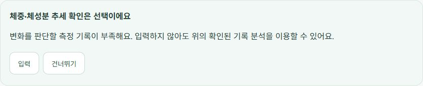
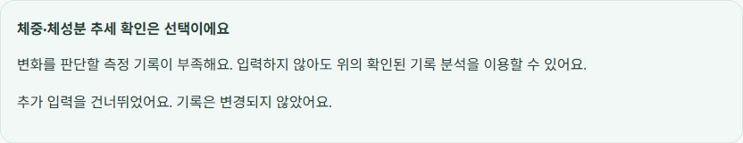

# 근거 검색 실패와 기록 분석 분리

후속 검증: [운영 DB 없이2시간720건 메모리·원격/하이브리드각120건 비교](../rag_memory_quality/README.md). Windows 대체 환경의 한계, 검색 품질 차이와 Gemini402로 미검증인 답변 품질을 구분한다.

## 실제 실행 조사

사용자가 제시한 상담 문구의 chat_history 저장 시각과 같은 thread의 체크포인트를 찾아 운영 LangSmith 루트 `fa5c4802-84e0-455c-b750-9bb2162550e9`의 시작/종료 시각과 대조했다. 2026-10-16 13:34:58~13:35:41 KST 실행이다. 프로필·오늘 섭취·측정·목표 추세·최근 식사 도구는 성공했지만, **search_evidence는3회 tool_failed**였다. 전체 실행은 completed이고 루트에 처리되지 않은 예외는 없었다. 따라서 화면 문구만 보고 ‘정상 검색 후 근거 부족’이라고 분류한 것은 부정확했다. [건강 수치·원문을 제외한 기록](historical_trace.json).

입출력 숨김 설정은 유지했다. 과거 checkpoint 이벤트에는 검색 예외 클래스/메시지가 보존되지 않아 그 세 실패의 정확한 Python 스택을 복구할 수는 없다. 대신 같은 실행 버전 `ea2964b`의 Git 트리를 확인하니 `activation.json`은 없고 기존 `chunks.pkl`만 있었다. runtime은 활성화 파일과 Gemini namespace/model/dimension 일치를 필수 검사한다. 실제 선택 빌드 `1157903c493dbb5d759f`는 git-ignored builds 폴더에만 있었다. Render 설정의 `/app/app/rag/chunks.pkl`에 새 활성화 파일을 배치하는 Docker 지시도 없었다. 이 배포 구조에서는 검색이 활성화 검사를 통과할 수 없다.

[Render Docker 공식 문서](https://render.com/docs/docker)와 [Docker build context 문서](https://docs.docker.com/build/concepts/context/)를 확인했다. 개발 머신의 ignored 산출물은 Git 기반 원격 빌드에 자동으로 전달되지 않는다. 배포 누락을 재현하는 파일 검사 테스트를 먼저 실패시킨 뒤 수정했다. 검색 임계값을 낮추거나 이전 OpenAI 벡터를 Gemini 벡터로 간주하는 방식은 사용하지 않았다.

## 수정

- 검증된4,139개 Gemini 청크와 활성화 manifest를 버전 관리되는 release bundle로 제공한다. Docker가 기존 Render 경로로 복사하고 SHA-256을 빌드 시 검사한다. namespace·임베딩 모델·3072차원·청크 수/메타데이터를 회귀에서 검사한다. 빌드 시 API 키를 사용하거나 새 인덱스를 만들지 않는다.
- 검색 도구 오류(`search_unavailable`)와 정상 조회의 근거 부족(`insufficient_evidence`)을 분리한다. 진단에는 상태·오류 클래스·고정 오류 코드·문서 수만 남기고 원문·건강 수치·오류 메시지·키는 넣지 않는다. 알려진 활성화 오류는 `activation_missing`/`activation_mismatch` 등으로 구분한다.
- 검색 장애가 확인되면 같은 요청 안에서 질의를 바꿔 검색을 반복하지 않는다. 요청 간 캐시는 추가하지 않아 다음 상담에서는 다시 시도할 수 있다. 사용자 확인·실행 예산·쓰기 소유권은 유지한다.
- 근거가 없더라도 **이번 실행에서 실제로 확인한** 목표·기록된 섭취·기록 기준 잔여량·측정 유무는 서버 계산으로 제공한다. 모델이 제시한 미검증 수치를 그대로 통과시키지 않고, 새 목표/비율 변경만 보류한다. 기록 없음과 조회 실패, 실제0을 구분하고 미기록 식사를 먹지 않았다고 가정하지 않는다.
- 추세 평가 결과가 실제 `insufficient_data`일 때만 선택 입력 카드를 제공한다. `입력`을 눌러야 입력란이 열린다. `건너뛰기`·`취소`는 분석 이용을 막거나 모델/저장 API를 실행하지 않는다. 보낸 측정 정보도 기존 제안·확정 경계를 거치며 자동 저장하지 않는다. 검색 실패만으로 식사 내역을 다시 요구하지 않는다.

[LangChain guardrails 공식 문서](https://docs.langchain.com/oss/python/langchain/guardrails)의 도구/최종 출력 경계 분리 원칙을 참고했다. 새 검증 모델이나 의존성을 추가하지 않고 기존 LangGraph 상태·저장·SSE/restore 응답에 선택 카드 정보만 추가했다. 과거 대화 문구를 소급 수정하지 않는다.

## 검증 범위와 한계

전체 백엔드1365 passed/기존1 skipped, 프론트107 passed/31 suites, CI 빌드 통과. 실패·근거 부족 분리, 장애 중 질의 변경 반복 방지, 기존 수치 보존/미검증 목표 제거, 빈 섭취와 조회 실패 구분, 선택 입력·건너뛰기·취소·로딩을 검사했다. 새 성능/정확도 향상률을 주장하는 실험이 아니며, 소수 기능 검사를100건 성능 평가로 표현하지 않는다. 추후 속도/품질 전후 비교는 기존 정책대로 동일 사례 조건별100건 이상 필요하다.

추세 평가에 필요한 측정 기록만 선택 입력으로 제공하며 일반식·기존 기록 확정 경로는 유지한다. 건너뛰기는 현재 카드의 로컬 선택이므로 새로고침 시 같은 서버 보완 카드가 다시 나타날 수 있다. 현재 근거 정책을 완전한 임상적 정확도 판정으로 확대 해석하지 않는다.

## 공개 검증에서 발견한 추가 장애: 512MB OOM

API·웹 `31a81b1` 배포 후 실제 브라우저 상담을 실행하자 첫 진행은 약902ms에 왔지만 약35초에 연결이 끊겼다. 재연결도 실패했다. Render Events는 **2026-10-16 16:28 KST, used over512MB**,16:29 복구를 명시했다. Python 예외 없이 프로세스가 종료됐으므로 검색 점수 부족이나 정상 보류로 분류하지 않았다. 사용자의 Render 알림과 같은 장애다. 운영 식사·측정·목표를 확정하거나 변경하는 검증은 하지 않았다.

로컬 BM25는 첫 검색에서 Kiwi 모델을 지연 초기화한다. 공식 [Kiwi 문서](https://bab2min.github.io/kiwipiepy/v0.23.1/kr/)의 기본 전체 코어 사용을 확인하고 우선 워커1개를 실험했다. 동일 코퍼스에서 균등 추출한100개 발췌, 별도 프로세스 전후100회씩이다. 데이터 해시는 동일하고 성공 토큰 해시100/100이 일치했다. 프로세스 peak는622,768,128→608,546,816bytes(593.9→580.4MiB)로 여전히512MiB를 넘었다. [이전 원본](kiwi_before100.json) · [워커1개 원본](kiwi_after100.json) · [재현 스크립트](../../backend/scripts/eval/kiwi_workers100.py). 워커 축소만으로 해결했다는 주장은 하지 않는다. Windows 토큰화 실험이며 Render RSS·검색 품질·운영 응답 시간 측정이 아니다.

[Render Free512MB 사양](https://render.com/docs/compute-plans)과 [Linux cgroup hard memory limit](https://www.kernel.org/doc/html/latest/admin-guide/cgroup-v2.html)을 확인했다. cgroup v2/v1의 유한한 hard limit이512MiB 이하일 때 로컬 검색기를 가져오거나 코퍼스를 열기 **전에** 차단한다. 기존 Pinecone/Gemini 원격 dense 검색, 한국어 dual query, 동일 grounded 임계값은 유지한다. 더 큰/제한 없는 환경은 기존 하이브리드를 유지한다. 로그에는 고정된 `memory_budget` 사유·limit_bytes, 완료 진단에는 실제 `retrieval_mode`를 남긴다. 유료 전환·인덱스 재작성·인증 완화는 없다.

이는 작은 서버의 가용성 보호이며, 하이브리드와 동일 검색 품질을 입증한 변경은 아니다. 기존 하이브리드 평가 수치를 dense fallback에 사용하지 않는다. 별도 품질 비교를 수행한다면 동결 사례 조건별100건 이상과 실패 포함 분모를 적용해야 한다. 재시작 없는 단일 상담 확인도 장시간 안정성 보장은 아니다.

추가로 `/session/restore` 완료 전 전송이 가능해 늦은 복원 결과가 새 대화를 덮는 경쟁 조건을 발견했다. 복원 대기 중 입력·전송을 비활성화하고 서버 복원이 끝난 뒤만 새 요청을 보낸다. 기존 테스트2개는 실제 사용자처럼 복원 완료를 기다리게 보완했고 테스트를 제거하지 않았다. 샌드박스 Temp realpath의 EPERM은 일반 환경에서 재실행해 구분했다. 수정 후 백엔드 **1369 passed/기존1 skipped**, 프론트 **108 passed/31 suites**, 빌드 통과. 메모리 guard는 코퍼스 open이 호출되지 않음을 먼저 실패시킨 뒤 검증했다.

## 수정 배포의 실제 브라우저 결과

메모리 보호 배포 API·웹 `3d13342c9b0685c709eee7461e8825ed1575025b`에서 동일 상담을 실제 로그인 브라우저로 실행한 요청 `a78e5ffc-e398-4d8b-8af1-d6ce54a788ed`는 완료됐다. 첫 진행679.5ms, 완료40,127.6ms는 **한 건의 기능 관측**이며 전후 속도 향상률·p95로 해석하지 않는다. 이전 실패도 [원본 사건](rejected_oom_browser.json)에 남겼다. [최종 빌드 응답](deployment.json)은 아래 복원 보완까지 포함한다.

Render 로그에는 `rag_sparse_unavailable reason=memory_budget limit_bytes=536870912`가 남았다. 같은 실행의 완료 체크포인트는 `grounded`, `dense_fallback`, 문서4개, 기록 조회 도구6개 성공, 새 proposal없음을 확인했다([허용 필드만 추출한 진단](public_completed.json)). 화면에서 실제 기록 분석과 선택 카드가 나타났고, 입력을 눌러야 입력란이 열리며 취소하면 닫혔다. 건너뛰기는 기록을 변경하지 않는 로컬 동작이다. 측정값을 제출하거나 운영 식사·목표를 확정하는 행동은 하지 않았다.

캡처는 건강 수치·대화 원문이 없는 선택 카드만 포함한다. 단일 정상 완료는 메모리 누수 부재나 장시간·동시 부하 안정성을 입증하지 않는다. 무료 서버의 실제 전체 RSS 상한과 재발 여부는 계속 관측해야 하며, 약40초의 모델·도구 완료 지연도 남아 있다.

### 새로고침 검사에서 드러난 대화 ID 불일치

위 상담 완료 후 새로고침하니 선택 카드는 복원됐지만 답변이 비었다. Render의 새 실행 thread와 체크포인트는 일치했으나, `_initial_state`가 이전 요청의 thread를 유지해 `save_chat`이 이전 ID에 저장한 것을 확인했다. [LangGraph persistence 문서](https://docs.langchain.com/oss/python/langgraph/persistence)의 thread별 체크포인트 경계를 확인하고, 새 실행 상태의 저장 ID를 실제 config와 맞췄다. 이미 잘못 저장된 현재 상담은 **인증된 소유자의 요청 thread 체크포인트**에 완료 응답이 있을 때만 마지막 질문·답변을 복원한다. 다른 대화의 기록을 합치거나 모델 재실행·건강 기록 변경을 하지 않는다. 재현 테스트2개를 먼저 실패시킨 뒤 보완했다.

최종 복원 보완을 포함한 백엔드 전체 회귀는 **1371 passed/기존1 skipped**다. 프론트108개·CI 빌드는 통과한 동일 프론트 코드이며 별도 lint/typecheck 스크립트는 없다. 기존 deprecation 경고3개는 남아 있다. Render 무료 Metrics는 CPU/RSS 그래프를 유료 기능으로 표시하므로, 이번 관측을 전체 RSS 측정치로 표현하지 않는다.

최종 API·웹 `db59fdd752d3a0d386405f9c8bbdead503fc54e9`를 확인하고 실제 브라우저를 새로고침했다. 방금 완료된 질문·분석 답변·선택 카드가 다시 표시됐으며, 모델을 다시 요청하거나 건강 기록을 확정하지 않았다. 건너뛰기는 로컬 상태이므로 새로고침 뒤 다시 선택할 수 있다는 한계는 유지한다. 관측 시간 동안 Render Events의 마지막 OOM은 기존16:28 사건이며 새 장애 이벤트는 없었다. 수시간 안정성이나 운영 실패율0%를 의미하지 않는다.
