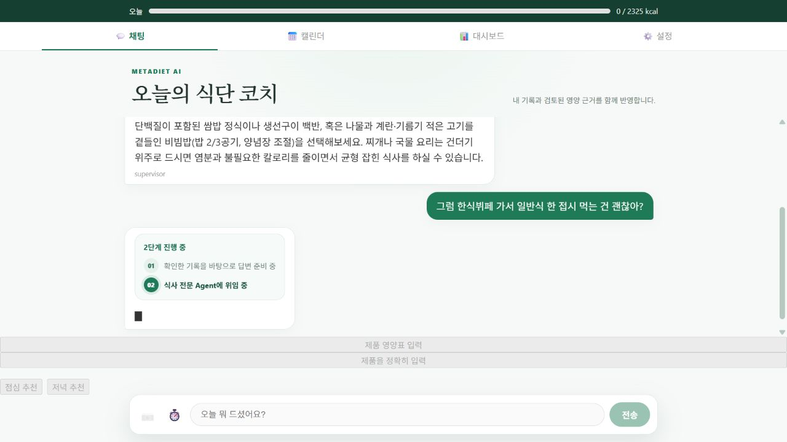
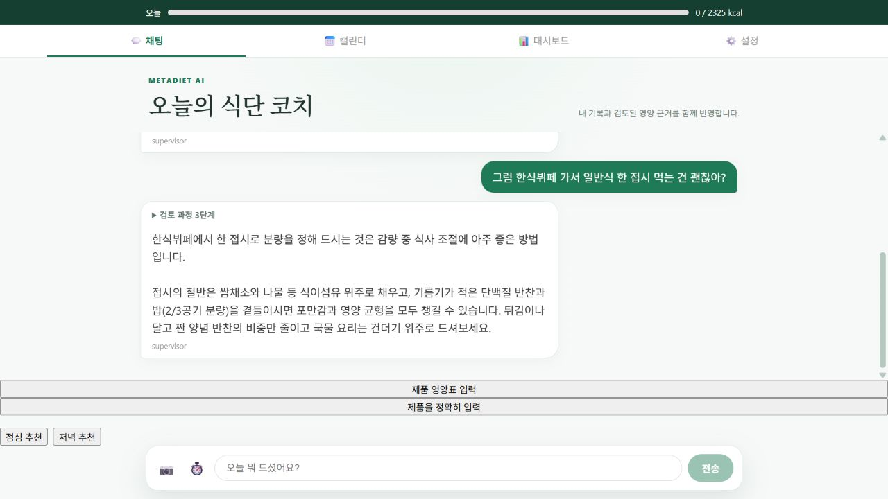
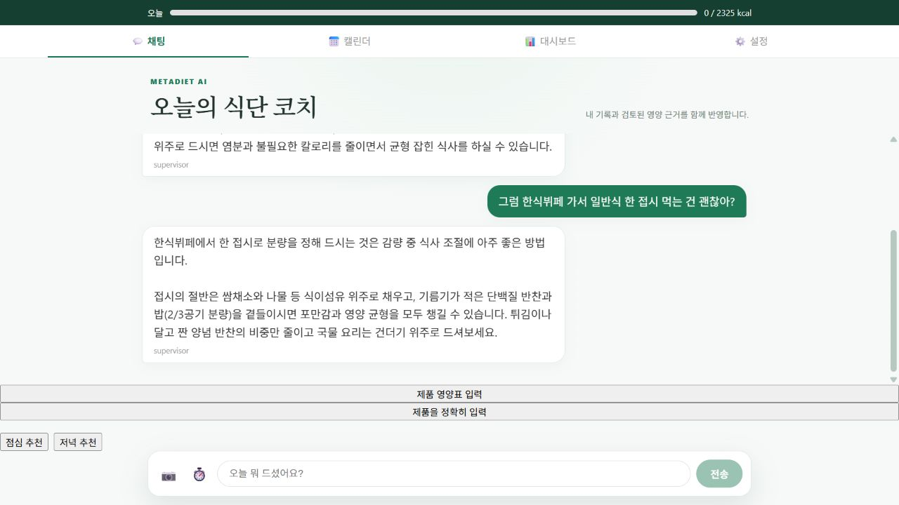

# 단계별 계측으로 찾은 실행 예산 저장 병목

2026-10-13. 이전의 표시 지연 제거 다음 실험이다. 모델, 사용자 정보 조회, 실행 예산 영속화, 그래프 전체, 최종 체크포인트, 응답 스냅샷, 공개 통계 조회 시간을 분리했다. 계측은 고정 단계 이름과 시간만 추가하며 대화 원문·건강 수치를 분석 이벤트에 추가하지 않는다.

## 변경과 안전 경계

계측 기준 커밋 `e7df0dc`, 개선 런타임 `f9ef7e7`. 실행 예산 저장은 매번 새 PostgreSQL 연결을 열고 있었다. 초기 표본에서 이 단계에 6.8초가 사용됐다. 모델 합산 시간이 더 크지만, 모델·라우팅 품질을 바꾸지 않고 제거할 수 있는 연결 비용을 먼저 줄였다.

실행 예산 전용 `AsyncConnectionPool(min_size=1,max_size=3,timeout=10)`을 앱 수명주기에 연결했다. 체크포인터의 autocommit 풀과 분리하여 `autocommit=False`, `dict_row`, `SELECT FOR UPDATE`, 성공 커밋·실패 롤백을 보존했다. 풀 대여 실패는 실행 차단으로 전파하며 DB 안전 검증을 생략하지 않는다. CLI 평가에는 원래 직접 연결을 유지한다. 연결 검사로 휴면 중 끊어진 연결을 확인한다. [Psycopg 공식 풀 문서](https://www.psycopg.org/psycopg3/docs/advanced/pool.html).

요청 간 정보 캐시, 모델 변경, 식사 확정 정책 변경은 없다. 프로세스당 추가 DB 연결 상한은 3개이며, 여러 프로세스·동시 사용자 부하에서 전체 연결 한도와 풀 대기를 별도 검증해야 한다.

## 비교 조건

공개 Render API, 기동 상태, 같은 합성 계정의 식사 0건. 점심→한식뷔페, 저녁→편의점, 아침→밥·계란의 3개 대화를 2회 반복했다. 각 버전 12요청이며 후속 턴에 실제 이전 사용자·모델 메시지를 전달했다. 전후를 시간순으로 실행했고 모델 응답과 위임 여부는 변할 수 있다. 실제 사용자 결과·운영 p95·통계적 인과 효과로 일반화하지 않는다.

[변경 전](BEFORE_MULTITURN.json) · [변경 후](AFTER_MULTITURN.json) · [집계](SUMMARY.json)

| 중앙값 | 전 | 후 |
|---|---:|---:|
| 첫 답변 | 20.97초 | 18.05초 |
| 전체 완료 | 21.36초 | 18.45초 |
| 예산 저장 | 6.86초 | 3.90초 |
| 모델 합산 | 10.12초 | 10.58초 |
| 정보 DB 조회 | 0.51초 | 0.50초 |
| 그래프 전체(상위 span) | 19.44초 | 16.55초 |
| 모델 / 논리 도구 호출 | 2 / 3회 | 2 / 3회 |
| 첫 턴 전체 완료 | 21.49초 | 19.89초 |
| 후속 턴 전체 완료 | 21.34초 | 17.86초 |

전체 완료는 관측상 13.6%, 예산 저장은 43.1% 감소했다. 모델 합산은 4.6% 늘었다. 호출 수 중앙값은 같지만 개별 모델 라우팅·출력은 변동하므로 전체 시간의 모든 차이를 풀 하나의 인과 효과로 단정하지 않는다. 이후 가장 큰 남은 구간은 모델 생성·위임이며, 기본 thinking 설정 축소나 읽기 전용 코칭 경로를 각각 독립 평가하는 것이 다음 단계다.

`graph_total`은 모델·DB·예산 저장을 포함하는 상위 span이다. 표의 단계 시간을 전체에 다시 더하지 않는다. 병렬 호출의 합산 시간은 wall time과 다를 수 있다. 계측하지 않은 구간을 모두 체크포인트 비용으로 단정하지 않는다. 현재 journal의 단계 시간은 해당 프로세스 실행에 한정되며 장애 후 복구의 전체 이력 계측은 아니다.

## 실제 모델 스트리밍 검토

운영 모델 래퍼의 `astream`을 사용한 **provider 단독·도구 없는 합성 요청 3회**를 수행했다. 첫 가시 텍스트 8.48/11.19/14.20초, 전체 10.70/13.32/16.44초, 각 10~12개 가시 청크, 모두 `STOP` 완료. 첫 글자 이후 약 2.1~2.2초 동안 생성되는 내용을 앞당겨 보여줄 수 있지만 첫 글자까지의 생성 대기는 남는다. 이는 Agent 전체나 비스트리밍 대비 속도 개선률이 아니다. [원본](MODEL_STREAMING.json).

초기 탐색의 700 토큰 제한에서는 답변이 짧아 완료 품질을 판단하기 어려웠다. 제한을 제거하고 finish reason까지 수집한 위 3회만 최종 보고했다. [Gemini 텍스트 생성](https://ai.google.dev/gemini-api/docs/text-generation), [LangChain Gemini 통합](https://docs.langchain.com/oss/python/integrations/chat/google_generative_ai).

**운영 토큰 스트리밍은 이번 배포에서 활성화하지 않았다.** 현재 Agent는 모델 완료 후 근거 부족·부적절한 배분 권고를 보류 답변으로 교체한다. 검증 전 내용을 즉시 노출하면 이 경계를 깨뜨릴 수 있다. 다음 실험은 읽기 전용 코칭에 한해 최종 출력 역할을 구분하고, thought/tool-call 비노출, 중단·재연결 seq, 최종 보류 전환을 검증하는 제한적 경로다. 저장·proposal에는 적용하지 않는다.

## 정확성과 실패 처리

- [최신 문맥 회귀 100건](FRESHNESS_MATRIX.xml): 확정·수정·삭제·목표·날짜·사용자 분리·조회 실패를 같은 평가로 검사했다.
- [실제 DB 풀 검증](BUDGET_POOL_INTEGRATION.json): 동시 예약 12개, 한도 4개 중 정확히 4개 허용·8개 차단, 저장 카운트 4, 예외 롤백 후 행 보존. 테스트 실행 ID 행은 finally에서 정리했다.
- [공개 최신 기록 검증](FRESHNESS_PUBLIC.json): 취소·확정 전 수정의 미저장, 중복 확정 1건, 오래된 대화보다 수정된 실제 섭취 우선, 삭제 후 새 조회 0을 검사한다.
- 전체 백엔드 685 passed / 기존 1 skipped, 프론트 72 passed / 22 suites, production build 통과. 테스트 삭제·새 skip 없음.
- 초기 공개 측정은 실행 환경 DNS 제한(`getaddrinfo failed`)으로 실패하여 네트워크 허용 환경에서 재실행했다. 전체 pytest의 임시 폴더 `WinError 5` 29건은 전용 workspace `--basetemp`로 해결했다. [pytest 공식 문서](https://docs.pytest.org/en/stable/how-to/tmp_path.html). 제품 장애로 분류하지 않는다.

## 공개 브라우저 증거

API `f9ef7e7` Live를 확인한 뒤 합성 계정으로 점심 조언과 한식뷔페 후속 대화를 실행했다. 입력 복구와 후속 답변, 새로고침 후 대화 유지 및 섭취 0을 확인했다. 이 정지 화면은 기능 증거이며 응답 시간 증거는 위 SSE 측정값이다.





## 재현 명령

자격 증명은 git-ignored env에만 둔다. 실제 사용자가 아닌 비어 있는 합성 계정을 사용한다.

```powershell
backend\venv\Scripts\python.exe backend/scripts/eval/benchmark_multiturn_delivery.py --phase before --repeats 2 --output-dir docs/coaching_stages
# 개선 버전 Live 확인 후
backend\venv\Scripts\python.exe backend/scripts/eval/benchmark_multiturn_delivery.py --phase after --repeats 2 --output-dir docs/coaching_stages
backend\venv\Scripts\python.exe backend/scripts/eval/summarize_coaching_stages.py
backend\venv\Scripts\python.exe backend/scripts/eval/verify_budget_pool.py
backend\venv\Scripts\python.exe backend/scripts/eval/verify_public_coaching_freshness.py --output-dir docs/coaching_stages
backend\venv\Scripts\python.exe backend/scripts/eval/probe_model_streaming.py
```
