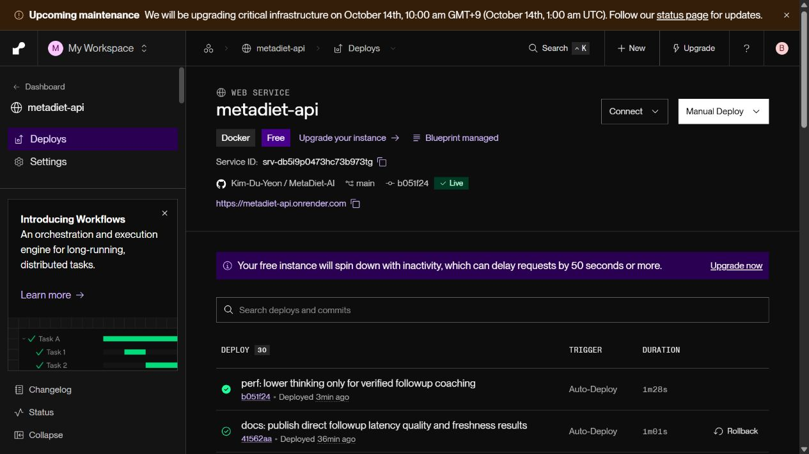
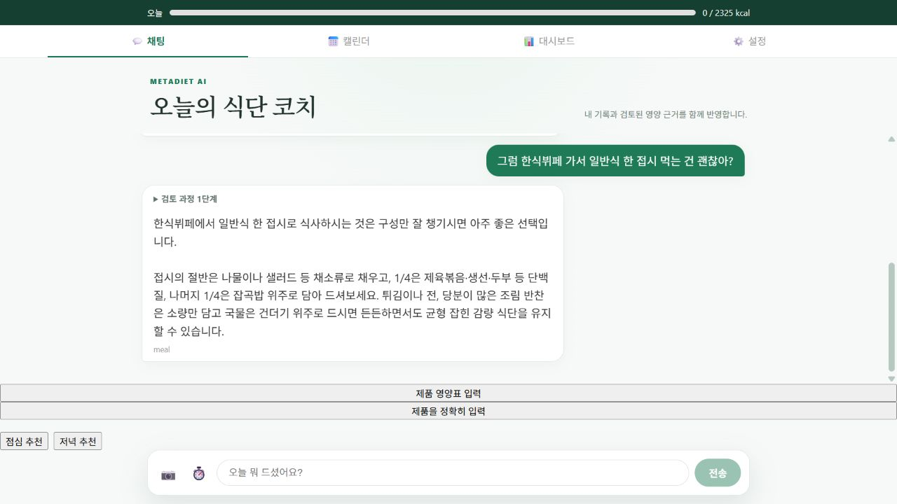
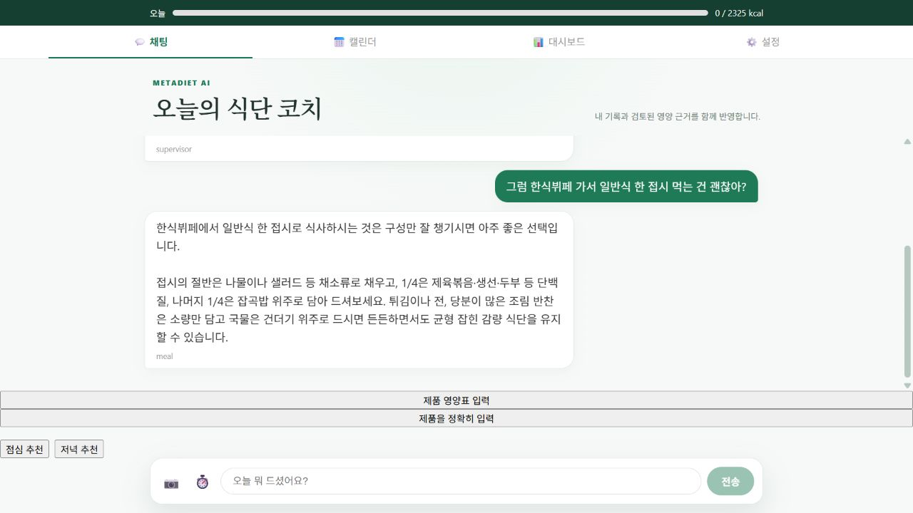

# 단순 후속 코칭 추론 수준 실험

## 문제와 변경 범위

Supervisor 위임을 제거해도 후속 코칭의 모델 응답을 기다리는 시간이 남았다. 모델을 교체하거나 전체 Agent의 추론을 줄이지 않고, 최신 profile/intake가 확인된 읽기 전용 후속 질문에만 `thinking_level=low`를 적용했다. 첫 추천·복잡한 계획·저장·목표 변경·Vision·평가 모델은 기존 설정을 유지한다. LangGraph, 확인 카드, 실행 예산, 최종 근거 검증도 유지한다.

운영 모델은 `gemini-3.8-flash`다. [Gemini 공식 문서](https://ai.google.dev/gemini-api/docs/thinking)는 이 모델의 기본값 medium 및 low/medium/high를 안내하며, [LangChain 공식 문서](https://docs.langchain.com/oss/python/integrations/chat/google_generative_ai)는 `thinking_level` 설정을 지원한다. 답변이 잘릴 수 있는 출력 토큰 제한으로 속도를 줄이지 않았다. 도구 응답의 native message와 thought signature도 그대로 유지한다.

`COACHING_THINKING_LEVEL=default`로 배포하면 이 경로도 공급자 기본 설정으로 복구된다. `low`가 기본값이며 다른 값은 설정 검증에서 거부한다. 요청 간 섭취 캐시는 추가하지 않았다.

## 동일 문맥 교차 비교

[원본 18응답](ALTERNATING.json): 공개 DB 대신 합성 DB를 사용하되 운영 `DietTeam`과 실제 Gemini를 실행했다. 한식뷔페·샌드위치·밥/계란의 동일 세 질문에 확정 후 600kcal, 삭제 후 0kcal, 목표 2000→1800kcal 변경을 조합했다. 이전 대화에는 오래된 300kcal/2000kcal를 포함했다. 쌍마다 default→low / low→default 순서를 번갈아 실행했다. 동일 질문·문맥·도구·온도에서 추론 설정만 다르다.

| 항목 | 기본 설정 | low |
|---|---:|---:|
| 처리시간 중앙값 | 8.72초 | 5.06초 |
| 최신 섭취·목표 반영 | 9/9 | 9/9 |
| 실행 완료 | 9/9 | 9/9 |
| 저장·제안 생성 없음 | 9/9 | 9/9 |

중앙값은 42.0% 감소했고 9쌍 모두 low가 빨랐다. 모델 호출은 양쪽 모두 1회였다. 이 값은 합성 DB를 사용한 로컬 Agent 실행시간이며 공개 서버의 전체 응답시간이 아니다. 9쌍의 작은 표본으로 p95나 통계적 인과 효과를 주장하지 않는다.

[설정명을 가린 품질 검토](ALTERNATING_QUALITY.json)는 `gemini-3.1-pro-preview`를 사용했다. 질문 관련성, 실행 가능한 조언, 섭취 사실 비조작, 거짓 저장 주장 없음, 500자 이내 간결성 모두 양쪽 9/9다. 같은 공급자 모델 judge이며 독립 인간·임상 평가나 실제 사용자 만족도 검증은 아니다.

## 공개 배포 전후

운영 기본 버전 `41562aa`와 low 적용 버전 `b051f24`의 Live 상태를 확인하고 측정했다. 동일 일회용 계정, 점심→한식뷔페·저녁→샌드위치·아침→밥/계란 대화를 2회씩, 전후 각각 12요청 실행했다. 후속 질문에는 바로 앞의 실제 답변을 전달했다. API 기동을 확인한 뒤 측정했으므로 휴면 복구 시간은 포함하지 않는다.

[전 원본](BEFORE_MULTITURN.json) · [후 원본](AFTER_MULTITURN.json) · [집계](SUMMARY.json)

| 중앙값 | 기본 설정 | low 적용 후 |
|---|---:|---:|
| 후속 전체 완료 | 13.00초 | 9.86초 |
| 후속 첫 답변 도착 | 12.14초 | 9.49초 |
| 후속 model_meal 구간 | 6.55초 | 3.83초 |
| 후속 모델 호출 | 1회 | 1회 |
| 후속 논리 도구 호출 | 2회 | 2회 |
| 첫 추천 전체 완료 | 20.97초 | 19.80초 |
| 첫 추천 모델 호출 | 2회 | 2회 |

후속 완료 중앙값은 24.2% 감소했다. 첫 추천은 추론 설정을 변경하지 않았으므로 20.97→19.80초 변동을 이번 변경의 효과로 해석하지 않는다. 전후 각 후속 6건의 시간순 비교로, 무작위 A/B나 실사용자 지표가 아니다. 네트워크·공급자 부하 변동도 포함된다. 최초 SSE 진행 이벤트를 답변 도착으로 계산하지 않았다.

[공개 답변 품질 평가](QUALITY.json)도 동일 5개 기준에서 전후 각각 6/6이었다. [실제 DB 최신성 검증](FRESHNESS_PUBLIC.json)은 확인 전 미저장·취소·분량 수정·중복 확정 1건·오래된 대화보다 최신 섭취 우선·삭제 후 새로고침 0 반영을 통과했다. 공개 환경의 목표 변경·날짜 전환·DB 장애 주입까지 실시한 것은 아니며 해당 범위는 합성 비교/회귀 결과로 구분한다.



실제 공개 브라우저에서 첫 추천→한식뷔페 후속 답변 완료, 후속 검토 과정 1단계, 입력창 재활성화, 새로고침 후 두 턴 복원을 확인했다. 캡처는 기능 증거이며 시간은 위 API 타임스탬프로 측정했다.




## 실패 원인과 조치

- 예비 평가에 넣은 ‘현재 기록과 목표’가 보수적인 라우팅 규칙에 걸려 Supervisor 경로로 갔다. [예비 원본](PREFLIGHT_WRONG_ROUTE.json)은 성능 집계에서 제외했다. 운영 안전 규칙을 완화하지 않고 평가 문구를 변경했으며, 실행 전 `simple_followup`과 실행 후 담당 Agent를 검사하도록 보완했다.
- 최초 Jest 실행은 Windows 샌드박스의 `realpath` 권한 오류(`EPERM`)로 테스트 시작 전에 중단됐다. [Node 임시 폴더 문서](https://nodejs.org/api/os.html#ostmpdir)와 [Jest 캐시 설정](https://jestjs.io/docs/configuration#cachedirectory-string)을 확인했다. 작업 폴더로 임시 경로를 바꿔도 동일해 환경 권한 문제로 분류하고, 정상 권한으로 동일 테스트를 실행해 통과했다. 제품 코드를 우회 수정하거나 테스트를 삭제하지 않았다.

## 회귀 검증

백엔드 전체 **808 passed / 기존 1 skipped**, 프론트 **72 passed / 22 suites**, production build 통과. 별도 lint/type-check 스크립트는 없다. [설정 범위·최신 문맥 회귀 223건](FRESHNESS_MATRIX.xml)은 기존/직접 경로의 수정·삭제·다른 thread·목표·날짜·사용자 변경·조회 실패 검사를 포함한다. 외부 모델/DB는 이 회귀에서는 mock이며 실제 모델의 수치 반영 검사는 위 교차 비교와 별도 공개 검증으로 분리했다.

## 재현

```powershell
backend\venv\Scripts\python.exe backend/scripts/eval/benchmark_thinking.py
backend\venv\Scripts\python.exe backend/scripts/eval/evaluate_followup_quality.py --output-dir docs/coaching_thinking --alternating
backend\venv\Scripts\python.exe backend/scripts/eval/benchmark_multiturn_delivery.py --phase before --repeats 2 --output-dir docs/coaching_thinking
# 변경 버전 Live 확인 후 같은 일회용 계정, 같은 질문 사용
backend\venv\Scripts\python.exe backend/scripts/eval/benchmark_multiturn_delivery.py --phase after --repeats 2 --output-dir docs/coaching_thinking
backend\venv\Scripts\python.exe backend/scripts/eval/evaluate_followup_quality.py --output-dir docs/coaching_thinking
backend\venv\Scripts\python.exe backend/scripts/eval/summarize_thinking.py
backend\venv\Scripts\python.exe backend/scripts/eval/verify_public_coaching_freshness.py --output-dir docs/coaching_thinking --direct-followup
```

자격증명은 git-ignored env에만 보관한다. 원본 답변·수치는 일회용 합성 계정이며 실제 사용자 원문·건강 정보는 포함하지 않는다.
