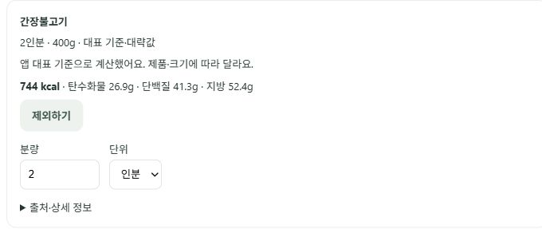
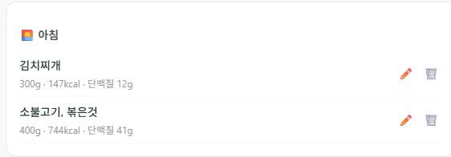

# 공개 브라우저 식사 기록 검증 (2026-10-15)

사용자가 로그인한 실제 공개 웹에서 수행한 **기능 검증**이다. 성능·정확도 비교나 실제 사용자 식단 성과 평가는 아니다. 캡처에는 이번 검증으로 만든 음식 카드만 포함하며 계정 정보·개인 목표·다른 날짜의 기록은 제외했다.

| 단계 | 관찰 결과 |
|---|---|
| `오늘 점심에 김치찌개 간장불고기 200g 밥 한공기 먹었어` | 제조사 선택 없이 세 음식 확인 카드 생성. 불고기 명시량200g 유지, 밥200g, 김치찌개 기본200g |
| 대기 상태 새로고침 | 로그인·대화·pending 제안 복원. 최신 화면에서 `200g (1인분)` 표시 |
| 취소 | pending 해제, 확정 전 섭취량 유지. 취소한 식사가 저장되지 않음 |
| `김치찌개 간장불고기 밥 먹었어` | 세 음식 모두 기본200g/1인분으로 표시. 빈 분량 입력·제품 선택 없음 |
| 김치찌개1.5인분·불고기2인분, 밥 제외 | 재계산 전 확정 버튼 비활성화. 서버 재계산 후300g/147kcal와400g/744kcal, 밥 제외, 합계891kcal |
| 이대로 기록 | 실제 섭취량에891kcal 반영, pending 해제 |
| 확정 후 새로고침·캘린더 | 김치찌개300g와 소불고기400g 두 행 유지, 제외한 밥 없음. 끼니 미지정 요청은 당시 서비스 시간 기준 아침으로 저장 |

## 발견한 표시 오류와 수정

취소 답변 본문은 정상인데 아래 담당 Agent 배지에 `✅ 식단 확정`이 표시됐다. 실제 저장 실패가 아니라 확정과 취소를 모두 담당하는 `confirm` 노드의 고정 표시 문자열이 원인이었다. 브라우저 관찰과 `ChatInterface.jsx`의 `AGENT_LABELS`를 대조해 확인했다. 상태를 단정하지 않는 `식단 확인 처리`로 바꾸었다. 저장·확정 API나 Agent 상태 전이는 변경하지 않았다.

복원된 취소 메시지에 잘못된 확정 배지가 없어야 한다는 테스트를 추가해 수정 전 실패를 확인했다. 수정 후 프론트 전체 **23 suites / 78 passed**, production build 성공. 표시 처리 참고: [React 공식 JSX 렌더링 문서](https://react.dev/learn/conditional-rendering).

수정 커밋 `ecd9d03a426e222422c40a6257405366c1be45bb`의 Render Auto-Deploy/Live와 공개 웹 build-info를 확인했다. 다시 새로고침해 취소·확정 메시지 아래 배지가 모두 `식단 확인 처리`로 표시되고 기존 확정 기록이 유지됨을 실제 브라우저에서 재검증했다. 게시 후 관련13개 회귀 테스트도 통과했다.

이번 검증에서 확정한 두 음식은 사용자 승인에 따라 실제 계정에 남겼다. 자동으로 삭제하지 않았다.
