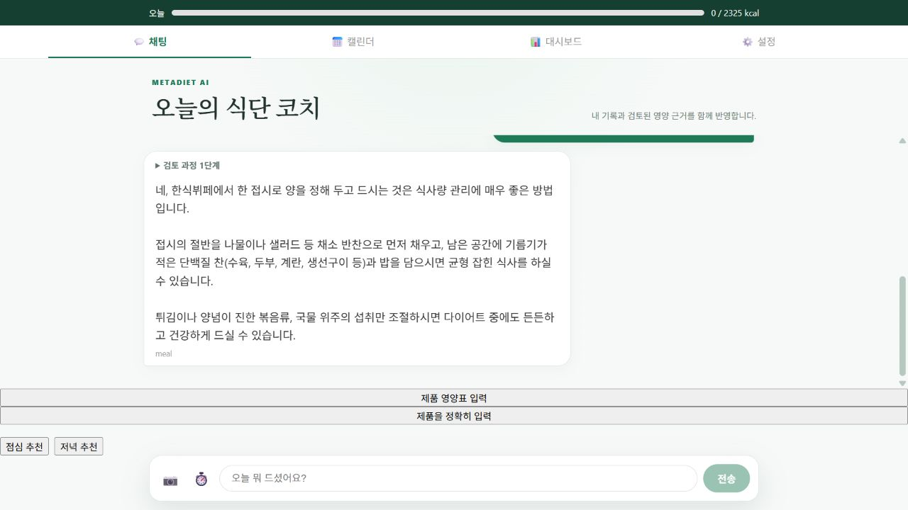
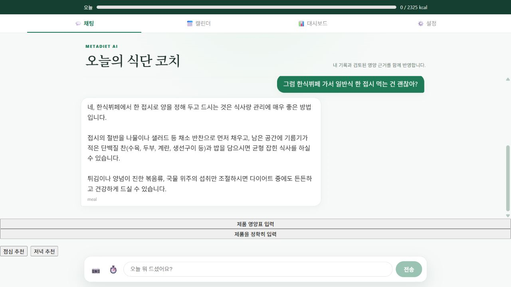

# 단순 후속 코칭의 Supervisor 왕복 제거

## 문제와 구현

한식뷔페·편의점·일반식에 대한 후속 질문에도 Supervisor가 전문 Agent에게 다시 위임하며 모델 왕복이 추가됐다. 기존 요청 단위 최신 DB 조회와 LangGraph·실행 예산·HITL을 유지하면서, 확실한 읽기 전용 후속 조언만 meal Agent로 바로 보낸다.

- 최근 대화에 식사 추천/조언 문맥이 있고 짧은 일반 음식 적합성 질문이어야 한다.
- 현재 요청에서 사용자 정보와 섭취량 조회에 성공한 경우만 사용한다. 대화 기억을 최신 기록 대신 사용하지 않는다.
- 명시적 작업, pending 제안, 기록·추가·변경·계획 요청은 기존 Supervisor 경로로 보낸다. 질환·약 등 제외 표현도 보수적으로 처리한다. 모든 의료 질문을 분류하는 별도 의료 분류기는 아니다.
- 직접 경로에는 읽기 도구만 제공한다. proposal/위임 도구를 제공하지 않고, 공통 최종 근거 검증을 그대로 거친다.
- 첫 추천·복잡한 요청은 기존 경로다. 모든 음식/모든 후속 발화를 단축했다는 의미가 아니다. 실제 도구 검색이 필요하면 추가 모델 호출은 가능하다.

[LangGraph 공식 workflow/agent 패턴](https://docs.langchain.com/oss/python/langgraph/workflows-agents)의 결정적 경로와 동적 Agent 구분을 참고했다. 체크포인트와 트랜잭션 저장 구조를 교체하지 않았다.

## 고정 평가와 품질 기준

기준 `841fa93` → 런타임 `587c9af`. 기동 상태의 공개 API에서 동일 합성 계정(식사 기록 0건), 점심→한식뷔페·저녁→샌드위치·아침→밥/계란의 세 대화를 2회씩 실행했다. 전후 각각 12요청, 후속 질문 각각 6건이다. 후속 요청에는 실제 이전 응답을 전달했다. 시간순 전후이며 무작위 A/B 실험은 아니다.

[이전 원본](BEFORE_MULTITURN.json) · [이후 원본](AFTER_MULTITURN.json)

| 중앙값/건수 | 전 | 후 |
|---|---:|---:|
| 후속 질문 전체 완료 | 19.28초 | 12.07초 |
| 후속 질문 첫 답변 | 18.64초 | 11.70초 |
| 후속 모델 호출 중앙값 | 1.5회 | 1회 |
| 후속 논리 도구 호출 중앙값 | 2.5회 | 2회 |
| 후속 Supervisor 호출 요청 | 6/6 | 0/6 |
| 첫 추천 전체 완료 | 20.34초 | 19.82초 |
| 첫 추천 모델 호출 중앙값 | 2회 | 2회 |

후속 완료 중앙값은 관측상 37.4% 감소했다. 변경 전 후속 3건은 이미 Supervisor 1회로 답했고 다른 3건은 전문 Agent까지 호출했다. 따라서 모든 요청의 모델 호출이 2→1이라고 표현하지 않는다. 변경 후 6건은 모두 전문 Agent 1회였고, 최신 profile/intake의 논리 읽기 2회는 유지했다. 각 단계의 원본은 JSON에 보존했다. [집계](SUMMARY.json). 소수 합성 표본의 시간순 비교로 운영 p95·실제 사용자 성과·통계적 인과 효과를 주장하지 않는다.

품질 평가는 전후 후속 답변 각각 6건을 버전명 없이 섞고 동일 기준으로 모델 rubric 검토한다: 질문 관련성, 실행 가능한 조언, 섭취 사실 비조작, 거짓 저장 주장 없음, 불필요한 반복 없는 500자 이내 답변. 하나의 같은 공급자 계열 모델 평가이므로 독립 임상 검증·실제 사용자 만족도·완전한 영양학 정확도 점수로 해석하지 않는다. 최신 수치 반영은 별도 실제 DB/스크립트 검증으로 판단한다.

모든 기준에서 전후 각각 **6/6**이었다. [모델명·항목별 이유·답변 원문](QUALITY.json). 특정 끼니의 예시 분량을 개인별 최적값으로 검증한 것은 아니며, 개선 후에도 일반적 조언 수준이라는 한계가 있다.

## 실패 재현과 안전 검증

코드 검토에서 `그럼 밥 먹어도 괜찮아? 아침 바나나 한 개 먹었으니 추가해줘`가 읽기 전용 경로에 들어가는 오류를 발견했다. 기록 도구가 없어 요청을 누락할 수 있었다. 두 개의 실패 회귀 테스트로 재현하고 섭취 보고·추가·변경 표현을 기존 경로로 제외했다. 수정 후 관련 214개, 전체 백엔드 799 passed / 기존 1 skipped, 프론트 72 passed / 22 suites, production build 통과.

기존 최신 문맥 matrix 100건을 유지하고 직접 후속 경로에 같은 시나리오 100건을 추가했다. 수정·삭제·다른 thread·목표 변경·날짜 변경·다른 사용자·조회 실패를 검사한다. 조회 실패 때 직접 경로를 사용하지 않으며, 미확정 저장은 없다. [회귀 증거](FRESHNESS_MATRIX.xml).

공개 환경에서도 취소·수정 전 미저장, 중복 확정 1건, 수정된 섭취량을 오래된 0kcal 대화보다 우선 사용, 삭제 후 0 복원을 통과했다. 이번에는 `model_meal` span 존재와 `model_supervisor` 부재도 검사해 직접 경로에서의 최신성을 확인했다. [공개 증거](FRESHNESS_PUBLIC.json).

API 런타임 `587c9af` Live 확인 후 검증했다. 실제 브라우저에서도 첫 추천→한식뷔페 후속 조언→새로고침 복원을 확인했다. 정지 캡처는 기능 증거이며 시간 개선은 위 타임스탬프 기반이다.




## 재현

합성 계정의 자격 증명은 git-ignored env 파일만 사용한다.

```powershell
backend\venv\Scripts\python.exe backend/scripts/eval/benchmark_multiturn_delivery.py --phase before --repeats 2 --output-dir docs/direct_followup
# 개선 버전 Live 확인 뒤
backend\venv\Scripts\python.exe backend/scripts/eval/benchmark_multiturn_delivery.py --phase after --repeats 2 --output-dir docs/direct_followup
backend\venv\Scripts\python.exe backend/scripts/eval/evaluate_followup_quality.py
backend\venv\Scripts\python.exe backend/scripts/eval/verify_public_coaching_freshness.py --output-dir docs/direct_followup --direct-followup
```
