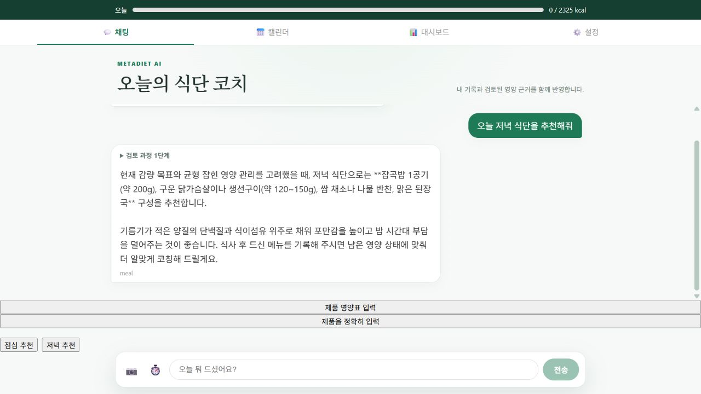
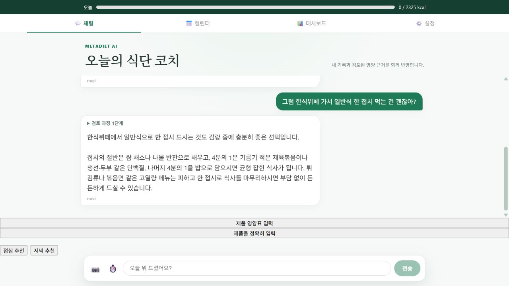
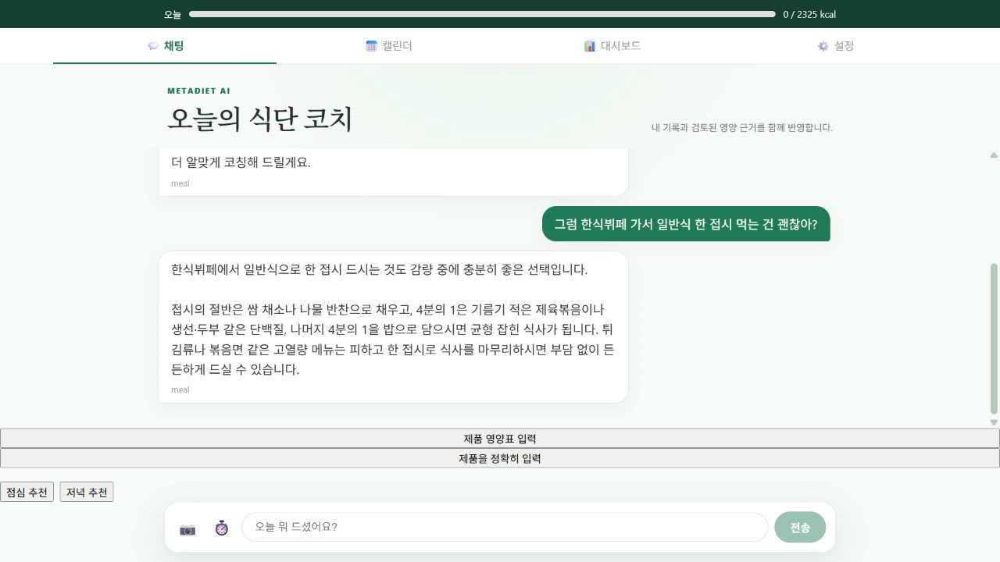

# 첫 식사 추천의 모델 위임·추론 최적화

## 문제와 변경

기존 후속 코칭 최적화 이후에도 첫 추천에는 Supervisor와 meal 모델 호출이 각각 필요했다. 공개 환경 첫 추천 6회에서 전체 완료 중앙값은 20.70초, Supervisor 모델 4.74초, meal 모델 7.42초, 예산 저장 4.02초, DB 읽기 0.48초였다. 단계 시간은 중첩될 수 있어 합산하지 않는다.

현재 요청에서 최신 사용자 정보와 섭취 기록을 확인한 **단순한 오늘 아침·점심·저녁 추천**만 meal 모델로 직접 연결하고 낮은 추론 설정을 사용한다. 전체 문자열이 허용된 형태와 일치해야 한다. 복잡한 조건·질환·계획 카드·기록 변경·확인 대기 요청과 DB 조회 실패는 기존 경로를 유지한다. 읽기 전용 도구, LangGraph, HITL, 실행 예산, 최종 검증은 유지한다. 요청 간 캐시는 추가하지 않았다.

`FIRST_COACHING_MODE=low`가 기본값이다. `default`는 직접 연결하되 공급자 기본 추론, `off`는 기존 Supervisor 경로로 복구한다. 후속 코칭의 기존 설정은 독립적으로 유지된다.

설계 근거: [LangGraph workflows/agents](https://docs.langchain.com/oss/python/langgraph/workflows-agents), [Gemini thinking 설정](https://ai.google.dev/gemini-api/docs/thinking).

## 실제 모델 교차 실험

[원본 18응답](ALTERNATING.json): 동일 세 질문 × 확정 기록 600/목표 2000, 삭제 후 기록 0/목표 1800 두 조건을 비교했다. 이전 대화에는 오래된 300/2000을 넣었다. 각 쌍에서 세 실행 순서를 회전했다. 실제 운영 DietTeam·Gemini를 사용하고 DB만 합성 데이터로 대체했다.

| 지표 | 기존 위임 | 직접 연결·기본 추론 | 직접 연결·low |
|---|---:|---:|---:|
| 전체 처리 중앙값 | 16.04초 | 8.84초 | 5.15초 |
| 모델 호출 | 2회 | 1회 | 1회 |
| 최신 남은 열량 일치 | 6/6 | 6/6 | 6/6 |
| 완료·저장 없음 | 6/6 | 6/6 | 6/6 |

[블라인드 모델 품질 평가](ALTERNATING_QUALITY.json)는 관련성·실행 가능성·섭취 사실 비조작·거짓 저장 주장 없음·간결성 각각 세 방식 모두 6/6이었다. judge는 gemini-3.1-pro-preview이며 동일 공급자 계열 평가다. 독립 인간·임상 평가나 실제 사용자 만족도를 뜻하지 않는다. [최신 수치 검사](FRESHNESS_MODEL.json)는 요청한 남은 열량을 서버 기대값과 비교했다.

## 실패와 해결

- 수치 검사 초기에는 기존 2/6, 직접 기본 4/6, low 6/6으로 나왔다. [실패 원본](FRESHNESS_PARSER_BEFORE.json)을 답변과 대조하니 실제 수치는 맞았지만 `1,400 kcal가 남아 있습니다`라는 역순 표현을 정규식이 놓쳤다. [Python re 문서](https://docs.python.org/3/library/re.html)를 확인하고 양방향 표현을 지원하되 충돌하는 수치가 있으면 실패하도록 수정했다. 7개 회귀 사례와 원본 18응답을 재검사했으며 답변을 재생성하지 않았다.
- 프론트 테스트는 샌드박스 임시 폴더의 `EPERM realpath`로 시작하지 못했다. [Node 오류 문서](https://nodejs.org/api/errors.html)의 권한 오류 의미에 따라 정상 사용자 환경에서 재실행해 72개 통과했다.
- 백엔드 전체 테스트는 시스템 임시 폴더의 `WinError 5`로 fixture 29개가 실패했다. [pytest basetemp 문서](https://docs.pytest.org/en/stable/how-to/tmp_path.html)에 따라 프로젝트 안의 전용 임시 폴더를 사용해 937 passed, 기존 1 skipped를 확인했다. 테스트를 삭제하거나 새로 건너뛰지 않았다.

## 공개 배포 전후

기준 버전 `8699002`, 최종 검증 버전 `925b24c`(성능 코드 `8928fd2` + 비식별 경로 진단 로그). 동일 일회용 계정에서 점심→뷔페, 저녁→샌드위치, 아침→밥/계란의 2턴 대화를 각 2회, 전후 각각 12요청 실행했다. 직전 실제 답변을 후속 요청에 전달하고 기동 확인 후 측정했다.

[전 원본](BEFORE_MULTITURN.json) · [후 원본](AFTER_MULTITURN.json) · [집계와 단계 시간](SUMMARY.json)

| 중앙값 | 전 | 후 |
|---|---:|---:|
| 첫 추천 전체 완료 | 20.70초 | 10.30초 |
| 첫 답변 도착 | 20.05초 | 9.90초 |
| 첫 추천 모델 호출 | 2회 | 1회 |
| Supervisor 모델 단계 | 4.74초 | 호출 없음 |
| meal 모델 단계 | 7.42초 | 3.90초 |
| 예산 상태 저장 단계 | 4.02초 | 2.46초 |
| 후속 전체 완료 | 9.72초 | 9.58초 |

첫 추천 완료 중앙값은 약 50.2% 감소했다. 여섯 쌍 모두 빨랐으며 후속 경로는 큰 변화가 없었다. 원격 모델·네트워크·DB가 포함된 순차 배포 비교이므로 모든 차이를 코드만의 인과 효과로 단정하지 않는다.

처음 `8928fd2` Live 표시는 확인했지만 [최초 배포 후 표본](DEPLOY_INITIAL_MULTITURN.json)은 여전히 Supervisor 1회+meal 1회였다. 해당 표본을 숨기거나 최종 적용 표본과 섞지 않았다. 환경변수·Docker 경로를 점검하고 대화 원문/건강 수치를 제외한 판정 로그를 추가해 재배포했다. `first_mode=low eligible=True verified=True direct=True action=False pending=False` 및 재측정 12/12의 모델 1회·Supervisor 없음으로 실제 활성화를 검증했다. [Render 배포 공식 문서](https://render.com/docs/deploys)의 인스턴스 전환 절차도 확인했지만 최초 표본의 인스턴스 식별 증거가 없어 정확한 플랫폼 원인은 미확정이다. **Live 배지만으로 성능 경로 활성화를 판정하지 않는다.**

## 한계와 다음 단계

[첫 추천 품질](FIRST_QUALITY.json)과 [후속 품질](QUALITY.json)은 각각 전후 6/6씩 다섯 기준을 통과했다. [공개 최신 기록 검사](FRESHNESS_PUBLIC.json)에서는 취소·수정 전 미저장, 중복 확정 1행, 수정 후 확정 438kcal 반영, 삭제 및 새로고침 후 0 복구를 확인했다. 오래된 대화가 있어도 [실제 답변](FRESHNESS_PUBLIC_ANSWER.json)은 목표 2325−확정 438=남은 1887kcal를 사용했다. 날짜·목표·다른 사용자·조회 장애는 공개 장애 주입이 아닌 300개 회귀 행렬로 검증했다.

브라우저에서 로그인→첫 추천 버튼→전송→후속 질문→새로고침 흐름을 확인했다. 아래는 실제 서비스의 합성 계정 화면이다.

검증 종료 후 일회용 Auth 계정·앱 기록·체크포인트와 임시 인증 파일을 정리했다. 캡처에는 기존 화면의 Markdown 기호와 일부 기본 버튼 스타일도 보이며, 이번 속도 개선이 UI 디자인 개선을 의미하지는 않는다.

다음 병목은 아직 남은 모델 생성(첫 추천 중앙값 3.90초), 예산 저장(2.46초) 및 요청·저장 비용이다. 실제 모델 스트리밍은 별도 정확성·중단·재연결 검증이 필요하다. 먼저 실제 사용자 표본을 쌓고 긴 응답의 첫 토큰 시간과 완료 시간을 분리해 평가한다.

재현: `benchmark_first_coaching.py`, `check_first_coaching_answers.py`, `benchmark_multiturn_delivery.py --phase before|after --output-dir docs/first_coaching`, `summarize_first_coaching.py`, `evaluate_followup_quality.py --turn 0|1 --output-dir docs/first_coaching`, `verify_public_coaching_freshness.py --first-advice --output-dir docs/first_coaching`. 공개 평가는 전용 일회용 계정과 무시된 환경 파일을 사용한다. 과거 원본은 덮어쓰지 말고 별도 출력 경로에서 재실행한다.

조건당 6개 합성 응답의 작은 표본이다. 모델·네트워크 편차가 있으며 p95나 모든 요청의 성능을 일반화하지 않는다. 빠른 경로 밖의 복잡한 요청은 여전히 여러 모델 호출이 필요하다. 현재 응답은 생성 완료 후 전달하며 실제 토큰 스트리밍 변경은 이번 범위가 아니다.
