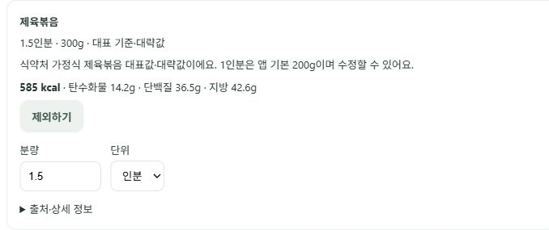

# 제육볶음 대표값 누락 수정 (2026-10-16)

## 원인

`오늘 아침에 계란후라이 4개와 제육볶음 먹었어`가 계란후라이 200g과 미확인 제육볶음으로 해석됐다. 대표 음식 목록/음식군에 제육볶음 연결이 없어 미확인 음식 기입·제외 화면으로 보냈다. CSV에는 돼지불고기 생것과 양념만 있었고, 활성 가공식품 DB에는 제육볶음 제품이 여러 개였다. DB 전체의 영양값 부재나 서버 오류가 아니라 **대표 기준 연결 누락**이다.

## 적용

- 식약처 K-FIND 가정식 품목대표 `돼지고기볶음(제육볶음)`, `D110-465000000-0001`을 검토한 고정 행으로 추가했다. 임의의 제조사 첫 검색 결과나 생것을 대신 쓰지 않는다.
- [공식 상세](https://various.foodsafetykorea.go.kr/nutrient/general/food/detail.do?searchFoodCd=D110-465000000-0001&searchMonthCd=AVG&searchRegionCd=ZZ), [확인한 수치·HTML hash](JEYUK_SOURCE.json). 데이터 기준일 2026-08-28, 100g당 195kcal/탄수화물4.73g/단백질12.15g/지방14.19g/나트륨501mg.
- 앱 기본 1인분은 **200g**이다. 원본의 총 내용량250g을 보편적 1인분으로 간주하지 않는다. 200g 기준 390kcal이며 앱 기본값·대표 대략값임을 표시하고 수정할 수 있다.
- 제육볶음·제육 볶음·돼지고기볶음·매운제육볶음·제육 별칭을 연결했다. 직접 g 또는 인분을 입력하면 우선 적용한다.
- 계란후라이4개는 기존대로 50g×4=200g이다. 두 음식을 바로 기존 확인 카드에 표시하고 분량 수정·제외·재계산·취소·이대로 기록을 사용한다. 자동 확정/실제 섭취 저장은 하지 않는다.
- 공통 영양 조회도 가공 제품과 식약처 일반 음식 대표값을 구분한다. 정확한 제품 조회의 복수 후보/부분 일치 선택 정책은 유지한다. DB migration·새 외부 API 의존성은 없다.

## 조회가 안 될 때의 정책

이번 음식에는 Exa가 필요하지 않다. 일반적인 방식은 **공식 조리 음식 데이터 → 검토한 대표 음식/음식군과 기본 분량 → 사용자 확인 카드**다. 외부 검색은 누락된 공식 자료를 개발 과정에서 찾는 보조 수단이며 실시간 검색 결과나 LLM 추측 영양값을 바로 기록하지 않는다. 적절한 대표 기준도 없으면 기존 기입·제외·취소 선택권을 유지한다. 모든 미등록 음식을 이번 수정으로 해결했다는 뜻은 아니다.

## 검증

재현 테스트6개가 실제 실패한 뒤 수정 후 통과했다. 일반 영양 조회 API의 not_found도 별도 실패 테스트로 재현·수정했다. 동일한 별칭4종×분량5종×문맥5종의 동결100가지 파서 회귀와 출처·수치 환산·확인 전 미저장·수정 버전 검사를 포함해 **백엔드 전체1215 passed·기존1 skipped**였다. 기능 회귀이며 속도/정확도 전후100건 비교나 실제 사용자 성과는 아니다.

원본 조사 중 없는 CSV 코드 컬럼을 선택한 KeyError는 [pandas 공식 인덱싱 지침](https://pandas.pydata.org/docs/user_guide/indexing.html)에 따라 실제 컬럼만 조회해 해결했다. 공식 검색이 다운로드 메타데이터만 반환한 경우 페이지의 searchDetailMode=all 옵션을 대조해 음식 목록을 확인했다. HTML 조사 도구의 bs4 미설치는 새 의존성을 추가하지 않고 [Python 표준 HTMLParser](https://docs.python.org/3/library/html.parser.html)로 대체했다. 운영 검색에 이 조사 도구를 넣지는 않았다.

## 공개 배포와 브라우저

Render main 자동 배포 후 API health의 커밋 `7868cdbab3153d77af81aae709db97ece78fe2d1`을 확인했다. [공개 읽기 전용 조회](JEYUK_PUBLIC.json)에서 제육볶음200g=390kcal, 제육 볶음300g=585kcal였다.

로그인된 공개 브라우저에서 사용자가 제보한 원문을 입력했다. 계란후라이4개=200g/412kcal와 제육볶음200g(1인분)/390kcal가 영양표 기입 화면 없이 바로 확인 카드에 나왔다. 제육볶음을1.5인분으로 바꿔 재계산해300g/585kcal, 합계997kcal로 갱신됨을 확인했다. 계란을 제외하고 재계산하자 제육볶음만 남고 합계585kcal가 됐다. 마지막에 취소해 실제 섭취로 확정하지 않았다. 기존 실제 기록은 수정·삭제하지 않았다.

프론트의 기존 분량 편집3개와 미확인 선택권2개 테스트도 통과했다. UI 코드를 변경하지 않아 프론트 빌드는 반복하지 않았다. 캡처는 개인 목표·계정·다른 대화를 제외하고 제육볶음 수정 카드만 담았다.

이전 대화에 남아 있는 미확인 선택 카드는 자동으로 다시 계산하지 않는다. **전체 취소 후 새 입력**으로 확인한다. 기존 ‘아침이’ 등 별개의 조사 오타와 아직 검토된 대표 기준이 없는 음식은 이번 변경의 완료 범위가 아니다.
