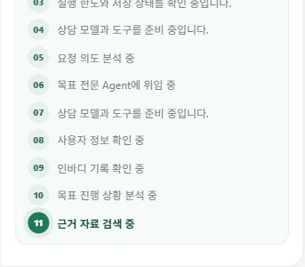

# 첫 진행 표시 전 대기 개선

## 원인과 변경

기존 화면은 서버 진행 이벤트가 오기 전 빈 응답과 커서만 표시했다. 서버에서는 사용자 인증 매핑, 대화 잠금, 체크포인트 복원, 예산 상태 저장, SDK 준비 등이 첫 의도 분석 이벤트보다 앞에 있었다. 과거 사용자가 경험한 20초를 특정 구간으로 확정할 계측은 없었다.

- 프론트: 전송 후 서버 응답 전에도 즉시 일반 대기 안내. 텍스트 없는 커서는 숨김.
- 서버: 인증 완료 후 잠금 대기 진입 전 준비 프레임, 잠금 획득 후 상태 복원 안내. 실제 예산 확인과 모델 준비 이벤트도 추가.
- 안전: 준비 프레임은 seq 없는 일시적 안내이며 기존 재연결 저널 번호를 소비하지 않는다. 잠금 밖에서는 상태를 읽거나 변경하지 않는다. 인증·소유권·확정 경계는 유지한다.
- 계측: `chat_preparation` 고정 레이블로 auth_profile, conversation_lock, checkpoint_restore, sdk_prepare_*, tool_bind_*, model_budget_*, budget_storage, first_model_started의 시간을 남긴다. 원문·사용자 ID·건강 수치를 추가 기록하지 않는다. 서로 포함되는 구간은 단순 합산하지 않는다.

## 검증과 한계

[합성 전후 결과](PREPARATION_DELIVERY_SYNTHETIC.json): 고정한 20ms 잠금 대기를 전후 각 100회 실행했다(Windows 실제 타이머 때문에 약 30ms 관측). 첫 프레임 중앙값 30.390→0.038ms, p95 31.333→0.102ms. 실패·타임아웃 0/100씩, 완료 응답 동일 100/100씩. 완료 중앙값 30.450→30.519ms로 실질적 단축은 없다. 이는 모델·실제 DB·최신 기록 정확도 실험이 아니다.

프론트 전체 102개 테스트와 빌드, 준비·스트림·재연결 관련 백엔드 21개 테스트 통과. 최종 백엔드 전체는 1341 passed, 기존 1 skipped. 실제 공개 지연 비교는 이 합성 결과로 대체하지 않는다. 과거 20초의 원인은 미확정이며 새로운 공개 계측을 근거로 개선 여부를 판단해야 한다.

공식 근거: [FastAPI StreamingResponse](https://fastapi.tiangolo.com/advanced/custom-response/#streamingresponse). generator의 yield 시점에 전달하므로 오래 걸리는 잠금 획득 이전에 비민감 준비 안내를 먼저 yield한다. 최초 안내가 보인다고 모델 호출이나 Agent 위임이 시작되었다고 주장하지 않는다.

## 공개 배포 기능 검증

2026-10-16 웹 `/build-info.json`과 API `/health` 모두 `abc03e45f9f63e8d5fcf1c7b2c1bb0c834f475ab` 확인. 실제 로그인 브라우저에서 복합 상담 전송 직후 일반 대기 안내가 AX와 스크린샷 관찰에 나타났다. 이어 잠금·상태 복원·실행 한도·모델 준비·의도 분석·목표 Agent 위임이 표시됐고, 최종 12단계 검토로 종료했다. 근거 정책에 의해 구체 수치 권고는 보류되어 답변 품질 개선을 주장하지 않는다. 저장/전략 변경 버튼은 누르지 않았다.

단일 공개 기능 관측 로그(성능 비교 표본 아님): 대화 잠금 783.990ms, 체크포인트 143.764ms, 초기 예산 저장 420.431ms, supervisor SDK 준비 503.776ms, 도구 바인딩 1.598ms, 모델 예산 예약 357.914ms. 그래프 진입→첫 모델 호출 1942.757ms는 일부 구간을 포함하므로 중복 합산하지 않는다. auth_profile은 동시에 분석 이벤트에도 발생해 어느 행이 이 요청인지 단정하지 않는다. 과거 20초 재현 실패이며, 현재 로그만으로 과거 원인을 확정하거나 실제 모델 지연을 줄였다고 주장할 수 없다.

브라우저 자동화의 초기 버튼 대기는 페이지 복원 도중 selector deadline으로 한 번 실패했으나, 새 AX에서 복원 완료를 확인한 뒤 입력했다. 제품 요청은 중복 제출하지 않았다.

