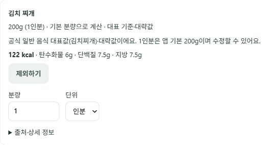
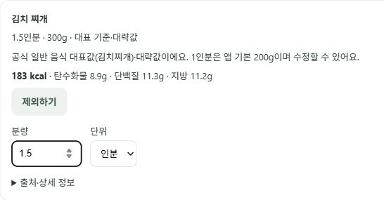
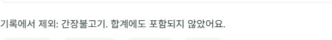
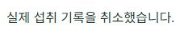

# 대표 음식 공개 배포·브라우저 검증과 새로고침 복구

검증일: 2026-10-16. 로그인된 실제 MetaDiet 브라우저에서 합성 식사 입력으로 기능을 점검했다. 확정 저장은 수행하지 않았다.

## 최초 배포 확인

`/health`와 웹 `/build-info.json`이 모두 `d2b65400e7f0bead98e0e737bdda6686a5216462`를 반환했다. 이전 턴의 ‘공개 반영 미확인’ 상태를 해소했다.

입력: `오늘 점심에 김치 찌개 간장불고기 김치볶음밥 먹었어`.

| 단계 | 실제 브라우저 관찰 |
|---|---|
| 기본 분량 | 김치 찌개200g/122kcal, 간장불고기200g/372kcal, 김치볶음밥300g/501kcal, 합계995kcal |
| 안내 | 기본 분량·대표 기준·대략값 표시, 제조사 선택이나 영양표 기입 요구 없음 |
| 분량 수정 | 김치찌개1.5인분→300g/183kcal, 합계1056kcal |
| 변경 중 경계 | 다시 계산하기 전 ‘이대로 기록’ 비활성화, 이전 영양값임을 표시 |
| 제외 | 간장불고기 제외 후 두 음식만 남고 제외 안내·합계684kcal |
| 추가 새로고침 | **실패 발견**: 진행 중 제안이 보이지 않고 날짜 기준의 다른 대화가 복원됨 |

캡처는 합성 음식 카드만 잘라 실제 사용자 목표·섭취 현황·계정 정보는 포함하지 않았다.

## 실패 원인과 수정

`App.js`가 대화 ID를 React 메모리에만 두고 새로고침마다 날짜 기준으로 초기화했다. 서버의 제안/체크포인트가 없어지는 문제와 구분한다. 장시간 열어둔 탭에서 날짜가 달라지거나 서버가 다른 대화 ID를 반환한 뒤 새로고침하면 같은 대화를 복원하지 못한다.

[MDN sessionStorage](https://developer.mozilla.org/en-US/docs/Web/API/Window/sessionStorage)는 탭 세션 저장소가 새로고침을 넘어 유지되고 탭을 닫으면 사라지는 점과 차단 시 SecurityError가 발생할 수 있음을 설명한다. 이 특성에 맞춰 아래를 구현했다.

- `useConversationThread`에서 인증 계정별로 **불투명한 대화 ID만** 저장한다. 토큰·대화 원문·건강 수치를 추가 저장하지 않는다.
- 현재 계정의 ID 복구가 끝나기 전에 Chat을 마운트하지 않는다.
- 최초 날짜 기반 ID도 보관해 날짜 변경 뒤 새로고침을 지원한다. 정상 새로고침은 로그인 세션을 변경하지 않는다.
- 잘못된 저장값은 무시하고, 저장소 차단은 현재 대화를 중단시키지 않는다. 차단 환경에서는 새로고침 복구를 보장하지 않는다.
- 계정 변경 시 이전 화면 상태를 초기화하고 이전 계정의 늦은 대화·통계·중단 상태 응답은 적용하지 않는다. 독립 코드 리뷰에서 발견한 기존 늦은 콜백 문제를 실패 테스트로 재현 후 차단했다. [React 공식 비동기 응답 경쟁 안내](https://react.dev/reference/react/useEffect#fetching-data-with-effects).
- 기존 JWT 소유권 검사·proposal 확인·중복 저장 방지·도메인 저장 로직은 바꾸지 않았다.

실패한 첫 합성 제안은 원문·음식 ID·분량·버전으로 유일하게 식별하고 기존 `ProposalRepository.resolve(..., cancel)`로 정리했다. `meal_logs` 전체 행의 전후 fingerprint가 동일함을 비공개로 확인했으며 실제 식사 내용이나 사용자 식별자는 문서에 게시하지 않았다. 이 정리는 브라우저 취소 성공으로 집계하지 않는다.

## 자동 회귀

- 프론트 전체 **28 suites /99 tests 통과(exit0)**, production build 통과.
- 신규7개: 대화 ID 재마운트 복구, 계정 분리와 늦은 ID 콜백, 저장값/저장소 차단, 날짜 변경, App 실제 연결2개, 늦은 이전 계정의 화면 콜백.
- 먼저 미구현 모듈과 늦은 화면 콜백 실패를 확인한 뒤 수정했다. 신규 테스트 환경의 인증 mock은 CRA가 초기화하므로 매 테스트 반환값을 다시 설정하고, jest-dom matcher 초기화도 보완했다. [Jest resetMocks](https://jestjs.io/docs/configuration#resetmocks-boolean). 테스트를 삭제하거나 skip하지 않았다.
- D드라이브 Jest 캐시와 `--testTimeout=15000`을 사용했다. 기존 대량 UI100회 갱신 회귀를 그대로 포함한다.
- 이번 제품 수정은 프론트 대화 포인터 복구다. 백엔드/영양 매핑은 바꾸지 않았다. 앞선 동결 음식100종 평가와 본 수동 브라우저 기능 점검은 별개이며, 새 속도·정확도·p95 개선 주장을 하지 않는다.

## 수정 배포 후 브라우저 재검증

API와 웹 모두 **`1d48676d921bc76ebc83c2931f61feb403276818`** 응답을 확인했다. [배포 버전 원결과](REPRESENTATIVES_PUBLIC_DEPLOYMENT.json), [브라우저 검증 요약](REPRESENTATIVES_PUBLIC_BROWSER.json).

| 단계 | 수정 배포 후 실제 결과 |
|---|---|
| 같은 입력 → 기본 분량 | 200g·200g·300g, 합계995kcal, 기입/제조사 선택 없음 |
| 1.5인분 수정 | 김치찌개300g/183kcal, 합계1056kcal |
| 간장불고기 제외 | 두 음식만 유지, 제외 안내와 합계684kcal |
| 수정 후 새로고침 | 같은 V4, 300g·300g, 제외 안내와 합계684kcal 복원 |
| 실제 취소 버튼 | ‘실제 섭취 기록을 취소했습니다.’ 표시, 확인 카드 제거 |
| 취소 후 새로고침 | 대화 내용 유지, 확인 카드 재등장 없음, 입력 가능 |
| 실제 섭취 보호 | 검증 전후 meal_logs fingerprint 동일, 확정 버튼 미실행 |

중간 자동화에서 합계 문구의 exact-text 대기를 실패했지만, 직후 접근성 트리에서1056kcal와 V3를 확인했다. 제품 실패로 세거나 요청을 중복 전송하지 않았고 이후 새 상태를 기준으로 제외를 진행했다. 공개 기능 검증은 단일 로그인 세션의 합성 입력 흐름이며, 실제 사용자 연구/부하/속도 비교가 아니다.

이 문서 반영 커밋은 `[skip render]`로 배포를 생략한다. 문서 커밋과 실행 구현 커밋을 구분하며 위1d48676이 검증한 최신 실행 구현이다. 모델 크레딧 소진 문제는 이번 프론트 수정으로 해결된 것이 아니며, 모델 코칭의 정상성은 이 검증 범위에 포함하지 않았다.
