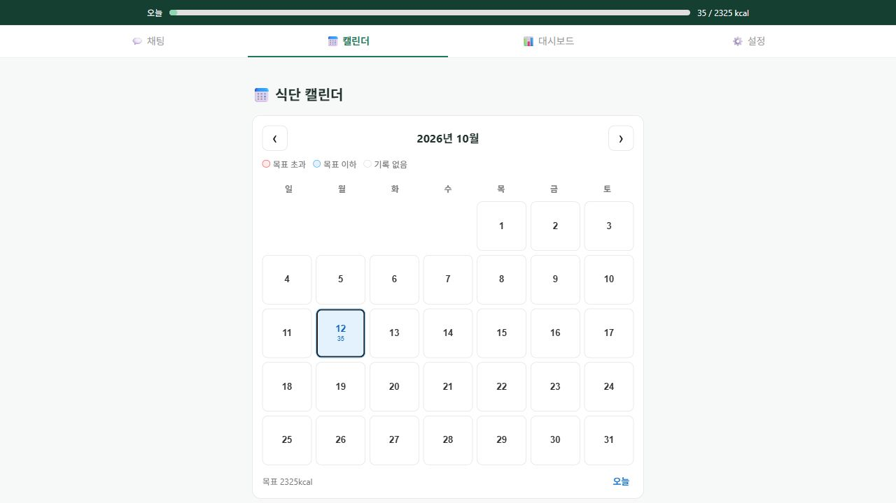

# 국내 식품 카탈로그 통합 검증·Agent 비교

측정일: 2026-10-12. 실제 사용자 성과가 아닌 합성 검증 결과다.

## 버전 복구 통합 검증

실제 Supabase PostgreSQL 연결에서 운영 수입·활성화 함수를 호출했다. 운영 카탈로그 변경 없이 세션 전용 임시 테이블로 격리했으며, 별도 연결에서도 운영 활성 버전이 그대로임을 확인했다.

7항목 통과: 동일 버전 재수입 1행 유지, 새 버전에서 이전 검증 버전 복구, 버전 내용 충돌 거부, 수입 건수 불일치 거부, 미검증 버전 거부, 별도 연결의 운영 상태 불변, 강제 롤백 후 합성 행 제거.

- [원본 결과](RECOVERY_INTEGRATION.json)
- 재현: `cd backend` 후 `venv\Scripts\python.exe scripts/check_food_catalog_recovery.py`
- 범위: 실제 PostgreSQL/COPY/활성화 함수 검증. 전체 28만 행의 운영 판본을 실제 교체하는 장애 훈련은 아니다.

처음에는 운영 테이블의 미커밋 활성화 실험을 준비했으나 자동 승인 검토가 트랜잭션 격리 실패 가능성을 지적했다. 임시 테이블이 운영 이름을 가리는지 OID로 검사하고, 수입 함수의 연결 컨텍스트가 외부 트랜잭션을 커밋하지 않도록 바꿨다. [psycopg 공식 트랜잭션 문서](https://www.psycopg.org/psycopg3/docs/basic/transactions.html)를 확인한 뒤 7항목을 재검증했다.

## Agent 호출 수·응답 시간 비교

현재 Agent 구현에서 카탈로그만 CSV 단독/CSV+식약처로 바꾼 비교다. 실제 Gemini `gemini-3.8-flash`를 사용하고, 각 식품 3회씩 총 18회 실행했다. 실행 순서를 번갈아 배치했으며 제안 저장소는 메모리로 대체하여 실제 식사 DB 변경은 0건이다.

| 항목 | CSV 단독 (9회) | CSV + 식약처 (9회) |
|---|---:|---:|
| 모델 호출 중앙값 | 4회 | 4회 |
| 도구 호출 중앙값 | 3회 | 3회 |
| 실행 시간 중앙값 | 16.128초 | 18.010초 |
| 정확히 선택한 제품의 제안 생성 | 3/9 | 9/9 |

조회 범위 확대는 확인됐지만 호출 수 감소나 속도 향상은 확인되지 않았다. 전체 중앙값은 1.882초 늘었다. CSV 단독은 일반 밥만 제안했고, 미등록 가공식품 6회는 임의 대체 없이 정보를 요청했다.

| 합성 선택 제품 | CSV 단독 중앙값 | 식약처 추가 중앙값 |
|---|---:|---:|
| 멥쌀, 백미, 밥 | 17.994초 | 16.841초 |
| 라이스 페이퍼 | 14.834초 | 17.865초 |
| B.돼지바 마카롱 | 15.719초 | 23.524초 |

`돼지바` 검색의 합성 선택은 **B.돼지바 마카롱**(`mfds:P101-102000100-0789`)이다. 원래 사용자가 말한 돼지바 아이스크림을 찾거나 검증했다고 주장하지 않는다. 검색 후보 중 특정 ID를 명시적으로 선택한 계산 경로를 검증했다.

- [18회 원본 결과·호출 이벤트](AGENT_COMPARISON.json)
- 재현: `cd backend` 후 `venv\Scripts\python.exe scripts/eval/run_food_agent_comparison.py`
- 과거 12회 모델/17회 도구/약 100초 장애 실행의 동일 조건 재현 비교가 아니다.
- 로컬 CSV 구성, Gemini, 원격 DB 읽기를 포함한다. Render 휴면 복구·브라우저 전체 지연이나 `/health` 응답 시간과 다르다.
- 조건당 9회이므로 p95·통계적 유의성·실제 사용자 만족도를 주장하지 않는다.

## 검증 중 발견한 오류와 해결

1. **UI 선택 ID가 Agent 검색 이력에 없으면 거부**: 실험의 `nutrition_lookup` 이벤트에서 선택된 ID를 다시 검색하라는 오류를 확인했다. 카탈로그에 제품이 있어도 영양표를 요청했다. 사용자 메시지의 단일 `제품 선택: ID`만 허용하고 활성 카탈로그에서 재검증하도록 수정했다. 다른 ID는 여전히 거부하며 HITL을 유지한다. 회귀 테스트 RED→GREEN, 전체 백엔드 407 passed/1 skipped 후 공개 API 배포를 확인했다. [LangGraph 상태 지속성 문서](https://docs.langchain.com/oss/python/langgraph/persistence)를 참고했다.
2. **날짜 없는 UI 요청의 기록일 오류**: 공개 브라우저 확인 카드에 오늘 대신 카탈로그 판본 날짜와 같은 2026-09-29가 표시됐다. 모델이 그 날짜를 택한 내부 이유까지 확인한 것은 아니다. 확정하지 않고 취소했으며 식사 저장 0건을 확인했다. 제품 검색 설명과 생성 요청에 `오늘`을 명시해 서버의 오늘 날짜 검증을 사용하도록 수정했다. 프론트 회귀 테스트 RED→GREEN, 전체 61 passed 및 프로덕션 빌드 통과. 임의의 모든 날짜 없는 채팅까지 해결했다고 주장하지 않는다.
3. **부분 결과 저장 중 빈 그룹 중앙값 계산**: 첫 샘플에는 다른 조건 데이터가 없어 `StatisticsError`가 발생했다. [Python statistics.median 공식 문서](https://docs.python.org/3/library/statistics.html#statistics.median)에 따라 빈 그룹을 제외하고 18회 실행을 완료했다.
4. **최종 프론트 검사 시작 전 EPERM**: 샌드박스의 Jest 초기화가 `realpath` 임시 경로 접근에서 실패했다. [Node os.tmpdir 공식 정의](https://github.com/nodejs/node/blob/main/doc/api/os.md#ostmpdir)를 확인해 TEMP/TMP를 프로젝트로 지정했으나 같은 EPERM이 반복됐다. 테스트 코드나 기대값을 바꾸지 않고 동일 명령을 일반 실행 환경에서 재실행하여 19 suites/61 tests 통과를 확인했다. 백엔드는 407 passed/1 skipped, 프로덕션 build는 `main.cdd52911.js` 생성에 성공했다.

[선택 오류 발견 당시 7회 부분 실행](AGENT_COMPARISON_BEFORE_SELECTION_FIX.json)은 진단 자료다. 완결된 기준 실험이나 위 표의 비교군으로 사용하지 않았다.

## 공개 브라우저 전체 흐름

공개 웹에서 합성 계정으로 라이스페이퍼를 검색하고 제조사 `BRANCH OF CHANH KHANG COMPANY LTD.`/포장 300g/기준 100g 후보를 선택했다. 생성된 요청에는 제품 ID와 `오늘`이 들어갔고, 실제 Agent가 10g/35kcal/2026-10-12/식약처 출처의 확인 카드를 만들었다.

확정 전 SQL 식사 행 0건·pending 제안 1건 → 화면의 명시적 확정 → 오늘 합계 35kcal → 새로고침 후 대화·35kcal 유지·확인 카드 소멸을 검증했다. 새로고침 후 SQL 행은 정확히 1건이며 제품 ID·제조사·기준량·판본 메타데이터가 저장됐다. 앞선 날짜 오류 제안은 취소했고 저장 0건을 확인했다.

- [공개 브라우저 11항목 결과](BROWSER_FLOW_VERIFICATION.json)
- API 제품 선택 수정: `0b57738`, 웹 오늘 기록 의도 수정: `af977fb`
- 중복 확정 HTTP 검증은 앞선 [공개 API 9항목](PUBLIC_SMOKE.json)과 구분한다.
- 실제 사용자 계정·건강 데이터는 테스트에 사용하지 않았다.
- 합성 계정의 Auth·앱 프로필·식사 데이터·체크포인트를 정리하고 미존재를 확인했다. Auth admin 삭제만으로 앱 프로필도 제거된다는 초기 정리 검증은 실패했다. 기존 `AccountDeletionService`처럼 앱 데이터와 Auth가 별도 삭제 단계임을 확인하고, 이번 합성 UUID로 한정해 체크포인트와 프로필을 제거했다. 실제 서비스 계정 삭제 기능의 실패로 해석하지 않는다. [Supabase 사용자 데이터 문서](https://supabase.com/docs/guides/auth/managing-user-data)와 [cascade 문서](https://supabase.com/docs/guides/database/postgres/cascade-deletes)를 참고했다.

## 검증 한계와 후속 작업

- 실제 사용자 피드백·만족도·건강 변화는 추후 수집한다.
- Open Food Facts, 미등록 제품의 자동 사진 인식, 운영 판본 전체 교체 훈련은 이번 범위에 포함하지 않는다.
- 카탈로그 보강은 조회 범위와 안전한 미등록 처리를 개선했다. Agent 지연 단축은 별도 성능 개선 과제로 남는다.
