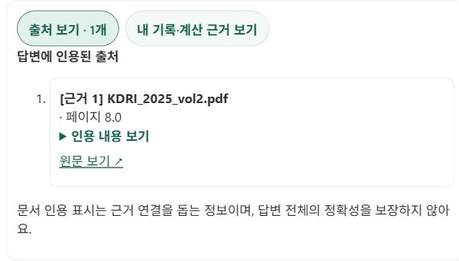
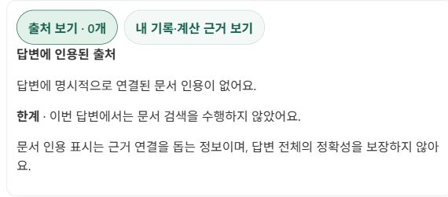

# 공개 배포·저녁 추천 출처 검증 (2026-10-19)

공개 API·웹 모두 `19bd2597ba741b46302c7d5efdf9b20d78f24c11` 반영과 API health 정상 응답을 확인했다. [공개 버전](public-build.json), [민감 정보 없는 검증 결과](verification.json).

## 실제 브라우저 확인

| 항목 | 결과 |
| --- | --- |
| 일반 ‘저녁 추천’ | 출처 보기·내 기록 근거 버튼 표시 |
| 문서 검색 없는 답변 | 출처 0개와 검색 미수행 안내, 출처를 임의 생성하지 않음 |
| 내 기록·계산 근거 | 조회한 확정 음식·섭취량·활성 목표 표시, 상단 집계와 일치 |
| 공식 지침 검색을 명시한 추천 | 수정 후 본문 근거 1과 출처 카드 1개 연결 |
| 출처 상세 | KDRI_2025_vol2.pdf, 페이지 8.0, 발췌문 펼침 확인 |
| 원문 링크 | 한국영양학회 2025 KDRI 공식 배포 페이지를 새 탭으로 열어 확인 |
| 새로고침 | 최신 답변의 출처·기록 근거 복원 |
| 실제 섭취 기록 | 저장·수정·삭제 수행하지 않음 |

## 실패 → 원인 → 수정 → 재검증

최초 검색 포함 요청은 ‘검색 기능이 없다’고 답했다. 요청 ID `2663e7c8-222b-4ab9-8ffe-3f9ff087642e`의 브라우저 진단과 실행 단계는 응답 완료·전문 Agent 위임을 보여줬지만 검색 단계는 없었다. 출처 패널도 검색 미수행으로 표시했다.

원인은 ‘검색…없이/하지 마’를 문장 전체에서 매칭하는 기존 정규식이었다. ‘검색해줘. 저장이나 식사 제안 생성 없이 조언만 해줘’의 저장 제한까지 검색 금지로 오인했다. [Python re 공식 문서](https://docs.python.org/3/library/re.html)를 확인하고 검색에 인접한 금지 표현만 판정하도록 수정했다. 재현 테스트 최초 4 failed / 6 passed → 관련 회귀 38 passed. 명시적 검색 금지는 유지한다.

수정 후 같은 요청을 공개 브라우저에 재입력하여 실제 문서 검색·명시적 인용·출처 카드·원문 링크를 확인했다. 자동화 도구의 응답 도착 전 selector 대기 만료와 summary 역할 조회 실패는 실제 서비스 오류와 구분하고, 새 화면 상태와 실제 summary 요소로 재확인했다.

## 테스트와 검증 범위

최종 백엔드 전체 1,461 passed / 기존 1 skipped / 기존 경고 3건. 프론트 전체 126 passed / 35 suites. 프로덕션 빌드 성공. 자격 정보 검사 0건 노출.

이는 기능 검증이다. 조건별 100건 속도·품질 비교를 수행한 결과가 아니며, 응답 지연 개선이나 검색 정확도 개선률을 주장하지 않는다. 인용된 문서가 있다는 사실은 답변 전체의 정확성을 보장하지 않는다. 모든 과거 메시지의 근거 이력은 저장하지 않으며, 최근 며칠의 식사·체성분 조회 전체는 표시 범위에 포함되지 않는다.

## 캡처

개인 섭취 기록·건강 수치가 들어간 화면은 공개 자료에서 제외했다.

