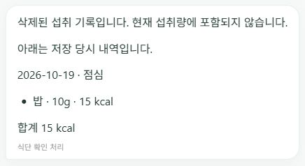
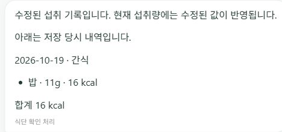
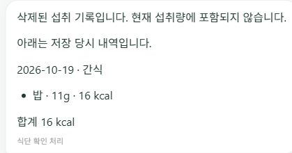

# 식사 기록 변경과 화면 동기화 (2026-10-19)

## 문제와 원인

검증용 기록을 삭제하면 캘린더 집계는 바뀌지만 상단은 이전 값을 유지했다. CalendarView의 변경 성공 경로에 App의 공유 집계를 갱신하는 연결이 없었다. 대화의 저장 요약은 당시 문자열이어서 삭제 후에도 현재 기록처럼 보였다.

## 변경

- 삭제·분량 수정 성공 후 서버의 오늘 집계를 다시 읽어 상단에 반영한다. 과거 날짜 수정에도 상단은 항상 서비스 시간대의 오늘을 표시한다.
- 요청 실패를 성공으로 처리하지 않는다. 집계 재조회 실패는 기록 변경 실패와 구분하고 재조회 버튼을 제공한다. 응답이 늦게 와도 다른 로그인 사용자의 상태를 덮어쓰지 않는다.
- 대화 복원 시 현재 사용자·대화의 확정 intake proposal 결과에 있는 meal ID를 현재 기록과 대조한다. 삭제·일부 삭제·수정을 구분하고 원래 요약에는 ‘저장 당시 내역’이라고 표시한다. 원본 대화는 변경하지 않는다.
- 기존 영양값을 분량 비율로 환산한다. 캘린더 수정에서 모델이 새 영양값을 만드는 경로를 제거했다. 0·음수·비정상 분량, 기존 영양값 부재는 거부한다. 소유권 검증을 유지한다.
- 새 마이그레이션이나 의존성을 추가하지 않았다.

## 검증

- 백엔드 전체: 1,442 passed, 기존 skip 1건 유지, 기존 deprecation warning 3건.
- 프론트 최종 전체: 118 passed / 33 suites.
- 프로덕션 빌드 성공(빌드 시 ESLint 포함).
- 삭제/일부 삭제/수정/변경 없음, 소유권, 조회 실패 시 삭제 오판 방지, HTTP 오류, 캘린더→상단→대화 갱신을 합성 회귀 테스트로 확인했다.
- 속도·정확도 비교 실험은 수행하지 않았다. 위 테스트는 기능 검증이며 실사용 성공률이나 성능 개선 수치가 아니다.

## 제한

기록 ID가 남아 있는 최근 100개 확정 proposal과 정확히 일치하는 저장 요약만 상태를 연결한다. ID가 없는 레거시 요약이나 그 범위를 벗어난 요약은 삭제 상태를 추정하지 않는다. 동일한 요약이 여러 건이고 상태가 다르면 캘린더 확인 안내를 제공한다. 별도 기기에서 생긴 변경은 대화 복원/새로고침 시 반영되며 실시간 구독은 아니다. 분량 수정은 기존 추정값을 비례 환산하므로 원래 음식 선택의 정확도까지 개선하지 않는다.

## 공식 문서 근거

- [React: 공유 상태와 부모 콜백](https://react.dev/learn/sharing-state-between-components)
- [Supabase Python: 사용자·대화 필터](https://supabase.com/docs/reference/python/using-filters)

## 공개 배포 검증

웹 `build-info.json`과 API `/health`가 모두 코드 커밋 `8f93fd048cec00c4262d54c48ae2e9402c05bfde`를 반환했다. Render API 자동 배포 ID는 `dep-dbaradlg1s2s73bknh0g`다.

로그인된 공개 브라우저에서 앞서 삭제한 합성 밥 10g 요약이 ‘삭제된 섭취 기록입니다. 현재 섭취량에 포함되지 않습니다.’로 바뀌고 ‘저장 당시 내역’이 구분되는 것을 확인했다. 상단도 검증 전 집계로 유지됐다. 캡처는 이 검증용 요약만 포함하며 실제 섭취·목표 수치는 공개하지 않았다.

최초 공개 확인은 기존 삭제 내역을 읽는 범위였다. 이후 사용자가 검증용 기록 한 건 생성·수정·정리를 승인하여 아래 공개 브라우저 전 과정을 추가 확인했다.

### 사용자 승인 후 실제 브라우저 수정·삭제 검증

1. 오늘 간식에 합성 밥 11g 한 건을 확인 카드로 확정했다. 저장 전과 비교해 상단에 해당 열량(표시 16kcal)이 반영됐다.
2. 캘린더에서 그 한 건만 22g으로 수정했다. 캘린더에는 22g·32kcal가 표시됐고, 페이지 새로고침 없이 상단도 추가 분량만큼 갱신됐다.
3. 채팅 탭으로 돌아오자 ‘수정된 섭취 기록입니다’와 ‘저장 당시 내역’ 안내를 확인했다. 요약의 11g은 저장 당시 값이고 현재 값은 캘린더의 22g이다.
4. 실행 직전 삭제 확인을 받은 뒤 검증용 22g 한 건만 삭제했다. 페이지 새로고침 없이 상단이 검증 전 값으로 복원됐고, 채팅에도 ‘삭제된 섭취 기록입니다. 현재 섭취량에 포함되지 않습니다.’가 표시됐다.
5. 기존 아침 실제 기록 두 건의 음식·분량·표시 열량이 그대로 유지됨을 확인했다. 검증용 활성 기록은 남기지 않았다. 저장·수정·삭제 이력 안내는 대화에 남는다.

단일 합성 기록의 기능 E2E 검증이다. 즉시는 ‘사용자 새로고침 없이 서버 재조회 완료 후 갱신’이라는 뜻이며, 0ms 반영·지연 개선·일반 성공률을 주장하지 않는다. 새 성능 비교는 수행하지 않았다.

공개 API health 최초 확인은 30초 타임아웃, 다음 확인에서는 200과 기존 커밋을 반환했다. Render 공식 문서는 무료 서버가 유휴 후 기동에 약 1분이 걸릴 수 있다고 설명한다. 이번 한 번의 타임아웃 원인을 그것으로 확정하지는 않는다. [무료 서비스 제한](https://render.com/docs/free#spinning-down-on-idle).
