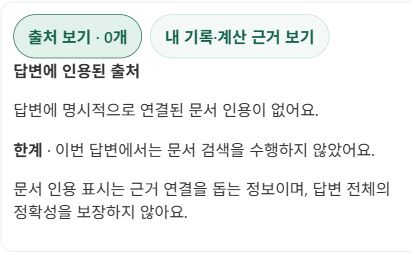
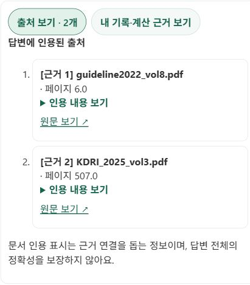

# 자연스러운 근거 요청 검색과 출처 상태 표시

2026-10-20. ‘영양학적으로’, ‘근거해서’ 같은 요청에도 문서 검색을 수행하도록 보완했다. 일반 추천에 매번 검색을 강제하지 않는 기존 설계는 유지한다.

## 원인과 수정

기존 Agent는 `search_evidence` 도구를 사용할 수 있지만 검색 여부는 모델 선택에 달려 있었다. ‘영양성분 지식에 근거해서’가 있어도 검색 없이 답할 수 있었다. UI는 사유를 접힌 ‘출처 보기 · 0개’ 안에 표시해 검색 미수행과 실패를 알아보기 어려웠다.

공개 구버전 `19bd2597`에서 사용자가 제시한 치킨 약속 질문을 그대로 재현했다. 요청 `306c37d9-2172-4b79-99cd-0e1bd28e91df`는 전문 Agent 위임까지 8단계로 완료했으나 검색 단계 없이 출처 0개였고, 펼친 안내는 ‘문서 검색을 수행하지 않았어요’였다. 연결 실패 후 재시도한 성공 실행의 관측이며 별도 정확도 평가가 아니다. [수정 전 화면](before-no-search.jpg), [기능 검증 기록](verification.json).

모델이 도구를 고르지 않고 답하는 재현 테스트를 고정했다. 수정 전 새 백엔드 테스트 14건 실패를 확인하고 답변 생성 전 예산을 사용하는 읽기 전용 검색 단계를 추가했다. 검색 결과와 evidence ID를 Supervisor·전문 Agent·직접 코칭 경로에 전달한다. 관련 주장에 실제로 의존한 자료만 명시적으로 인용하도록 지시하며 검색된 모든 자료를 출처에 자동 첨부하지 않는다.

명시적 검색 금지·도구 정책·기록 전용 요청·확인 대기 제안은 자동 검색보다 우선한다. HITL·저장 경로·모델 설정·v1 프롬프트 파일은 변경하지 않는다. 추가 런타임 지시는 instruction hash에 반영되므로 기존 v1 비교 실험과 동일 조건이라고 주장하지 않는다.

## 화면 상태

| 서버 상태 | 화면 | 의미 |
|---|---|---|
| `not_searched` | 문서 검색 안 함 | 이번 실행에 검색 없음 |
| `insufficient_evidence` | 관련 근거 미확보 | 검색 결과가 근거 기준 미충족 |
| `search_unavailable` | 근거 검색 오류 | 도구 오류 또는 제한 시간 내 완료 실패 |
| `retrieved_not_cited` | 검색 완료 · 인용 없음 | 자료는 검색됐지만 유효한 명시적 인용 없음 |
| `cited` | 출처 보기 · N개 | 실제 인용된 문서·페이지·발췌·원문 확인 |

출처가 없어도 상태·사유를 기본 화면에 표시한다. 검색 상태가 없는 과거 응답은 ‘문서 인용 없음’으로 표시하고 검색 여부를 추정하지 않는다. 내 기록·계산 근거는 별도로 확인한다.

## 실패와 공식 문서 적용

- [LangGraph 워크플로·Agent 구분](https://docs.langchain.com/oss/python/langgraph/workflows-agents)에 따라 필수 검색만 코드 경로로 보장한다.
- UI 회귀에서 안내가 표시 영역과 숨긴 패널에 중복돼 `Found multiple elements`가 발생했다. [Testing Library 쿼리 문서](https://testing-library.com/docs/queries/about/) 확인 후 인용 0건이면 불필요한 출처 패널을 생성하지 않도록 수정했다.
- Windows 샌드박스의 비동기 초기화 정지·Jest `EPERM realpath`를 확인하고 mock 기반 테스트를 정상 권한에서 재실행했다. 환경 문제와 제품 실패를 구분한다.
- 최초 공개 재현은 `Failed to fetch`였다. 요청 ID `97efeddf-b0c5-49ad-844b-40b75cf86d35`의 두 전송 모두 브라우저 헤더 수신 전 실패했지만 별도 health는 200이었다. Render 로그에서 첫 전송의 인증 프로필 준비 뒤 `httpx.ReadError: [Errno 11] Resource temporarily unavailable`과 `/chat` 500을 확인했다. 새로고침 후 세션·기존 대화가 정상 복원됐다. [HTTPX 예외 분류](https://www.python-httpx.org/exceptions/)상 전송 읽기 오류이며 검색 선택 오류와 구분한다. 이 작업에서 해당 전송 계층의 근본 수정이나 재발 방지를 달성했다고 주장하지 않는다.

## 검증과 한계

자연어 선행 검색·전문 Agent 전달·명시적 인용만 연결·일반 추천 미검색·검색 금지·pending 유지·검색 장애/근거 미확보·기록 전용 경계를 검증한다. UI는 상태 기본 표시·출처 펼침·안전한 링크·과거 응답 호환을 검사한다. 백엔드 전체 **1,475 passed / 기존 1 skipped / 경고 3건**, 프론트 **130 passed / 35 suites**, production 빌드 성공. 읽기 전용 코드 리뷰에서 배포 차단 사항 없음. 공개 배포 결과는 검증 후 아래에 기록한다.

기능 수정이며 속도·정확도 비교 실험이 아니다. 새 성능 비교는 같은 동결 사례로 조건별 최소 100회를 수행한다. 검색을 해도 관련 문서 존재나 답변 충실도가 보장되지는 않는다. ‘그걸 영양학적으로’ 같은 후속 질문은 검색어가 모호할 수 있어 전문 Agent의 추가 검색이 필요할 수 있다. 모든 과거 메시지의 근거 영속화는 이번 범위가 아니다.

## 공개 배포와 브라우저 검증

API·웹 모두 `7dfbda0f14e556c7def56a16138597db68d123d5`의 공개 버전과 health 200을 확인했다. [버전 원본](public-build.json). 실제 브라우저에서 기존 계정의 상담만 실행했으며 섭취 기록·목표의 저장·수정·삭제는 하지 않았다.

| 확인 항목 | 관측 결과 |
|---|---|
| 기존 치킨 약속 질문 그대로 재입력 | 검색 진행 표시, 명시적 인용 2개 및 문서·페이지·원문 표시 |
| ‘영양학적으로 설명해줘’ | 실제 인용 1개, WHO_total_fat_2023.pdf 페이지 37.0 표시 |
| 인용 발췌문 펼침 | 체중 감량 시 영양적으로 적절한 에너지 조절·개별화 문구 확인 |
| 최신 답변 새로고침 | WHO 문서·페이지·원문 링크 복원 |
| 일반 ‘점심 추천해줘’ | 문서 검색 안 함과 사유가 펼침 없이 표시 |
| ‘영양학적으로 설명하되 검색하지 말고’ | 명시적 검색 금지 우선, 문서 검색 안 함 표시 |

숫자는 두 자연어 표현의 개별 기능 관측이며 일반화한 인용 성공률이 아니다. source count는 고유 문서 수가 아닌 인용 passage 수다. 검색 오류·미확보·검색 후 미인용은 자동 테스트에서 검증하며 공개 운영 도구를 일부러 중단하지 않았다.

캡처는 브라우저 원본 JPEG이며 별도 확대·합성을 하지 않았다. 사용자 건강 수치·기록 영역은 캡처에서 제외했다.
