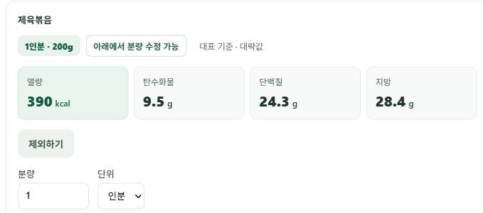
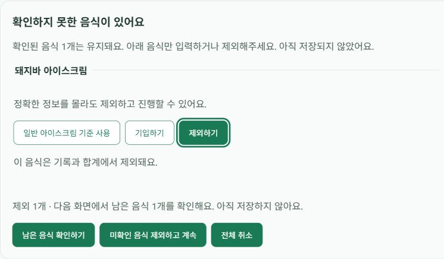
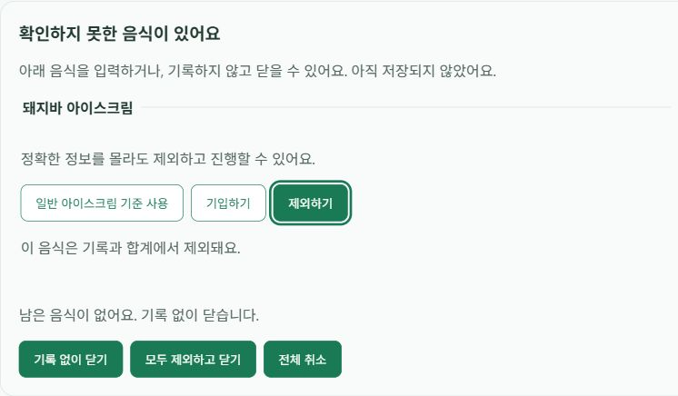

# 장소 표현과 음식 제외 흐름 수정 (2026-10-19)

## 문제와 원인

`한식뷔페가서 제육볶음과 돈까스와 밥 먹었어`가 하나의 미확인 음식으로
표시됐다. 제육볶음과 돈가스 대표값은 이미 있었지만, 간단 파서는 음식으로
시작하는 문장을 기대해 장소 접두어에서 실패하고 모델 경로로 넘어갔다.
또 UI는 전부 제외한 선택을 제출할 수 있지만 서버는 빈 제안을 422로 거부했다.
사용자의 조작 실수가 아닌 입력 분리·화면/서버 상태 불일치였다.

## 변경

- 문장 앞의 명시적인 식사 장소 표현(한식뷔페/뷔페/식당/회사·학교 식당/
  구내식당/집/편의점/급식실 + 가서·에서)을 처리한다. 문장 중간의 음식이나
  모르는 내용을 검색해서 건너뛰지 않는다. 명시 g·날짜·끼니를 유지한다.
- 예시 입력은 제육볶음200g, 돈가스200g, 밥200g의 수정 가능한 카드로 계산한다.
  이는 앱 기본 분량이며 보편적 실측값이 아니다. 영양값은 기존 DB를 사용한다.
- 미확인 음식 화면에 확인된 음식 수와 제외 후 남을 음식 수를 표시한다.
  일부 제외는 `남은 음식 확인하기`, 전부 제외는 `기록 없이 닫기`로 구분한다.
- 전체 스킵도 남은 음식이 없으면 닫는다. 서버도 전체 제외 요청을 빈 제안으로
  만들지 않고 정상 취소로 처리한다. 취소 완료 후 다시 입력할 수 있음을 알린다.
- 확인 전 실제 섭취 저장, 공용 데이터 수정, 목표 변경은 하지 않는다.

## 검증과 실패 해결

먼저 장소 접두어4종·전체 제외 endpoint 테스트가 실패함을 확인했다
(5 failed/97 passed). 수정 후 관련109개 통과. 프론트 첫 실행은 샌드박스의
임시 디렉터리 `realpath EPERM`으로 시작하지 못해 허용된 실행 환경에서 재실행했다.
React 폼 이벤트/조건부 상태 문서와 Python의 시작 위치 매칭 문서를 근거로
submit·취소 분기와 시작 위치에 한정한 장소 정규화를 구현했다.

- 최종 전체 백엔드: 1435 passed, 기존1 skipped, 기존 deprecation 경고3개.
- 최종 프론트 전체: 111 passed/31 suites, production build 성공.
- 독립 리뷰에서 추가 연결어 규칙이 약과·한과·유과의 이름을 자르는 문제를 발견했다.
  3개 실패를 재현한 후 해당 연결어 변경을 되돌려 기존 미등록 음식 경계를 유지했다.
  이 회귀와 팀의 모델 없는 제안 경로를 포함한 관련113개가 통과했다.
- 합성 파서 비교: 같은 동결100문장, 전후 각100회. 모든 실패를 분모에 포함.
  `670d57b` 기준 직접 파서 성공0/100 → 수정 후100/100.
  10개 장소 표현 × 5개 음식 조합 × 시간 접두어2종이다.
  [200개 판정과 고정 입력/해시](parser-comparison.json), [실행 소스](parser-comparison.py.txt).
  이는 **장소 문법만 바꾼 결정론적 파서 시험**이다. 기존 모델 경로의 성공률,
  새로운 음식100종, 실제 사용자 정확도·응답 속도·DB 영양 정확도 비교가 아니다.

## 공개 배포 확인

main의 수정 `28f27a3`, 리뷰 후속 수정 `c4df916`을 자동 배포했다.
최종 API health와 웹 build-info는 모두 `c4df9168a296a05f2cb5ac6110996d0bb71f07f5`다.
[공개 빌드 근거](public-build.json). 후속 API 배포는 기동 중 포트 탐색 안내 후
`0.0.0.0:10000` 바인딩·앱 시작 완료·health 통과를 확인했다. 오류로 성급히
분류하지 않고 [Render 공식 포트 설명](https://render.com/docs/web-services#port-binding)과 로그를 대조했다.

로그인 브라우저 기능 검증(합성 입력, 실제 섭취는 확정 저장하지 않음):

1. 원래 한식뷔페 입력 → 제육볶음/돈까스/밥 각각200g 카드. 제조사 선택·빈 g 입력 없음.
2. 돈까스만 제외·재계산 → 제육볶음/밥만 남고 합계에서 돈까스가 빠짐. 제안 취소.
3. 한식뷔페 + 밥/돼지바 입력 → 확인된1개 유지 안내. 돼지바 제외 →
   `남은 음식 확인하기` → 밥200g 카드, 제외 항목 명시. 제안 취소.
4. 돼지바 단독 → 제외 → `기록 없이 닫기` → 선택 카드가 사라지고 새 입력 가능.
   이전422 안내는 나타나지 않음. 전체 과정에서 기존 실제 섭취량은 유지됨.
5. 새로고침 후 종료한 선택 카드와 확인 대기 제안이 다시 나타나지 않음.
6. 최종 `c4df916` API/웹에서 `한식뷔페가서 제육볶음 150g과 돈까스와 밥 먹었어`
   재실행 → 제육볶음150g, 돈까스200g, 밥200g. 직접 g와 기본값을 구분해 표시.
   이 마지막 제안도 확정하지 않고 취소했다.

공개 UI 검사는 소수 기능 점검이며 위100개 파서 비교에 합산하지 않았다.
개인 목표·섭취량을 제외하고 합성 입력 카드 영역만 캡처했다.

## 한계와 공식 문서

명시된 장소 접두어 이외의 모든 자연어 표현을 지원한다고 보장하지 않는다.
대표 음식이 없는 경우에는 임의 영양값을 생성하지 않고 입력·제외·취소를 제공한다.
기존 저장·확정·소유권·제안 버전 검증은 유지한다.

- [Python 정규식 match/sub](https://docs.python.org/3/library/re.html)
- [React 폼 submit](https://react.dev/reference/react-dom/components/form)
- [React 입력과 상태](https://react.dev/learn/reacting-to-input-with-state)
