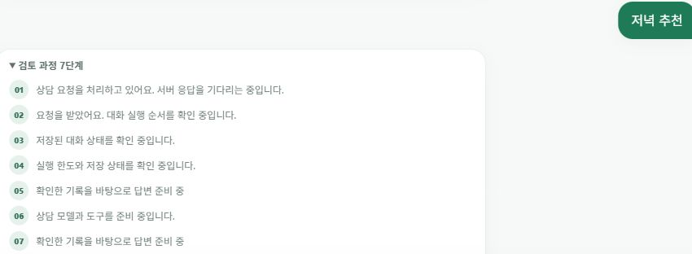
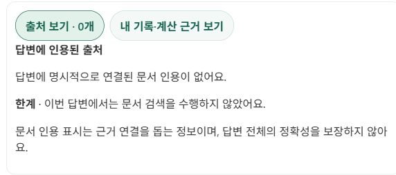
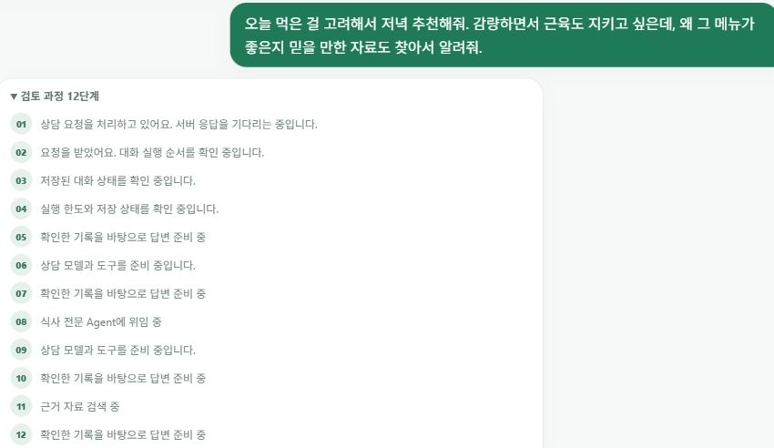
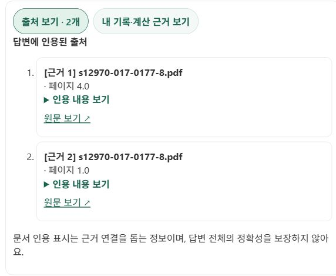

# 필요한 질문에만 문서 검색을 사용하는 저녁 추천 설계

2026-10-19 공개 서비스 재현 캡처. 코드 버전 `19bd2597ba741b46302c7d5efdf9b20d78f24c11`.

## 설계 결정: 기본 추천에 RAG를 매번 강제하지 않는다

일상적인 ‘저녁 추천’에도 매번 전문 Agent 위임과 문서 검색을 수행하면 불필요한 모델·도구 왕복이 발생할 수 있다. 단순 추천은 오늘 확정한 섭취 기록과 활성 목표를 확인한 뒤 읽기 전용 코칭으로 처리하고, 문서 근거나 설명이 필요한 질문에는 검색 가능한 전문 Agent 경로를 유지하도록 나눴다. 섭취 기록 저장은 별도의 사용자 확정을 유지한다.

이것은 **RAG를 모든 요청에 붙이는 대신 요청에 따라 검색을 선택하는 설계**다. 단순 추천에서 검색을 생략한 결과는 검색 장애와 구분한다. 문서 검색을 하지 않아도 실제 조회한 사용자 기록·목표는 근거 패널에서 확인할 수 있다.

정확한 구현 범위는 ‘검색을 매번 강제하지 않는다’다. 현재 단순 첫 추천의 읽기 전용 도구 목록에는 검색 도구도 남아 있다. 따라서 **단순 추천은 검색할 수 없도록 하드 차단했다**고 설명하지 않는다. 일부 일반 후속 코칭의 도구 생략도 별도 설정과 보수적인 문장 판정을 충족할 때만 적용한다. 명시적 근거 요청은 단순 추천의 전체 문장 패턴과 일치하지 않으므로 일반/전문 Agent 경로를 유지하지만, 모든 자연어 요청이 항상 검색·인용에 성공한다고 보장하지 않는다.

| 요청 | 처리 의도 | 이번 화면에서 관찰한 결과 |
| --- | --- | --- |
| ‘저녁 추천’ | 최신 기록·목표 기반의 간단한 읽기 전용 코칭, 매번 문서 검색을 강제하지 않음 | 실행 상태 7단계, 검색 단계 없음, 출처 0개·검색 미수행 안내 |
| ‘왜 좋은지 믿을 만한 자료도 찾아서 알려줘’ | 설명을 뒷받침할 문서를 검색할 수 있는 전문 Agent 경로 | 실행 상태 12단계, 식사 전문 Agent 위임·근거 자료 검색, 인용 구간 2개 |

두 화면은 기능 예시다. 7단계/12단계는 고정 설계 상수가 아니며 질문·문맥·실행 결과에 따라 바뀐다. 이는 모델 내부의 사고 과정(chain of thought)이 아니라 서버가 전달한 준비·조회·위임·검색 등의 **실행 상태 이벤트**다.

## 1. 단순 추천

실제 입력:

> 저녁 추천

질문과 실행 상태: [원본 이미지 열기 · 850×312](simple-question-trace.jpg?raw=true)

검색 미수행 안내: [원본 이미지 열기 · 572×253](simple-sources.jpg?raw=true)

‘출처 0개’는 이 실행에서 문서 인용이 없다는 뜻이다. 사용자 기록까지 참고하지 않았다는 뜻은 아니다. 문서 검색 미수행·검색 실패·인용 미확인도 서로 구분한다.

## 2. 자연스러운 근거 요청

앞서 제안한 자연스러운 질문을 공개 서비스에 다시 입력했다. 사용자 첨부 화면의 원본 실행과 동일하다고 주장하지 않으며 현재 서비스의 재현이다.

> 오늘 먹은 걸 고려해서 저녁 추천해줘. 감량하면서 근육도 지키고 싶은데, 왜 그 메뉴가 좋은지 믿을 만한 자료도 찾아서 알려줘.

질문·전문 Agent 위임·근거 자료 검색: [원본 이미지 열기 · 850×492](evidence-question-trace.jpg?raw=true)

실제 인용된 출처: [원본 이미지 열기 · 572×469](evidence-sources.jpg?raw=true)

출처 2개는 서로 다른 논문 2편이 아니다. 이번 실행에서는 같은 `s12970-017-0177-8.pdf`의 서로 다른 두 페이지(표시값 4.0, 1.0)가 인용됐다. 원문은 [DOI 링크](https://doi.org/10.1186/s12970-017-0177-8)로 연결된다. 인용이 있다는 사실만으로 답변의 모든 문장이 검증됐다고 해석하지 않는다.

## 캡처 품질·공개 범위

브라우저에서 받은 JPEG 원본 바이트를 그대로 사용했다. 추가 축소·확대·재압축·합성하지 않았다. 긴 화면을 한 장으로 줄이는 대신 질문/실행 상태와 출처 영역을 각각 원본 픽셀 크기로 캡처했다. GitHub 미리보기는 화면 폭에 따라 줄어들 수 있으므로 원본 이미지 링크를 열어 확인하면 된다. [파일 크기·픽셀 크기·SHA-256·실제 질문·관찰 결과](capture-manifest.json)를 함께 보관했다. JPEG 캡처를 무손실 PNG라고 표현하지 않는다.

처음 PNG 파일로 저장했으나 파일 시그니처 검사에서 도구 반환값이 JPEG임을 확인했다. [Pillow 공식 문서](https://pillow.readthedocs.io/en/stable/reference/Image.html#PIL.Image.Image.format)의 파일 형식 식별을 참고했으나 프로젝트 venv에는 Pillow가 없었다. 패키지를 추가하지 않고 JPEG 프레임 헤더에서 형식·픽셀 크기를 확인하고 확장자만 `.jpg`로 바로잡았다. 이미지 바이트는 재인코딩하지 않았다.

공개 자료에는 개인 식사 목록과 목표/섭취 수치 표를 포함하지 않았다. 실제 섭취 기록을 추가·수정·삭제하지 않았다. 질문·실행 상태·공용 문서 출처 영역을 캡처했다.

## 구현 근거와 한계

- [단순 추천/후속 질문 판정](../../../backend/app/agents/coaching_route.py): 단순 첫 추천은 전체 문장을 매칭하고 기록·계획·다른 의도가 섞이면 간단 경로로 흡수하지 않는다.
- [Team 실행](../../../backend/app/agents/team.py): 요청 내 최신 기록 확인, 검증된 문맥일 때 직접 코칭, 읽기 도구 제한 또는 전문 Agent 위임을 수행한다.
- [근거 구성](../../../backend/app/agents/answer_basis.py): 요청에서 확보한 자료 중 명시적으로 인용한 ID만 출처로 연결한다.
- [기존 배포 검증·실패 수정 기록](../answer-basis-20261019/README.md): 검색/저장 금지 문구 오분류 수정과 원문·새로고침 확인을 구분해 기록했다.

이번 작업은 설계 문서·공개 기능 재현·원본 캡처 보강이며 운영 코드는 변경하지 않았다. 두 예시를 속도·정확도 향상의 정량 증거로 사용하지 않는다. 새로운 성능 비교는 동일 동결 사례로 조건별 100건 이상 수행하고 실패·타임아웃도 포함해야 한다. 단순 추천의 모든 영양 판단이 문서로 검증되는 것은 아니며 최신 기록 기반의 일반 코칭이라는 한계가 남는다.

문서 설명과 기존 코드의 일치 확인: 직접 첫 추천·일반 후속 도구 생략·검색 금지 범위 관련 테스트 **58 passed**. 운영 코드 변경이 없어 전체 회귀와 재배포는 반복하지 않았다.
