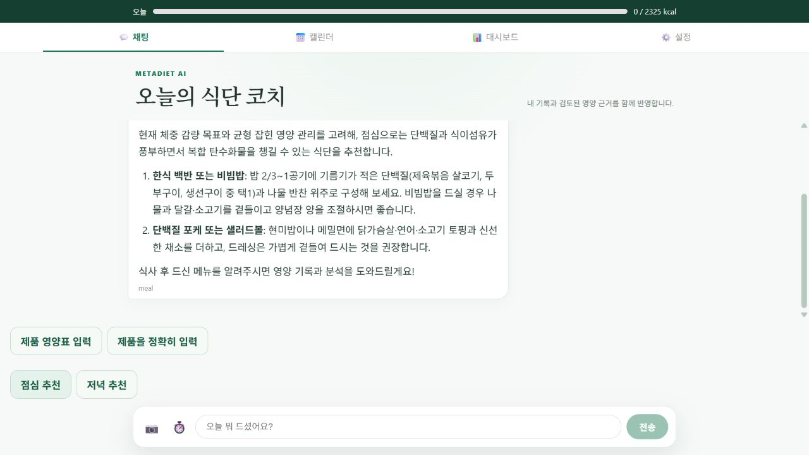
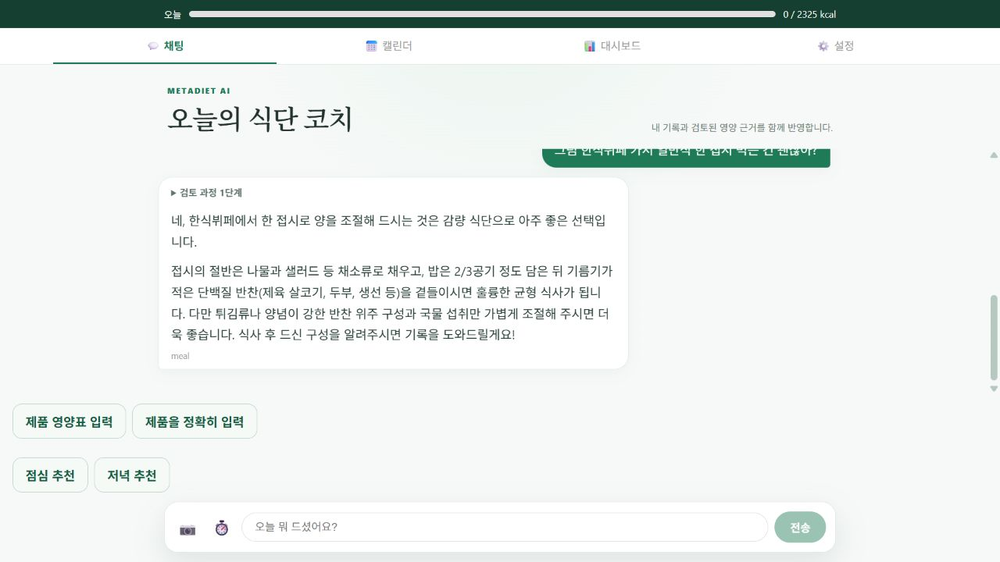
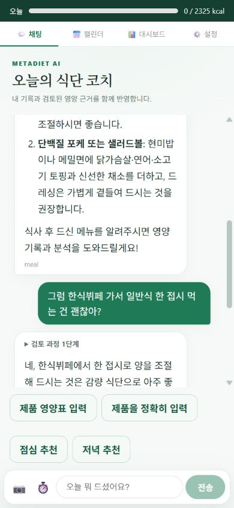

# 100건씩 비교하는 코칭 응답 개선

2026-10-13. 공개 합성 계정에서 같은 20개 요청을 5회 반복해 조건별 100건을 측정한다. 실패·시간 초과를 제거하지 않는다. 이는 100명의 실제 사용자 평가가 아니며, 실제 사용자 평균이나 p95를 보장하지 않는다.

## 구현과 채택 기준

- `/health`, SSE 시작·완료 응답, LangSmith에 실행 커밋을 남기고 웹의 `build-info.json`과 대조한다. 배포 직후 오래된 경로가 보였던 이전 현상의 원인은 확정하지 않았으며, 이후 진단 가능한 식별자를 추가했다.
- 실제 추천 버튼 문구를 읽기 전용 직접 코칭 경로에 연결한다. 복잡한 요청과 proposal/HITL 흐름은 유지한다.
- 최종 근거 검증을 통과한 답변만 표시한다. Gemini `astream`은 내부에서 모아 검증하는 비교 실험이며, 원시 토큰을 사용자에게 공개하지 않는다.
- SSE v2는 단조 증가 ID, 최종 답변 기준 복원, 중복 이벤트 제거를 제공한다. 완료 후 연결 오류는 성공 답변을 덮어쓰지 않는다. 실행 정보가 없으면 재실행하지 않고 실패한다.
- Markdown을 안전하게 렌더링하고 추천 버튼을 분리했다. HTML·이미지는 허용하지 않으며 링크 URL을 제한한다.

모델 스트리밍은 검증된 첫 표시 시간 30% 개선과 완료 시간 악화 10% 이내를 요구한다. DB 예산 예약 최적화는 해당 단계 20% 개선을 요구한다. 개선이 확인되지 않으면 운영 기본값을 유지한다.

## 공개 전후 결과

기준 커밋 `7c08e818` → 후보 `95e167d8`. 이전 버전은 `/health`에 커밋이 없어 Render의 Live 배포에서 확인했다. 후보 100건은 각 완료 응답의 커밋이 일치하는지 검증했다.

| 지표 | 이전 100건 | 이후 100건 | 해석 |
|---|---:|---:|---|
| 완료 / 시도 | 100/100 | 100/100 | 실패·시간 초과 0건 |
| 검증된 첫 답변 중앙값 | 10.159초 | 10.457초 | 2.9% 느림, 첫 표시 개선 아님 |
| 검증된 첫 답변 p95 | 36.258초 | 22.620초 | 합성 표본의 긴 대기 구간 감소 |
| 완료 시간 중앙값 | 10.627초 | 10.530초 | 0.9% 감소, 사실상 비슷함 |
| 완료 시간 p95 | 36.674초 | 22.693초 | 38.1% 감소 |
| 모델 호출 합계 | 153회 | 118회 | 같은 100건에서 22.9% 감소 |
| 예상하지 않은 proposal | 2건 | 0건 | 기존 2건은 즉시 취소, 확정하지 않음 |

기존 2건의 완료 시간에는 측정 스크립트의 취소 API 처리도 포함된다. 첫 답변 시간에는 포함되지 않는다. 이 조건 차이를 포함한 원본을 그대로 보존했다.

단순 추천 버튼이 불필요한 위임 경로로 가던 경우를 줄였다. 모든 요청이 빨라진 것은 아니며, 전체 중앙값은 거의 그대로다. 검증 후 답변 전송 정책 때문에 모델 생성 완료 전 화면에 내용을 보여주지는 않는다. 표본 p95 개선을 실제 사용자 p95나 엄밀한 인과 효과로 확대 해석하지 않는다.

## 채택하지 않은 최적화도 기록

공개 답변 자동 품질 평가도 전후 각각 100건을 완료했다. 관련성·실행 가능한 조언·섭취 사실을 지어내지 않음·간결성은 전후 모두 100/100이었다. 하지 않은 저장/카드 생성을 했다고 주장하지 않는 기준은 99/100→100/100이었다. 단일 자동 judge의 루브릭 결과이며 영양학적 정확도 100%를 뜻하지 않는다. 내부 native 평가의 원본 판정 완료는 invoke 96/100, buffered 99/100이며 나머지는 아래에 설명한 judge API 실패다.

원본: [이전100](before.json), [이후100](after.json), [이전품질](before_quality.json), [이후품질](after_quality.json), [native200](native_stream.json), [native품질](native_stream_quality.json), [DB200](budget.json), [집계](summary.json), [실제 trace 메타데이터](trace_metadata.json).

| 실험 | 기존 100건 | 후보 100건 | 결정 |
|---|---:|---:|---|
| 실제 모델 완료 중앙값 | invoke 4.459초 | buffered stream 4.508초 | 1.1% 느림, 기본 invoke 유지 |
| 실제 모델 완료 p95 | 6.752초 | 7.073초 | 스트리밍 속도 개선 주장 안 함 |
| 최신 수치 반영 | 100/100 | 100/100 | 합성 DB의 현재값을 사용 |
| domain write 없음 | 100/100 | 100/100 | 읽기 전용 경계 유지 |
| DB 예약 중앙값 | 65.04ms | 56.19ms | 13.6% 개선으로 사전 기준 20% 미달, 기본 비활성 |

native 첫 콘텐츠 토큰 중앙값은 2.554초지만 **서버 내부 수신 시간**이다. 사용자에게 검증된 내용이 표시된 시간이 아니다. 부분 답변을 먼저 노출하려면 전체 답변을 교정하는 현재 근거 가드와 동등한 증분 검증이 필요하므로 이번에는 활성화하지 않았다.

## 실험 구성과 재현

| 실험 | 표본 | 환경 / 제한 |
|---|---:|---|
| 공개 전후 | 이전 100 + 이후 100 | 고정 20문항×5, 같은 합성 계정, 순차 요청. 배포 전후이므로 시간대·서비스 부하 차이가 있음 |
| 실제 모델 호출 방식 | invoke 100 + buffered stream 100 | 순서를 교대로 바꾼 쌍 비교. 실제 모델, 합성 DB 상태 |
| DB 예산 예약 | 기존 100 + 실험 100 | 실제 DB, 교차 순서. 전체 응답 시간이 아닌 예약 단계만 측정 |
| 자동 품질 평가 | 위 답변 전부 | Gemini 3.1 Pro judge, 조건·시간을 숨긴 루브릭. 단일 자동 판정이며 임상 검증 아님 |

후속 문맥은 고정한 이전 대화와 현재 DB 값을 함께 입력한다. 최신 기록 평가는 확정·수정·삭제·목표 변경·새 날짜의 5가지 합성 상태를 사용한다. 실제 사용자 행동이나 날짜 경과를 관찰한 실험으로 표현하지 않는다. 공개 전후와 내부 실험 일부가 동시에 실행되어 제공자 부하가 공유됐다는 제한도 있다.

```powershell
backend\venv\Scripts\python.exe backend\scripts\eval\latency100.py --phase before
# 후보 배포 뒤 실제 커밋을 전달
backend\venv\Scripts\python.exe backend\scripts\eval\latency100.py --phase after --expected-commit <commit>
backend\venv\Scripts\python.exe backend\scripts\eval\quality100.py before
backend\venv\Scripts\python.exe backend\scripts\eval\quality100.py after
backend\venv\Scripts\python.exe backend\scripts\eval\quality100.py native_stream
backend\venv\Scripts\python.exe backend\scripts\eval\summarize_latency100.py
```

스크립트는 기존 결과 덮어쓰기를 거부한다. 재실험은 기존 증거를 별도 폴더에 보존한 후 수행한다. 자격증명은 Git에 제외된 환경 파일에만 둔다. `summary.json`은 완전한 조건별 100건과 동일 요청 순서가 없으면 생성되지 않는다. p95는 nearest-rank 방식이며, 성공 요청 지연 분포와 전체 시도·실패 건수를 함께 공개한다.

## 오류와 해결 근거

1. native chunk의 문자열·블록 혼합 콘텐츠가 누락되는 테스트 실패: [LangChain 메시지 병합](https://reference.langchain.com/python/langchain-core/messages/ai) 형식에 맞춰 문자열도 읽되 thought 블록은 제외했다.
2. CRA Jest27에서 Markdown ESM 의존성 해석 실패: [Jest transform](https://jestjs.io/docs/configuration#transformignorepatterns-arraystring)과 [Jest28 exports 지원](https://jestjs.io/blog/2022/04/25/jest-28)을 확인해 변환 허용 목록·브라우저 모듈 매핑을 추가했다. 렌더러를 가짜로 대체하지 않았다.
3. 검토에서 발견한 재접속 중복 모델 호출 가능성: 재접속 플래그·기존 이벤트 우선 재생·실행 소실 시 종료를 적용했다. [SSE 이벤트 ID](https://developer.mozilla.org/en-US/docs/Web/API/Server-sent_events/Using_server-sent_events)와 최종 스냅샷을 함께 검증한다.
4. 완료 이벤트 이후 reader 오류가 성공을 실패로 바꾸는 가능성: terminal 이벤트 수신 즉시 [reader cancel](https://developer.mozilla.org/en-US/docs/Web/API/ReadableStreamDefaultReader/cancel) 후 반환하도록 변경했다.

## 실제 공개 화면

전체 회귀는 백엔드 **955 passed, 기존 1 skipped**, 프론트 **77 passed**, production build 성공이다. 평가 집계의 100건 제한·실패 분모·p95 계산 검증 3개도 마지막 코드 수정 후 통과했다. 기존 parser 선택 테스트의 skip을 이번 작업에서 추가하거나 변경하지 않았다.

자동 judge의 native 평가에서 한 배치가 `GoogleAPIError`로 실패했다(기존 호출 4개, buffered 1개). 원본에는 HTTP 상태가 없어 정확한 제공자 원인을 확정할 수 없다. [공식 Gemini 오류 대응](https://ai.google.dev/gemini-api/docs/troubleshooting)을 확인하고 해당 5개만 별도로 재평가했으며 모두 루브릭을 통과했다. 원본 실패 5개는 주 결과 분모에 유지한다. [별도 재평가](native_stream_quality_retry.json)는 누락 판정 보충 자료이며 원래 성공률을 덮어쓰지 않는다.

성능 100건과 별개인 브라우저 기능 확인이다. 합성 계정을 사용했고 아래 답변은 실제 배포 모델이 생성했다.





공개 SSE 복원 확인: [public_delivery.json](public_delivery.json). 상세 작업 결정: [WORK_LOG.md](WORK_LOG.md).
