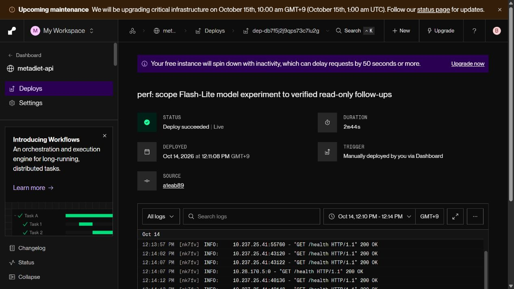

# 공개 모델 병목 실험 (2026-10-14)

기존 200건을 분석하고 공개 API에서 기존 100건과 Flash-Lite 후보 100건을 비교했다. **후보는 채택하지 않았다.** 중앙값은 빨라졌지만 p95와 실행 가능한 조언 품질이 나빠졌다.

| 지표 | 기존 Gemini 3.8 Flash / low | Gemini 3.5 Flash-Lite / low |
|---|---:|---:|
| 전체 응답 중앙값 | 7.821초 | 6.334초 |
| 전체 응답 p95 | 9.551초 | 10.727초 |
| 실패·보류 | 0/100 | 0/100 |
| 최신 섭취·목표 반영 | 100/100 | 100/100 |
| 식사·목표 미변경 | 100/100 | 100/100 |
| 실행 가능한 조언 | 100/100 | 98/100 |
| 나머지 품질 4항목 | 각각 100/100 | 각각 100/100 |
| 모델 호출 수 p95 | 1 | 2 |

## 원인 분석과 해결 시도

[기존 200건 분석](historical_analysis.json)의 모델 단계 중앙값은 2.596초, p95는 4.378초다. SDK output_tokens에는 답변 토큰뿐 아니라 thinking 토큰이 합산된다. 최초에 출력 길이를 병목으로 의심했으나 설치된 LangChain 소스를 확인해 해석을 수정했다. 실제 답변 글자 수와 지연의 상관계수는 0.057이어서 답변 축약 후보를 활성화하지 않았다. 최초 분석과 수정 기록은 [이전 실험 작업 로그](../brief_followup_public/WORK_LOG.md)에 보존했다.

저지연 모델로 단순 후속 코칭만 전환했으나 9건에서 추가 도구·모델 왕복이 발생했다. 현재 기록을 이미 읽었더라도 모델이 optional tool을 다시 선택하는 경로가 긴 꼬리를 만들었다. 품질 평가의 58·62번은 구체적인 식사 조절 방법 없이 긍정만 해 실행 가능성이 떨어졌다. 완료된 낮은 평가를 재평가하거나 삭제하지 않았다.

공식 문서: [Flash-Lite 모델](https://ai.google.dev/gemini-api/docs/models/gemini-3.5-flash-lite), [thinking 설정](https://ai.google.dev/gemini-api/docs/thinking), [function calling](https://ai.google.dev/gemini-api/docs/function-calling). Flash-Lite의 sampling 설정은 SDK 경고대로 고정되어 temperature=0 요청이 그대로 적용되는 비교가 아니다. 모델 변경에 따른 차이로 기록한다.

`FOLLOWUP_MODEL=default`로 복구했고 [공개 복구 요청](rollback/before_probe.json)에서 원래 Gemini 3.8 Flash 경로를 확인했다. 이후 [도구 생략 후보](../tool_free_followup_public/README.md)를 별도로 검증했다.

## 재현과 한계

[사전 기준](PROTOCOL.md), [기존 100건](before.json), [후보 100건](after.json), [기존 품질](before_quality.json), [후보 품질](after_quality.json), [판정](summary.json).

실제 모델·DB·Render API를 사용하는 합성 계정의 직렬 측정이다. 4개 질문 × 확정·수정·삭제·목표 변경·전날 기록의 5개 상태 × 5회 반복이다. 기존 100건은 다음 도구 실험에도 원본 SHA를 유지해 재사용한다. 각 후보가 독립적인 새 baseline을 갖는 실험은 아니다. 순차 시간대, 반복된 20조건, 단일 자동 judge라는 한계가 있다. 실제 100명·임상 정확도·장애율 개선을 입증하지 않는다. 실패·타임아웃은 평가 분모에서 제외하지 않지만 이번 200건에서는 발생하지 않았다.

```powershell
backend\venv\Scripts\python.exe backend/scripts/eval/summarize_brief_public100.py --experiment model
```


