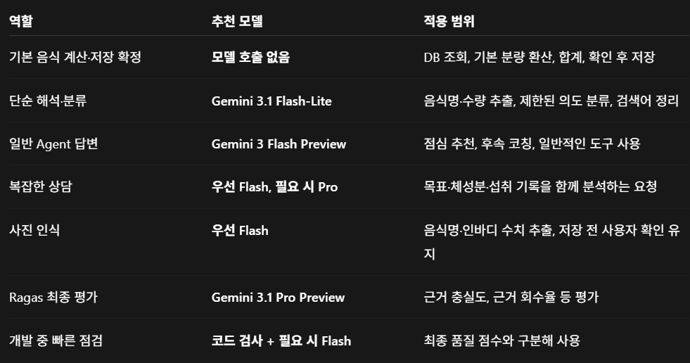

# 작업별 Gemini 모델 라우팅

추가 검증: [Jev와 규칙의 동일 100개 비교](JEV_COMPARISON.md), [주요 프롬프트 버전 관리](../prompt_versioning/README.md).

2026-10-19. **구현은 기본 비활성 상태입니다.** 실제 모델 비교와 평가자 검증을
통과하기 전에는 운영에서 활성화하지 않습니다. 결과와 채택 판단은 아래에 별도로 기록합니다.

## 사용자와 합의한 역할표

첨부받은 표 원본을 보존했습니다. 이 표는 **선정 설계**이며 전체 항목의 운영 채택을
주장하는 실행 결과가 아닙니다.



| 역할 | 첨부 표의 추천 모델 | 적용 범위 |
|---|---|---|
| 기본 음식 계산·저장 확정 | 모델 호출 없음 | DB 조회, 기본 분량 환산, 합계, 확인 후 저장 |
| 단순 해석·분류 | Gemini 3.1 Flash-Lite | 음식명·수량 추출, 제한된 의도 분류, 검색어 정리 |
| 일반 Agent 답변 | Gemini 3 Flash Preview | 점심 추천, 후속 코칭, 일반적인 도구 사용 |
| 복잡한 상담 | 우선 Flash, 필요 시 Pro | 목표·체성분·섭취 기록을 함께 분석 |
| 사진 인식 | 우선 Flash | 음식명·인바디 수치 추출, 저장 전 사용자 확인 유지 |
| Ragas 최종 평가 | Gemini 3.1 Pro Preview | 근거 충실도·근거 회수율 등 평가 |
| 개발 중 빠른 점검 | 코드 검사 + 필요 시 Flash | 최종 품질 점수와 구분 |

현재 코드의 일반 Agent 기본값은 기존 **3.8 Flash**로 유지했습니다. 3 Flash Preview로
바꾸는 실험까지 섞지 않습니다. 복잡한 상담의 자동 Pro 승격은 구현·채택하지 않았습니다.
도구 실패·DB 오류를 더 비싼 모델로 재시도하는 정책도 추가하지 않았습니다.

## 환경변수와 실제 연결 범위

모델 ID는 환경변수, 작업 선택은 코드의 고정된 `task` 값으로 관리합니다.
모델을 고르기 위한 LLM 호출은 추가하지 않습니다.

```dotenv
# backend/.env 또는 Render metadiet-api > Environment
GEMINI_API_KEY=발급받은_키
GEMINI_MODEL=gemini-3.8-flash
GEMINI_SIMPLE_MODEL=gemini-3.1-flash-lite
GEMINI_VISION_MODEL=gemini-3.8-flash
GEMINI_EVAL_MODEL=gemini-3.1-pro-preview
MODEL_ROUTING_ENABLED=false
```

- `false`: 기존 일반 모델을 사용. 새 기능의 즉시 롤백 설정입니다.
- `true`: `extraction`, `classification`, `query_translation` 작업만 SIMPLE 모델 사용.
- 현재 활성 DietTeam의 도구를 쓰는 Supervisor·전문 Agent·온라인 검증은 일반 Flash 유지.
  단순 분류용 레거시 supervisor와 전문 Agent 위임용 Supervisor는 서로 다른 경로입니다.
- 음식 추출은 레거시 diet_logger의 **파싱 호출만** 연결합니다. 영양 수치 생성에
  경량 모델을 새로 연결하지 않습니다. 활성 대표 음식 경로는 기존처럼 모델 없이 계산합니다.
- RAG 검색어 번역은 경량 경로에 연결하되, 임베딩 모델·Pinecone namespace·청크는 그대로입니다.
- Vision과 offline eval 역할은 독립 모델 설정을 사용하고, 테스트 주입·명시적 모델
  override는 기존 우선순위를 유지합니다.
- 요청별 실제 모델·task 선택은 도구 Agent의 LangSmith metadata에 연결합니다.
- 로컬 파일은 Git 제외 대상입니다. 공개 서비스에는 Render 환경변수를 별도로 반영하고
  재시작해야 합니다. 프론트 환경변수에 API 키를 넣지 않습니다.

## 선정 근거와 비용 기준

[Google 모델 문서](https://ai.google.dev/gemini-api/docs/models/gemini-3.1-flash-lite)는
Flash-Lite의 번역·분류·가벼운 추출·구조화 출력을 지원 용도로 안내합니다.
이는 MetaDiet의 품질 통과를 대신하지 않으므로 실제 동일 사례 비교가 필요합니다.

2026-10-19 확인한 Standard 텍스트 요금, USD/100만 토큰:

| 모델 | 입력 | 출력(thinking 포함) | 캐시 입력 |
|---|---:|---:|---:|
| 3.1 Flash-Lite | 0.25 | 1.50 | 0.025 |
| 3.8 Flash | 0.75 | 3.75 | 0.075 |
| 3.1 Pro Preview, 입력 ≤20만 토큰 | 2.00 | 12.00 | 0.20 |

3.8 가격은 2026-12-31까지의 가격입니다. 재실험 시 최신 요금을 다시 확인해야 합니다.
실제 반환된 usage에서 캐시 입력을 분리하고 출력에 이미 포함된 추론 토큰은 중복 합산하지
않습니다. usage 없는 실패 요청은 비용 미상으로 남깁니다. 이것은 토큰 요금 추정이며
계정 청구서·무료 계층 실지출이 아닙니다. 평가자 비용은 운영 답변 비용과 구분합니다.
[공식 요금표](https://ai.google.dev/gemini-api/docs/pricing).

Ragas 평가 모델이 생성 모델과 반드시 달라야 하거나 더 커야 하는 제약은 없습니다.
이번 설계에서는 Pro를 최종 평가자로 분리하되, 같은 모델 계열의 공통 편향과 자동 평가의
한계를 명시하고 사람 검토 근거와 대조합니다.
[Ragas judge alignment](https://docs.ragas.io/en/latest/howtos/cli/judge_alignment/).

## 실패 원인과 해결 기록

1. 제한된 실행 환경의 연결 실패와 Jest/pytest 임시 폴더 접근 거부는 제품 오류와
   구분했습니다. 허용된 네트워크 실행과 프로젝트 전용 pytest 임시 경로로 재검증했습니다.
   [pytest 임시 경로](https://docs.pytest.org/en/stable/how-to/tmp_path.html),
   [Jest 설정](https://jestjs.io/docs/configuration#cachedirectory-string).
2. 직접 HTTP 사전 확인에서는 새 키로 Flash·Lite가 성공했지만 초기 SDK 실험은402였습니다.
   키 값 출력 없이 비교하니 프로세스의 기존 `GEMINI_API_KEY`와 새 `.env` 값이 달랐습니다.
   기본 dotenv는 기존 프로세스 환경을 덮어쓰지 않는 것이 원인이었습니다.
   평가기에 `--env-file`을 추가해 그 파일의 Gemini 키만 명시적으로 읽고, 기존 실패
   `run-20261019/paired.json`은 보존했습니다. 운영 환경 우선순위는 바꾸지 않았습니다.
   [python-dotenv 공식 동작](https://saurabh-kumar.com/python-dotenv/).
3. 새 키의 Pro 사전 확인은429 `RESOURCE_EXHAUSTED`: `FreeTier` 분당·일일
   quota metric과82735초 retry delay가 반환됐습니다. Pro는 무료 대상이 아니며
   프로젝트 계층·할당량은 키 재발급만으로 바뀌지 않습니다. 평가를 Flash로 몰래 대체하지
   않고 Pro 품질 평가를 미완료로 남깁니다.
   [할당량](https://ai.google.dev/gemini-api/docs/rate-limits),
   [결제](https://ai.google.dev/gemini-api/docs/billing).
4. 별도 코드 리뷰에서 탐색 평가의 단순화된 스키마·운영과 다른 low 추론 설정·전체
   평균만 보는 채택 조건을 발견했습니다. 탐색 로그 `run-20261019-file-key`는
   채택 근거에서 제외하고, 운영 프롬프트/추론 설정 및 작업별 비열화 방지 기준을 적용했습니다.
5. 작업을4개씩 반복하는 평가에서 단순 `index % 2` 교대는 작업별 선후 순서를 바꾸지
   않는다는 추가 지적을 반영했습니다. `final-20261019` 탐색 결과도 보존하되 제외하고,
   작업별 출현 횟수 기준 교대로 바꾼 `final-v2-shard0/1/2`를 최종 입력으로 사용합니다.
   각 프로세스가 `index % 3`으로 서로 겹치지 않는 사례를 담당하고 합산 시 케이스·설정·해시·
   분할 소유권·조건별 정확히1회 여부를 검증합니다. 비교는 로컬 동시3프로세스 조건입니다.
6. 최종 비교 중 Flash도429를 반환했습니다. 별도 최소 HTTP 확인에서 일일 무료 요청
   한도20건(`GenerateRequestsPerDayPerProjectPerModel-FreeTier`), retry delay81792초가
   확인됐습니다. 이것은 재시도 간격을 몇 초 늘려 해결할 분당 제한이 아닙니다. 실패도
   100건 시도에 남기며, 거절이 빠르다는 이유로 속도 개선을 주장하지 않습니다.
   일부 SDK 오류 처리에서 `ClientResponse.json was never awaited` 경고도 관측했습니다.
   quota의 HTTP 원인은 별도 직접 호출로 확인했으며 이 경고의 SDK 내부 원인은 확정하지
   않았습니다. 유료 전환·한도 변경은 자동 수행하지 않았습니다.
7. 오류 로그 분류기가 대기 시간81402초의 일부를 HTTP402로 오인하는 문제를 발견했습니다.
   예외 유형과 독립된 상태 코드 경계로 판정하도록 테스트 후 수정했습니다. 실제 실행한
   평가기 원본은 `executed-benchmark-v2.py.txt`로 남기고, 합산 결과는 확실한
   `GoogleRateLimitError` 유형에 한해 정규화 사유를 별도 필드로 추가했습니다. 원본 오류
   필드는 덮어쓰지 않았습니다.
8. Windows의 write_text 기본 CRLF 저장 때문에 문자열 LF 기준 선언 해시와 파일 바이트
   해시가 달라 합산이 중단됐습니다. 이후 frozen 저장은 LF로 명시하고, 기존 파일은
   UTF-8/LF 정규화 해시로 검증합니다. 실제 사례 내용 변경은 계속 거부하며 테스트에
   포함했습니다. [Python pathlib](https://docs.python.org/3/library/pathlib.html#pathlib.Path.write_text).

## 고정 비교 프로토콜

- 기준과 후보 각각100건: 음식 추출25, 분류25, 검색어 번역25, DietTeam 후속 코칭25.
- 같은 frozen case를 교대 순서로 실행하고 실패·timeout을 분모에 포함합니다.
- 추출은 실제 PARSE_PROMPT와 현재 메시지 필터, 분류는 실제 legacy supervisor 및
  pending/휴리스틱 경로를 사용합니다. 일부 분류는 정상적으로 모델0회입니다.
- 번역은 실제 프롬프트와 같은 조건으로 호출하되 키워드 보존 검사는 전체 검색 품질을
  입증하지 않습니다. 검색 품질이나 영양학적 정확도 수치를 전용하지 않습니다.
- 코칭은 실제 DietTeam, DB 대신 합성 읽기와 mock proposal 경계를 사용합니다.
  이전 답변300/2200kcal와 다른 현재 fixture 수치를 반영하는지 검사합니다.
  확정·수정·삭제·목표 변경·새 날짜 상태는 fixture 변경이지 실제 운영 기록 변경이 아닙니다.
- 100개 실제 사용자나100개 독립 의도가 아닌 반복 템플릿 기반 개발 평가입니다.
- 추출·분류는 gold 비교, 번역은 개념 키워드, 코칭은 최신값·허위 저장 여부와 별도 Pro
  rubric을 사용합니다. 이 rubric은 Ragas faithfulness/context recall과 구분합니다.
- 채택 조건: 조건별100건, 작업별 품질·실패율 비열화 없음, 후보 품질≥95%, 최신값 전부
  반영, 비용 누락 없음/평균≥10% 감소, p50≥5% 개선, p95 증가≤5%, Pro 평가 완료.
  평가자가 막히거나 한 작업이 나빠지면 전체 활성화하지 않습니다.

```powershell
backend/venv/Scripts/python.exe -u -X utf8 backend/scripts/eval/benchmark_model_routing.py `
  --output-dir docs/model_routing/new-run --env-file backend/.env --interval 7
# Pro 사용 권한이 확인된 환경에서는 --judge 추가
```

출력 경로에 기존 paired.json이 있으면 덮어쓰지 않습니다. 최종 분할은
`final-v2-shard0/1/2`의 frozen.json·paired.json이며, summary.json은 이200개 시도의
동일성과 누락·중복을 검증한 합산 결과입니다. 각 분할의 같은 frozen.json은 전체100개
사례를 보존하며 `--shard 0 --shards 3`처럼 분할 실행합니다.

## 최종200시도 결과 — 활성화 보류

[합산200건·작업별 결과](summary.json) · [사전 확인·실제 quota](preflight.json) ·
[실행 소스·패키지 식별](execution-identity.json)

| 항목 | Flash 기준 | 작업별 라우팅 |
|---|---:|---:|
| 고정 사례 시도 | 100 | 100 |
| 완료 | 17 | 74 |
| 실패(분모에 포함) | 83 | 26 |
| 음식 추출 완료 | 0/25 | 24/25 |
| 분류 완료 | 17/25 | 25/25 |
| 검색어 번역 완료 | 0/25 | 25/25 |
| 후속 코칭 완료 | 0/25 | 0/25 |
| 최신값 검증 성공 | 검증 불가(코칭 차단) | 검증 불가(코칭 차단) |
| Pro 평가 | 미실행: 무료 quota 차단 | 미실행: 무료 quota 차단 |
| 전체 평균 비용 | 미상 | 미상 |
| 채택 gate | — | **false** |

기준 조건의 완료17건은 모두 휴리스틱의 모델0회 분류입니다. 라우팅 조건은 그17건과
Lite 생성57건이 완료됐습니다. 기계적 계약 체크도17/100·74/100이지만, 이를 모델
정확도17%→74% 개선이라고 표현하지 않습니다. 모델이 다른 일일 quota로 제한된 결과여서
같은 정상 가용 조건의 품질·속도 비교가 성립하지 않았습니다. 정규화한 오류는 기준
quota81건/기타 SDK2건, 후보 quota24건/기타 SDK2건입니다. 기타 예외의 내부 원인은
확정하지 않았고 합산에서 성공으로 바꾸지 않았습니다.

실패·모델0회 경로를 포함한 p50은1.617/2.172초, p95는6.724/3.524초였습니다.
**이 수치는 정상 답변 생성 속도가 아닙니다.** quota 거절과 timeout 경로가 섞였으므로
p95 감소를 최적화 성과로 주장하지 않습니다. 반환 usage가 있는 후보57건만의 요금 추정
합계는$0.005123이며, 실패 요청 비용·평가 비용을 포함한 전체 비용 절감률은 계산하지 않습니다.

운영 배포·라우팅 활성화는 하지 않습니다. GitHub 작업 브랜치/PR에는 비활성 구현,
환경변수 안내, 첨부 선정표와 실패 포함 결과를 게시합니다. 다음 실행에는 최소한
Flash 일일20건 제한 해소와 Pro 사용 가능한 프로젝트 quota가 필요합니다. 키만 같은
프로젝트에서 재발급해도 이 한도는 바뀌지 않습니다. 가용 조건을 맞춘 뒤 같은 frozen
100개/조건으로 재실행하고, Pro rubric·사람 검토와 Ragas 결과는 각각 구분해 추가합니다.

## 회귀 검증

- 최종 백엔드: **1399 passed, 기존1 skipped**. 모델 선택, 명시적 키 선택, 비용/추론 토큰,
  작업별 채택 조건, 분할 중복·누락, 오류 정규화, CRLF 내용 해시 검증을 포함합니다.
- 프론트 전체: **108 tests /31 suites passed**, production build 성공.
- 기존 경고3개(Pydantic class config, langchain-community/experimental deprecation)는
  이번 변경으로 제거하거나 테스트를 skip하지 않았습니다.
- 최종 결과는 기능·회귀 검증과 할당량 제한 하의200시도이며, 정상 가용 조건의 성능
  개선 검증·공개 배포·배포 후 브라우저 검증 완료를 뜻하지 않습니다.
