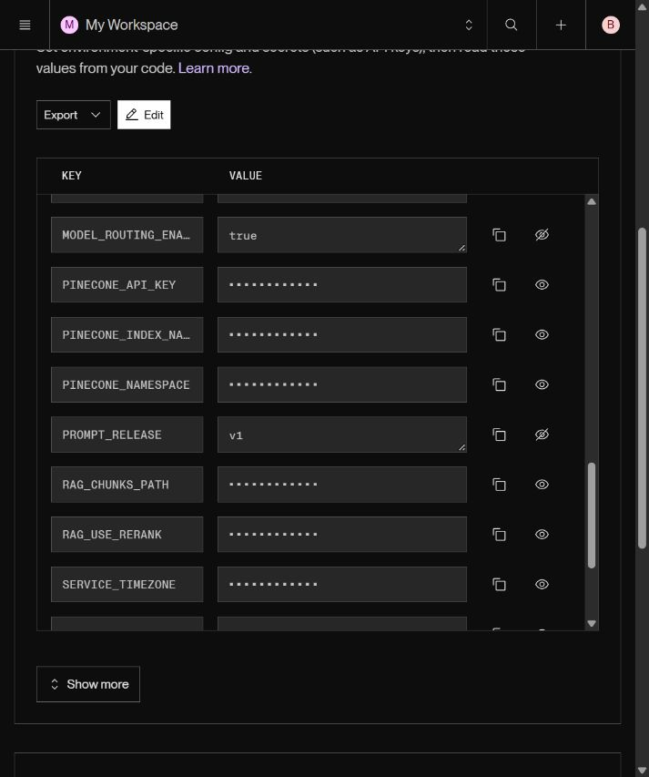
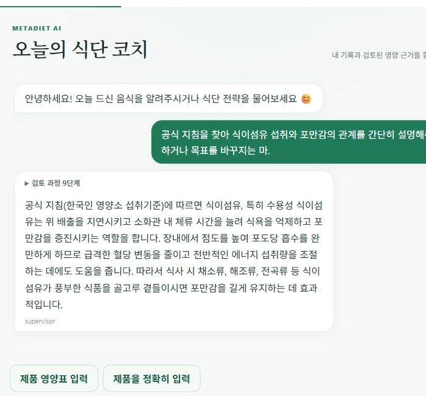

# Tier1에서 프롬프트 v1 고정 모델 라우팅 비교

2026-10-19. [이전 무료 quota 차단](../v1-recheck-20261019/README.md)과 분리한
새 유료 계층 실험입니다. [최소 생성 사전 확인](preflight.json)에서 Flash/Lite/Pro가
모두 HTTP200이었습니다. 이전 실패를 성공으로 덮어쓰거나 재사용하지 않습니다.

## 고정 조건과 측정 범위

- 동일100개 사례를 기준/후보 각각1회, 총200건. 세 프로세스로 서로 다른 사례를
  분할하고, 작업별 조건 선후를 교대합니다. 프로세스별 요청 간격2초.
- v1 번들: `4c40f46e4c2aa01b5ba7c78f456cff11b11907a4730e697288f796694ec7a741`.
  평가 시작 전에 해시/릴리스를 검사하며 변경된 v1이나 v2는 거부합니다.
- 기준은 모든 모델 작업에 기존 Flash3.8, 후보는 추출·제한 분류·검색어 번역에
  Lite3.1을 사용합니다. 후속 코칭/도구 Agent는 양쪽 모두 Flash를 유지합니다.
- 각 조건 추출25·분류25·번역25·후속 코칭25. 일부 분류는 기존 휴리스틱으로 모델0회.
  활성 대표 음식 계산 전체가 경량 모델을 호출한다는 뜻은 아닙니다.
- 추출은 실제 v1 파싱 프롬프트와 필터, 분류는 실제 legacy supervisor 경로,
  번역은 실제 v1 시스템 템플릿. 번역 키워드 일치는 최종 RAG 답변 품질과 구분합니다.
- 코칭은 실제 DietTeam과 합성 읽기/가짜 저장 경계 사용. 이전 대화300/2200kcal와
  다른 현재 섭취/목표를 반영하는지 검사합니다. 확정·수정·삭제·목표 변경·새 날짜
  **fixture**는 실제 운영 기록 변경·날짜 경계 통합검증이 아닙니다.
- Pro 평가50건은 관련성·실행 가능성·섭취 사실 조작 없음·허위 저장 없음 rubric입니다.
  Ragas faithfulness/context recall 지표가 아닙니다.
- 모든 실패·timeout은 분모에 유지. 답변 생성 비용과 offline 평가 비용은 분리합니다.
  출력 usage에 포함된 thinking은 중복 합산하지 않으며 비용 누락은0원으로 바꾸지 않습니다.
- 반복 템플릿 기반 개발 합성평가입니다.100명의 실제 사용자 성능이나 임상적
  정확도·서비스 p95 보장을 주장하지 않습니다.

## 원본·재현

[실행 당시 평가기](executed-benchmark.py.txt), 분할별 [0](shard0/paired.json) ·
[1](shard1/paired.json) · [2](shard2/paired.json). 각 폴더 frozen.json은 동일한 전체100개
사례를 보존합니다. 분석기는 해시·작업·분할 소유권·조건별1회·프롬프트 일치를 검사합니다.

```powershell
$env:PROMPT_RELEASE='v1'
# N=0,1,2를 별도 프로세스에서 실행. 출력 경로는 새 디렉터리를 사용합니다.
backend\venv\Scripts\python.exe -u -X utf8 backend/scripts/eval/benchmark_model_routing.py --output-dir tmp/new-tier1/shardN --env-file backend/.env --interval 2 --shard N --shards 3 --judge
```

사전 채택 기준은 작업별 품질·실패율 비열화 없음, 후보 품질≥95%, 최신값 전부 반영,
기준 실패율≤2%, 생성 비용 완전/평균≥10% 감소, p50≥5% 개선, p95 증가≤5%,
Pro 평가·평가 비용 완전입니다. 결과를 보고 임계값을 낮추지 않습니다.

## 결과 — 사전 채택 기준 통과

[검증된200건 합산·작업별 결과·Pro50건](summary.json),
[실행 소스·패키지 식별](execution-identity.json).

| 지표 | 단일 Flash | 규칙 라우팅 |
|---|---:|---:|
| 시도/완료 | 100/100 | 100/100 |
| 실행 실패·timeout | 0 | 0 |
| 작업 계약·rubric 통과 | 100/100 | 100/100 |
| 최신 섭취·목표 반영(합성 코칭) | 25/25 | 25/25 |
| 응답 중앙값 | 4.226초 | 2.010초 |
| 응답 p95 | 7.050초 | 5.158초 |
| 답변 생성 토큰요금 추정/100건 | $0.10900125 | $0.04809125 |
| 별도 Pro 평가25건 요금 추정 | $0.152650 | $0.152634 |
| 생성+평가 합계 | $0.26165125 | $0.20072525 |

중앙값52.44%·p95 26.84%·생성 비용55.88% 감소입니다. 전체 실험의 생성+평가
요금 추정 합계는 **$0.46237650**이며 선불 충전액·계정 청구서와 구분합니다.
평가자까지 포함한 조건 간 비용은23.29% 감소했습니다. 모든 usage가 수집됐습니다.
실패를 제외한 통계가 아니라 전체 시도 기준입니다. 휴리스틱0회 분류도 포함합니다.

후속 코칭은 양쪽 같은 Flash이므로 해당 작업 중앙값은4.410→4.495초로 소폭
늘었습니다. 전체 속도 개선을 복잡한 상담 전체의 속도 개선으로 확대하지 않습니다.
후속 코칭25건은 각 조건 Pro rubric도 모두 통과했습니다.

실제 모델 호출 오류나 품질 실패는 이번200건에서 발생하지 않았습니다. 별도 코드
리뷰에서 평가 합산이 같은 잘못된 프롬프트 해시를 허용하는 경우와 평가 비용 누락
조건을 보완했습니다. 실패 테스트 재현 후 수정했으며, 최종 백엔드1,425 passed/
기존1 skipped입니다. 개별 shard는100건 미만이라 채택false이고, 모든200건을 검증한
통합 결과의 gate=true만 채택 판단에 사용합니다.

실행 snapshot은 당시 평가기이며 이후 수정은 채택 검사에만 해당합니다. 프롬프트·
모델·사례·생성/평가 요청과 원본 결과는 바꾸지 않았습니다. 운영 적용 범위는
기존에 정의한 추출·제한 분류·번역만이며 도구 Agent·Vision·평가 모델·HITL은 유지합니다.

## main 병합과 공개 검증

[PR2](https://github.com/Kim-Du-Yeon/MetaDiet-AI/pull/2)를 main의
`aea07144a283b0d05cd0102cca1532f3496d20c4`로 병합했습니다. API·웹의 공개 빌드가
해당 커밋임을 확인했습니다. [공개 health 원본](public-health.json).
Render 배포 `dep-dbao3s0jgiss739k5n9g`는 Live이며 다음 설정을 저장·재배포했습니다.

```dotenv
MODEL_ROUTING_ENABLED=true
PROMPT_RELEASE=v1
GEMINI_SIMPLE_MODEL=gemini-3.1-flash-lite
```



첫 공개 상담은 실패했습니다. 요청ID·서버로그·LangSmith LLM 추적을 연결하니
**HTTP402/선불 크레딧 소진**이었습니다. [건강 수치와 키를 제외한 오류 근거](public-smoke-failure.json).
같은 시점 로컬 키는 세 모델 모두200이었고, 키 원문을 저장·출력하지 않은 비교에서
Render 저장 키와 로컬 평가 키가 다름을 확인했습니다. 다른 프로젝트라고 단정하지는
않습니다. 사용자에게 실제 자격 정보 반영을 요청했습니다.
[Google 공식 선불 잔액/402 설명](https://ai.google.dev/gemini-api/docs/billing#prepay).

사용자가 키를 직접 반영한 뒤 새 배포 `dep-dbaoa6uq1p3s73cf0nv0`의 Live와
health 200을 확인했습니다. 같은 공식 지침 질문을 실제 로그인 브라우저에서
재실행하니 근거 전문 Agent 위임·자료 검색·최종 답변까지 성공했습니다.
요청 ID는 `ed686503-bb3b-4e60-bab4-d6e271d1d594`이며 첫 서버 진행 이벤트는
813.9ms, 완료는 27,325.1ms였습니다. 이는 **단일 기능 점검**이며 100건 비교나
운영 평균·p95 개선 근거가 아닙니다. 이 요청에서 402는 재현되지 않았습니다.
섭취 기록 확정·목표 변경은 하지 않았습니다. 복구 후 별도 장기 관측은 남아 있습니다.



독립적으로 일반 음식3개가 기본 분량 카드로 계산되는 흐름과 저장 전 확인을 확인했습니다.
취소 첫 요청은 브라우저 `Failed to fetch`였으며 최신 제안 재조회 후 재시도로 정상
취소됐습니다. 이 일시적 연결 오류의 정확한 원인은 확정하지 않았고 코드 문제로
단정하지 않았습니다. 검증용 섭취는 확정 저장하지 않았습니다. 이 소수 기능 점검은
조건별100건 성능 비교에 합산하지 않습니다.

공식 근거: [Google 요금](https://ai.google.dev/gemini-api/docs/pricing),
[LangChain Gemini usage와 structured output](https://docs.langchain.com/oss/python/integrations/chat/google_generative_ai).
