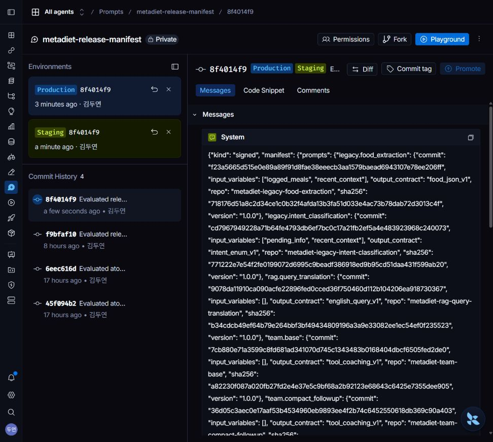
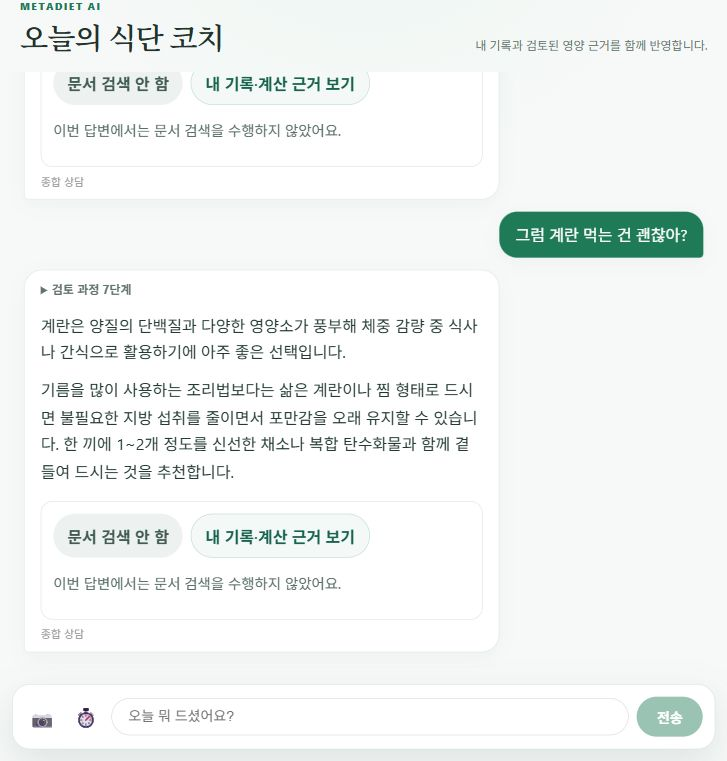

# v4 승인 정책 분리·운영 적용 결과 (2026-10-22)

[먼저 고정한 정책](policy.json) · [원문 보존 목록](source-hashes.json) · [승인 영수증](receipt.json) · [운영 판정](operational-decision.json) · [비용](cost-reconciliation.json) · [검사](checks.json)

## 무엇을 바꿨나

기준선의 정상 완료 조건을 후보 자체의 승인 조건에서 분리했다. 기준선100건은 모두 시도·엄격 채점·사용량이 연결돼 있어야 하지만, 기준선의 blocked2건 때문에 후보를 자동 거부하지 않는다. 실패2건은 원래100분모에 그대로 남는다. v4의 정상완료100/100, 정답/충실성 각각98 이상 및 기준선 대비 -1 이내, 행동98 이상 및 기준선 이상, 필수 질문49/50 이상, 근거 없는 확정0, 최신값/무저장100, 불필요 질문2 이하 및 기준선 이하, p95/비용1.25배 이내는 유지했다.

**결과를 본 뒤 사용자의 요청으로 개정한 운영 승인 정책이다.** 새 사전등록 실험·외부 독립 검증이 아니다. 기존 사전 기준 미통과를 통과로 바꿔 쓰지 않는다. 기존 [원래100쌍 결과](../v4-independent-20261022/RESULTS.md), 거부 기록과 원문344개는 변경하지 않았고 SHA-256 목록을 검증했다. 새 선택 정책을 고정한 뒤 원문을 재검토했다.

## 기존 결과 재활용

| 실패 포함 각100분모 | v1 | v4 |
|---|---:|---:|
| 정답 | 98 | 100 |
| 충실성 | 97 | 100 |
| 행동 통과 | 92 | 100 |
| 미완료 | 2 | 0 |
| 불필요 질문 | 5 | 0 |
| 필수 질문 | 50/50 | 50/50 |
| 평균 / p95 | 8.012 / 12.883초 | 5.592 / 9.269초 |
| 생성 비용 추정 /100시도 | $0.246820 | $0.220208 |

200답변과100쌍 Pro 원문 채점을 재사용했으며 새 생성·재채점으로 기존 실패를 대체하지 않았다. 새 검증기는 같은 수치를 재계산했고 모든 지표가 기존 집계와 동일했다. 변경된 것은 승인 정책뿐이다. 원래 gate는 실패, 새 후보 정책은 통과라는 두 판정을 함께 보존한다. 모델·프롬프트·질문·루브릭은 바꾸지 않았다. 이 수치는 같은 개발자가 만든10유형 합성100문항의 관찰이며 실사용자/임상 성과가 아니다.

## 서명·Staging·운영

[서명된 릴리스](approved.json)는 `clarification-v4-20261022`, 커밋 **8f4014f9b18d5c4cf993d9bb6219a8d5bc2cf03d7d4316272010957bc9a173c8**다. `team.base=7cb880e7…`, `team.compact_followup=36d05c3a…`와 기존6개를 한 명세로 묶었다. 미검증 조합을 개별 태그 변경으로 적용하지 않는다. exact candidate, 정상 Pro 종료/엄격 파싱, 질문·답변 binding, 비용·usage, 실제 원래 시스템 지시문 적용, helper·정책·원문 해시를 검증한 receipt를 서명에 연결했다.

LangSmith 실제 화면에서 manifest를 Staging으로 승격했다. 실제 원격 채널의 서명/8커밋/본문을 검증한 뒤 읽기 전용 합성6건을 실행했다. 분량만 요청, 개별 레시피 필수 정보, 영양표155.25kcal 계산, 일반식 후속 상담, 새 목표의1,456kcal 계산, 과거 합계 대신 현재값으로1,396kcal 계산을 확인했다. [6건 원문](staging-smoke.json) · [판정과 한계](staging-checks.json). 별도 호스팅 Staging 서버가 아니라 실제 Staging 채널을 읽는 격리 실행이다.

그 뒤 LangSmith 실제 화면에서 Production으로 승격하고 [두 채널 readback](channels-after.json)의 동일8커밋/서명을 확인했다. 기존 운영 서버의60초 백그라운드 갱신 경로가 새 릴리스를 가져왔다. **새 Render 코드 빌드가 아니라 프롬프트 릴리스 배포**이며, 서버/프런트 실행 코드는 바꾸지 않았다.

공개 브라우저에서 일반식 질문과 계란 후속 질문을 보내 두 답변이 추가 입력 요구 없이 완료됨을 확인했다. 식사/목표는 변경하지 않았고 대화 자체는 서비스의 정상 이력으로 남았다. [브라우저 답변](browser-ui.json) · [실제 요청 추적](browser-trace-roots.json) · [실제 모델 추적/usage](browser-model-traces.json). 두 모델 호출은 새 서명 릴리스와 정확한8개 ID/해시를 기록했고 오류0이었다. 두 공개 요청은 Supervisor 경로였다. compact 후속 경로는 이번 공개 요청에서 호출되지 않았으며 합성Staging에서 검증한 것으로 구분한다. 모델 입력 본문은 추적에 없어 공개 화면에서 실제 시스템 문자열까지 재검사했다고 주장하지 않는다.

## 비용·검사·남은 한계

추가 호출은 Staging Flash6회+공개 브라우저 Flash2회, Pro0회다. 로컬 사용량 추정 $0.01135575, 별도 운영 LangSmith 비용 추정 $0.010674, 합계 약 **$0.02203**이다. 로컬 기존 원장 $12.281684의 모든 행을 보존했고 신규 티켓을 정산해 $12.293043이 됐다. 원격 앱 호출은 로컬 실험 원장 밖이므로 비용을 별도로 명시했으며 청구서 확정액으로 표현하지 않는다.

백엔드 전체 **1,825개 통과·기존 skip1개·신규 skip0개**. 새 정책 경계/기존 원문·receipt 연결/변조 거부19개가 포함된다. 검증기 독립 리뷰에서 중요한 문제0. 프런트엔드/서버 실행 코드를 바꾸지 않아 프런트엔드 빌드·새 Render 빌드는 수행하지 않았다.

Staging6건 중1건에는 선택적 마무리 제안이 다시 나타났다. 본100건의 불필요 질문0이 운영에서 항상0을 보장하지 않는다. 이6건을 새100건 품질 점수로 확대하지 않고 원문과 함께 한계로 남겼다. 앞으로 임의의 후보를 기존 결과에 연결할 수는 없으며, 새 프롬프트 조합에는 별도 동결 증거가 필요하다. 실제 사용자 A/B는 시작하지 않았다.

## 운영·복구 순서

1. LangSmith에서 변경할 두 프롬프트의 실제 커밋을 선택하고 별도 candidate를 만든다. 개별 자식 태그만 Production으로 바꾸지 않는다.
2. 같은 조건·사례의 증거를 만들고 명시적 승인 정책으로 `evaluate`한다. 이 검토 정책은 이번 동결v4/원본에만 연결돼 있다.
3. receipt를 다시 검증한 `publish`가 서명 manifest를 비공개 저장소에 추가한다. 자동 승격은 하지 않는다.
4. manifest 커밋을 Staging으로 승격하고 안전·최신값 점검 후 Production으로 승격한다. 이번 실제 UI 순서/원격 readback이 위 증거다.
5. 기본60초 갱신 후 다음 요청부터 새 릴리스를 사용한다. 관리자 ‘프롬프트’ 화면의 강제 갱신 또는 권한 있는 `POST /admin/prompts/refresh`로 즉시 요청할 수 있다. 권한을 늘리지 않는다.
6. 복구 시 manifest의 Production Rollback에서 이전 **45f094b2… (v1)**를 선택한다. 다음 갱신/강제 갱신 이후 새 요청을 확인한다. 진행 중 요청/HITL은 기존 pin을 유지한다. 이 변경에서 실제 운영을 다시 v1로 왕복시키지는 않았으며 기존 rollback/pin 회귀 테스트를 재사용했다.
7. 조회 실패는 마지막 정상 서명 릴리스를 유지한다. 서버 재시작은 기존 last-good 파일이 있으면 복구하고, 파일이 없는 새 인스턴스는 로컬v1에서 시작해 검증된 원격Production을 다시 가져오는 기존 정책을 유지한다.

[LangSmith 공식 환경 승격·롤백 문서](https://docs.langchain.com/langsmith/manage-prompts): reserved staging/production을 자유 태그가 아니라 환경 승격 흐름으로 관리한다. 서명/평가 자체는 MetaDiet의 코드 승인 경계다.

체크아웃 재현성: 원래 Markdown2개는 생성 당시CRLF였으므로 정확한2경로에 eol=crlf를 명시했다. 원본 파일/점수/판정은 바꾸지 않았고 core.autocrlf=false의Git 필터에서도 동결SHA와 일치함을 확인했다. JSON·Python 원문은 기존 -text 설정을 유지한다.
