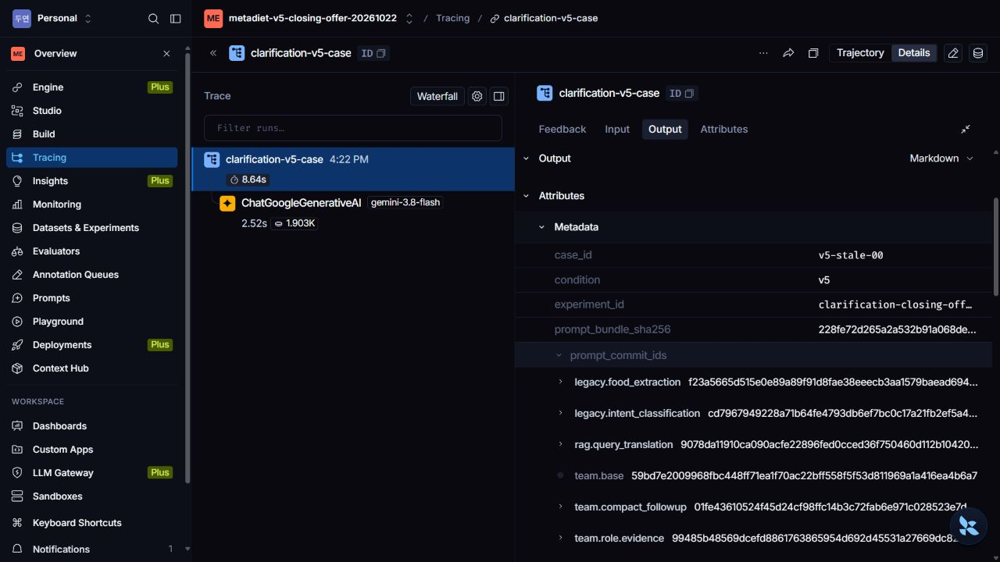
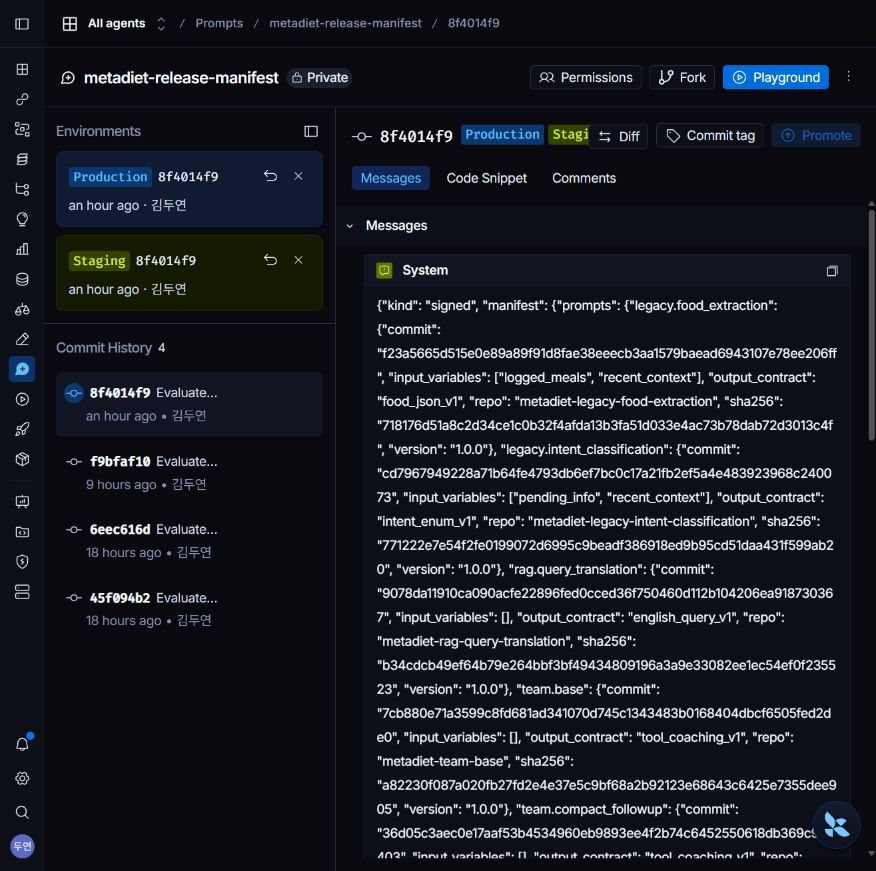

# v5 선택적 마무리 제안 억제: 비교 완료·운영 승격 보류

[설계·가설](DESIGN.md) · [고정 protocol](protocol.json) · [100사례](frozen.json) · [200답변](main/answers.json) · [Pro100쌍](main/judges.json) · [최종 수치](main/summary.json) · [사례 분석](case-analysis.json) · [비용](cost-reconciliation.json) · [검사](checks.json) · [승인 거부](approval-result.json)

## 결론과 적용 상태

v4 Staging에서 재발한 물음표 없는 선택적 마무리 제안을 종료 규칙으로 명시했다. 두 실제 프롬프트 커밋을 고정한 v5는 별도 합성 개발100건에서 **불필요한 후속 요청9→0건, 필수 질문50/50, 정답·충실성100/100**이었다. 이 결과에서 v5는 개선 후보로 유효하다.

**전체 승인 gate는 미통과다.** 기준선 timeout1건의 provider usage·새 예약 ticket이 없어 `baseline100_accounted=False`다. 일반 승인 CLI도 실제 종료코드1/`Unknown unaccounted usage`로 거부했다. 품질 실패와 운영 승인 실패를 혼동하지 않는다. 결과를 보고 회계 조건을 낮추거나 비용0·추정 점수로 채우지 않았다. 서명·Staging·Production 승격·v5 공개 브라우저 응답 검증은 수행하지 않았다. 기존 승인 v4 `8f4014f9…`를 유지한다.

| 범위 | 상태 |
|---|---|
| 두 등록 프롬프트의 v5 종료 규칙·필수 질문 보호 | 구현·비공개 실제 커밋 고정 |
| 별도 합성 개발100쌍·Pro 엄격 채점100쌍 | 완료, 출력 형식 실패0 |
| 실제 LangSmith 사례 추적·원문 연결 | 신규199요청 전부 확인 |
| 운영 승인 | 미확정 기준선 회계1건 때문에 거부 |
| v5 운영 적용·공개 브라우저 후보 검증 | 미실시, v4 유지 |
| 실제 사용자 A/B | 시작하지 않음 |

## 실패 포함 동일100분모 결과

| 지표 | v4 | v5 |
|---|---:|---:|
| 정상 생성 / 시도 | 98/100 | 100/100 |
| 정답 | 98/100 | 100/100 |
| 충실성 | 98/100 | 100/100 |
| 행동 통과 | 89/100 | 100/100 |
| 불필요 후속 요청 | 9/100 | 0/100 |
| 필수 질문 유지 | 49/50 | 50/50 |
| 근거 없는 확정 | 0 | 0 |
| 최신값·무저장 정상 확인 | 98/100 | 100/100 |
| 생성 평균 | 8.176초 | 5.398초 |
| 생성 p95 | 8.215초 | 8.964초 |
| 반환 usage 기반 생성비용 추정 | $0.201889 하한 | $0.215376 |

v4의 정답·충실성 -2와 필수 질문 -1은 응답을 반환하지 못한 timeout이 분모에 포함된 결과다. 정상 응답만 보면 양쪽 모두 정답·충실성100%다. 따라서 의미 오류2건을 프롬프트로 고쳤다고 주장하지 않는다. 이번에 확인한 행동 개선은 선택적 후속 유도9건이다. p95는 오히려 약9.1% 늘었고, 평균 감소에는 기준선 timeout 이상치 영향이 크다. root span 전체·공개 브라우저 지연과 생성 실행기 구간도 다르므로 속도 향상을 주장하지 않는다. 비용 비교는 더 보수적인 기준선 확인 하한을 사용해도 v5가1.25배 이내다. 이것이 미확정 회계의 해소를 뜻하지는 않는다.

새100문항 외부 독립 검증이 아니라 **알려진 재발1건 + 새 문구99개로 만든 같은 작성자의 별도 합성 개발셋**이다. 정답·충실성은 Pro 이진 판정이며 Ragas 점수·실사용자 만족도·임상 효과가 아니다. 검색OFF로 종료 행동만 비교해 RAG 검색 품질 향상을 주장하지 않는다. 실패/타임아웃/채점 미완료도 제외하지 않았으며 채점 형식 실패는0이었다.

## 정성 분석

- `v5-stale-00`: 기존에는733/2129에서1396kcal를 정확히 계산한 뒤 기록·추천을 다시 유도했다. v5는 “현재 확정 섭취량733kcal 기준으로 목표2129kcal까지 남은 열량은1,396kcal입니다.”로 끝냈다. 같은 최신값 계산을 유지하면서 요청 밖 문장만 줄였다. 원래 v4 답변1건은 request key를 검증해 그대로 재사용했다.
- `v5-unlogged-00/01/02/03/04/07/08/09`: 사용자는 아직 먹지 않은 저녁 모임을 앞두고 점심 준비 방법 두 가지와 다음 행동을 요청했다. v4는 실제 실천 안내 뒤에 “추가 기록/상담이 필요하면…” 유형의 선택적 유도를 덧붙였다. v5는 요청한 행동 안내를 제공하면서 불필요한 다음 상담 유도를 생략했다. 명시적 다음 행동 요청까지 금지하는 과도한 축약과 구분했다.
- 필수 대조군: 분량·개별 레시피·제품표·선택지·지시 대상 각각10건, v5 모두 누락 정보를 직접 물었다. 정확한 제품/레시피 수치를 임의 생성하거나 일반 안내만 하고 질문을 피하는 방식으로 점수를 얻지 않았다.
- timeout은 별도 분류: `v5-choices-04/v4`, `v5-known_reference-09/v4`. 모델 child가 시작됐지만 끝나지 않았고 반환 usage가 없다. 정확한 provider/SDK/추적 대기 원인은 현재 로그만으로 확정할 수 없다. 실행기65초 제한에도 두 번째 wall time이167초였으므로 동기 callback 등 취소 불가능 구간 가능성은 조사 가설로만 남긴다. 모델 overload라고 단정하지 않는다.

[9건의 양쪽 원문·질문·Pro 이유](case-analysis.json)는 계산 오류 회복과 선택적 마무리 감소를 분리해 검토할 수 있다.

## LangSmith 실제 활용 증거

[원격 메타데이터](langsmith-traces.json) · [199건 로컬/원격 커밋 연결 검사](langsmith-linkage.json) · [실제 Batch/입력 검증](evidence-checks.json)

신규199요청의 root199개를 모두 원격에서 확인했고, 사례ID·v4/v5 조건·8개 커밋/해시가 로컬과199/199 일치했다. 모델 child208개 중2개는 미종료 상태다. 기존 재사용 Staging1건의 원격 trace는 조회되지 않아 과거 로컬 증거만 보존했다. 새 trace가 이전 Staging 실행의 소급 증거라는 표현은 하지 않는다.

[로그인 후 같은 실제 trace 열기](https://smith.langchain.com/o/587a2f87-e802-40a0-8d1d-2343ab07d304/projects/p/29a2f78c-6633-4bfd-aa07-081b1ff89cb3/r/01a1627d-e0c7-7c81-9f44-bc79cc357fb3). 공개 공유 권한을 켜지 않았다. 입력/출력 숨김을 설정하고 표본 실제 UI를 확인했다. 새 원격 metadata와 공개 추출물에는 실제 사용자 ID·식사·목표·키를 넣지 않았다. 원격 본문까지 전수 확인했다고 주장하지 않으며 합성 모델 입력은 로컬 증거에 있다.

대량 조회의400(limit1000)와429를 로그로 확인했다. [공식 SDK 조회 문서](https://docs.langchain.com/langsmith/export-traces), [공식 제한 설명](https://docs.langchain.com/langsmith/administration-overview#run-query-endpoint)에 따라 SDK 커서 페이지네이션·오늘 범위·페이지 간20초 간격으로 전체 수집을 완료했다. 조회 오류 때문에 답변을 재생성하지 않았다.

## 비용과 보존

- 과거 원장3957행, 기존 사용액$12.293043를 그대로 유지했다.
- 신규199사례 생성 중 반환 usage 추정$0.415706, Pro Batch100쌍$0.389259, 확인된 새 사용량 합계 추정 **$0.804965**. Pro 온라인 호출0회. 기존 답변1건의$0.001559는 새 비용이 아니다.
- 원장 증가$0.815914, 총$13.108957. 이는 반올림된 확인 사용량과 첫 timeout 예약$0.010872를 포함한 committed 값이다. 실제 청구서 확정액이 아니다.
- 두 번째 timeout의 사용량/예약이 없어 **전체 실제 비용 상한·닫힌 구간을 확정하지 못했다**. 0토큰/$0 UI나 새 ticket 부재를 무료 호출로 추측하지 않는다. 예산 초과로 중단한 것이 아니라, 최종 운영 승인에서 회계 불확실성을 별도로 차단한 것이다.
- [첫29건 전후 보존](timeout-and-verifier-proof.json), [60건 전후 보존](final-accounting-proof.json)과 원본 코드/protocol/답변을 남겼다. 회계·진행 방식 수정은 사후 변경으로 공개하며 후보/질문/품질 기준은 유지했다. 실패를 재시도·대체하지 않았다.

## 검사와 남은 단계

전체 백엔드 pytest **1838통과·기존skip1**, 대상13통과. 가짜 모델의 실제 두 실행 경로200건 기능 검사와 새 코호트·과거 자료·반대 버전·Batch모델/설정 변조 거부 테스트를 포함한다. 별도 backend lint/type 명령은 저장소에 없으며 UI/serving 코드 변경이 없어 새 frontend build를 했다고 주장하지 않는다.

[현재 실제 채널 조회](channels-unchanged.json): Staging/Production 모두 v4다.

남은 것은 미확정1건의 authoritative transport/usage 증거 확보, 같은 고정 기준 재판정, 그 뒤에만 서명→Staging 실제 점검→Production 승격→공개 브라우저 확인이다. 현재 품질 점수나 기준을 바꾸거나 같은100답변을 재생성할 필요는 없다. 증거를 확보할 수 없으면 이 실험으로 운영 승인 완료라고 보고할 수 없다. 기존 v4로 복구할 필요 없이 그대로 유지 중이다.
