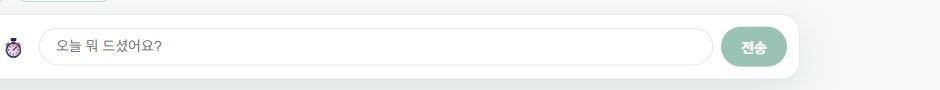

# 최종 섭취 통계 ReadError 복구

해석 보완: 아래 25건 보류는 응답 문구 기준이며 정상 검색·근거 부족을 검증한 지표가 아니다. 후속 실제 상담에서 검색 오류와 최종 문구 혼동을 확인해 [별도 수정](../coaching_review/README.md)했다. 모든 25건이 같은 원인이라고 단정하지 않으며 이 보고서의 원본·통계 조회 결과는 그대로 보존한다.

## 원인 근거와 확정 범위

이전 공개 100건의 index38/40에서 `public_stats`가 `ReadError`를 내고 한 번의 제한 재시도도 실패했다. [기존 두 요청의 원본 진단](original_failures.json), [Render에서 확인한 오류 행](render_failure_lines.json). 모델 답변 실패와 최종 통계 조회 실패는 별개다. Render UI의 중복 표시 행은 요청 수로 세지 않았다.

[HTTPX 예외 문서](https://www.python-httpx.org/exceptions/)에서 ReadError는 네트워크 수신 실패다. 당시 진단은 예외 클래스만 보존하므로 소켓 errno, TCP 종료 주체, 프록시·DB 서버 대기 원인은 **확정할 수 없다**. 앞서 관측한 `[Errno 11] Resource temporarily unavailable`와 같은 원인이라고 단정하지 않는다. 설치 SDK는 supabase/postgrest2.30.0, HTTPX0.28.1/httpcore1.0.9이며, SDK 기본 동기 PostgREST 클라이언트는 HTTP/2를 사용한다. 이 사실만으로 HTTP/2 결함이 입증된 것은 아니다.

확인된 복구 구조의 약점은 process-wide 동기 Supabase 클라이언트를 여러 요청이 공유하고, 오류 후에도 같은 클라이언트로 두 조회를 다시 수행한다는 것이다. 바깥 asyncio.wait_for는 to_thread의 동기 소켓 읽기까지 중단시키지 못한다. [HTTPX 전송 문서](https://www.python-httpx.org/advanced/transports/)의 transport retries는 ConnectError/ConnectTimeout 대상이므로 ReadError 복구를 대신하지 않는다. 읽기 전용 통계에만 명시적 제한 재시도를 적용한다.

## 변경

`app/db/public_stats.py`에서 요청·시도별 비동기 HTTP 클라이언트로 두 통계 읽기를 수행한다. 같은 시도 안에서는 연결을 재사용하고, 실패 후 한 번만 새 클라이언트로 재시도한다. 다른 요청의 전역 클라이언트를 닫거나 교체하지 않는다. [공식 비동기 클라이언트 수명 관리](https://www.python-httpx.org/async/)와 [타임아웃 구분](https://www.python-httpx.org/advanced/timeouts/)에 따라 연결3초/수신·쓰기4초/풀1초와 전체15초 마감시간을 둔다. 취소 시 async context가 소켓을 정리한다. 요청별 새 연결에는 TLS 생성 비용이 있으므로 속도 개선을 가정하지 않는다.

기존 서비스 날짜·인증된 내부 user_id 필터·활성 목표 조건을 유지한다. 재시도 날짜를 고정하고 캐시를 도입하지 않는다. 성공한 빈 섭취 목록은 실제0, 목표 부재나 최종 오류는 빈 통계이며 임의 목표/0을 만들지 않는다. DB schema·권한·쓰기·확정 경로는 바꾸지 않는다. 끼니/전략의 두 HTTP 읽기는 단일 트랜잭션 snapshot은 아니며, 동시 변경 중 원자성 보장은 이번 범위가 아니다.

성공/실패를 포함해 meals/strategy 구간을 분리 계측하고 전체 마감시간 초과도 오류 타입으로 관측한다. 새 로그에 대화 원문·건강 수치·자격 정보는 넣지 않는다. 기존 retry 로그는 클래스만 남긴다.

## 평가 프로토콜

공개 API·실제 모델·DB, 동일 합성 계정, 4고정 질문×25회, 동시성4. 전후 각각100건을 새로 수집하며 실패·타임아웃·근거 보류를 분모에서 빼지 않는다. 이전 문맥에 낡은 숫자를 넣어 현재 DB 값과 비교하고, **최종 통계 누락은 답변이 성공해도 별도 실패로 집계**한다. 원본 [전100](before_frozen100.json), [후100](after_frozen100.json), [집계](comparison.json). 사전 안전 기준은 통계 정확 반환·숫자 일치·수집 실패·실행 보류·무변경의 악화 없음이다. 통계 지연 중앙값과 p95가 모두 줄 때만 속도 개선으로 분류한다.

별도로 합성 식사 생성→수정→삭제→목표 변경→전날 기록만 존재하는5상태×20회로 `/session/restore`를 전후100건씩 검사한다. 이 검사는 모델을 호출하지 않는 공개 통계/복원 검사이며 전체 상담 응답 시간과 섞지 않는다. 상태별 완료 후 다음 변경을 수행하고, 조회의 domain snapshot 불변과 원래 합성 fixture 복구를 확인한다. [전 최신값100](before_freshness100.json), [후 최신값100](after_freshness100.json).

평가 질문은 기존 개발 고정셋을 재사용하므로 독립 holdout이나 실제 사용자 성능이 아니다. 전후를 시간순 실행하여 공급자/시간대 변동이 남는다. 수집 timeout180초는 urllib 소켓 inactivity 한도이며 전체 상담 hard deadline이 아니다. 100건에 오류가 없더라도 영구 해결이나0% 운영 실패율을 증명하지 않는다. 회귀 테스트의 강제 ReadError/권한 오류/취소·마감시간은 기능 검증이며 공개 성능 표본에 합산하지 않는다.

Supabase 변경 기록은 2026-10-16 확인했다. 2026-10-12 공지의 일부 TLS1.2 cipher 종료는 11월10일 적용 예정이어서 이번 오류 원인으로 채택하지 않았다. changelog.md는 웹 도구가 text/markdown을 거부해 직접 HTTPS 읽기로 확인했다.

## 공개 결과와 채택

기준선 실행 `368ee2e`, 후보 `2c1162d`. 아래 두 비교는 각각 전후100건씩이며 서로 다른 검사이므로 성공률을 하나로 합치지 않는다. 모델/도구 설정과 frozen 질문·동시성·합성 계정은 양쪽 동일하다.

| 상담100건, 실패·보류 포함 | 전 | 후 |
|---|---:|---:|
| 전체 완료 중앙값 |24.849초|23.945초|
| 전체 완료 p95 |30.709초|29.608초|
| 첫 진행 p95 |0.751초|0.807초|
| 최종 통계 정확 반환 |100/100|100/100|
| 통계 오류 이벤트 요청 |1, 재시도 복구|0|
| 전체 외부 오류 이벤트 요청 |3|0|
| 숫자 제공 응답 최신값 일치 |75/75|75/75|
| 근거 보류 포함 전체 숫자 일치 |75/100|75/100|
| 근거 기준 미달 안내 |25|25|
| HTTP/수집 실패 |0|0|
| 통계 조회 중앙값 |0.304초|0.600초|
| 통계 조회 p95 |0.757초|1.190초|
| 합성 섭취·전략 snapshot 불변 |확인|확인|

기준선의 세 오류는 통계 ReadError1건과 profile_intake_read ReadError2건이며 모두 제한 재시도로 복구됐다. 과거의 최종 실패2건을 새 기준선에서 재현했다고 주장하지 않는다. 전체 완료 지연의 감소를 통계 최적화의 인과 효과로 설명하지 않는다. 통계 자체 중앙값은 약97.4%, p95는 약57.1% 증가했으며 **통계 속도 기준은 통과하지 못했다**. 첫 진행 p95도 증가했다.

| 상태 변경·복원100건, 모델 호출 없음 | 전 | 후 |
|---|---:|---:|
| 최신값 정확 반환 |84/100|100/100|
| 응답에서 통계 누락 |13|0|
| 복원 요청 실패 |3|0|
| 전체 시도 중앙값 |1.780초|2.398초|
| 전체 시도 p95 |3.544초|2.821초|
| 원래 합성 fixture 복구 |확인|확인|

기준선의3건은 수집 도구가 HTTP 오류를 RuntimeError로 기록한 것이다. 이 원본에는 상태 코드/스택을 보존하지 않았으므로 세 건 모두를 통계 ReadError로 재분류하지 않는다. 잘못된 수치가 반환된 건은 없고, 실패16건은 누락13건+요청 실패3건이다. 후보100건은5상태 전부 정확히 반환했다. 복원 중앙값은 약34.7% 늘었지만 p95는 약20.4% 줄었다.

통계 반환·최신 숫자·보류·실패·무변경 사전 안전 기준을 통과했고 동시 복원 누락 감소를 확인해 **신뢰성 복구로 채택**했다. 전체 조회를 강제로 직렬화하거나 재시도 횟수를 무작정 늘리지 않았다. 이 결과만으로 서버/네트워크의 정확한 고장 원인이 확정되거나 특정 전송 방식의 우월성이 입증된 것은 아니다. 휴면 복구·장시간 운영 실패율·고부하 포화는 이번 검사가 아니다.

진행 중인 latest-value 파일을 집계한 첫 시도는100건 미완료 assert에 걸렸다. 불완전 표본을 성공 결과로 내보내지 않는 정상 보호 동작이며, 완료 후 같은 파일을 그대로 집계해 [comparison.json](comparison.json)을 생성했다. 이 도구 실행 실패를 제품 요청 실패 수에 섞지 않았다.

합성 fixture는 두 비교 사이 원래 값으로 복구했고, 최종 `/users/me` 삭제와 users 행 부재 확인 후 ignored env를 삭제했다. [정리 결과](cleanup.json). 운영 사용자 식사·목표를 시험용으로 바꾸거나 삭제하지 않았다. 실서비스의 읽기 전용 상담은 대화 이력만 추가하며 섭취 확정은 수행하지 않았다.

## 회귀와 공개 브라우저

백엔드 전체 **1358 passed / 기존1 skipped**, 프론트 전체 **104 passed /30 suites**, CI 프로덕션 빌드(ESLint 포함) 통과. 새 복구 경계 테스트는 구현 전 모듈 부재로 실패하는 것을 확인하고 구현 후 통과했다. 영구401/403/400은 재시도하지 않으며, 반복 ReadError는 두 시도 뒤 빈 통계로 종료한다. 취소와 전체 마감시간에서도 클라이언트가 닫히고, 빈 섭취와 목표 부재를 구분한다. 집계 회귀는 성공 답변100건이어도 통계2건 누락이면 통계 성공98/100으로 남는지 확인한다. 기존 테스트 삭제/skip 추가는 없다.

main 실행 커밋 `2c1162d7c9768a98ffd8b2c9b27c76bb0f081175`를 API health와 웹 build-info에서 각각 확인했다. 로그인된 실제 브라우저에서 새로고침 복원→수치 없는 읽기 전용 상담→답변 완료·입력 재활성화→재새로고침을 확인했다. 기존 섭취/목표 표시는 유지됐고 새 저장/확정 버튼을 누르지 않았다. [건강 수치를 생략한 기능 확인](browser_check.json), [UUID 계측](browser_timing.json). 한 브라우저 요청의 첫 서버 진행705ms, 완료23.293초는 기능 관측이며 전후100건 속도 지표에 합산하지 않는다. 이 요청은 후100건 수집 중 별도로 실행됐으므로 운영 환경 배경 부하가 완전히 통제된 실험이 아니다.

캡처에는 개인 건강 수치와 과거 대화를 포함하지 않았다. 새 동기화/비동기 분리와 HTTP/1.1 기본 전송을 함께 바꿨으므로 개선이 관측되더라도 특정 HTTP/2 결함의 인과 증명으로 해석하지 않는다. 다른 Supabase SDK 호출은 변경하지 않아 통계 이외의 외부 조회 오류까지 해결했다고 주장하지 않는다.
