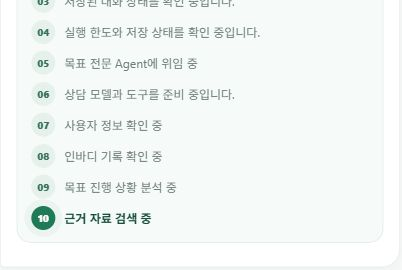

# 요청 ID 기반 시작 지연 분석

후속 작업: 이 보고서에서 남긴 통계 ReadError는 [별도 공개 상담·상태 변경 전후100건 검증과 연결 복구](../public_stats_recovery/README.md)에서 보완했다. 아래 수치는 당시 실험 결과 그대로 보존한다.

## 계측 경계

클라이언트가 생성한 UUID를 `stream_run_id`와 `X-Request-ID`로 공유한다. 재연결은 같은 요청 ID와 새 `X-Attempt-ID`를 사용한다. 서버는 UUID 형식만 받아들이며 형식이 잘못되면 새 ID를 생성한다. ID는 인증이나 권한의 근거가 아니다. API 응답 헤더, 고정 이름의 준비 구간 로그와 LangSmith invocation metadata에 연결한다. 대화 원문·이메일·건강 수치·토큰은 새 계측에 넣지 않는다.

브라우저 `metadiet:request-timing` 이벤트와 `[request_timing]` 콘솔 JSON은 fetch 시작·헤더 수신·첫 서버 진행·완료·실패 및 표시 기회를 기록한다. React 화면 갱신 뒤 두 번의 requestAnimationFrame으로 측정한 것은 **paint opportunity**이며 실제 픽셀 표시 시각을 보장하지 않는다. 비활성 탭에서는 지연될 수 있어 visibility를 같이 남긴다. 브라우저와 서버의 서로 다른 시계를 직접 빼지 않는다. 서버는 ASGI 진입→헤더/첫 body 송신과 인증·잠금·복원·모델 구간을 같은 요청 ID로 연결한다.

## 고정 평가

공개 HTTPS·실제 모델·실제 DB를 사용하는 합성 계정만 사용한다. 4개 고정 질문을 각 25회, 동시성 4로 실행한다. 일반 추천/후속 질문 50건과 명시적 읽기 전용 목표/추세 검토 50건이다. 의도적으로 이전 대화에 낡은 숫자를 넣고 현재 합성 DB의 섭취·목표 숫자와 비교한다. 모든 실패·타임아웃·근거 보류를 보존한다. 비교 조건 사이 합성 데이터와 질문을 바꾸지 않으며 domain snapshot이 일치해야 한다. API 100건은 브라우저 100건 렌더링 실험이 아니다.

기존 평가 도구의 transport 실험 설정은 별도 전송 타이밍 필드를 요구해 첫 시도에서 중단됐다(`before.json`에 원본 보존). 기존 직렬 평가 시도는 수집 도구를 교체하며 중단했고 `matched/before.json`을 pilot로 보존한다. 이 pilot들은 정식 고정 100건 비교 결과와 섞지 않는다. 중단 당시 진행 중 요청의 최종 응답은 수집되지 않았으므로 그 구간으로 성공률을 산출하지 않는다.

## 후보 개선

기록을 변경하지 말라는 명시적 요청과 목표 검토/진행/근손실 위험 표현, **영양 근거 검토 요청**이 함께 있고, pending 제안과 기존 목표 위임이 없는 경우에만 목표 전문 Agent로 바로 연결한다. 목표 Agent는 기존의 프로필·섭취·측정·근거 조회 도구를 가지며 쓰기 도구를 주지 않는다. Supervisor 선택/중계 모델 왕복을 제거하되, 동일 실행 예산·위임 카운터·최종 근거 정책을 유지한다. 전략 변경 요청과 불명확한 요청은 기존 Supervisor 경로다.

첫 후보 `46047ca`는 근거 검색을 명시하지 않은 추세 검토에도 적용해, 기존 응답을 불필요한 근거 보류로 바꾸는 회귀가 있었다. 18개 수집 관측을 [실패 pilot](rejected_goal_direct_pilot.json)에 보존하고 실행을 중단했다. 중단 중 진행/대기 중인 요청의 최종 응답은 모두 수집되지 않았으므로 이 pilot의 속도·성공률을 비교 근거로 쓰지 않는다. 조건을 좁힌 `368ee2e`를 별도 100건으로 재검증했다. [LangChain 공식 multi-agent 문서](https://docs.langchain.com/oss/python/langchain/multi-agent)가 설명하는 라우팅/도구 문맥/모델 왕복 비용 구분을 참고했으며, 근거 정책을 느슨하게 하는 방식은 사용하지 않았다.

## 공개 전후 100건 결과와 채택

기준선 `abc03e4`, 최종 후보 `368ee2e`. [전체 비교](comparison.json), [전 100건](before_frozen100.json), [후 100건](after_frozen100.json). 실패/보류를 제거하지 않은 전체 100건 지연이다. 각 조건은 4질문×25회로, 100개의 독립적인 실제 사용자 질문은 아니다. 전체 순서를 무작위 교차 배치하지 않아 시간대·공급자 변동의 영향이 남는다.

| 지표 | 전 | 후 |
|---|---:|---:|
| 시도 | 100 | 100 |
| 첫 서버 진행 중앙값 | 368.824ms | 319.824ms |
| 첫 서버 진행 p95 | 847.873ms | 884.710ms |
| 첫 서버 진행 최대 | 1249.235ms | 1390.968ms |
| 전체 완료 중앙값 | 25.233초 | 24.875초 |
| 전체 완료 p95 | 40.951초 | 30.428초 |
| 전체 완료 최대 | 93.349초 | 33.976초 |
| 평균 모델 호출 | 3.27 | 2.81 |
| 숫자 제공 응답의 최신 DB 값 일치 | 75/75 | 75/75 |
| 근거 보류 포함 전체 기준 숫자 일치 | 75/100 | 75/100 |
| 근거 기준 미달 안내 | 25 | 25 |
| HTTP/수집 실패 | 0 | 0 |
| 외부 오류 이벤트가 기록된 요청 | 7 | 2 |
| 섭취·전략 snapshot 불변 | 확인 | 확인 |

전체 완료 중앙값은 약 1.4%, p95는 약 25.7% 감소했다. 평균 모델 호출은 약 14.1% 감소했다. 첫 진행 p95는 약 4.3% 증가했으므로 표시 지연의 p95 개선을 주장하지 않는다. 원래 보고된 **첫 표시 전 20초**는 이번 양쪽 200건에서 재현되지 않았으며 과거 원인은 확정하지 못했다. 반면 관측된 답변 완료 지연에서는 외부 모델 왕복이 큰 비중이었다. 기준선의 가장 느린 요청은 모델 오류 이벤트와 약 90초 실행 예산 사용을 포함한다. 그 요청을 제외해 결과를 좋게 만들지 않았다.

외부 오류 기록은 기준선 7건(모델 및 통계 조회 포함), 후보 2건이다. 후보 2건은 `public_stats`의 `ReadError`로, 제한 재시도도 실패했다. 이는 모델 생성 오류가 아니며, API는 통계 조회 불가를 0으로 바꾸지 않고 기존 UI 값을 유지한다. 최종 답변의 숫자 일치와 별개로 완료 통계 조회의 신뢰성 한계가 남는다. 오류 기록 수의 감소를 라우팅 최적화의 인과 효과로 단정하지 않는다.

사전에 코드로 둔 채택 기준은 완료 중앙값·p95 감소, 최신 숫자 일치/보류/실패/외부 오류 기록 악화 없음, 첫 진행 누락 0 및 p95 20% 이내 변동이다. [집계 스크립트](../../backend/scripts/eval/summarize_request_startup100.py)의 기준을 통과해 **좁힌 직접 경로를 채택**했다. 정책 보류를 정상적인 영양 답변이나 임상적 정확도 성공으로 계산하지 않는다.

## 실제 브라우저·서버·LangSmith 연결

공개 웹/API의 `368ee2e5b2cec4993759b5df44897f8bfca0076b`를 확인한 뒤 로그인 브라우저에서 읽기 전용 상담을 실행했다. 같은 UUID가 [브라우저 계측](browser_timing.json), [Render 준비 로그](server_browser_request.json), [운영 LangSmith 루트 metadata](langsmith_correlation.json)에 존재함을 확인했다. 로컬 기본 `diet-agent`는 오래된 개발 프로젝트여서 최초 trace 검색이 빗나갔고, 최신 운영 `metadiet-beta`에서 해당 요청을 확인했다. CLI 최초 설정 조회도 실행 위치 때문에 .env를 찾지 못했으나 명시적 경로 로딩으로 해결했다. 입력/출력·키는 증거 파일에 저장하지 않았다.

단일 브라우저 기능 검증에서 로컬 표시 기회 16.9ms, 헤더 828.1ms, 첫 서버 진행 수신 829.1ms, 서버 진행 표시 기회 866.4ms, 완료 25725.7ms였다. 서버 동일 요청의 인증 397.613ms, ASGI→헤더 400.739ms/첫 body 401.063ms, 잠금 775.675ms, 복원 144.673ms가 연결됐다. 서버 first_model_started 2030.584ms는 그래프 진입 기준이어서 HTTP 경과시간과 직접 합산하지 않는다. 이 브라우저 한 건으로 p95나 렌더 성능 전후 개선을 주장하지 않는다. 완료 시 기존 근거 정책에 따라 수치 권고를 보류했으며 확인/저장 버튼은 누르지 않았다.

검증 도구의 native 검색 입력이 IME/단축키와 충돌해 로그 검색이 한 번 잘못 적용됐고, DOM locator fill로 교정했다. 임시로 나타난 상세 패널은 다음 관측에서 이미 닫혀 닫기 locator가 한 번 실패했으며 제품 실패로 계산하지 않는다.

## 정리

합성 평가 계정은 `/users/me` 삭제 절차로 정리했고 [cleanup 결과](cleanup.json)를 보존했다. 해당 Auth 사용자와 users 행 부재를 확인한 뒤 git-ignored 자격 파일을 삭제했다. 운영 사용자 식사·전략을 평가 fixture로 쓰지 않았다. 테스트·최종 배포 확인은 아래 릴리스 검증에 기록한다.

## 릴리스 검증

최종 코드: API·웹 `368ee2e5b2cec4993759b5df44897f8bfca0076b`의 HTTP200과 브라우저 계측·위임·정상 종료 확인. 백엔드 전체1347 passed/기존1 skipped, 프론트 전체104 passed/30 suites, 프로덕션 빌드 통과. Type/lint는 프론트 CI 빌드의 ESLint 검사를 포함한다. 결과 문서·증거 추가는 `[skip render]`로 반영해 검증된 실행 버전을 불필요하게 다시 배포하지 않는다.

동일 고정셋에서 회귀를 발견·수정했으므로 독립 holdout 검증이 아니다. 의료적 답변 품질 전체를 평가한 것이 아니며, 현재 DB 숫자 일치·안전한 보류·무변경은 제한된 품질 지표다. 지금도 답변 완료까지 수십 초가 걸리고 통계 조회 ReadError가 남는다. 이후 발생하는 20초 첫 표시 지연은 새 요청 ID의 브라우저/서버 경계를 따라 분석해야 한다.

## 해석 원칙

첫 서버 진행과 답변 완료를 구분한다. 20초 이상 걸리는 답변이 있더라도 첫 진행까지 20초 지연을 재현한 것으로 해석하지 않는다. 숫자 일치와 무변경 검사는 제한된 품질 지표이며 임상적 타당성·전체 답변 품질 평가가 아니다. 기동 직후/휴면 복구 성능과 실제 사용자 평균을 보장하지 않는다.

공식 문서: [FastAPI 미들웨어·CORS 헤더](https://fastapi.tiangolo.com/tutorial/middleware/), [MDN requestAnimationFrame](https://developer.mozilla.org/en-US/docs/Web/API/Window/requestAnimationFrame), [ESLint no-loop-func](https://eslint.org/docs/latest/rules/no-loop-func). 빌드에서 no-loop-func가 계측 콜백의 외부 let 참조를 검출했으며 const 상태 객체로 바꾼 뒤 재빌드했다. 경고를 비활성화하지 않았다.
