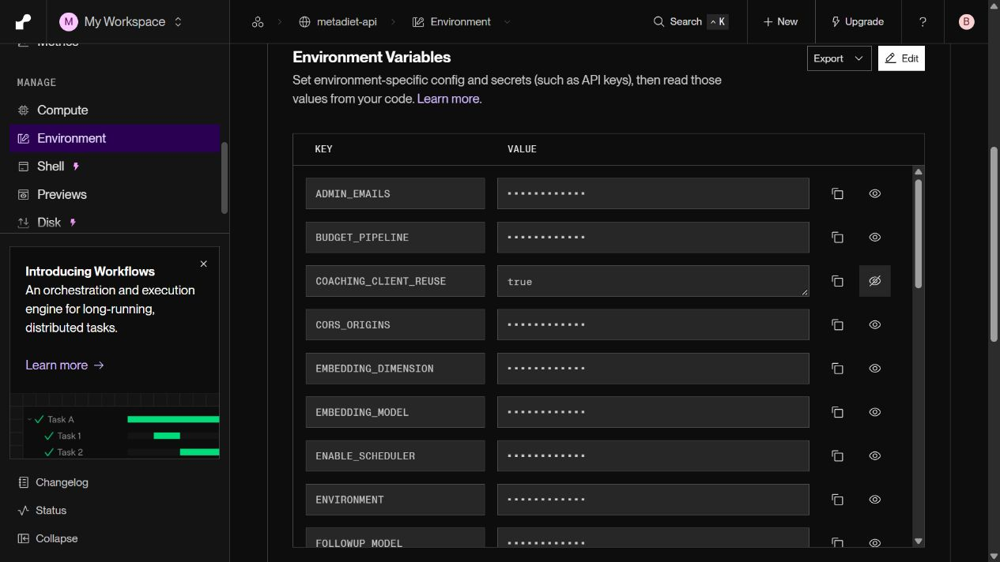

# SDK 준비와 외부 호출 분리·연결 재사용 실험 (2026-10-14)

**SDK 준비 비용과 전체 응답은 줄었지만, 가장 큰 모델 호출 구간의 사전 개선 기준에 미달해 후보를 채택하지 않는다.** 이전100건을 재사용하지 않고 새 공개 기준100건과 후보100건을 비교했다.

| 지표 | 기준100건 | 연결 재사용100건 | 변화 |
|---|---:|---:|---:|
| 전체 응답 중앙값 | 7.918초 | 7.406초 | 6.46% 감소 |
| 전체 응답 p95 | 11.021초 | 9.662초 | 12.33% 감소 |
| SDK 준비 중앙값 | 514.69ms | 0.03ms | 준비 비용 대부분 제거 |
| 외부 호출 중앙값 | 2.760초 | 2.671초 | 약3.22% 감소 |
| 외부 호출 p95 | 5.066초 | 4.646초 | 약8.28% 감소 |
| 실패·보류 | 0/100 | 0/100 | 장애율 개선 입증 아님 |
| 최신 섭취·목표 반영 | 100/100 | 100/100 | 유지 |
| 식사·목표 미변경 | 100/100 | 100/100 | 유지 |
| 모델 호출 수 | 모든 요청1회 | 모든 요청1회 | 유지 |
| 후보 provider 재사용 | 해당 기능 없음 | 100/100 | warm SDK 재사용 확인 |
| 품질5항목 | 각각100/100 | 각각100/100 | 동일 judge 유지 |

## 원인과 변경

기존 timer는 경로에 따라 SDK 준비를 포함하거나 제외했다. 새 계측은 준비·도구 binding·provider 호출을 같은 경계로 분리한다. 기준에서 가장 큰 구간은 provider 호출이었다. 가장 느린 기준 요청23.49초 중 provider17.21초, 준비0.43초였다. 후보에서도20.64초 중 provider15.51초, 준비0.025ms였으므로 준비 제거만으로 긴 지연을 해결한 것은 아니다.

같은 설정과 loop에서 stateless provider/HTTP client 한 슬롯만 재사용한다. 모델·프롬프트·thinking·read tools·budget pipeline과 현재 DB 조회는 유지한다. 메시지·응답·binding·사용자 기록은 캐시하지 않는다. 첫 추천·복잡한 요청·Vision·eval은 재사용하지 않는다. 설정/credential/loop가 바뀌면 기존 client를 사용하지 않는다. 종료는 공식 provider `aclose()`를 호출한다.

네트워크 연결 재사용이 provider 지연을 줄일 수 있는지 검증했지만, 실제 median 감소는 약3.22%였다. **전체 중앙값5%·p95 비회귀 기준은 통과했으나 모델 호출 단계 중앙값10% 개선 기준에는 미달했다.** 결과를 보고 기준을 낮추지 않는다. `COACHING_CLIENT_REUSE=false`로 복구했고 [공개 복구 요청](rollback/before_probe.json)의 client_reuse=false·provider_constructions=1·최신값·미저장을 확인했다. 양쪽 품질 judge100건도 완료됐으며 5항목 모두100/100이다. [작업 로그](WORK_LOG.md), [판정](summary.json), [계정 정리](cleanup.json).

## 증거와 재현

[사전 기준](PROTOCOL.md), [기준100건](before.json), [후보100건](after.json), [기준 품질](before_quality.json), [후보 품질](after_quality.json), [기준 phase 분석](baseline_phases.json), [작업·실패 해결](WORK_LOG.md), [로컬 준비100+100](local_preparation100.json).

```powershell
backend\venv\Scripts\python.exe backend/scripts/eval/summarize_sdk_phases.py --baseline-only
backend\venv\Scripts\python.exe backend/scripts/eval/summarize_sdk_phases.py
```

백엔드1042 passed·기존1 skipped, 프론트23 suites/77 tests·build 통과. 독립 검토에서 client lifecycle을 보완하고 종료·loop·설정 변경·동시 요청 격리를 재검증했다. [HTTPX 연결 재사용](https://www.python-httpx.org/async/), [Google SDK](https://googleapis.github.io/python-genai/), [LangChain aclose](https://reference.langchain.com/python/langchain-google-genai/chat_models/ChatGoogleGenerativeAI)를 근거로 구현했다.

## 해석 제한과 다음 단계

- `provider_roundtrip`은 SDK 직렬화·transport·서버 대기·thinking/생성·파싱·callback을 포함한다. 순수 네트워크와 순수 모델 생성 시간을 각각 측정한 것은 아니다. 중첩 timer를 합산하지 않는다.
- 4개 질문×5개 DB 상태×5반복의 합성 계정 직렬 평가다. 실제100명, 임상 정확도, 동시 부하 성능을 입증하지 않는다. 평가 중 natural traffic과 순차 시간대 차이를 완전히 통제하지 못한다.
- 별도 배포 확인 probe1건은 Live 전환 직전에 CancelledError로 종료했다. 삭제하지 않았으며 정식100건 밖의 preflight로 분리했다. 이후 Live 안정화 확인과 정식200건은 구분해 보고한다.
- 첫 SDK 생성 비용과 Render 휴면 복구는 남는다. 캐시 hit는 SDK 객체 재사용을 뜻하며 실제 TCP 연결의 재사용 횟수를 직접 측정하지 않았다.
- 다음은 provider 내부의 연결/응답 대기 경계를 더 세분화해야 한다. 추가 도구 왕복이나 답변 길이 때문에 느려졌다고 단정할 근거는 이번 느린 요청에 없다.


