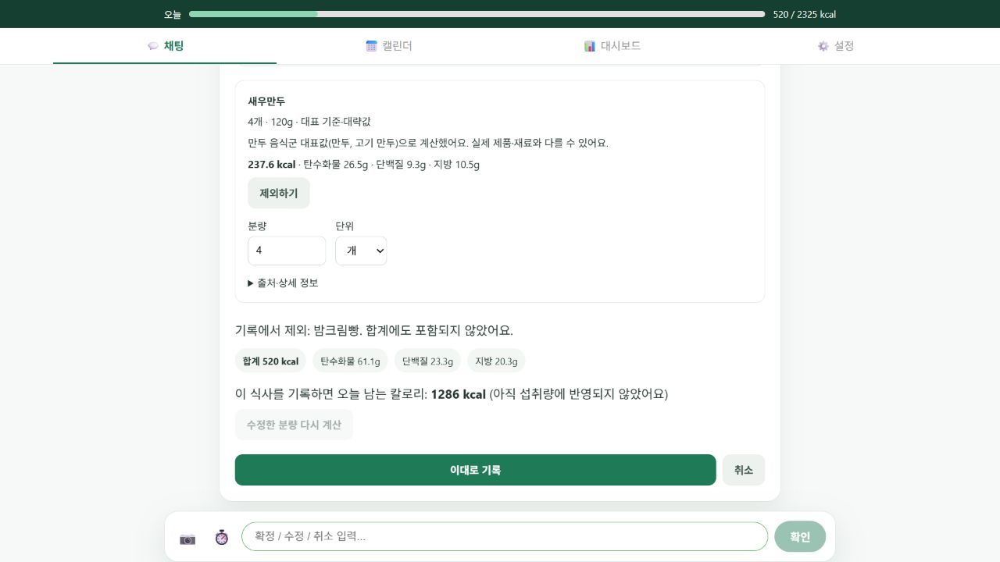

# 음식군 대표 기준과 선택 부담 개선

2026-10-13. 기존 53개 음식 연결을 유지하고 18개 음식군 규칙을 추가했다. 빵·피자·만두·치킨·볶음밥·버거·샌드위치·쿠키·케이크·아이스크림·주스·탄산·제로 탄산·요거트·라면·파스타·감자튀김·아메리카노를 대표 DB 행에 연결한다. 정확한 기존 연결이 우선이며, 복합 이름을 재료 두 개로 나누지 않는다.

## 사용자 흐름

음식 이름 → 기본 분량 계산 → 대표 기준·대략값 표시 → 필요하면 분량 수정·음식별 제외/되돌리기 → 서버 재계산 → 사용자 확정. 모두 제외하면 전체 취소를 안내한다. 확인 전 섭취 기록은 변경되지 않으며 소유권·제안 버전·중복 확정 정책을 유지한다. 기존 CSV/식약처 DB 조회를 재사용하고 DB 마이그레이션은 없다.

대표값은 제품의 정확한 영양표가 아니다. 예를 들어 망고주스는 주스 음식군의 오렌지 주스 DB 기준을 사용하며 카드에 적용 기준을 표시한다. 기본 분량은 앱 설정값이며 보편적인 실측량이라고 주장하지 않는다. 근거 없는 음식군(예: 대표 DB가 없는 찌개)은 임의 영양값을 만들지 않고 기존 기입·제외·취소 선택을 유지한다. 모든 음식이 지원된다고 주장하지 않는다.

## 검증

- 고정 합성 입력 18개: 기존 버전 `3d45904` 1/18 → 이번 버전 18/18 추가 질문 없이 완전 계산. 실제 사용자 성공률과 다른 지표다.
- 백엔드 전체: 567 passed, 1 기존 skipped.
- 프론트 전체: 71 passed / 22 suites. 프로덕션 빌드 성공.
- 모델/도구 호출 수와 실사용 지연은 이번 합성 파서 평가에서 측정하지 않았다.
- 재현 스크립트: backend 작업 디렉터리에서 `venv/Scripts/python.exe scripts/eval/evaluate_food_groups.py`.
- [고정 평가 원본](FOOD_GROUP_EVALUATION.json).

## 실패와 해결

1. `사과주스`/`고구마빵`이 기존 짧은 별칭에 먼저 매칭되어 두 음식으로 분리됨: 더 긴 음식군 이름 전체를 우선하고 정확한 기존 이름은 유지. 기존 미지원 테스트도 새 정책상 대표 계산 여부를 검증하도록 갱신했으며 삭제·스킵하지 않음.
2. Jest EPERM realpath: 샌드박스 임시 폴더 접근 실패로 테스트 실행 환경을 조정한 후 전체 통과.
3. 평가 실행 시 설정 누락: 프로젝트 backend 작업 디렉터리에서 환경파일을 읽도록 실행 경로를 바로잡음.

공식 근거: [Python 정규식](https://docs.python.org/3/library/re.html), [Node 파일 경로 API](https://nodejs.org/api/fs.html), [Pydantic Settings 환경파일 경로](https://docs.pydantic.dev/latest/concepts/pydantic_settings/#dotenv-env-support).

## 공개 배포 결과

기능 커밋 `98c840e`를 main에 푸시하고 Render API/Web Auto-Deploy Live를 확인했다. 공개 API에서 6개 음식군 입력 → proposal → 취소(섭취 기록 0건), 3개 음식 계산 → 빵 제외·피자 3→1조각 수정 → 확인 전 0건 → 확정 후 남긴 음식 2건 저장을 검증했다. [공개 합성 검증 원본](FOOD_GROUP_PUBLIC.json).

실제 공개 브라우저에서도 합성 계정으로 `밤크림빵 버섯피자 3조각 새우만두 4개`의 3개 카드 생성, 빵 제외·피자 분량 수정, 재계산 v2, 합계 520kcal와 남은 칼로리 갱신, 취소를 검증했다. 기존 합성 API 검증의 520kcal 섭취량과 새 미확정 제안은 구분된다. 브라우저 full-page 캡처는 지원 오류가 발생해 공식 브라우저 문제 해결 지침에 따라 일반 뷰포트 캡처로 증빙을 저장했다.

합성 계정과 검증 기록은 테스트 후 정리한다. 실제 사용자 피드백은 아직 포함하지 않는다.
