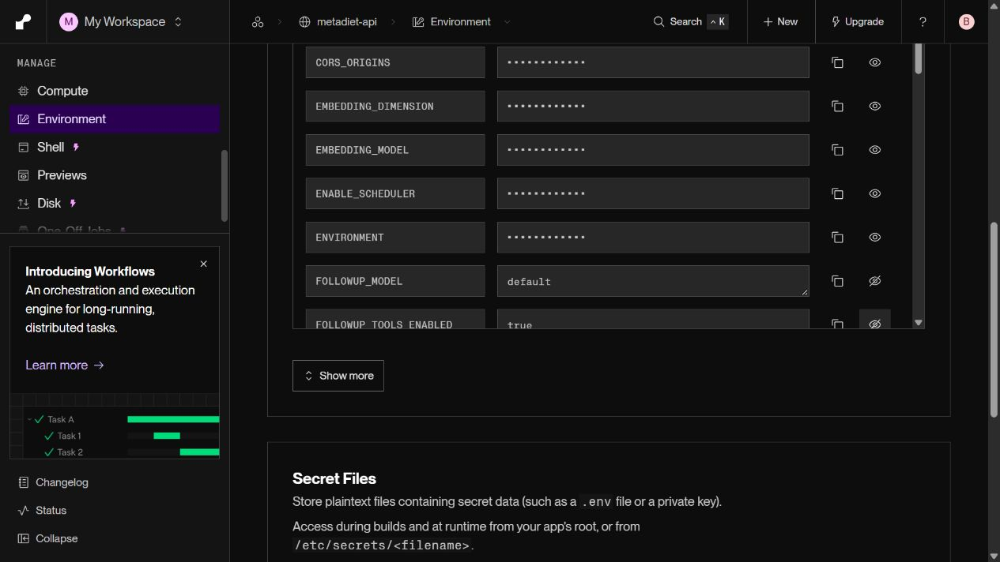

# 선택적 도구 생략 공개 실험 (2026-10-14)

이미 조회한 최신 기록으로 답할 수 있는 일반 식사 후속 코칭에서만 optional tool을 생략했다. **전체 응답 중앙값·p95가 개선되지 않아 채택하지 않는다.** 현재 기록 읽기, 사용자 확인, 저장·소유권 검증은 유지했다.

| 지표 | 기존 100건 | 도구 생략 100건 |
|---|---:|---:|
| 전체 응답 중앙값 | 7.821초 | 7.884초 |
| 전체 응답 p95 | 9.551초 | 9.707초 |
| 실패·보류 | 0/100 | 0/100 |
| 최신 섭취·목표 반영 | 100/100 | 100/100 |
| 식사·목표 미변경 | 100/100 | 100/100 |
| 모델 호출 수 중앙값 / p95 | 1 / 1 | 1 / 1 |
| 품질 5항목 | 각각 100/100 | 각각 100/100 |

품질 judge 100건도 완료했으며 5항목 모두 유지했다. 속도 기준 미달로 `FOLLOWUP_TOOLS_ENABLED=true`, `FOLLOWUP_MODEL=default`로 복구했다. 새 코드 배포 0395fe5의 [최종 복구 공개 요청](rollback_new_build/before_probe.json)에서 원래 `read` 정책·3.8 모델·최신값·미저장을 확인했다. [사전 기준](PROTOCOL.md), [기존 원본](before.json), [후보 원본](after.json), [기존 품질](before_quality.json), [후보 품질](after_quality.json), [종합 판정](summary.json). 초기 설정 배포의 실패한 두 probe도 [작업 로그](WORK_LOG.md)에 보존한다.

## 실패 원인과 보완

앞선 [Flash-Lite 실험](../model_followup_public/README.md)에서 발생한 추가 도구 왕복을 줄이려는 후보였다. 검토 중 denylist만으로는 질환·브랜드 요청을 놓칠 수 있어 전체 메시지의 좁은 allowlist로 수정하고 회귀 검증했다. 알려지지 않은 문구, 브랜드, 질환, 근거·상세 영양 요청은 원래 도구 경로를 유지한다. 도구 생략 후보 100건에서는 모델 호출 1회를 유지했으나 종단 응답 시간은 빨라지지 않았다.

모델 단계 중앙값 2.675→3.272초는 순수 생성 시간 비교로 해석하면 안 된다. 기존 도구 바인딩은 SDK 객체 준비를 해당 timer 밖에서 수행하고, 도구 없는 경로는 timer 안에서 수행한다. 따라서 SDK 준비·연결·thinking·생성을 정확히 분리하지 못했다. 종단 시간 비교와 미채택 판단은 이 배치 차이에 영향을 받지 않는다. 다음 실험은 SDK 준비와 외부 호출 시간을 분리하는 계측부터 시작해야 한다. 검증 없이 client 캐시나 기록 캐시를 적용하지 않았다.

공식 [function calling 문서](https://ai.google.dev/gemini-api/docs/function-calling)에 따라 모델의 도구 선택과 응답 생성을 구분했다. 평가 도구에서 누락된 모델 시간에 비교 연산을 하던 오류도 발견해 [finite 검증](https://docs.python.org/3/library/math.html#math.isfinite)과 회귀 테스트를 추가했다. 기준을 낮춰 통과시키지 않았다.

## 비교 조건과 제한

모델은 Gemini 3.8 Flash / low, buffered 응답, budget pipeline 유지다. 같은 4질문·5상태·5반복의 100건을 비교한다. 기존 원본과 judge는 앞선 실험의 동일 SHA 파일을 재사용한다. 기존 커밋 f42e4a3, 후보 803d779이며 관련 정책 외의 변경은 분석·실험 계측과 다른 비활성 후보다. 순차 시간대와 SDK timer 경계 차이, 반복 합성 요청 및 자동 judge라는 한계를 공개한다. 실사용 p95·장애율 개선이나 모든 의료 질문의 안전성을 주장하지 않는다.

```powershell
backend\venv\Scripts\python.exe backend/scripts/eval/summarize_brief_public100.py --experiment tool_free
```


